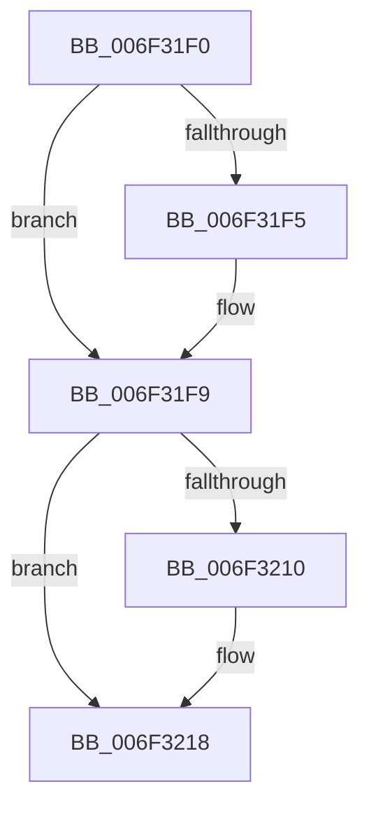

# sub_006F31F0

- RVA: `0x006F31F0`–`0x006F322D` (길이 `61` bytes)
- VA: `0x00000001406F31F0`
- 실행 섹션: `.text`
- PDB 이름 있음: `아니요`; PDB Function 태그: `아니요`
- unwind 정보 RVA: `0x000AB9E4`
- 디코드: `17`개 명령, `61/61` bytes 표시
- 미해석 바이트: `0` (있으면 어셈블리에 `.byte`로 보존)

> 이 문서는 커널 이미지의 기계어와 PDB 기호를 분석해 생성했습니다. 4번과 5번은 함수 원형과 자료형을 바이너리 사용 방식에서 추정한 C 해석이며 원본 소스 복구 결과는 아닙니다.

## 1. Dependencies

- 직접 호출 지점: **3**; 고유 호출 대상: **3**
- 직접 호출자로 확인된 함수: **0**
- RIP 상대 이미지 참조: **0**

### Outgoing calls
- `0x006F31FC` → [EtwpRelinquishCompressionTarget](../65/EtwpRelinquishCompressionTarget_function_00653818.md) (function, `0x00653818`)
- `0x006F3213` → [ExfTryToWakePushLock](../26/ExfTryToWakePushLock_function_00265DD0.md) (function, `0x00265DD0`)
- `0x006F321B` → [KeAbPostRelease](../2E/KeAbPostRelease_function_002E1600.md) (function, `0x002E1600`)

### Direct callers
- 이 함수 시작 RVA로 연결되는 직접 call은 확인되지 않았습니다. 간접 호출은 완전히 역산할 수 없습니다.

### Static image references
- 디코드된 RIP-relative 메모리 참조가 없습니다.

## 2. Other-region calls and transfers

- 다른 실행 섹션으로 향하는 call: **0**
- call이 아닌 외부 분기/꼬리 이동: **1**
  - `0x006F3228` → [EtwpFreeCompression + 0x2A](../46/EtwpFreeCompression_function_0046CCD8.md) (`tail-transfer`)

## 3. Assembly (complete function range)

```asm
006F31F0  48 85 F6                        test rsi, rsi
006F31F3  74 04                           je 0x1406f31f9
006F31F5  C6 46 0A 01                     mov byte ptr [rsi + 0xa], 1
006F31F9  48 8B CB                        mov rcx, rbx
006F31FC  E8 17 06 F6 FF                  call 0x140653818
006F3201  48 83 C8 FF                     or rax, 0xffffffffffffffff
006F3205  F0 48 0F C1 07                  lock xadd qword ptr [rdi], rax
006F320A  24 06                           and al, 6
006F320C  3C 02                           cmp al, 2
006F320E  75 08                           jne 0x1406f3218
006F3210  48 8B CF                        mov rcx, rdi
006F3213  E8 B8 2B B7 FF                  call 0x140265dd0
006F3218  48 8B CF                        mov rcx, rdi
006F321B  E8 E0 E3 BE FF                  call 0x1402e1600
006F3220  33 C0                           xor eax, eax
006F3222  87 83 98 05 00 00               xchg dword ptr [rbx + 0x598], eax
006F3228  E9 D5 9A D7 FF                  jmp 0x14046cd02
```

## 4. C-style interpretation (structured pseudocode)

```c
__int64 __fastcall sub_006F31F0(void)
{
    __int64 result;

    if (v_rsi != 0) {
        *(unsigned __int8 *)(v_rsi + 10) = 1;
    }
    result = EtwpRelinquishCompressionTarget(v_rbx, a2, a3, a4);
    result = (result) | (-1);
    result = (unsigned __int8)((result) & (6));
    if (((unsigned __int8)(result)) == 2) {
        a1 = v_rdi;
        result = ExfTryToWakePushLock(a1, a2, a3, a4);
    }
    result = KeAbPostRelease(v_rdi, a2, a3, a4);
    result = 0;
}
```

## 5. (Beta) C Style

```c
void sub_006F31F0(void)
{
    int64_t result;

    if (local_rsi != 0) {
        *(uint8_t *)(local_rsi + 0xA) = 1;
    }
    result = EtwpRelinquishCompressionTarget(local_rbx, a2, a3, a4);
    result = (result) | (-1);
    result = (uint8_t)((result) & (6));
    if (((uint8_t)(result)) == 2) {
        a1 = local_rdi;
        result = ExfTryToWakePushLock(a1, a2, a3, a4);
    }
    result = KeAbPostRelease(local_rdi, a2, a3, a4);
    result = 0;
}
```

## 6. Execution-region graph

[열기: 2D/3D 그래프와 함수 탐색 컨트롤 패널](../../../control-panel.html?section=text&rva=0x006F31F0&view=graph)

- 2D 그래프는 위에서 아래로 흐르고, 3D 그래프는 빈 공간을 드래그해 회전합니다. Shift+드래그는 이동, 휠은 확대·축소, 함수 노드 선택은 대상 보고서 이동입니다.

### Static fallback


