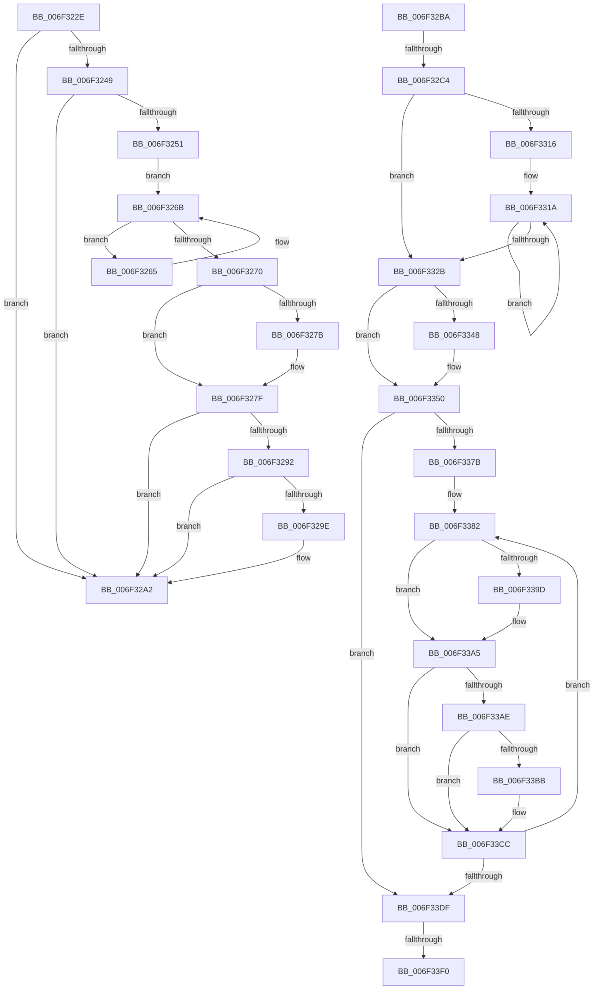

# sub_006F322E

- RVA: `0x006F322E`–`0x006F340D` (길이 `479` bytes)
- VA: `0x00000001406F322E`
- 실행 섹션: `.text`
- PDB 이름 있음: `아니요`; PDB Function 태그: `아니요`
- unwind 정보 RVA: `0x000ABA20`
- 디코드: `120`개 명령, `479/479` bytes 표시
- 미해석 바이트: `0` (있으면 어셈블리에 `.byte`로 보존)

> 이 문서는 커널 이미지의 기계어와 PDB 기호를 분석해 생성했습니다. 4번과 5번은 함수 원형과 자료형을 바이너리 사용 방식에서 추정한 C 해석이며 원본 소스 복구 결과는 아닙니다.

## 1. Dependencies

- 직접 호출 지점: **11**; 고유 호출 대상: **9**
- 직접 호출자로 확인된 함수: **0**
- RIP 상대 이미지 참조: **2**

### Outgoing calls
- `0x006F323B` → [KeAcquireSpinLockAtDpcLevel](../20/KeAcquireSpinLockAtDpcLevel_function_00208430.md) (function, `0x00208430`)
- `0x006F32A6` → [KxReleaseSpinLock](../20/KxReleaseSpinLock_function_00206670.md) (function, `0x00206670`)
- `0x006F32E1` → [memset](../6C/memset_function_006C6C40.md) (function, `0x006C6C40`)
- `0x006F32F7` → [memset](../6C/memset_function_006C6C40.md) (function, `0x006C6C40`)
- `0x006F3307` → [KiGetDeepIdleProcessors](../3C/KiGetDeepIdleProcessors_function_003C0268.md) (function, `0x003C0268`)
- `0x006F3372` → [KeEnumerateNextProcessor](../41/KeEnumerateNextProcessor_function_00415480.md) (function, `0x00415480`)
- `0x006F3390` → [KiSelectDpcData](../43/KiSelectDpcData_function_004396A0.md) (function, `0x004396A0`)
- `0x006F33A0` → [KiAcquireReleaseDpcData](../5C/KiAcquireReleaseDpcData_function_005C8404.md) (function, `0x005C8404`)
- `0x006F33D6` → [KeEnumerateNextProcessor](../41/KeEnumerateNextProcessor_function_00415480.md) (function, `0x00415480`)
- `0x006F33E3` → [KeIsEmptyAffinityEx](../2D/KeIsEmptyAffinityEx_function_002D1580.md) (function, `0x002D1580`)
- `0x006F3402` → [KeGenericProcessorCallback](../39/KeGenericProcessorCallback_function_00398C2C.md) (function, `0x00398C2C`)

### Direct callers
- 이 함수 시작 RVA로 연결되는 직접 call은 확인되지 않았습니다. 간접 호출은 완전히 역산할 수 없습니다.

### Static image references
- `0x006F337B` → RVA `0x00FC8C40` (`ALMOSTRO`; read)
- `0x006F33F7` → RVA `0x0049E550` (`EmpCheckErrataList`; read)

## 2. Other-region calls and transfers

- 다른 실행 섹션으로 향하는 call: **0**
- call이 아닌 외부 분기/꼬리 이동: **4**
  - `0x006F32B5` → [KeRemoveQueueDpcEx + 0xB4](../46/KeRemoveQueueDpcEx_function_0046CDC0.md) (`tail-transfer`)
  - `0x006F32BE` → [KeRemoveQueueDpcEx + 0xC2](../46/KeRemoveQueueDpcEx_function_0046CDC0.md) (`tail-transfer`)
  - `0x006F33EA` → [KeRemoveQueueDpcEx + 0xC2](../46/KeRemoveQueueDpcEx_function_0046CDC0.md) (`tail-transfer`)
  - `0x006F3408` → [KeRemoveQueueDpcEx + 0xC2](../46/KeRemoveQueueDpcEx_function_0046CDC0.md) (`tail-transfer`)

## 3. Assembly (complete function range)

```asm
006F322E  B8 40 38 00 00                  mov eax, 0x3840
006F3233  48 8D 3C 30                     lea rdi, [rax + rsi]
006F3237  48 8D 4F 10                     lea rcx, [rdi + 0x10]
006F323B  E8 F0 51 B1 FF                  call 0x140208430
006F3240  48 8B 43 38                     mov rax, qword ptr [rbx + 0x38]
006F3244  4C 3B E8                        cmp r13, rax
006F3247  75 59                           jne 0x1406f32a2
006F3249  8B 03                           mov eax, dword ptr [rbx]
006F324B  39 44 24 40                     cmp dword ptr [rsp + 0x40], eax
006F324F  75 51                           jne 0x1406f32a2
006F3251  8B 47 18                        mov eax, dword ptr [rdi + 0x18]
006F3254  48 8D 53 08                     lea rdx, [rbx + 8]
006F3258  FF C8                           dec eax
006F325A  48 8B CF                        mov rcx, rdi
006F325D  89 47 18                        mov dword ptr [rdi + 0x18], eax
006F3260  48 8B 07                        mov rax, qword ptr [rdi]
006F3263  EB 06                           jmp 0x1406f326b
006F3265  48 8B C8                        mov rcx, rax
006F3268  48 8B 00                        mov rax, qword ptr [rax]
006F326B  48 3B C2                        cmp rax, rdx
006F326E  75 F5                           jne 0x1406f3265
006F3270  48 8B 02                        mov rax, qword ptr [rdx]
006F3273  48 89 01                        mov qword ptr [rcx], rax
006F3276  48 85 C0                        test rax, rax
006F3279  75 04                           jne 0x1406f327f
006F327B  48 89 4F 08                     mov qword ptr [rdi + 8], rcx
006F327F  4C 21 73 38                     and qword ptr [rbx + 0x38], r14
006F3283  41 B7 01                        mov r15b, 1
006F3286  48 8B 96 B8 8E 00 00            mov rdx, qword ptr [rsi + 0x8eb8]
006F328D  48 85 D2                        test rdx, rdx
006F3290  74 10                           je 0x1406f32a2
006F3292  48 8D 86 40 38 00 00            lea rax, [rsi + 0x3840]
006F3299  48 3B F8                        cmp rdi, rax
006F329C  75 04                           jne 0x1406f32a2
006F329E  F0 FF 4A 1C                     lock dec dword ptr [rdx + 0x1c]
006F32A2  48 8D 4F 10                     lea rcx, [rdi + 0x10]
006F32A6  E8 C5 33 B1 FF                  call 0x140206670
006F32AB  40 8A 7C 24 20                  mov dil, byte ptr [rsp + 0x20]
006F32B0  BE 01 00 00 00                  mov esi, 1
006F32B5  E9 BA 9B D7 FF                  jmp 0x14046ce74
006F32BA  4C 39 73 10                     cmp qword ptr [rbx + 0x10], r14
006F32BE  0F 84 BE 9B D7 FF               je 0x14046ce82
006F32C4  41 BC 00 01 00 00               mov r12d, 0x100
006F32CA  48 C7 85 90 00 00 00 01 00 20 00  mov qword ptr [rbp + 0x90], 0x200001
006F32D5  45 8B C4                        mov r8d, r12d
006F32D8  48 8D 8D 98 00 00 00            lea rcx, [rbp + 0x98]
006F32DF  33 D2                           xor edx, edx
006F32E1  E8 5A 39 FD FF                  call 0x1406c6c40
006F32E6  45 8B C4                        mov r8d, r12d
006F32E9  48 C7 45 80 01 00 20 00         mov qword ptr [rbp - 0x80], 0x200001
006F32F1  33 D2                           xor edx, edx
006F32F3  48 8D 4D 88                     lea rcx, [rbp - 0x78]
006F32F7  E8 44 39 FD FF                  call 0x1406c6c40
006F32FC  48 8D 55 80                     lea rdx, [rbp - 0x80]
006F3300  48 8D 8D 90 00 00 00            lea rcx, [rbp + 0x90]
006F3307  E8 5C CF CC FF                  call 0x1403c0268
006F330C  41 8B CE                        mov ecx, r14d
006F330F  66 44 3B 75 80                  cmp r14w, word ptr [rbp - 0x80]
006F3314  73 15                           jae 0x1406f332b
006F3316  48 8B 53 10                     mov rdx, qword ptr [rbx + 0x10]
006F331A  8B C1                           mov eax, ecx
006F331C  03 CE                           add ecx, esi
006F331E  48 21 54 C5 88                  and qword ptr [rbp + rax*8 - 0x78], rdx
006F3323  0F B7 45 80                     movzx eax, word ptr [rbp - 0x80]
006F3327  3B C8                           cmp ecx, eax
006F3329  72 EF                           jb 0x1406f331a
006F332B  65 48 8B 04 25 20 00 00 00      mov rax, qword ptr gs:[0x20]
006F3334  0F B6 90 D0 00 00 00            movzx edx, byte ptr [rax + 0xd0]
006F333B  48 8B 88 C8 00 00 00            mov rcx, qword ptr [rax + 0xc8]
006F3342  66 39 55 80                     cmp word ptr [rbp - 0x80], dx
006F3346  76 08                           jbe 0x1406f3350
006F3348  48 F7 D1                        not rcx
006F334B  48 21 4C D5 88                  and qword ptr [rbp + rdx*8 - 0x78], rcx
006F3350  48 8B 45 88                     mov rax, qword ptr [rbp - 0x78]
006F3354  48 8D 54 24 28                  lea rdx, [rsp + 0x28]
006F3359  48 89 44 24 30                  mov qword ptr [rsp + 0x30], rax
006F335E  48 8D 4C 24 24                  lea rcx, [rsp + 0x24]
006F3363  48 8D 45 80                     lea rax, [rbp - 0x80]
006F3367  66 44 89 74 24 38               mov word ptr [rsp + 0x38], r14w
006F336D  48 89 44 24 28                  mov qword ptr [rsp + 0x28], rax
006F3372  E8 09 21 D2 FF                  call 0x140415480
006F3377  85 C0                           test eax, eax
006F3379  75 64                           jne 0x1406f33df
006F337B  4C 8D 25 BE 58 8D 00            lea r12, [rip + 0x8d58be]
006F3382  8B 44 24 24                     mov eax, dword ptr [rsp + 0x24]
006F3386  48 8B D3                        mov rdx, rbx
006F3389  49 8B 3C C4                     mov rdi, qword ptr [r12 + rax*8]
006F338D  48 8B CF                        mov rcx, rdi
006F3390  E8 0B 63 D4 FF                  call 0x1404396a0
006F3395  48 8B F0                        mov rsi, rax
006F3398  4D 85 ED                        test r13, r13
006F339B  75 08                           jne 0x1406f33a5
006F339D  48 8B C8                        mov rcx, rax
006F33A0  E8 5F 50 ED FF                  call 0x1405c8404
006F33A5  48 8B 46 20                     mov rax, qword ptr [rsi + 0x20]
006F33A9  48 3B C3                        cmp rax, rbx
006F33AC  74 1E                           je 0x1406f33cc
006F33AE  0F B6 87 D0 00 00 00            movzx eax, byte ptr [rdi + 0xd0]
006F33B5  66 39 45 80                     cmp word ptr [rbp - 0x80], ax
006F33B9  76 11                           jbe 0x1406f33cc
006F33BB  8B C8                           mov ecx, eax
006F33BD  48 8B 87 C8 00 00 00            mov rax, qword ptr [rdi + 0xc8]
006F33C4  48 F7 D0                        not rax
006F33C7  48 21 44 CD 88                  and qword ptr [rbp + rcx*8 - 0x78], rax
006F33CC  48 8D 54 24 28                  lea rdx, [rsp + 0x28]
006F33D1  48 8D 4C 24 24                  lea rcx, [rsp + 0x24]
006F33D6  E8 A5 20 D2 FF                  call 0x140415480
006F33DB  85 C0                           test eax, eax
006F33DD  74 A3                           je 0x1406f3382
006F33DF  48 8D 4D 80                     lea rcx, [rbp - 0x80]
006F33E3  E8 98 E1 BD FF                  call 0x1402d1580
006F33E8  85 C0                           test eax, eax
006F33EA  0F 85 92 9A D7 FF               jne 0x14046ce82
006F33F0  44 8D 48 02                     lea r9d, [rax + 2]
006F33F4  45 33 C0                        xor r8d, r8d
006F33F7  48 8D 15 52 B1 DA FF            lea rdx, [rip - 0x254eae]
006F33FE  48 8D 4D 80                     lea rcx, [rbp - 0x80]
006F3402  E8 25 58 CA FF                  call 0x140398c2c
006F3407  90                              nop
006F3408  E9 75 9A D7 FF                  jmp 0x14046ce82
```

## 4. C-style interpretation (structured pseudocode)

```c
__int64 __fastcall sub_006F322E(__int64 a1, __int64 a2, __int64 a3, __int64 a4, __int64 a5, __int64 a6, __int64 a7, unsigned int a8)
{
    __int64 result;
    unsigned __int8 v_stack_p20;
    unsigned __int64 v_stack_p24;
    unsigned __int64 v_stack_p28;
    unsigned __int64 v_stack_p30;
    unsigned __int16 v_stack_p38;

    result = KeAcquireSpinLockAtDpcLevel((unsigned int)(0x3840ULL) + v_rsi * 1 + 16, a2, a3, a4);
    if (v_r13 != (*(unsigned __int64 *)(v_rbx + 56))) goto loc_006F32A2;
    if (a8 != ((unsigned int)((unsigned int)(*(unsigned int *)(v_rbx))))) goto loc_006F32A2;
    result = (unsigned int)(((unsigned int)(*(unsigned int *)((unsigned int)(0x3840ULL) + v_rsi * 1 + 24))) - 1);
    *(unsigned int *)((unsigned int)(0x3840ULL) + v_rsi * 1 + 24) = (unsigned int)(result);
    goto loc_006F326B;
loc_006F3265:
loc_006F326B:
    if ((*(unsigned __int64 *)(*(unsigned __int64 *)((unsigned int)(0x3840ULL) + v_rsi * 1))) != (v_rbx + 8)) goto loc_006F3265;
    *(unsigned __int64 *)(*(unsigned __int64 *)((unsigned int)(0x3840ULL) + v_rsi * 1)) = *(unsigned __int64 *)(v_rbx + 8);
    if (*(unsigned __int64 *)(v_rbx + 8) == 0) {
        *(unsigned __int64 *)((unsigned int)(0x3840ULL) + v_rsi * 1 + 8) = *(unsigned __int64 *)((unsigned int)(0x3840ULL) + v_rsi * 1);
    }
    if (*(unsigned __int64 *)(v_rsi + 36536) == 0) goto loc_006F32A2;
    if (((unsigned int)(0x3840ULL) + v_rsi * 1) == (v_rsi + 14400)) {
    }
    result = KxReleaseSpinLock((unsigned int)(0x3840ULL) + v_rsi * 1 + 16, *(unsigned __int64 *)(v_rsi + 36536), a3, a4);
}
```

## 5. (Beta) C Style

```c
int64_t sub_006F322E(int64_t Arg1, int64_t Arg2, int64_t Arg3, int64_t Arg4, uint64_t Arg5, uint64_t Arg6, uint64_t Arg7, uint32_t Arg8)
{
    int64_t result;
    uint8_t v_stack_p20;
    uint64_t v_stack_p24;
    uint64_t v_stack_p28;
    uint64_t v_stack_p30;
    uint16_t v_stack_p38;

    result = KeAcquireSpinLockAtDpcLevel((uint32_t)(0x3840ULL) + local_rsi * 1 + 16, Arg2, Arg3, Arg4);
    if (local_r13 != (*(uint64_t *)(local_rbx + 0x38))) goto loc_006F32A2;
    if (Arg8 != ((uint32_t)((uint32_t)(*(uint32_t *)(local_rbx))))) goto loc_006F32A2;
    result = (uint32_t)(((uint32_t)(*(uint32_t *)((uint32_t)(0x3840ULL) + local_rsi * 1 + 0x18))) - 1);
    *(uint32_t *)((uint32_t)(0x3840ULL) + local_rsi * 1 + 0x18) = (uint32_t)(result);
    goto loc_006F326B;
loc_006F3265:
loc_006F326B:
    if ((*(uint64_t *)(*(uint64_t *)((uint32_t)(0x3840ULL) + local_rsi * 1))) != (local_rbx + 8)) goto loc_006F3265;
    *(uint64_t *)(*(uint64_t *)((uint32_t)(0x3840ULL) + local_rsi * 1)) = *(uint64_t *)(local_rbx + 0x8);
    if (*(uint64_t *)(local_rbx + 0x8) == 0) {
        *(uint64_t *)((uint32_t)(0x3840ULL) + local_rsi * 1 + 0x8) = *(uint64_t *)((uint32_t)(0x3840ULL) + local_rsi * 1);
    }
    if (*(uint64_t *)(local_rsi + 0x8EB8) == 0) goto loc_006F32A2;
    if (((uint32_t)(0x3840ULL) + local_rsi * 1) == (local_rsi + 14400)) {
    }
    result = KxReleaseSpinLock((uint32_t)(0x3840ULL) + local_rsi * 1 + 16, *(uint64_t *)(local_rsi + 0x8EB8), Arg3, Arg4);
}
```

## 6. Execution-region graph

[열기: 2D/3D 그래프와 함수 탐색 컨트롤 패널](../../../control-panel.html?section=text&rva=0x006F322E&view=graph)

- 2D 그래프는 위에서 아래로 흐르고, 3D 그래프는 빈 공간을 드래그해 회전합니다. Shift+드래그는 이동, 휠은 확대·축소, 함수 노드 선택은 대상 보고서 이동입니다.

### Static fallback


