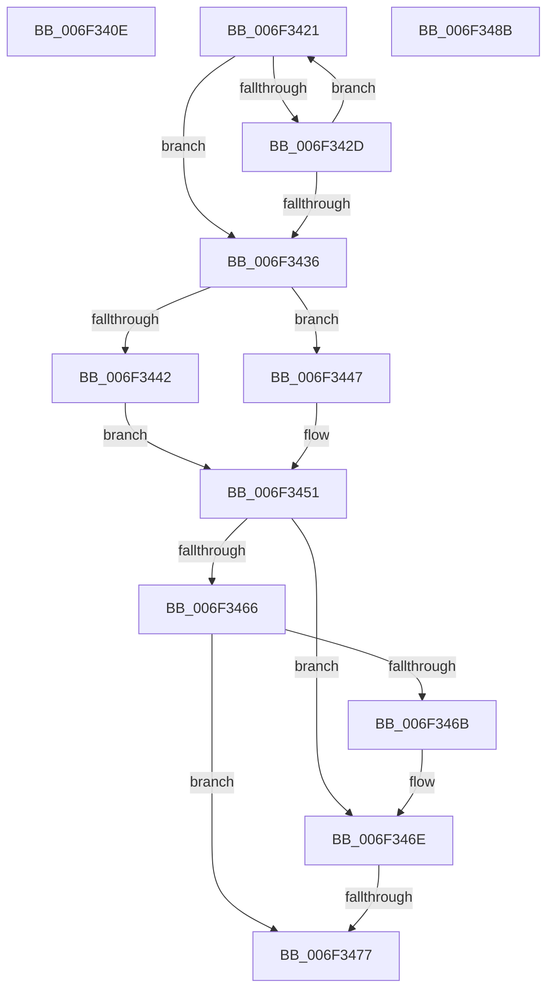

# sub_006F340E

- RVA: `0x006F340E`–`0x006F34A5` (길이 `151` bytes)
- VA: `0x00000001406F340E`
- 실행 섹션: `.text`
- PDB 이름 있음: `아니요`; PDB Function 태그: `아니요`
- unwind 정보 RVA: `0x000ABAC8`
- 디코드: `43`개 명령, `151/151` bytes 표시
- 미해석 바이트: `0` (있으면 어셈블리에 `.byte`로 보존)

> 이 문서는 커널 이미지의 기계어와 PDB 기호를 분석해 생성했습니다. 4번과 5번은 함수 원형과 자료형을 바이너리 사용 방식에서 추정한 C 해석이며 원본 소스 복구 결과는 아닙니다.

## 1. Dependencies

- 직접 호출 지점: **4**; 고유 호출 대상: **4**
- 직접 호출자로 확인된 함수: **0**
- RIP 상대 이미지 참조: **0**

### Outgoing calls
- `0x006F3414` → [KiResortScbQueue](../20/KiResortScbQueue_function_002024CC.md) (function, `0x002024CC`)
- `0x006F3451` → [KiMoveScbThreadsToNewReadylist](../30/KiMoveScbThreadsToNewReadylist_function_003099AC.md) (function, `0x003099AC`)
- `0x006F3480` → [KiRemoveSchedulingGroupQueue](../20/KiRemoveSchedulingGroupQueue_function_00202638.md) (function, `0x00202638`)
- `0x006F349A` → [EtwTraceScbRankChange](../4F/EtwTraceScbRankChange_function_004F899C.md) (function, `0x004F899C`)

### Direct callers
- 이 함수 시작 RVA로 연결되는 직접 call은 확인되지 않았습니다. 간접 호출은 완전히 역산할 수 없습니다.

### Static image references
- 디코드된 RIP-relative 메모리 참조가 없습니다.

## 2. Other-region calls and transfers

- 다른 실행 섹션으로 향하는 call: **0**
- call이 아닌 외부 분기/꼬리 이동: **4**
  - `0x006F341C` → [KeSetSchedulingGroupRankBias + 0xD1](../46/KeSetSchedulingGroupRankBias_function_0046DB74.md) (`tail-transfer`)
  - `0x006F3471` → [KeSetSchedulingGroupRankBias + 0x191](../46/KeSetSchedulingGroupRankBias_function_0046DB74.md) (`tail-transfer`)
  - `0x006F3486` → [KeSetSchedulingGroupRankBias + 0x191](../46/KeSetSchedulingGroupRankBias_function_0046DB74.md) (`tail-transfer`)
  - `0x006F34A0` → [KeSetSchedulingGroupRankBias + 0xFB](../46/KeSetSchedulingGroupRankBias_function_0046DB74.md) (`tail-transfer`)

## 3. Assembly (complete function range)

```asm
006F340E  48 8B D3                        mov rdx, rbx
006F3411  48 8B CF                        mov rcx, rdi
006F3414  E8 B3 F0 B0 FF                  call 0x1402024cc
006F3419  45 33 C9                        xor r9d, r9d
006F341C  E9 24 A8 D7 FF                  jmp 0x14046dc45
006F3421  48 8B 82 A0 01 00 00            mov rax, qword ptr [rdx + 0x1a0]
006F3428  48 85 C0                        test rax, rax
006F342B  74 09                           je 0x1406f3436
006F342D  48 8B D0                        mov rdx, rax
006F3430  44 39 48 7C                     cmp dword ptr [rax + 0x7c], r9d
006F3434  74 EB                           je 0x1406f3421
006F3436  45 33 C0                        xor r8d, r8d
006F3439  48 8B CB                        mov rcx, rbx
006F343C  44 39 4A 7C                     cmp dword ptr [rdx + 0x7c], r9d
006F3440  74 05                           je 0x1406f3447
006F3442  45 33 C9                        xor r9d, r9d
006F3445  EB 0A                           jmp 0x1406f3451
006F3447  4C 8D 8C 24 80 00 00 00         lea r9, [rsp + 0x80]
006F344F  33 D2                           xor edx, edx
006F3451  E8 56 65 C1 FF                  call 0x1403099ac
006F3456  48 8D 8B 90 01 00 00            lea rcx, [rbx + 0x190]
006F345D  48 8B 01                        mov rax, qword ptr [rcx]
006F3460  44 84 71 08                     test byte ptr [rcx + 8], r14b
006F3464  74 08                           je 0x1406f346e
006F3466  48 85 C0                        test rax, rax
006F3469  74 0C                           je 0x1406f3477
006F346B  48 33 C1                        xor rax, rcx
006F346E  48 85 C0                        test rax, rax
006F3471  0F 85 8E A8 D7 FF               jne 0x14046dd05
006F3477  45 8A C6                        mov r8b, r14b
006F347A  48 8B D3                        mov rdx, rbx
006F347D  48 8B CF                        mov rcx, rdi
006F3480  E8 B3 F1 B0 FF                  call 0x140202638
006F3485  90                              nop
006F3486  E9 7A A8 D7 FF                  jmp 0x14046dd05
006F348B  44 8A 4B 70                     mov r9b, byte ptr [rbx + 0x70]
006F348F  8B D6                           mov edx, esi
006F3491  41 D0 E9                        shr r9b, 1
006F3494  48 8B CD                        mov rcx, rbp
006F3497  45 22 CE                        and r9b, r14b
006F349A  E8 FD 54 E0 FF                  call 0x1404f899c
006F349F  90                              nop
006F34A0  E9 CA A7 D7 FF                  jmp 0x14046dc6f
```

## 4. C-style interpretation (structured pseudocode)

```c
__int64 __fastcall sub_006F340E(__int64 a1, __int64 a2, int a3, int a4)
{
    __int64 result;
    unsigned __int64 v_stack_p80;

    result = KiResortScbQueue(v_rdi, v_rbx, a3, a4);
    a4 = 0;
}
```

## 5. (Beta) C Style

```c
int64_t sub_006F340E(int64_t Arg1, int64_t Arg2, int32_t Arg3, int32_t Arg4)
{
    int64_t result;
    uint64_t v_stack_p80;

    result = KiResortScbQueue(local_rdi, local_rbx, Arg3, Arg4);
    Arg4 = 0;
}
```

## 6. Execution-region graph

[열기: 2D/3D 그래프와 함수 탐색 컨트롤 패널](../../../control-panel.html?section=text&rva=0x006F340E&view=graph)

- 2D 그래프는 위에서 아래로 흐르고, 3D 그래프는 빈 공간을 드래그해 회전합니다. Shift+드래그는 이동, 휠은 확대·축소, 함수 노드 선택은 대상 보고서 이동입니다.

### Static fallback


