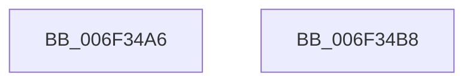

# sub_006F34A6

- RVA: `0x006F34A6`–`0x006F34C4` (길이 `30` bytes)
- VA: `0x00000001406F34A6`
- 실행 섹션: `.text`
- PDB 이름 있음: `아니요`; PDB Function 태그: `아니요`
- unwind 정보 RVA: `0x000ABB0C`
- 디코드: `5`개 명령, `30/30` bytes 표시
- 미해석 바이트: `0` (있으면 어셈블리에 `.byte`로 보존)

> 이 문서는 커널 이미지의 기계어와 PDB 기호를 분석해 생성했습니다. 4번과 5번은 함수 원형과 자료형을 바이너리 사용 방식에서 추정한 C 해석이며 원본 소스 복구 결과는 아닙니다.

## 1. Dependencies

- 직접 호출 지점: **0**; 고유 호출 대상: **0**
- 직접 호출자로 확인된 함수: **0**
- RIP 상대 이미지 참조: **3**

### Outgoing calls
- 직접 디코드된 call 명령이 없습니다.

### Direct callers
- 이 함수 시작 RVA로 연결되는 직접 call은 확인되지 않았습니다. 간접 호출은 완전히 역산할 수 없습니다.

### Static image references
- `0x006F34A6` → RVA `0x00F23434` (`.data`; write)
- `0x006F34AC` → RVA `0x00F2343C` (`.data`; write)
- `0x006F34B8` → RVA `0x00F23438` (`.data`; read/write)

## 2. Other-region calls and transfers

- 다른 실행 섹션으로 향하는 call: **0**
- call이 아닌 외부 분기/꼬리 이동: **2**
  - `0x006F34B3` → [KeSetSchedulingGroupCpuRates + 0xA8](../46/KeSetSchedulingGroupCpuRates_function_0046DE5C.md) (`tail-transfer`)
  - `0x006F34BF` → [KeSetSchedulingGroupCpuRates + 0x124](../46/KeSetSchedulingGroupCpuRates_function_0046DE5C.md) (`tail-transfer`)

## 3. Assembly (complete function range)

```asm
006F34A6  89 15 88 FF 82 00               mov dword ptr [rip + 0x82ff88], edx
006F34AC  44 89 15 89 FF 82 00            mov dword ptr [rip + 0x82ff89], r10d
006F34B3  E9 4C AA D7 FF                  jmp 0x14046df04
006F34B8  83 25 79 FF 82 00 00            and dword ptr [rip + 0x82ff79], 0
006F34BF  E9 BC AA D7 FF                  jmp 0x14046df80
```

## 4. C-style interpretation (structured pseudocode)

```c
void __fastcall sub_006F34A6(__int64 a1, int a2)
{
    *(unsigned int *)(v_rip + 8585096) = a2;
    *(unsigned int *)(v_rip + 8585097) = (unsigned int)(v_r10);
}
```

## 5. (Beta) C Style

```c
void sub_006F34A6(int64_t Arg1, int32_t Arg2)
{
    *(uint32_t *)(v_rip + 0x82FF88) = Arg2;
    *(uint32_t *)(v_rip + 0x82FF89) = (uint32_t)(local_r10);
}
```

## 6. Execution-region graph

[열기: 2D/3D 그래프와 함수 탐색 컨트롤 패널](../../../control-panel.html?section=text&rva=0x006F34A6&view=graph)

- 2D 그래프는 위에서 아래로 흐르고, 3D 그래프는 빈 공간을 드래그해 회전합니다. Shift+드래그는 이동, 휠은 확대·축소, 함수 노드 선택은 대상 보고서 이동입니다.

### Static fallback


