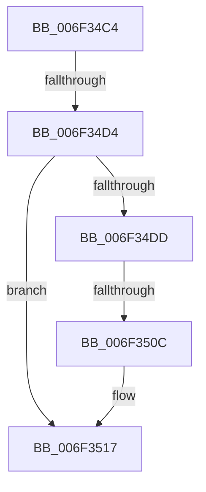

# sub_006F34C4

- RVA: `0x006F34C4`–`0x006F3522` (길이 `94` bytes)
- VA: `0x00000001406F34C4`
- 실행 섹션: `.text`
- PDB 이름 있음: `아니요`; PDB Function 태그: `아니요`
- unwind 정보 RVA: `0x000ABBD4`
- 디코드: `21`개 명령, `94/94` bytes 표시
- 미해석 바이트: `0` (있으면 어셈블리에 `.byte`로 보존)

> 이 문서는 커널 이미지의 기계어와 PDB 기호를 분석해 생성했습니다. 4번과 5번은 함수 원형과 자료형을 바이너리 사용 방식에서 추정한 C 해석이며 원본 소스 복구 결과는 아닙니다.

## 1. Dependencies

- 직접 호출 지점: **6**; 고유 호출 대상: **6**
- 직접 호출자로 확인된 함수: **0**
- RIP 상대 이미지 참조: **0**

### Outgoing calls
- `0x006F34DD` → [HvUnlockHiveFlusherExclusive](../../pagecmrc/BC/HvUnlockHiveFlusherExclusive_function_00BC9C34.md) (function, `0x00BC9C34`)
- `0x006F34E2` → [CmpUnlockRegistry](../../pagecmrc/BC/CmpUnlockRegistry_function_00BC9A84.md) (function, `0x00BC9A84`)
- `0x006F34F0` → [CmpAdjustFileCFSafety](../4B/CmpAdjustFileCFSafety_function_004BCEF8.md) (function, `0x004BCEF8`)
- `0x006F34F7` → [CmpLockRegistry](../../pagecmrc/BC/CmpLockRegistry_function_00BC9B34.md) (function, `0x00BC9B34`)
- `0x006F34FF` → [HvLockHiveFlusherExclusive](../../pagecmrc/BC/HvLockHiveFlusherExclusive_function_00BC9C50.md) (function, `0x00BC9C50`)
- `0x006F3517` → [HvUnlockHiveFilePages](../../page/AA/HvUnlockHiveFilePages_function_00AA5CFC.md) (function, `0x00AA5CFC`)

### Direct callers
- 이 함수 시작 RVA로 연결되는 직접 call은 확인되지 않았습니다. 간접 호출은 완전히 역산할 수 없습니다.

### Static image references
- 디코드된 RIP-relative 메모리 참조가 없습니다.

## 2. Other-region calls and transfers

- 다른 실행 섹션으로 향하는 call: **5**
  - `0x006F34DD` → [HvUnlockHiveFlusherExclusive](../../pagecmrc/BC/HvUnlockHiveFlusherExclusive_function_00BC9C34.md) (`.text` → `PAGECMRC`)
  - `0x006F34E2` → [CmpUnlockRegistry](../../pagecmrc/BC/CmpUnlockRegistry_function_00BC9A84.md) (`.text` → `PAGECMRC`)
  - `0x006F34F7` → [CmpLockRegistry](../../pagecmrc/BC/CmpLockRegistry_function_00BC9B34.md) (`.text` → `PAGECMRC`)
  - `0x006F34FF` → [HvLockHiveFlusherExclusive](../../pagecmrc/BC/HvLockHiveFlusherExclusive_function_00BC9C50.md) (`.text` → `PAGECMRC`)
  - `0x006F3517` → [HvUnlockHiveFilePages](../../page/AA/HvUnlockHiveFilePages_function_00AA5CFC.md) (`.text` → `PAGE`)
- call이 아닌 외부 분기/꼬리 이동: **3**
  - `0x006F34CE` → [CmpRecheckHiveVolumePolicy + 0x63](../46/CmpRecheckHiveVolumePolicy_function_0046EE14.md) (`tail-transfer`)
  - `0x006F3506` → [CmpRecheckHiveVolumePolicy + 0x63](../46/CmpRecheckHiveVolumePolicy_function_0046EE14.md) (`tail-transfer`)
  - `0x006F351D` → [CmpRecheckHiveVolumePolicy + 0x63](../46/CmpRecheckHiveVolumePolicy_function_0046EE14.md) (`tail-transfer`)

## 3. Assembly (complete function range)

```asm
006F34C4  F7 87 A0 00 00 00 00 80 00 00   test dword ptr [rdi + 0xa0], 0x8000
006F34CE  0F 85 A3 B9 D7 FF               jne 0x14046ee77
006F34D4  0F BA E1 10                     bt ecx, 0x10
006F34D8  48 8B CF                        mov rcx, rdi
006F34DB  72 3A                           jb 0x1406f3517
006F34DD  E8 52 67 4D 00                  call 0x140bc9c34
006F34E2  E8 9D 65 4D 00                  call 0x140bc9a84
006F34E7  48 8B 8F 08 06 00 00            mov rcx, qword ptr [rdi + 0x608]
006F34EE  B2 01                           mov dl, 1
006F34F0  E8 03 9A DC FF                  call 0x1404bcef8
006F34F5  8B D8                           mov ebx, eax
006F34F7  E8 38 66 4D 00                  call 0x140bc9b34
006F34FC  48 8B CF                        mov rcx, rdi
006F34FF  E8 4C 67 4D 00                  call 0x140bc9c50
006F3504  85 DB                           test ebx, ebx
006F3506  0F 88 6B B9 D7 FF               js 0x14046ee77
006F350C  0F BA AF 10 10 00 00 10         bts dword ptr [rdi + 0x1010], 0x10
006F3514  48 8B CF                        mov rcx, rdi
006F3517  E8 E0 27 3B 00                  call 0x140aa5cfc
006F351C  90                              nop
006F351D  E9 55 B9 D7 FF                  jmp 0x14046ee77
```

## 4. C-style interpretation (structured pseudocode)

```c
__int64 __fastcall sub_006F34C4(int a1)
{
    __int64 result;

    if (condition_is_below) goto loc_006F3517;
    result = HvUnlockHiveFlusherExclusive(v_rdi, a2, a3, a4);
    result = CmpUnlockRegistry(v_rdi, a2, a3, a4);
    result = CmpAdjustFileCFSafety(*(unsigned __int64 *)(v_rdi + 1544), 1, a3, a4);
    result = CmpLockRegistry(*(unsigned __int64 *)(v_rdi + 1544), 1, a3, a4);
    result = HvLockHiveFlusherExclusive(v_rdi, 1, a3, a4);
loc_006F3517:
    result = HvUnlockHiveFilePages(v_rdi, 1, a3, a4);
}
```

## 5. (Beta) C Style

```c
int64_t sub_006F34C4(int32_t Arg1)
{
    int64_t result;

    if (condition_is_below) goto loc_006F3517;
    result = HvUnlockHiveFlusherExclusive(local_rdi, a2, a3, a4);
    result = CmpUnlockRegistry(local_rdi, a2, a3, a4);
    result = CmpAdjustFileCFSafety(*(uint64_t *)(local_rdi + 0x608), 1, a3, a4);
    result = CmpLockRegistry(*(uint64_t *)(local_rdi + 0x608), 1, a3, a4);
    result = HvLockHiveFlusherExclusive(local_rdi, 1, a3, a4);
loc_006F3517:
    result = HvUnlockHiveFilePages(local_rdi, 1, a3, a4);
}
```

## 6. Execution-region graph

[열기: 2D/3D 그래프와 함수 탐색 컨트롤 패널](../../../control-panel.html?section=text&rva=0x006F34C4&view=graph)

- 2D 그래프는 위에서 아래로 흐르고, 3D 그래프는 빈 공간을 드래그해 회전합니다. Shift+드래그는 이동, 휠은 확대·축소, 함수 노드 선택은 대상 보고서 이동입니다.

### Static fallback


