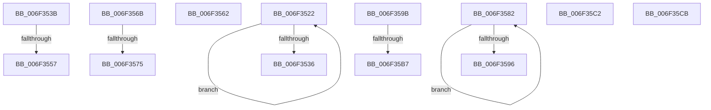

# sub_006F3522

- RVA: `0x006F3522`–`0x006F35D8` (길이 `182` bytes)
- VA: `0x00000001406F3522`
- 실행 섹션: `.text`
- PDB 이름 있음: `아니요`; PDB Function 태그: `아니요`
- unwind 정보 RVA: `0x000ABC50`
- 디코드: `49`개 명령, `182/182` bytes 표시
- 미해석 바이트: `0` (있으면 어셈블리에 `.byte`로 보존)

> 이 문서는 커널 이미지의 기계어와 PDB 기호를 분석해 생성했습니다. 4번과 5번은 함수 원형과 자료형을 바이너리 사용 방식에서 추정한 C 해석이며 원본 소스 복구 결과는 아닙니다.

## 1. Dependencies

- 직접 호출 지점: **4**; 고유 호출 대상: **2**
- 직접 호출자로 확인된 함수: **0**
- RIP 상대 이미지 참조: **0**

### Outgoing calls
- `0x006F3526` → [KeYieldProcessorEx](../3F/KeYieldProcessorEx_function_003FBD00.md) (function, `0x003FBD00`)
- `0x006F3557` → [KeWakeAddressAll](../21/KeWakeAddressAll_function_00217C20.md) (function, `0x00217C20`)
- `0x006F3586` → [KeYieldProcessorEx](../3F/KeYieldProcessorEx_function_003FBD00.md) (function, `0x003FBD00`)
- `0x006F35B7` → [KeWakeAddressAll](../21/KeWakeAddressAll_function_00217C20.md) (function, `0x00217C20`)

### Direct callers
- 이 함수 시작 RVA로 연결되는 직접 call은 확인되지 않았습니다. 간접 호출은 완전히 역산할 수 없습니다.

### Static image references
- 디코드된 RIP-relative 메모리 참조가 없습니다.

## 2. Other-region calls and transfers

- 다른 실행 섹션으로 향하는 call: **0**
- call이 아닌 외부 분기/꼬리 이동: **11**
  - `0x006F3536` → [KiScanSharedReadyThreads + 0x72](../46/KiScanSharedReadyThreads_function_0046F120.md) (`tail-transfer`)
  - `0x006F3551` → [KiScanSharedReadyThreads + 0x2AD](../46/KiScanSharedReadyThreads_function_0046F120.md) (`tail-transfer`)
  - `0x006F355D` → [KiScanSharedReadyThreads + 0x2AD](../46/KiScanSharedReadyThreads_function_0046F120.md) (`tail-transfer`)
  - `0x006F3566` → [KiScanSharedReadyThreads + 0x2AD](../46/KiScanSharedReadyThreads_function_0046F120.md) (`tail-transfer`)
  - `0x006F356F` → [KiScanSharedReadyThreads + 0xB4](../46/KiScanSharedReadyThreads_function_0046F120.md) (`tail-transfer`)
  - `0x006F357D` → [KiScanSharedReadyThreads + 0xB4](../46/KiScanSharedReadyThreads_function_0046F120.md) (`tail-transfer`)
  - `0x006F3596` → [KiScanSharedReadyThreads + 0x2CD](../46/KiScanSharedReadyThreads_function_0046F120.md) (`tail-transfer`)
  - `0x006F35B1` → [KiScanSharedReadyThreads + 0x54E](../46/KiScanSharedReadyThreads_function_0046F120.md) (`tail-transfer`)
  - `0x006F35BD` → [KiScanSharedReadyThreads + 0x54E](../46/KiScanSharedReadyThreads_function_0046F120.md) (`tail-transfer`)
  - `0x006F35C6` → [KiScanSharedReadyThreads + 0x54E](../46/KiScanSharedReadyThreads_function_0046F120.md) (`tail-transfer`)
  - `0x006F35D3` → [KiScanSharedReadyThreads + 0x2A5](../46/KiScanSharedReadyThreads_function_0046F120.md) (`tail-transfer`)

## 3. Assembly (complete function range)

```asm
006F3522  48 8D 4D FF                     lea rcx, [rbp - 1]
006F3526  E8 D5 87 D0 FF                  call 0x1403fbd00
006F352B  48 8B 03                        mov rax, qword ptr [rbx]
006F352E  45 33 C9                        xor r9d, r9d
006F3531  48 85 C0                        test rax, rax
006F3534  75 EC                           jne 0x1406f3522
006F3536  E9 57 BC D7 FF                  jmp 0x14046f192
006F353B  48 8D 48 08                     lea rcx, [rax + 8]
006F353F  4C 89 4D C7                     mov qword ptr [rbp - 0x39], r9
006F3543  48 8B 55 CF                     mov rdx, qword ptr [rbp - 0x31]
006F3547  48 8B C2                        mov rax, rdx
006F354A  48 87 01                        xchg qword ptr [rcx], rax
006F354D  32 C2                           xor al, dl
006F354F  A8 04                           test al, 4
006F3551  0F 84 76 BE D7 FF               je 0x14046f3cd
006F3557  E8 C4 46 B2 FF                  call 0x140217c20
006F355C  90                              nop
006F355D  E9 6B BE D7 FF                  jmp 0x14046f3cd
006F3562  F0 4C 21 0B                     lock and qword ptr [rbx], r9
006F3566  E9 62 BE D7 FF                  jmp 0x14046f3cd
006F356B  0F BA E1 1A                     bt ecx, 0x1a
006F356F  0F 83 5F BC D7 FF               jae 0x14046f1d4
006F3575  44 0F AF E0                     imul r12d, eax
006F3579  44 89 65 D7                     mov dword ptr [rbp - 0x29], r12d
006F357D  E9 52 BC D7 FF                  jmp 0x14046f1d4
006F3582  48 8D 4D 03                     lea rcx, [rbp + 3]
006F3586  E8 75 87 D0 FF                  call 0x1403fbd00
006F358B  48 8B 03                        mov rax, qword ptr [rbx]
006F358E  45 33 C9                        xor r9d, r9d
006F3591  48 85 C0                        test rax, rax
006F3594  75 EC                           jne 0x1406f3582
006F3596  E9 52 BE D7 FF                  jmp 0x14046f3ed
006F359B  48 8D 48 08                     lea rcx, [rax + 8]
006F359F  4C 89 4D C7                     mov qword ptr [rbp - 0x39], r9
006F35A3  48 8B 55 CF                     mov rdx, qword ptr [rbp - 0x31]
006F35A7  48 8B C2                        mov rax, rdx
006F35AA  48 87 01                        xchg qword ptr [rcx], rax
006F35AD  32 C2                           xor al, dl
006F35AF  A8 04                           test al, 4
006F35B1  0F 84 B7 C0 D7 FF               je 0x14046f66e
006F35B7  E8 64 46 B2 FF                  call 0x140217c20
006F35BC  90                              nop
006F35BD  E9 AC C0 D7 FF                  jmp 0x14046f66e
006F35C2  F0 4C 21 0B                     lock and qword ptr [rbx], r9
006F35C6  E9 A3 C0 D7 FF                  jmp 0x14046f66e
006F35CB  83 F8 0E                        cmp eax, 0xe
006F35CE  0F 47 C7                        cmova eax, edi
006F35D1  8B F8                           mov edi, eax
006F35D3  E9 ED BD D7 FF                  jmp 0x14046f3c5
```

## 4. C-style interpretation (structured pseudocode)

```c
__int64 __fastcall sub_006F3522(__int64 a1, __int64 a2, __int64 a3, int a4)
{
    __int64 result;

    result = KeYieldProcessorEx(v_rbp - 1, a2, a3, a4);
    a4 = 0;
    if (*(unsigned __int64 *)(v_rbx) != 0) goto loc_006F3522;
}
```

## 5. (Beta) C Style

```c
int64_t sub_006F3522(int64_t Arg1, int64_t Arg2, int64_t Arg3, int32_t Arg4)
{
    int64_t result;

    result = KeYieldProcessorEx(local_rbp - 1, Arg2, Arg3, Arg4);
    Arg4 = 0;
    if (*(uint64_t *)(local_rbx) != 0) goto loc_006F3522;
}
```

## 6. Execution-region graph

[열기: 2D/3D 그래프와 함수 탐색 컨트롤 패널](../../../control-panel.html?section=text&rva=0x006F3522&view=graph)

- 2D 그래프는 위에서 아래로 흐르고, 3D 그래프는 빈 공간을 드래그해 회전합니다. Shift+드래그는 이동, 휠은 확대·축소, 함수 노드 선택은 대상 보고서 이동입니다.

### Static fallback


