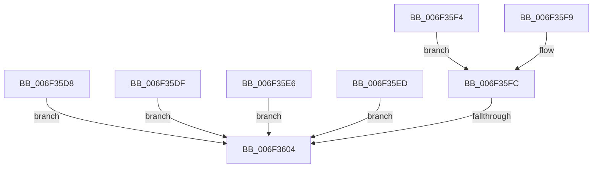

# sub_006F35D8

- RVA: `0x006F35D8`–`0x006F3619` (길이 `65` bytes)
- VA: `0x00000001406F35D8`
- 실행 섹션: `.text`
- PDB 이름 있음: `아니요`; PDB Function 태그: `아니요`
- unwind 정보 RVA: `0x000ABC74`
- 디코드: `18`개 명령, `65/65` bytes 표시
- 미해석 바이트: `0` (있으면 어셈블리에 `.byte`로 보존)

> 이 문서는 커널 이미지의 기계어와 PDB 기호를 분석해 생성했습니다. 4번과 5번은 함수 원형과 자료형을 바이너리 사용 방식에서 추정한 C 해석이며 원본 소스 복구 결과는 아닙니다.

## 1. Dependencies

- 직접 호출 지점: **1**; 고유 호출 대상: **1**
- 직접 호출자로 확인된 함수: **0**
- RIP 상대 이미지 참조: **1**

### Outgoing calls
- `0x006F360E` → [guard_dispatch_icall](../6B/guard_dispatch_icall_function_006BAAD0.md) (function, `0x006BAAD0`)

### Direct callers
- 이 함수 시작 RVA로 연결되는 직접 call은 확인되지 않았습니다. 간접 호출은 완전히 역산할 수 없습니다.

### Static image references
- `0x006F3607` → RVA `0x00E10430` (`.data`; read)

## 2. Other-region calls and transfers

- 다른 실행 섹션으로 향하는 call: **0**
- call이 아닌 외부 분기/꼬리 이동: **2**
  - `0x006F35FE` → [HalpApicSetLineState + 0x73](../46/HalpApicSetLineState_function_0046F680.md) (`tail-transfer`)
  - `0x006F3614` → [HalpApicSetLineState + 0x73](../46/HalpApicSetLineState_function_0046F680.md) (`tail-transfer`)

## 3. Assembly (complete function range)

```asm
006F35D8  B9 40 03 00 00                  mov ecx, 0x340
006F35DD  EB 25                           jmp 0x1406f3604
006F35DF  B9 50 03 00 00                  mov ecx, 0x350
006F35E4  EB 1E                           jmp 0x1406f3604
006F35E6  B9 60 03 00 00                  mov ecx, 0x360
006F35EB  EB 17                           jmp 0x1406f3604
006F35ED  B9 70 03 00 00                  mov ecx, 0x370
006F35F2  EB 10                           jmp 0x1406f3604
006F35F4  8B 4B 20                        mov ecx, dword ptr [rbx + 0x20]
006F35F7  EB 03                           jmp 0x1406f35fc
006F35F9  8B 4B 24                        mov ecx, dword ptr [rbx + 0x24]
006F35FC  85 C9                           test ecx, ecx
006F35FE  0F 84 EF C0 D7 FF               je 0x14046f6f3
006F3604  8B 55 20                        mov edx, dword ptr [rbp + 0x20]
006F3607  48 8B 05 22 CE 71 00            mov rax, qword ptr [rip + 0x71ce22]
006F360E  E8 BD 74 FC FF                  call 0x1406baad0
006F3613  90                              nop
006F3614  E9 DA C0 D7 FF                  jmp 0x14046f6f3
```

## 4. C-style interpretation (structured pseudocode)

```c
__int64 __fastcall sub_006F35D8(void)
{
    __int64 result;

    goto loc_006F3604;
loc_006F3604:
    result = guard_dispatch_icall(832, (unsigned int)(*(unsigned int *)(v_rbp + 32)), a3, a4);
}
```

## 5. (Beta) C Style

```c
void sub_006F35D8(void)
{
    int64_t result;

    goto loc_006F3604;
loc_006F3604:
    result = guard_dispatch_icall(832, (uint32_t)(*(uint32_t *)(local_rbp + 0x20)), a3, a4);
}
```

## 6. Execution-region graph

[열기: 2D/3D 그래프와 함수 탐색 컨트롤 패널](../../../control-panel.html?section=text&rva=0x006F35D8&view=graph)

- 2D 그래프는 위에서 아래로 흐르고, 3D 그래프는 빈 공간을 드래그해 회전합니다. Shift+드래그는 이동, 휠은 확대·축소, 함수 노드 선택은 대상 보고서 이동입니다.

### Static fallback


