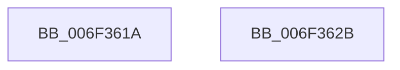

# sub_006F361A

- RVA: `0x006F361A`–`0x006F3647` (길이 `45` bytes)
- VA: `0x00000001406F361A`
- 실행 섹션: `.text`
- PDB 이름 있음: `아니요`; PDB Function 태그: `아니요`
- unwind 정보 RVA: `0x000ABC9C`
- 디코드: `11`개 명령, `45/45` bytes 표시
- 미해석 바이트: `0` (있으면 어셈블리에 `.byte`로 보존)

> 이 문서는 커널 이미지의 기계어와 PDB 기호를 분석해 생성했습니다. 4번과 5번은 함수 원형과 자료형을 바이너리 사용 방식에서 추정한 C 해석이며 원본 소스 복구 결과는 아닙니다.

## 1. Dependencies

- 직접 호출 지점: **0**; 고유 호출 대상: **0**
- 직접 호출자로 확인된 함수: **0**
- RIP 상대 이미지 참조: **0**

### Outgoing calls
- 직접 디코드된 call 명령이 없습니다.

### Direct callers
- 이 함수 시작 RVA로 연결되는 직접 call은 확인되지 않았습니다. 간접 호출은 완전히 역산할 수 없습니다.

### Static image references
- 디코드된 RIP-relative 메모리 참조가 없습니다.

## 2. Other-region calls and transfers

- 다른 실행 섹션으로 향하는 call: **0**
- call이 아닌 외부 분기/꼬리 이동: **2**
  - `0x006F3626` → [HalpApicConvertToRte + 0x12C](../46/HalpApicConvertToRte_function_0046F774.md) (`tail-transfer`)
  - `0x006F3642` → [HalpApicConvertToRte + 0x12C](../46/HalpApicConvertToRte_function_0046F774.md) (`tail-transfer`)

## 3. Assembly (complete function range)

```asm
006F361A  44 8B 4F 20                     mov r9d, dword ptr [rdi + 0x20]
006F361E  41 C1 E1 10                     shl r9d, 0x10
006F3622  44 0B 4F 24                     or r9d, dword ptr [rdi + 0x24]
006F3626  E9 75 C2 D7 FF                  jmp 0x14046f8a0
006F362B  0F B7 47 20                     movzx eax, word ptr [rdi + 0x20]
006F362F  66 C1 E0 04                     shl ax, 4
006F3633  44 0F B7 C8                     movzx r9d, ax
006F3637  0F B7 47 24                     movzx eax, word ptr [rdi + 0x24]
006F363B  44 0B C8                        or r9d, eax
006F363E  41 C1 E1 18                     shl r9d, 0x18
006F3642  E9 59 C2 D7 FF                  jmp 0x14046f8a0
```

## 4. C-style interpretation (structured pseudocode)

```c
__int64 __fastcall sub_006F361A(void)
{
    a4 = (unsigned int)(((unsigned int)(*(unsigned int *)(v_rdi + 32))) << (16));
    a4 = (unsigned int)((a4) | (*(unsigned int *)(v_rdi + 36)));
}
```

## 5. (Beta) C Style

```c
void sub_006F361A(void)
{
    a4 = (uint32_t)(((uint32_t)(*(uint32_t *)(local_rdi + 0x20))) << (16));
    a4 = (uint32_t)((a4) | (*(uint32_t *)(local_rdi + 0x24)));
}
```

## 6. Execution-region graph

[열기: 2D/3D 그래프와 함수 탐색 컨트롤 패널](../../../control-panel.html?section=text&rva=0x006F361A&view=graph)

- 2D 그래프는 위에서 아래로 흐르고, 3D 그래프는 빈 공간을 드래그해 회전합니다. Shift+드래그는 이동, 휠은 확대·축소, 함수 노드 선택은 대상 보고서 이동입니다.

### Static fallback


