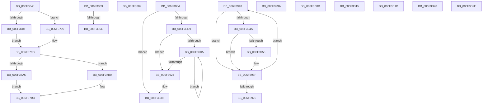

# sub_006F3648

- RVA: `0x006F3648`–`0x006F3B38` (길이 `1,264` bytes)
- VA: `0x00000001406F3648`
- 실행 섹션: `.text`
- PDB 이름 있음: `아니요`; PDB Function 태그: `아니요`
- unwind 정보 RVA: `0x000ABCDC`
- 디코드: `247`개 명령, `1,264/1,264` bytes 표시
- 미해석 바이트: `0` (있으면 어셈블리에 `.byte`로 보존)

> 이 문서는 커널 이미지의 기계어와 PDB 기호를 분석해 생성했습니다. 4번과 5번은 함수 원형과 자료형을 바이너리 사용 방식에서 추정한 C 해석이며 원본 소스 복구 결과는 아닙니다.

## 1. Dependencies

- 직접 호출 지점: **16**; 고유 호출 대상: **9**
- 직접 호출자로 확인된 함수: **0**
- RIP 상대 이미지 참조: **3**

### Outgoing calls
- `0x006F3662` → [memset](../6C/memset_function_006C6C40.md) (function, `0x006C6C40`)
- `0x006F3687` → [memset](../6C/memset_function_006C6C40.md) (function, `0x006C6C40`)
- `0x006F36AC` → [memset](../6C/memset_function_006C6C40.md) (function, `0x006C6C40`)
- `0x006F36D1` → [memset](../6C/memset_function_006C6C40.md) (function, `0x006C6C40`)
- `0x006F36F6` → [memset](../6C/memset_function_006C6C40.md) (function, `0x006C6C40`)
- `0x006F3709` → [KeAddGroupAffinityEx](../25/KeAddGroupAffinityEx_function_0025B6C0.md) (function, `0x0025B6C0`)
- `0x006F371C` → [KeAddGroupAffinityEx](../25/KeAddGroupAffinityEx_function_0025B6C0.md) (function, `0x0025B6C0`)
- `0x006F3733` → [KeAddGroupAffinityEx](../25/KeAddGroupAffinityEx_function_0025B6C0.md) (function, `0x0025B6C0`)
- `0x006F377E` → [guard_dispatch_icall](../6B/guard_dispatch_icall_function_006BAAD0.md) (function, `0x006BAAD0`)
- `0x006F37DA` → [PpmEventParkNodePreference](../5D/PpmEventParkNodePreference_function_005DAFC8.md) (function, `0x005DAFC8`)
- `0x006F381D` → [memset](../6C/memset_function_006C6C40.md) (function, `0x006C6C40`)
- `0x006F384D` → [KiCopyAffinityEx](../2C/KiCopyAffinityEx_function_002CE860.md) (function, `0x002CE860`)
- `0x006F38C7` → [PpmHeteroRestrictToFavoredClass](../2D/PpmHeteroRestrictToFavoredClass_function_002D8CE4.md) (function, `0x002D8CE4`)
- `0x006F3933` → [PpmEventHeteroFavoredCoreRotationChange](../47/PpmEventHeteroFavoredCoreRotationChange_function_0047ACB0.md) (function, `0x0047ACB0`)
- `0x006F396A` → [KeEnumerateNextProcessor](../41/KeEnumerateNextProcessor_function_00415480.md) (function, `0x00415480`)
- `0x006F3B01` → [EtwWriteEx](../25/EtwWriteEx_function_0025F0D0.md) (function, `0x0025F0D0`)

### Direct callers
- 이 함수 시작 RVA로 연결되는 직접 call은 확인되지 않았습니다. 간접 호출은 완전히 역산할 수 없습니다.

### Static image references
- `0x006F3738` → RVA `0x00F0B260` (`.data`; read)
- `0x006F399A` → RVA `0x00F083E8` (`.data`; read)
- `0x006F3A76` → RVA `0x00019F00` (`.rdata`; read)

## 2. Other-region calls and transfers

- 다른 실행 섹션으로 향하는 call: **0**
- call이 아닌 외부 분기/꼬리 이동: **12**
  - `0x006F37FE` → [PpmParkComputeUnparkMask + 0x196](../46/PpmParkComputeUnparkMask_function_0046F9C4.md) (`tail-transfer`)
  - `0x006F3868` → [PpmParkComputeUnparkMask + 0x200](../46/PpmParkComputeUnparkMask_function_0046F9C4.md) (`tail-transfer`)
  - `0x006F387D` → [PpmParkComputeUnparkMask + 0x200](../46/PpmParkComputeUnparkMask_function_0046F9C4.md) (`tail-transfer`)
  - `0x006F3885` → [PpmParkComputeUnparkMask + 0x200](../46/PpmParkComputeUnparkMask_function_0046F9C4.md) (`tail-transfer`)
  - `0x006F393B` → [PpmParkComputeUnparkMask + 0x2FA](../46/PpmParkComputeUnparkMask_function_0046F9C4.md) (`tail-transfer`)
  - `0x006F3995` → [PpmParkComputeUnparkMask + 0x63E](../46/PpmParkComputeUnparkMask_function_0046F9C4.md) (`tail-transfer`)
  - `0x006F3B08` → [PpmParkComputeUnparkMask + 0x442](../46/PpmParkComputeUnparkMask_function_0046F9C4.md) (`tail-transfer`)
  - `0x006F3B10` → [PpmParkComputeUnparkMask + 0x4A4](../46/PpmParkComputeUnparkMask_function_0046F9C4.md) (`tail-transfer`)
  - `0x006F3B18` → [PpmParkComputeUnparkMask + 0x4A4](../46/PpmParkComputeUnparkMask_function_0046F9C4.md) (`tail-transfer`)
  - `0x006F3B21` → [PpmParkComputeUnparkMask + 0x4BE](../46/PpmParkComputeUnparkMask_function_0046F9C4.md) (`tail-transfer`)
  - `0x006F3B29` → [PpmParkComputeUnparkMask + 0x251](../46/PpmParkComputeUnparkMask_function_0046F9C4.md) (`tail-transfer`)
  - `0x006F3B33` → [PpmParkComputeUnparkMask + 0x2A3](../46/PpmParkComputeUnparkMask_function_0046F9C4.md) (`tail-transfer`)

## 3. Assembly (complete function range)

```asm
006F3648  33 D2                           xor edx, edx
006F364A  48 C7 85 E0 06 00 00 01 00 20 00  mov qword ptr [rbp + 0x6e0], 0x200001
006F3655  41 B8 00 01 00 00               mov r8d, 0x100
006F365B  48 8D 8D E8 06 00 00            lea rcx, [rbp + 0x6e8]
006F3662  E8 D9 35 FD FF                  call 0x1406c6c40
006F3667  44 21 BD D4 05 00 00            and dword ptr [rbp + 0x5d4], r15d
006F366E  48 8D 8D D8 05 00 00            lea rcx, [rbp + 0x5d8]
006F3675  33 D2                           xor edx, edx
006F3677  C7 85 D0 05 00 00 01 00 20 00   mov dword ptr [rbp + 0x5d0], 0x200001
006F3681  41 B8 00 01 00 00               mov r8d, 0x100
006F3687  E8 B4 35 FD FF                  call 0x1406c6c40
006F368C  44 21 BD C4 04 00 00            and dword ptr [rbp + 0x4c4], r15d
006F3693  48 8D 8D C8 04 00 00            lea rcx, [rbp + 0x4c8]
006F369A  33 D2                           xor edx, edx
006F369C  C7 85 C0 04 00 00 01 00 20 00   mov dword ptr [rbp + 0x4c0], 0x200001
006F36A6  41 B8 00 01 00 00               mov r8d, 0x100
006F36AC  E8 8F 35 FD FF                  call 0x1406c6c40
006F36B1  44 21 BD A4 02 00 00            and dword ptr [rbp + 0x2a4], r15d
006F36B8  48 8D 8D A8 02 00 00            lea rcx, [rbp + 0x2a8]
006F36BF  33 D2                           xor edx, edx
006F36C1  C7 85 A0 02 00 00 01 00 20 00   mov dword ptr [rbp + 0x2a0], 0x200001
006F36CB  41 B8 00 01 00 00               mov r8d, 0x100
006F36D1  E8 6A 35 FD FF                  call 0x1406c6c40
006F36D6  44 21 BD B4 03 00 00            and dword ptr [rbp + 0x3b4], r15d
006F36DD  48 8D 8D B8 03 00 00            lea rcx, [rbp + 0x3b8]
006F36E4  33 D2                           xor edx, edx
006F36E6  C7 85 B0 03 00 00 01 00 20 00   mov dword ptr [rbp + 0x3b0], 0x200001
006F36F0  41 B8 00 01 00 00               mov r8d, 0x100
006F36F6  E8 45 35 FD FF                  call 0x1406c6c40
006F36FB  4C 8B C7                        mov r8, rdi
006F36FE  48 8D 8D E0 06 00 00            lea rcx, [rbp + 0x6e0]
006F3705  41 0F B7 D4                     movzx edx, r12w
006F3709  E8 B2 7F B6 FF                  call 0x14025b6c0
006F370E  4C 8B C3                        mov r8, rbx
006F3711  48 8D 8D D0 05 00 00            lea rcx, [rbp + 0x5d0]
006F3718  41 0F B7 D4                     movzx edx, r12w
006F371C  E8 9F 7F B6 FF                  call 0x14025b6c0
006F3721  4C 8B 85 68 09 00 00            mov r8, qword ptr [rbp + 0x968]
006F3728  48 8D 8D C0 04 00 00            lea rcx, [rbp + 0x4c0]
006F372F  41 0F B7 D4                     movzx edx, r12w
006F3733  E8 88 7F B6 FF                  call 0x14025b6c0
006F3738  48 8B 15 21 7B 81 00            mov rdx, qword ptr [rip + 0x817b21]
006F373F  48 8D 85 B0 03 00 00            lea rax, [rbp + 0x3b0]
006F3746  48 89 44 24 38                  mov qword ptr [rsp + 0x38], rax
006F374B  4C 8D 8D E0 06 00 00            lea r9, [rbp + 0x6e0]
006F3752  48 8D 85 A0 02 00 00            lea rax, [rbp + 0x2a0]
006F3759  45 8B C5                        mov r8d, r13d
006F375C  48 89 44 24 30                  mov qword ptr [rsp + 0x30], rax
006F3761  33 C9                           xor ecx, ecx
006F3763  48 8D 85 C0 04 00 00            lea rax, [rbp + 0x4c0]
006F376A  48 89 44 24 28                  mov qword ptr [rsp + 0x28], rax
006F376F  48 8D 85 D0 05 00 00            lea rax, [rbp + 0x5d0]
006F3776  48 89 44 24 20                  mov qword ptr [rsp + 0x20], rax
006F377B  49 8B C6                        mov rax, r14
006F377E  E8 4D 73 FC FF                  call 0x1406baad0
006F3783  33 C9                           xor ecx, ecx
006F3785  66 44 3B A5 A0 02 00 00         cmp r12w, word ptr [rbp + 0x2a0]
006F378D  73 0A                           jae 0x1406f3799
006F378F  4E 8B AC E5 A8 02 00 00         mov r13, qword ptr [rbp + r12*8 + 0x2a8]
006F3797  EB 03                           jmp 0x1406f379c
006F3799  4C 8B E9                        mov r13, rcx
006F379C  66 44 3B A5 B0 03 00 00         cmp r12w, word ptr [rbp + 0x3b0]
006F37A4  73 0A                           jae 0x1406f37b0
006F37A6  4E 8B B4 E5 B8 03 00 00         mov r14, qword ptr [rbp + r12*8 + 0x3b8]
006F37AE  EB 03                           jmp 0x1406f37b3
006F37B0  4C 8B F1                        mov r14, rcx
006F37B3  48 8B 85 68 09 00 00            mov rax, qword ptr [rbp + 0x968]
006F37BA  4C 8B CB                        mov r9, rbx
006F37BD  44 8B 85 50 09 00 00            mov r8d, dword ptr [rbp + 0x950]
006F37C4  48 8B D7                        mov rdx, rdi
006F37C7  4C 89 74 24 30                  mov qword ptr [rsp + 0x30], r14
006F37CC  41 0F B7 CC                     movzx ecx, r12w
006F37D0  4C 89 6C 24 28                  mov qword ptr [rsp + 0x28], r13
006F37D5  48 89 44 24 20                  mov qword ptr [rsp + 0x20], rax
006F37DA  E8 E9 77 EE FF                  call 0x1405dafc8
006F37DF  4C 8B 44 24 68                  mov r8, qword ptr [rsp + 0x68]
006F37E4  48 8B C3                        mov rax, rbx
006F37E7  48 0B 85 68 09 00 00            or rax, qword ptr [rbp + 0x968]
006F37EE  48 F7 D0                        not rax
006F37F1  4C 23 E8                        and r13, rax
006F37F4  4C 23 F0                        and r14, rax
006F37F7  4C 89 6D F0                     mov qword ptr [rbp - 0x10], r13
006F37FB  45 33 C9                        xor r9d, r9d
006F37FE  E9 57 C3 D7 FF                  jmp 0x14046fb5a
006F3803  33 D2                           xor edx, edx
006F3805  48 C7 85 90 01 00 00 01 00 20 00  mov qword ptr [rbp + 0x190], 0x200001
006F3810  41 B8 00 01 00 00               mov r8d, 0x100
006F3816  48 8D 8D 98 01 00 00            lea rcx, [rbp + 0x198]
006F381D  E8 1E 34 FD FF                  call 0x1406c6c40
006F3822  48 8B 45 98                     mov rax, qword ptr [rbp - 0x68]
006F3826  48 8B 90 00 05 00 00            mov rdx, qword ptr [rax + 0x500]
006F382D  48 63 42 04                     movsxd rax, dword ptr [rdx + 4]
006F3831  4C 8D 42 10                     lea r8, [rdx + 0x10]
006F3835  0F B7 95 92 01 00 00            movzx edx, word ptr [rbp + 0x192]
006F383C  48 69 C8 08 01 00 00            imul rcx, rax, 0x108
006F3843  4C 03 C1                        add r8, rcx
006F3846  48 8D 8D 90 01 00 00            lea rcx, [rbp + 0x190]
006F384D  E8 0E B0 BD FF                  call 0x1402ce860
006F3852  0F B7 44 24 52                  movzx eax, word ptr [rsp + 0x52]
006F3857  45 33 C9                        xor r9d, r9d
006F385A  48 8B CF                        mov rcx, rdi
006F385D  41 8B D9                        mov ebx, r9d
006F3860  48 23 8C C5 98 01 00 00         and rcx, qword ptr [rbp + rax*8 + 0x198]
006F3868  0F 84 56 C3 D7 FF               je 0x14046fbc4
006F386E  41 BB 00 00 40 00               mov r11d, 0x400000
006F3874  48 8B D9                        mov rbx, rcx
006F3877  44 09 1E                        or dword ptr [rsi], r11d
006F387A  45 8B FB                        mov r15d, r11d
006F387D  E9 42 C3 D7 FF                  jmp 0x14046fbc4
006F3882  49 8B D9                        mov rbx, r9
006F3885  E9 3A C3 D7 FF                  jmp 0x14046fbc4
006F388A  8B 85 A8 09 00 00               mov eax, dword ptr [rbp + 0x9a8]
006F3890  4C 8D 44 24 50                  lea r8, [rsp + 0x50]
006F3895  44 8A 8D 98 09 00 00            mov r9b, byte ptr [rbp + 0x998]
006F389C  0F B7 D7                        movzx edx, di
006F389F  0F BA 2E 0F                     bts dword ptr [rsi], 0xf
006F38A3  41 0F BA EF 0F                  bts r15d, 0xf
006F38A8  89 44 24 38                     mov dword ptr [rsp + 0x38], eax
006F38AC  8B 85 90 09 00 00               mov eax, dword ptr [rbp + 0x990]
006F38B2  89 4C 24 30                     mov dword ptr [rsp + 0x30], ecx
006F38B6  49 8B CD                        mov rcx, r13
006F38B9  89 44 24 28                     mov dword ptr [rsp + 0x28], eax
006F38BD  8A 85 A0 09 00 00               mov al, byte ptr [rbp + 0x9a0]
006F38C3  88 44 24 20                     mov byte ptr [rsp + 0x20], al
006F38C7  E8 18 54 BE FF                  call 0x1402d8ce4
006F38CC  4C 8B E8                        mov r13, rax
006F38CF  8A 44 24 54                     mov al, byte ptr [rsp + 0x54]
006F38D3  38 44 24 50                     cmp byte ptr [rsp + 0x50], al
006F38D7  74 5F                           je 0x1406f3938
006F38D9  8A 44 24 50                     mov al, byte ptr [rsp + 0x50]
006F38DD  33 D2                           xor edx, edx
006F38DF  88 44 24 54                     mov byte ptr [rsp + 0x54], al
006F38E3  45 33 DB                        xor r11d, r11d
006F38E6  48 8B 85 88 09 00 00            mov rax, qword ptr [rbp + 0x988]
006F38ED  4D 8B C5                        mov r8, r13
006F38F0  F3 4D 0F B8 D5                  popcnt r10, r13
006F38F5  41 8B CA                        mov ecx, r10d
006F38F8  45 8B CB                        mov r9d, r11d
006F38FB  45 8D 73 01                     lea r14d, [r11 + 1]
006F38FF  48 8B 00                        mov rax, qword ptr [rax]
006F3902  48 F7 F1                        div rcx
006F3905  49 03 D6                        add rdx, r14
006F3908  74 1A                           je 0x1406f3924
006F390A  49 0F BC C0                     bsf rax, r8
006F390E  41 FF C1                        inc r9d
006F3911  44 89 5C 24 70                  mov dword ptr [rsp + 0x70], r11d
006F3916  44 03 C8                        add r9d, eax
006F3919  8D 48 01                        lea ecx, [rax + 1]
006F391C  49 D3 E8                        shr r8, cl
006F391F  49 2B D6                        sub rdx, r14
006F3922  75 E6                           jne 0x1406f390a
006F3924  45 8D 71 FF                     lea r14d, [r9 - 1]
006F3928  41 8B CA                        mov ecx, r10d
006F392B  41 8B D6                        mov edx, r14d
006F392E  44 89 74 24 60                  mov dword ptr [rsp + 0x60], r14d
006F3933  E8 78 73 D8 FF                  call 0x14047acb0
006F3938  45 33 C9                        xor r9d, r9d
006F393B  E9 7E C3 D7 FF                  jmp 0x14046fcbe
006F3940  41 0F B7 44 24 0A               movzx eax, word ptr [r12 + 0xa]
006F3946  3B F8                           cmp edi, eax
006F3948  73 15                           jae 0x1406f395f
006F394A  8B 4C 24 5C                     mov ecx, dword ptr [rsp + 0x5c]
006F394E  39 0C BE                        cmp dword ptr [rsi + rdi*4], ecx
006F3951  74 0C                           je 0x1406f395f
006F3953  89 0C BE                        mov dword ptr [rsi + rdi*4], ecx
006F3956  41 C6 84 24 E6 04 00 00 01      mov byte ptr [r12 + 0x4e6], 1
006F395F  48 8D 55 00                     lea rdx, [rbp]
006F3963  FF CF                           dec edi
006F3965  48 8D 4C 24 5C                  lea rcx, [rsp + 0x5c]
006F396A  E8 11 1B D2 FF                  call 0x140415480
006F396F  33 D2                           xor edx, edx
006F3971  85 C0                           test eax, eax
006F3973  74 CB                           je 0x1406f3940
006F3975  48 8B 75 28                     mov rsi, qword ptr [rbp + 0x28]
006F3979  4C 8B 74 24 70                  mov r14, qword ptr [rsp + 0x70]
006F397E  4C 8B 65 30                     mov r12, qword ptr [rbp + 0x30]
006F3982  F3 49 0F B8 C6                  popcnt rax, r14
006F3987  0F B6 C8                        movzx ecx, al
006F398A  48 8B 45 98                     mov rax, qword ptr [rbp - 0x68]
006F398E  66 01 88 E4 04 00 00            add word ptr [rax + 0x4e4], cx
006F3995  E9 68 C6 D7 FF                  jmp 0x140470002
006F399A  48 8B 0D 47 4A 81 00            mov rcx, qword ptr [rip + 0x814a47]
006F39A1  48 8D 45 A8                     lea rax, [rbp - 0x58]
006F39A5  48 89 85 F0 07 00 00            mov qword ptr [rbp + 0x7f0], rax
006F39AC  45 33 C9                        xor r9d, r9d
006F39AF  48 8D 45 B0                     lea rax, [rbp - 0x50]
006F39B3  48 C7 85 F8 07 00 00 04 00 00 00  mov qword ptr [rbp + 0x7f8], 4
006F39BE  48 89 85 00 08 00 00            mov qword ptr [rbp + 0x800], rax
006F39C5  45 33 C0                        xor r8d, r8d
006F39C8  48 8D 45 B8                     lea rax, [rbp - 0x48]
006F39CC  48 C7 85 08 08 00 00 04 00 00 00  mov qword ptr [rbp + 0x808], 4
006F39D7  48 89 85 10 08 00 00            mov qword ptr [rbp + 0x810], rax
006F39DE  48 8D 45 C0                     lea rax, [rbp - 0x40]
006F39E2  48 89 85 20 08 00 00            mov qword ptr [rbp + 0x820], rax
006F39E9  48 8D 45 90                     lea rax, [rbp - 0x70]
006F39ED  48 89 85 30 08 00 00            mov qword ptr [rbp + 0x830], rax
006F39F4  48 8D 44 24 70                  lea rax, [rsp + 0x70]
006F39F9  48 89 85 40 08 00 00            mov qword ptr [rbp + 0x840], rax
006F3A00  48 8D 45 38                     lea rax, [rbp + 0x38]
006F3A04  48 89 85 50 08 00 00            mov qword ptr [rbp + 0x850], rax
006F3A0B  48 8D 45 40                     lea rax, [rbp + 0x40]
006F3A0F  48 89 85 60 08 00 00            mov qword ptr [rbp + 0x860], rax
006F3A16  48 8D 45 48                     lea rax, [rbp + 0x48]
006F3A1A  48 89 85 70 08 00 00            mov qword ptr [rbp + 0x870], rax
006F3A21  48 8D 45 50                     lea rax, [rbp + 0x50]
006F3A25  48 89 85 80 08 00 00            mov qword ptr [rbp + 0x880], rax
006F3A2C  48 8D 45 58                     lea rax, [rbp + 0x58]
006F3A30  48 89 85 90 08 00 00            mov qword ptr [rbp + 0x890], rax
006F3A37  48 8D 45 60                     lea rax, [rbp + 0x60]
006F3A3B  48 89 85 A0 08 00 00            mov qword ptr [rbp + 0x8a0], rax
006F3A42  48 8D 45 68                     lea rax, [rbp + 0x68]
006F3A46  48 89 85 B0 08 00 00            mov qword ptr [rbp + 0x8b0], rax
006F3A4D  48 8D 45 70                     lea rax, [rbp + 0x70]
006F3A51  48 89 85 C0 08 00 00            mov qword ptr [rbp + 0x8c0], rax
006F3A58  48 8D 85 F0 07 00 00            lea rax, [rbp + 0x7f0]
006F3A5F  48 89 44 24 38                  mov qword ptr [rsp + 0x38], rax
006F3A64  C7 44 24 30 0E 00 00 00         mov dword ptr [rsp + 0x30], 0xe
006F3A6C  48 89 54 24 28                  mov qword ptr [rsp + 0x28], rdx
006F3A71  48 89 54 24 20                  mov qword ptr [rsp + 0x20], rdx
006F3A76  48 8D 15 83 64 92 FF            lea rdx, [rip - 0x6d9b7d]
006F3A7D  48 C7 85 18 08 00 00 04 00 00 00  mov qword ptr [rbp + 0x818], 4
006F3A88  48 C7 85 28 08 00 00 04 00 00 00  mov qword ptr [rbp + 0x828], 4
006F3A93  48 C7 85 38 08 00 00 04 00 00 00  mov qword ptr [rbp + 0x838], 4
006F3A9E  48 C7 85 48 08 00 00 04 00 00 00  mov qword ptr [rbp + 0x848], 4
006F3AA9  48 C7 85 58 08 00 00 08 00 00 00  mov qword ptr [rbp + 0x858], 8
006F3AB4  48 C7 85 68 08 00 00 08 00 00 00  mov qword ptr [rbp + 0x868], 8
006F3ABF  48 C7 85 78 08 00 00 08 00 00 00  mov qword ptr [rbp + 0x878], 8
006F3ACA  48 C7 85 88 08 00 00 08 00 00 00  mov qword ptr [rbp + 0x888], 8
006F3AD5  48 C7 85 98 08 00 00 08 00 00 00  mov qword ptr [rbp + 0x898], 8
006F3AE0  48 C7 85 A8 08 00 00 08 00 00 00  mov qword ptr [rbp + 0x8a8], 8
006F3AEB  48 C7 85 B8 08 00 00 08 00 00 00  mov qword ptr [rbp + 0x8b8], 8
006F3AF6  48 C7 85 C8 08 00 00 08 00 00 00  mov qword ptr [rbp + 0x8c8], 8
006F3B01  E8 CA B5 B6 FF                  call 0x14025f0d0
006F3B06  33 D2                           xor edx, edx
006F3B08  E9 F9 C2 D7 FF                  jmp 0x14046fe06
006F3B0D  4C 23 D1                        and r10, rcx
006F3B10  E9 53 C3 D7 FF                  jmp 0x14046fe68
006F3B15  4C 23 D0                        and r10, rax
006F3B18  E9 4B C3 D7 FF                  jmp 0x14046fe68
006F3B1D  33 C0                           xor eax, eax
006F3B1F  8B D0                           mov edx, eax
006F3B21  E9 5C C3 D7 FF                  jmp 0x14046fe82
006F3B26  4D 23 CE                        and r9, r14
006F3B29  E9 E7 C0 D7 FF                  jmp 0x14046fc15
006F3B2E  09 06                           or dword ptr [rsi], eax
006F3B30  44 8B F8                        mov r15d, eax
006F3B33  E9 2F C1 D7 FF                  jmp 0x14046fc67
```

## 4. C-style interpretation (structured pseudocode)

```c
__int64 __fastcall sub_006F3648(__int64 a1, int a2, __int64 a3, __int64 a4, __int64 a5, __int64 a6, __int64 a7, __int64 a8, __int64 a9, __int64 a10, __int64 a11, __int64 a12, __int64 a13)
{
    __int64 result;
    __int64 v_r13;
    __int64 v_r14;
    unsigned __int64 v_stack_p20;
    unsigned __int64 v_stack_p28;
    unsigned __int64 v_stack_p30;
    unsigned __int64 v_stack_p38;
    unsigned __int64 v_stack_p50;
    unsigned __int16 v_stack_p52;
    unsigned __int8 v_stack_p54;
    unsigned int v_stack_p5C;
    unsigned int v_stack_p60;
    unsigned int v_stack_p70;

    a2 = 0;
    *(unsigned __int64 *)(v_rbp + 1760) = 0x200001ULL;
    result = memset(v_rbp + 1768, a2, 256, a4);
    a2 = 0;
    *(unsigned int *)(v_rbp + 1488) = 0x200001ULL;
    result = memset(v_rbp + 1496, a2, 256, a4);
    a2 = 0;
    *(unsigned int *)(v_rbp + 1216) = 0x200001ULL;
    result = memset(v_rbp + 1224, a2, 256, a4);
    a2 = 0;
    *(unsigned int *)(v_rbp + 672) = 0x200001ULL;
    result = memset(v_rbp + 680, a2, 256, a4);
    a2 = 0;
    *(unsigned int *)(v_rbp + 944) = 0x200001ULL;
    result = memset(v_rbp + 952, a2, 256, a4);
    result = KeAddGroupAffinityEx(v_rbp + 1760, (unsigned __int16)(v_r12), v_rdi, a4);
    result = KeAddGroupAffinityEx(v_rbp + 1488, (unsigned __int16)(v_r12), v_rbx, a4);
    result = KeAddGroupAffinityEx(v_rbp + 1216, (unsigned __int16)(v_r12), *(unsigned __int64 *)(v_rbp + 2408), a4);
    v_stack_p38 = v_rbp + 944;
    v_stack_p30 = v_rbp + 672;
    a1 = 0;
    v_stack_p28 = v_rbp + 1216;
    v_stack_p20 = v_rbp + 1488;
    result = guard_dispatch_icall(a1, *(unsigned __int64 *)(v_rip + 8485665), (unsigned int)((unsigned int)(v_r13)), v_rbp + 1760);
    a1 = 0;
    if (((unsigned __int16)(v_r12)) >= (*(unsigned __int16 *)(v_rbp + 672))) goto loc_006F3799;
    goto loc_006F379C;
loc_006F3799:
loc_006F379C:
    if (((unsigned __int16)(v_r12)) >= (*(unsigned __int16 *)(v_rbp + 944))) goto loc_006F37B0;
    goto loc_006F37B3;
loc_006F37B0:
loc_006F37B3:
    v_stack_p30 = 0;
    v_stack_p28 = 0;
    v_stack_p20 = *(unsigned __int64 *)(v_rbp + 2408);
    result = PpmEventParkNodePreference((unsigned __int16)(v_r12), v_rdi, (unsigned int)(*(unsigned int *)(v_rbp + 2384)), v_rbx);
    result = (v_rbx) | (*(unsigned __int64 *)(v_rbp + 2408));
    result = ~(result);
    v_r13 = (0) & (result);
    v_r14 = (0) & (result);
    *(unsigned __int64 *)(v_rbp - 16) = v_r13;
    a4 = 0;
}
```

## 5. (Beta) C Style

```c
int64_t sub_006F3648(int64_t Arg1, int32_t Arg2, int64_t Arg3, int64_t Arg4, uint64_t Arg5, uint64_t Arg6, uint64_t Arg7, uint64_t Arg8, uint64_t Arg9, uint64_t Arg10, uint64_t Arg11, uint64_t Arg12, int64_t Arg13)
{
    int64_t result;
    int64_t local_r13;
    int64_t local_r14;
    uint64_t v_stack_p20;
    uint64_t v_stack_p28;
    uint64_t v_stack_p30;
    uint64_t v_stack_p38;
    uint64_t v_stack_p50;
    uint16_t v_stack_p52;
    uint8_t v_stack_p54;
    uint32_t v_stack_p5C;
    uint32_t v_stack_p60;
    uint32_t v_stack_p70;

    Arg2 = 0;
    *(uint64_t *)(local_rbp + 0x6E0) = 0x200001ULL;
    result = memset(local_rbp + 1768, Arg2, 256, Arg4);
    Arg2 = 0;
    *(uint32_t *)(local_rbp + 0x5D0) = 0x200001ULL;
    result = memset(local_rbp + 1496, Arg2, 256, Arg4);
    Arg2 = 0;
    *(uint32_t *)(local_rbp + 0x4C0) = 0x200001ULL;
    result = memset(local_rbp + 1224, Arg2, 256, Arg4);
    Arg2 = 0;
    *(uint32_t *)(local_rbp + 0x2A0) = 0x200001ULL;
    result = memset(local_rbp + 680, Arg2, 256, Arg4);
    Arg2 = 0;
    *(uint32_t *)(local_rbp + 0x3B0) = 0x200001ULL;
    result = memset(local_rbp + 952, Arg2, 256, Arg4);
    result = KeAddGroupAffinityEx(local_rbp + 1760, (uint16_t)(local_r12), local_rdi, Arg4);
    result = KeAddGroupAffinityEx(local_rbp + 1488, (uint16_t)(local_r12), local_rbx, Arg4);
    result = KeAddGroupAffinityEx(local_rbp + 1216, (uint16_t)(local_r12), *(uint64_t *)(local_rbp + 0x968), Arg4);
    v_stack_p38 = local_rbp + 944;
    v_stack_p30 = local_rbp + 672;
    Arg1 = 0;
    v_stack_p28 = local_rbp + 1216;
    v_stack_p20 = local_rbp + 1488;
    result = guard_dispatch_icall(Arg1, *(uint64_t *)(v_rip + 0x817B21), (uint32_t)((uint32_t)(local_r13)), local_rbp + 1760);
    Arg1 = 0;
    if (((uint16_t)(local_r12)) >= (*(uint16_t *)(local_rbp + 0x2A0))) goto loc_006F3799;
    goto loc_006F379C;
loc_006F3799:
loc_006F379C:
    if (((uint16_t)(local_r12)) >= (*(uint16_t *)(local_rbp + 0x3B0))) goto loc_006F37B0;
    goto loc_006F37B3;
loc_006F37B0:
loc_006F37B3:
    v_stack_p30 = 0;
    v_stack_p28 = 0;
    v_stack_p20 = *(uint64_t *)(local_rbp + 0x968);
    result = PpmEventParkNodePreference((uint16_t)(local_r12), local_rdi, (uint32_t)(*(uint32_t *)(local_rbp + 0x950)), local_rbx);
    result = (local_rbx) | (*(uint64_t *)(local_rbp + 0x968));
    result = ~(result);
    local_r13 = (0) & (result);
    local_r14 = (0) & (result);
    *(uint64_t *)(local_rbp - 0x10) = local_r13;
    Arg4 = 0;
}
```

## 6. Execution-region graph

[열기: 2D/3D 그래프와 함수 탐색 컨트롤 패널](../../../control-panel.html?section=text&rva=0x006F3648&view=graph)

- 2D 그래프는 위에서 아래로 흐르고, 3D 그래프는 빈 공간을 드래그해 회전합니다. Shift+드래그는 이동, 휠은 확대·축소, 함수 노드 선택은 대상 보고서 이동입니다.

### Static fallback


