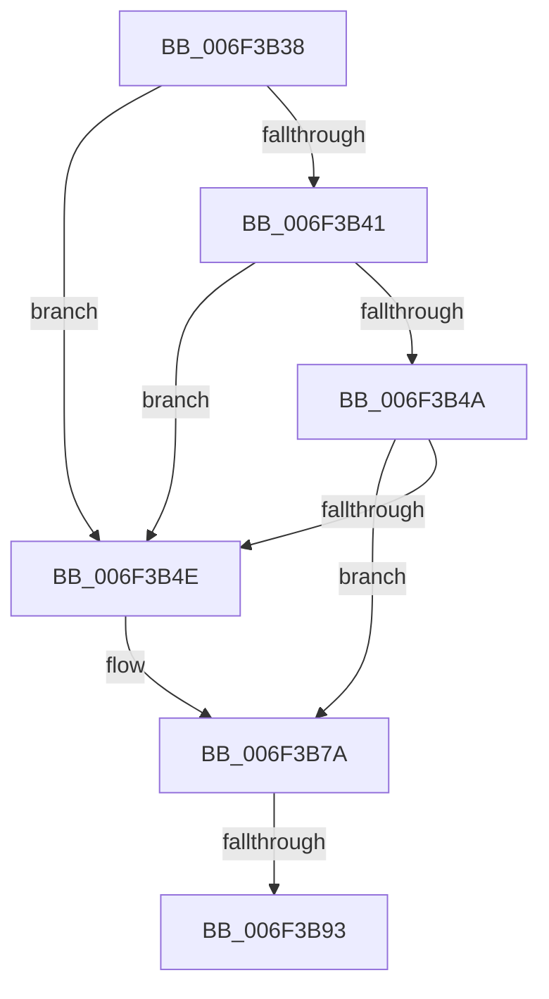

# sub_006F3B38

- RVA: `0x006F3B38`–`0x006F3B98` (길이 `96` bytes)
- VA: `0x00000001406F3B38`
- 실행 섹션: `.text`
- PDB 이름 있음: `아니요`; PDB Function 태그: `아니요`
- unwind 정보 RVA: `0x000ABD24`
- 디코드: `25`개 명령, `96/96` bytes 표시
- 미해석 바이트: `0` (있으면 어셈블리에 `.byte`로 보존)

> 이 문서는 커널 이미지의 기계어와 PDB 기호를 분석해 생성했습니다. 4번과 5번은 함수 원형과 자료형을 바이너리 사용 방식에서 추정한 C 해석이며 원본 소스 복구 결과는 아닙니다.

## 1. Dependencies

- 직접 호출 지점: **5**; 고유 호출 대상: **5**
- 직접 호출자로 확인된 함수: **0**
- RIP 상대 이미지 참조: **0**

### Outgoing calls
- `0x006F3B53` → [PipSetDevNodeUserFlags](../../page/8F/PipSetDevNodeUserFlags_function_008FB8FC.md) (function, `0x008FB8FC`)
- `0x006F3B61` → [IopRemoveDevice](../../page/8F/IopRemoveDevice_function_008FC7FC.md) (function, `0x008FC7FC`)
- `0x006F3B6B` → [PipClearDevNodeUserFlags](../../page/A2/PipClearDevNodeUserFlags_function_00A2ABC4.md) (function, `0x00A2ABC4`)
- `0x006F3B75` → [IopReleaseDeviceResources](../../page/A0/IopReleaseDeviceResources_function_00A0867C.md) (function, `0x00A0867C`)
- `0x006F3B82` → [PipSetDevNodeState](../47/PipSetDevNodeState_function_00470708.md) (function, `0x00470708`)

### Direct callers
- 이 함수 시작 RVA로 연결되는 직접 call은 확인되지 않았습니다. 간접 호출은 완전히 역산할 수 없습니다.

### Static image references
- 디코드된 RIP-relative 메모리 참조가 없습니다.

## 2. Other-region calls and transfers

- 다른 실행 섹션으로 향하는 call: **4**
  - `0x006F3B53` → [PipSetDevNodeUserFlags](../../page/8F/PipSetDevNodeUserFlags_function_008FB8FC.md) (`.text` → `PAGE`)
  - `0x006F3B61` → [IopRemoveDevice](../../page/8F/IopRemoveDevice_function_008FC7FC.md) (`.text` → `PAGE`)
  - `0x006F3B6B` → [PipClearDevNodeUserFlags](../../page/A2/PipClearDevNodeUserFlags_function_00A2ABC4.md) (`.text` → `PAGE`)
  - `0x006F3B75` → [IopReleaseDeviceResources](../../page/A0/IopReleaseDeviceResources_function_00A0867C.md) (`.text` → `PAGE`)
- call이 아닌 외부 분기/꼬리 이동: **2**
  - `0x006F3B8D` → [PnpRemoveLockedDeviceNode + 0x3A3](../47/PnpRemoveLockedDeviceNode_function_004702AC.md) (`tail-transfer`)
  - `0x006F3B93` → [PnpRemoveLockedDeviceNode + 0x42](../47/PnpRemoveLockedDeviceNode_function_004702AC.md) (`tail-transfer`)

## 3. Assembly (complete function range)

```asm
006F3B38  4C 39 B7 A0 01 00 00            cmp qword ptr [rdi + 0x1a0], r14
006F3B3F  75 0D                           jne 0x1406f3b4e
006F3B41  4C 39 B7 20 02 00 00            cmp qword ptr [rdi + 0x220], r14
006F3B48  75 04                           jne 0x1406f3b4e
006F3B4A  A8 40                           test al, 0x40
006F3B4C  74 2C                           je 0x1406f3b7a
006F3B4E  8B D5                           mov edx, ebp
006F3B50  48 8B CF                        mov rcx, rdi
006F3B53  E8 A4 7D 20 00                  call 0x1408fb8fc
006F3B58  48 8B 4F 20                     mov rcx, qword ptr [rdi + 0x20]
006F3B5C  BA 02 00 00 00                  mov edx, 2
006F3B61  E8 96 8C 20 00                  call 0x1408fc7fc
006F3B66  8B D5                           mov edx, ebp
006F3B68  48 8B CF                        mov rcx, rdi
006F3B6B  E8 54 70 33 00                  call 0x140a2abc4
006F3B70  33 D2                           xor edx, edx
006F3B72  48 8B CF                        mov rcx, rdi
006F3B75  E8 02 4B 31 00                  call 0x140a0867c
006F3B7A  BA 16 03 00 00                  mov edx, 0x316
006F3B7F  48 8B CF                        mov rcx, rdi
006F3B82  E8 81 CB D7 FF                  call 0x140470708
006F3B87  48 8B FE                        mov rdi, rsi
006F3B8A  48 85 F6                        test rsi, rsi
006F3B8D  0F 85 BC CA D7 FF               jne 0x14047064f
006F3B93  E9 56 C7 D7 FF                  jmp 0x1404702ee
```

## 4. C-style interpretation (structured pseudocode)

```c
__int64 __fastcall sub_006F3B38(void)
{
    __int64 result;

    if ((*(unsigned __int64 *)(v_rdi + 416)) != v_r14) goto loc_006F3B4E;
    if ((*(unsigned __int64 *)(v_rdi + 544)) != v_r14) goto loc_006F3B4E;
    if ((((unsigned __int8)(result)) & (64)) != 0) {
        a2 = (unsigned int)(v_rbp);
        a1 = v_rdi;
        result = PipSetDevNodeUserFlags(a1, a2, a3, a4);
        a1 = *(unsigned __int64 *)(v_rdi + 32);
        a2 = 2;
        result = IopRemoveDevice(a1, a2, a3, a4);
        a2 = (unsigned int)(v_rbp);
        a1 = v_rdi;
        result = PipClearDevNodeUserFlags(a1, a2, a3, a4);
        a2 = 0;
        a1 = v_rdi;
        result = IopReleaseDeviceResources(a1, a2, a3, a4);
    }
    result = PipSetDevNodeState(v_rdi, 790, a3, a4);
}
```

## 5. (Beta) C Style

```c
void sub_006F3B38(void)
{
    int64_t result;

    if ((*(uint64_t *)(local_rdi + 0x1A0)) != local_r14) goto loc_006F3B4E;
    if ((*(uint64_t *)(local_rdi + 0x220)) != local_r14) goto loc_006F3B4E;
    if ((((uint8_t)(result)) & (64)) != 0) {
        a2 = (uint32_t)(local_rbp);
        a1 = local_rdi;
        result = PipSetDevNodeUserFlags(a1, a2, a3, a4);
        a1 = *(uint64_t *)(local_rdi + 0x20);
        a2 = 2;
        result = IopRemoveDevice(a1, a2, a3, a4);
        a2 = (uint32_t)(local_rbp);
        a1 = local_rdi;
        result = PipClearDevNodeUserFlags(a1, a2, a3, a4);
        a2 = 0;
        a1 = local_rdi;
        result = IopReleaseDeviceResources(a1, a2, a3, a4);
    }
    result = PipSetDevNodeState(local_rdi, 790, a3, a4);
}
```

## 6. Execution-region graph

[열기: 2D/3D 그래프와 함수 탐색 컨트롤 패널](../../../control-panel.html?section=text&rva=0x006F3B38&view=graph)

- 2D 그래프는 위에서 아래로 흐르고, 3D 그래프는 빈 공간을 드래그해 회전합니다. Shift+드래그는 이동, 휠은 확대·축소, 함수 노드 선택은 대상 보고서 이동입니다.

### Static fallback


