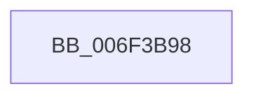

# sub_006F3B98

- RVA: `0x006F3B98`–`0x006F3C0A` (길이 `114` bytes)
- VA: `0x00000001406F3B98`
- 실행 섹션: `.text`
- PDB 이름 있음: `아니요`; PDB Function 태그: `아니요`
- unwind 정보 RVA: `0x000ABD7C`
- 디코드: `20`개 명령, `114/114` bytes 표시
- 미해석 바이트: `0` (있으면 어셈블리에 `.byte`로 보존)

> 이 문서는 커널 이미지의 기계어와 PDB 기호를 분석해 생성했습니다. 4번과 5번은 함수 원형과 자료형을 바이너리 사용 방식에서 추정한 C 해석이며 원본 소스 복구 결과는 아닙니다.

## 1. Dependencies

- 직접 호출 지점: **2**; 고유 호출 대상: **2**
- 직접 호출자로 확인된 함수: **0**
- RIP 상대 이미지 참조: **2**

### Outgoing calls
- `0x006F3BBA` → [tlgCreate1Sz_wchar_t](../42/tlgCreate1Sz_wchar_t_function_00426198.md) (function, `0x00426198`)
- `0x006F3BFF` → [tlgWriteEx_EtwWriteEx](../4A/tlgWriteEx_EtwWriteEx_function_004AA348.md) (function, `0x004AA348`)

### Direct callers
- 이 함수 시작 RVA로 연결되는 직접 call은 확인되지 않았습니다. 간접 호출은 완전히 역산할 수 없습니다.

### Static image references
- `0x006F3BD1` → RVA `0x0004C1C7` (`.rdata`; read)
- `0x006F3BEA` → RVA `0x00E07748` (`.data`; read)

## 2. Other-region calls and transfers

- 다른 실행 섹션으로 향하는 call: **0**
- call이 아닌 외부 분기/꼬리 이동: **1**
  - `0x006F3C05` → [PopDiagTraceDIrpAfterSx + 0x6B](../47/PopDiagTraceDIrpAfterSx_function_00470D88.md) (`tail-transfer`)

## 3. Assembly (complete function range)

```asm
006F3B98  41 8B 83 C0 00 00 00            mov eax, dword ptr [r11 + 0xc0]
006F3B9F  48 8D 4D 80                     lea rcx, [rbp - 0x80]
006F3BA3  89 44 24 40                     mov dword ptr [rsp + 0x40], eax
006F3BA7  48 8D 44 24 40                  lea rax, [rsp + 0x40]
006F3BAC  48 89 44 24 70                  mov qword ptr [rsp + 0x70], rax
006F3BB1  48 C7 44 24 78 04 00 00 00      mov qword ptr [rsp + 0x78], 4
006F3BBA  E8 D9 25 D3 FF                  call 0x140426198
006F3BBF  48 8D 44 24 48                  lea rax, [rsp + 0x48]
006F3BC4  48 C7 44 24 48 00 00 00 01      mov qword ptr [rsp + 0x48], 0x1000000
006F3BCD  48 89 45 90                     mov qword ptr [rbp - 0x70], rax
006F3BD1  48 8D 15 EF 85 95 FF            lea rdx, [rip - 0x6a7a11]
006F3BD8  48 8D 44 24 50                  lea rax, [rsp + 0x50]
006F3BDD  48 C7 45 98 08 00 00 00         mov qword ptr [rbp - 0x68], 8
006F3BE5  48 89 44 24 38                  mov qword ptr [rsp + 0x38], rax
006F3BEA  48 8D 0D 57 3B 71 00            lea rcx, [rip + 0x713b57]
006F3BF1  41 B9 01 00 00 00               mov r9d, 1
006F3BF7  C7 44 24 30 05 00 00 00         mov dword ptr [rsp + 0x30], 5
006F3BFF  E8 44 67 DB FF                  call 0x1404aa348
006F3C04  90                              nop
006F3C05  E9 E9 D1 D7 FF                  jmp 0x140470df3
```

## 4. C-style interpretation (structured pseudocode)

```c
__int64 __fastcall sub_006F3B98(__int64 a1, __int64 a2, __int64 a3, __int64 a4, __int64 a5, __int64 a6, __int64 a7, __int64 a8, __int64 a9, __int64 a10)
{
    __int64 result;
    unsigned int v_stack_p30;
    unsigned __int64 v_stack_p38;
    unsigned int v_stack_p40;
    unsigned __int64 v_stack_p48;
    unsigned __int64 v_stack_p70;
    unsigned __int64 v_stack_p78;

    v_stack_p40 = (unsigned int)((unsigned int)(*(unsigned int *)(v_r11 + 192)));
    v_stack_p70 = a8;
    v_stack_p78 = 4;
    result = tlgCreate1Sz_wchar_t(v_rbp - 128, a2, a3, a4);
    v_stack_p48 = 0x1000000ULL;
    *(unsigned __int64 *)(v_rbp - 112) = a9;
    *(unsigned __int64 *)(v_rbp - 104) = 8;
    v_stack_p38 = a10;
    v_stack_p30 = 5;
    result = tlgWriteEx_EtwWriteEx(v_rip + 7420759, v_rip - 6978065, a3, 1);
}
```

## 5. (Beta) C Style

```c
int64_t sub_006F3B98(int64_t Arg1, int64_t Arg2, int64_t Arg3, int64_t Arg4, uint64_t Arg5, uint64_t Arg6, uint64_t Arg7, int64_t Arg8, int64_t Arg9, int64_t Arg10)
{
    int64_t result;
    uint32_t v_stack_p30;
    uint64_t v_stack_p38;
    uint32_t v_stack_p40;
    uint64_t v_stack_p48;
    uint64_t v_stack_p70;
    uint64_t v_stack_p78;

    v_stack_p40 = (uint32_t)((uint32_t)(*(uint32_t *)(local_r11 + 0xC0)));
    v_stack_p70 = Arg8;
    v_stack_p78 = 4;
    result = tlgCreate1Sz_wchar_t(local_rbp - 128, Arg2, Arg3, Arg4);
    v_stack_p48 = 0x1000000ULL;
    *(uint64_t *)(local_rbp - 0x70) = Arg9;
    *(uint64_t *)(local_rbp - 0x68) = 8;
    v_stack_p38 = Arg10;
    v_stack_p30 = 5;
    result = tlgWriteEx_EtwWriteEx(v_rip + 7420759, v_rip - 6978065, Arg3, 1);
}
```

## 6. Execution-region graph

[열기: 2D/3D 그래프와 함수 탐색 컨트롤 패널](../../../control-panel.html?section=text&rva=0x006F3B98&view=graph)

- 2D 그래프는 위에서 아래로 흐르고, 3D 그래프는 빈 공간을 드래그해 회전합니다. Shift+드래그는 이동, 휠은 확대·축소, 함수 노드 선택은 대상 보고서 이동입니다.

### Static fallback


