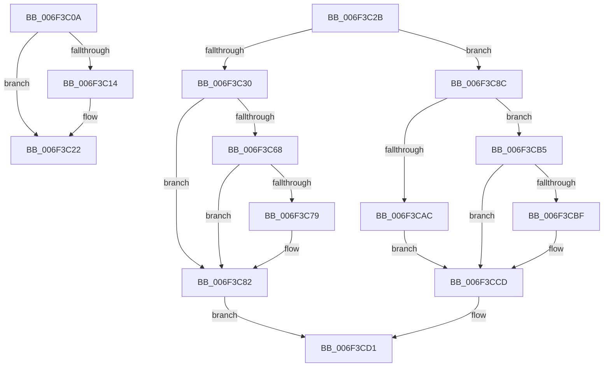

# sub_006F3C0A

- RVA: `0x006F3C0A`–`0x006F3CDF` (길이 `213` bytes)
- VA: `0x00000001406F3C0A`
- 실행 섹션: `.text`
- PDB 이름 있음: `아니요`; PDB Function 태그: `아니요`
- unwind 정보 RVA: `0x000ABE74`
- 디코드: `53`개 명령, `213/213` bytes 표시
- 미해석 바이트: `0` (있으면 어셈블리에 `.byte`로 보존)

> 이 문서는 커널 이미지의 기계어와 PDB 기호를 분석해 생성했습니다. 4번과 5번은 함수 원형과 자료형을 바이너리 사용 방식에서 추정한 C 해석이며 원본 소스 복구 결과는 아닙니다.

## 1. Dependencies

- 직접 호출 지점: **3**; 고유 호출 대상: **3**
- 직접 호출자로 확인된 함수: **0**
- RIP 상대 이미지 참조: **1**

### Outgoing calls
- `0x006F3C7D` → [KiRaiseIrqlProcessIrqlFlags](../4F/KiRaiseIrqlProcessIrqlFlags_function_004F56FC.md) (function, `0x004F56FC`)
- `0x006F3C85` → [MmGetPhysicalAddress](../23/MmGetPhysicalAddress_function_0023A500.md) (function, `0x0023A500`)
- `0x006F3C92` → [KeDisableInterrupts](../21/KeDisableInterrupts_function_00217BE0.md) (function, `0x00217BE0`)

### Direct callers
- 이 함수 시작 RVA로 연결되는 직접 call은 확인되지 않았습니다. 간접 호출은 완전히 역산할 수 없습니다.

### Static image references
- `0x006F3C70` → RVA `0x00FC6D20` (`ALMOSTRO`; read)

## 2. Other-region calls and transfers

- 다른 실행 섹션으로 향하는 call: **0**
- call이 아닌 외부 분기/꼬리 이동: **2**
  - `0x006F3C26` → [HvlpAcquireHypercallPage + 0x67](../47/HvlpAcquireHypercallPage_function_00471410.md) (`tail-transfer`)
  - `0x006F3CDA` → [HvlpAcquireHypercallPage + 0x6B](../47/HvlpAcquireHypercallPage_function_00471410.md) (`tail-transfer`)

## 3. Assembly (complete function range)

```asm
006F3C0A  B9 02 00 00 00                  mov ecx, 2
006F3C0F  40 84 F1                        test cl, sil
006F3C12  74 0E                           je 0x1406f3c22
006F3C14  48 8B 98 00 8C 00 00            mov rbx, qword ptr [rax + 0x8c00]
006F3C1B  48 81 C3 00 10 00 00            add rbx, 0x1000
006F3C22  48 8B 43 10                     mov rax, qword ptr [rbx + 0x10]
006F3C26  E9 4C D8 D7 FF                  jmp 0x140471477
006F3C2B  4D 85 F6                        test r14, r14
006F3C2E  74 5C                           je 0x1406f3c8c
006F3C30  48 C7 C2 00 F0 FF FF            mov rdx, 0xfffffffffffff000
006F3C37  49 8D 4E 07                     lea rcx, [r14 + 7]
006F3C3B  48 83 E1 F8                     and rcx, 0xfffffffffffffff8
006F3C3F  49 8D 5F FF                     lea rbx, [r15 - 1]
006F3C43  48 03 D9                        add rbx, rcx
006F3C46  48 8B C3                        mov rax, rbx
006F3C49  48 23 DA                        and rbx, rdx
006F3C4C  48 33 C1                        xor rax, rcx
006F3C4F  48 85 C2                        test rdx, rax
006F3C52  48 0F 44 D9                     cmove rbx, rcx
006F3C56  B9 02 00 00 00                  mov ecx, 2
006F3C5B  89 0F                           mov dword ptr [rdi], ecx
006F3C5D  44 0F 20 C0                     mov rax, cr8
006F3C61  88 47 08                        mov byte ptr [rdi + 8], al
006F3C64  3A C1                           cmp al, cl
006F3C66  73 1A                           jae 0x1406f3c82
006F3C68  44 0F 20 C0                     mov rax, cr8
006F3C6C  44 0F 22 C1                     mov cr8, rcx
006F3C70  83 3D A9 30 8D 00 00            cmp dword ptr [rip + 0x8d30a9], 0
006F3C77  74 09                           je 0x1406f3c82
006F3C79  8A D1                           mov dl, cl
006F3C7B  8A C8                           mov cl, al
006F3C7D  E8 7A 1A E0 FF                  call 0x1404f56fc
006F3C82  48 8B CB                        mov rcx, rbx
006F3C85  E8 76 68 B4 FF                  call 0x14023a500
006F3C8A  EB 45                           jmp 0x1406f3cd1
006F3C8C  C7 07 04 00 00 00               mov dword ptr [rdi], 4
006F3C92  E8 49 3F B2 FF                  call 0x140217be0
006F3C97  88 47 08                        mov byte ptr [rdi + 8], al
006F3C9A  89 77 0C                        mov dword ptr [rdi + 0xc], esi
006F3C9D  65 48 8B 04 25 20 00 00 00      mov rax, qword ptr gs:[0x20]
006F3CA6  40 F6 C6 01                     test sil, 1
006F3CAA  74 09                           je 0x1406f3cb5
006F3CAC  48 8B 98 00 8C 00 00            mov rbx, qword ptr [rax + 0x8c00]
006F3CB3  EB 18                           jmp 0x1406f3ccd
006F3CB5  B9 02 00 00 00                  mov ecx, 2
006F3CBA  40 84 F1                        test cl, sil
006F3CBD  74 0E                           je 0x1406f3ccd
006F3CBF  48 8B 98 00 8C 00 00            mov rbx, qword ptr [rax + 0x8c00]
006F3CC6  48 81 C3 00 10 00 00            add rbx, 0x1000
006F3CCD  48 8B 43 10                     mov rax, qword ptr [rbx + 0x10]
006F3CD1  B9 18 00 00 00                  mov ecx, 0x18
006F3CD6  48 89 04 0F                     mov qword ptr [rdi + rcx], rax
006F3CDA  E9 9C D7 D7 FF                  jmp 0x14047147b
```

## 4. C-style interpretation (structured pseudocode)

```c
__int64 __fastcall sub_006F3C0A(void)
{
    __int64 v_rbx;

    if (((2) & ((unsigned __int8)(v_rsi))) != 0) {
        v_rbx = *(unsigned __int64 *)(result + 35840);
        v_rbx = (v_rbx) + (0x1000ULL);
    }
}
```

## 5. (Beta) C Style

```c
void sub_006F3C0A(void)
{
    int64_t local_rbx;

    if (((2) & ((uint8_t)(local_rsi))) != 0) {
        local_rbx = *(uint64_t *)(result + 0x8C00);
        local_rbx = (local_rbx) + (0x1000ULL);
    }
}
```

## 6. Execution-region graph

[열기: 2D/3D 그래프와 함수 탐색 컨트롤 패널](../../../control-panel.html?section=text&rva=0x006F3C0A&view=graph)

- 2D 그래프는 위에서 아래로 흐르고, 3D 그래프는 빈 공간을 드래그해 회전합니다. Shift+드래그는 이동, 휠은 확대·축소, 함수 노드 선택은 대상 보고서 이동입니다.

### Static fallback


