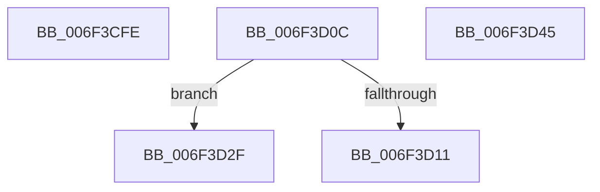

# sub_006F3CFE

- RVA: `0x006F3CFE`–`0x006F3D52` (길이 `84` bytes)
- VA: `0x00000001406F3CFE`
- 실행 섹션: `.text`
- PDB 이름 있음: `아니요`; PDB Function 태그: `아니요`
- unwind 정보 RVA: `0x000AC474`
- 디코드: `23`개 명령, `84/84` bytes 표시
- 미해석 바이트: `0` (있으면 어셈블리에 `.byte`로 보존)

> 이 문서는 커널 이미지의 기계어와 PDB 기호를 분석해 생성했습니다. 4번과 5번은 함수 원형과 자료형을 바이너리 사용 방식에서 추정한 C 해석이며 원본 소스 복구 결과는 아닙니다.

## 1. Dependencies

- 직접 호출 지점: **3**; 고유 호출 대상: **3**
- 직접 호출자로 확인된 함수: **0**
- RIP 상대 이미지 참조: **0**

### Outgoing calls
- `0x006F3D01` → [ExAcquireSpinLockExclusiveAtDpcLevel](../24/ExAcquireSpinLockExclusiveAtDpcLevel_function_00248E80.md) (function, `0x00248E80`)
- `0x006F3D24` → [MiUpdateLargePageCandidateValue](../33/MiUpdateLargePageCandidateValue_function_0033EF80.md) (function, `0x0033EF80`)
- `0x006F3D3A` → [MiUpdateLargePageCandidates](../37/MiUpdateLargePageCandidates_function_003798C0.md) (function, `0x003798C0`)

### Direct callers
- 이 함수 시작 RVA로 연결되는 직접 call은 확인되지 않았습니다. 간접 호출은 완전히 역산할 수 없습니다.

### Static image references
- 디코드된 RIP-relative 메모리 참조가 없습니다.

## 2. Other-region calls and transfers

- 다른 실행 섹션으로 향하는 call: **0**
- call이 아닌 외부 분기/꼬리 이동: **4**
  - `0x006F3D07` → [MiMirrorZeroFreeListsCallback + 0x8A](../47/MiMirrorZeroFreeListsCallback_function_00471DF0.md) (`tail-transfer`)
  - `0x006F3D2A` → [MiMirrorZeroFreeListsCallback + 0xD6](../47/MiMirrorZeroFreeListsCallback_function_00471DF0.md) (`tail-transfer`)
  - `0x006F3D40` → [MiMirrorZeroFreeListsCallback + 0xD6](../47/MiMirrorZeroFreeListsCallback_function_00471DF0.md) (`tail-transfer`)
  - `0x006F3D4D` → [MiMirrorZeroFreeListsCallback + 0x116](../47/MiMirrorZeroFreeListsCallback_function_00471DF0.md) (`tail-transfer`)

## 3. Assembly (complete function range)

```asm
006F3CFE  48 8B CB                        mov rcx, rbx
006F3D01  E8 7A 51 B5 FF                  call 0x140248e80
006F3D06  90                              nop
006F3D07  E9 6E E1 D7 FF                  jmp 0x140471e7a
006F3D0C  83 FE 03                        cmp esi, 3
006F3D0F  75 1E                           jne 0x1406f3d2f
006F3D11  48 83 64 24 20 00               and qword ptr [rsp + 0x20], 0
006F3D17  44 8D 4E FE                     lea r9d, [rsi - 2]
006F3D1B  44 8B C6                        mov r8d, esi
006F3D1E  48 8B D0                        mov rdx, rax
006F3D21  48 8B CD                        mov rcx, rbp
006F3D24  E8 57 B2 C4 FF                  call 0x14033ef80
006F3D29  90                              nop
006F3D2A  E9 97 E1 D7 FF                  jmp 0x140471ec6
006F3D2F  41 B8 01 00 00 00               mov r8d, 1
006F3D35  8B D6                           mov edx, esi
006F3D37  48 8B C8                        mov rcx, rax
006F3D3A  E8 81 5B C8 FF                  call 0x1403798c0
006F3D3F  90                              nop
006F3D40  E9 81 E1 D7 FF                  jmp 0x140471ec6
006F3D45  40 0F B6 CD                     movzx ecx, bpl
006F3D49  44 0F 22 C1                     mov cr8, rcx
006F3D4D  E9 B4 E1 D7 FF                  jmp 0x140471f06
```

## 4. C-style interpretation (structured pseudocode)

```c
__int64 __fastcall sub_006F3CFE(void)
{
    __int64 result;
    unsigned __int64 v_stack_p20;

    result = ExAcquireSpinLockExclusiveAtDpcLevel(v_rbx, a2, a3, a4);
}
```

## 5. (Beta) C Style

```c
void sub_006F3CFE(void)
{
    int64_t result;
    uint64_t v_stack_p20;

    result = ExAcquireSpinLockExclusiveAtDpcLevel(local_rbx, a2, a3, a4);
}
```

## 6. Execution-region graph

[열기: 2D/3D 그래프와 함수 탐색 컨트롤 패널](../../../control-panel.html?section=text&rva=0x006F3CFE&view=graph)

- 2D 그래프는 위에서 아래로 흐르고, 3D 그래프는 빈 공간을 드래그해 회전합니다. Shift+드래그는 이동, 휠은 확대·축소, 함수 노드 선택은 대상 보고서 이동입니다.

### Static fallback


