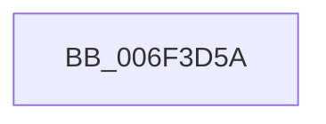

# sub_006F3D5A

- RVA: `0x006F3D5A`–`0x006F3D91` (길이 `55` bytes)
- VA: `0x00000001406F3D5A`
- 실행 섹션: `.text`
- PDB 이름 있음: `아니요`; PDB Function 태그: `아니요`
- unwind 정보 RVA: `0x000AC534`
- 디코드: `14`개 명령, `55/55` bytes 표시
- 미해석 바이트: `0` (있으면 어셈블리에 `.byte`로 보존)

> 이 문서는 커널 이미지의 기계어와 PDB 기호를 분석해 생성했습니다. 4번과 5번은 함수 원형과 자료형을 바이너리 사용 방식에서 추정한 C 해석이며 원본 소스 복구 결과는 아닙니다.

## 1. Dependencies

- 직접 호출 지점: **2**; 고유 호출 대상: **2**
- 직접 호출자로 확인된 함수: **0**
- RIP 상대 이미지 참조: **0**

### Outgoing calls
- `0x006F3D71` → [XmGetOffsetAddress](../57/XmGetOffsetAddress_function_00578B84.md) (function, `0x00578B84`)
- `0x006F3D7C` → [XmSetSourceValue](../47/XmSetSourceValue_function_004737A8.md) (function, `0x004737A8`)

### Direct callers
- 이 함수 시작 RVA로 연결되는 직접 call은 확인되지 않았습니다. 간접 호출은 완전히 역산할 수 없습니다.

### Static image references
- 디코드된 RIP-relative 메모리 참조가 없습니다.

## 2. Other-region calls and transfers

- 다른 실행 섹션으로 향하는 call: **0**
- call이 아닌 외부 분기/꼬리 이동: **1**
  - `0x006F3D8C` → [XmGroup45General + 0x53](../47/XmGroup45General_function_00472A80.md) (`tail-transfer`)

## 3. Assembly (complete function range)

```asm
006F3D5A  8B 5F 78                        mov ebx, dword ptr [rdi + 0x78]
006F3D5D  48 8B CF                        mov rcx, rdi
006F3D60  8B 97 80 00 00 00               mov edx, dword ptr [rdi + 0x80]
006F3D66  FF C2                           inc edx
006F3D68  C7 47 78 01 00 00 00            mov dword ptr [rdi + 0x78], 1
006F3D6F  03 D3                           add edx, ebx
006F3D71  E8 0E 4E E8 FF                  call 0x140578b84
006F3D76  48 8B D0                        mov rdx, rax
006F3D79  48 8B CF                        mov rcx, rdi
006F3D7C  E8 27 FA D7 FF                  call 0x1404737a8
006F3D81  0F B7 4F 6C                     movzx ecx, word ptr [rdi + 0x6c]
006F3D85  66 89 4F 52                     mov word ptr [rdi + 0x52], cx
006F3D89  89 5F 78                        mov dword ptr [rdi + 0x78], ebx
006F3D8C  E9 42 ED D7 FF                  jmp 0x140472ad3
```

## 4. C-style interpretation (structured pseudocode)

```c
__int64 __fastcall sub_006F3D5A(void)
{
    __int64 result;

    a2 = (unsigned int)(((unsigned int)(*(unsigned int *)(v_rdi + 128))) + 1);
    *(unsigned int *)(v_rdi + 120) = 1;
    a2 = (unsigned int)((a2) + ((unsigned int)((unsigned int)(*(unsigned int *)(v_rdi + 120)))));
    result = XmGetOffsetAddress(v_rdi, a2, a3, a4);
    result = XmSetSourceValue(v_rdi, result, a3, a4);
    *(unsigned __int16 *)(v_rdi + 82) = (unsigned __int16)(*(unsigned __int16 *)(v_rdi + 108));
    *(unsigned int *)(v_rdi + 120) = (unsigned int)((unsigned int)(*(unsigned int *)(v_rdi + 120)));
}
```

## 5. (Beta) C Style

```c
void sub_006F3D5A(void)
{
    int64_t result;

    a2 = (uint32_t)(((uint32_t)(*(uint32_t *)(local_rdi + 0x80))) + 1);
    *(uint32_t *)(local_rdi + 0x78) = 1;
    a2 = (uint32_t)((a2) + ((uint32_t)((uint32_t)(*(uint32_t *)(local_rdi + 0x78)))));
    result = XmGetOffsetAddress(local_rdi, a2, a3, a4);
    result = XmSetSourceValue(local_rdi, result, a3, a4);
    *(uint16_t *)(local_rdi + 0x52) = (uint16_t)(*(uint16_t *)(local_rdi + 0x6C));
    *(uint32_t *)(local_rdi + 0x78) = (uint32_t)((uint32_t)(*(uint32_t *)(local_rdi + 0x78)));
}
```

## 6. Execution-region graph

[열기: 2D/3D 그래프와 함수 탐색 컨트롤 패널](../../../control-panel.html?section=text&rva=0x006F3D5A&view=graph)

- 2D 그래프는 위에서 아래로 흐르고, 3D 그래프는 빈 공간을 드래그해 회전합니다. Shift+드래그는 이동, 휠은 확대·축소, 함수 노드 선택은 대상 보고서 이동입니다.

### Static fallback


