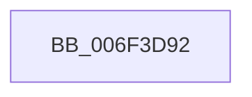

# sub_006F3D92

- RVA: `0x006F3D92`–`0x006F3DB5` (길이 `35` bytes)
- VA: `0x00000001406F3D92`
- 실행 섹션: `.text`
- PDB 이름 있음: `아니요`; PDB Function 태그: `아니요`
- unwind 정보 RVA: `0x000AC564`
- 디코드: `9`개 명령, `35/35` bytes 표시
- 미해석 바이트: `0` (있으면 어셈블리에 `.byte`로 보존)

> 이 문서는 커널 이미지의 기계어와 PDB 기호를 분석해 생성했습니다. 4번과 5번은 함수 원형과 자료형을 바이너리 사용 방식에서 추정한 C 해석이며 원본 소스 복구 결과는 아닙니다.

## 1. Dependencies

- 직접 호출 지점: **0**; 고유 호출 대상: **0**
- 직접 호출자로 확인된 함수: **0**
- RIP 상대 이미지 참조: **0**

### Outgoing calls
- 직접 디코드된 call 명령이 없습니다.

### Direct callers
- 이 함수 시작 RVA로 연결되는 직접 call은 확인되지 않았습니다. 간접 호출은 완전히 역산할 수 없습니다.

### Static image references
- 디코드된 RIP-relative 메모리 참조가 없습니다.

## 2. Other-region calls and transfers

- 다른 실행 섹션으로 향하는 call: **0**
- call이 아닌 외부 분기/꼬리 이동: **1**
  - `0x006F3DB0` → [XmAddOperands + 0x43](../47/XmAddOperands_function_00472EA0.md) (`tail-transfer`)

## 3. Assembly (complete function range)

```asm
006F3D92  66 03 51 6C                     add dx, word ptr [rcx + 0x6c]
006F3D96  BE 0F 00 00 00                  mov esi, 0xf
006F3D9B  0F B7 49 68                     movzx ecx, word ptr [rcx + 0x68]
006F3D9F  8D 04 11                        lea eax, [rcx + rdx]
006F3DA2  66 3B C1                        cmp ax, cx
006F3DA5  66 89 44 24 38                  mov word ptr [rsp + 0x38], ax
006F3DAA  0F 92 C3                        setb bl
006F3DAD  66 3B D7                        cmp dx, di
006F3DB0  E9 2E F1 D7 FF                  jmp 0x140472ee3
```

## 4. C-style interpretation (structured pseudocode)

```c
__int64 __fastcall sub_006F3D92(__int64 a1, unsigned __int16 a2)
{
    __int64 v_rbx;
    unsigned __int16 v_stack_p38;

    a2 = (unsigned __int16)((a2) + (*(unsigned __int16 *)(a1 + 108)));
    v_stack_p38 = (unsigned __int16)(*(unsigned __int16 *)(a1 + 104) + a2 * 1);
    v_rbx = (((unsigned __int16)(*(unsigned __int16 *)(a1 + 104) + a2 * 1)) < ((unsigned __int16)(*(unsigned __int16 *)(a1 + 104)))) ? 1 : 0;
}
```

## 5. (Beta) C Style

```c
int64_t sub_006F3D92(void *Arg1, uint16_t Arg2)
{
    uint8_t *arg1 = (uint8_t *)Arg1;

    int64_t local_rbx;
    uint16_t v_stack_p38;

    Arg2 = (uint16_t)((Arg2) + (*(uint16_t *)(arg1 + 0x6C)));
    v_stack_p38 = (uint16_t)(*(uint16_t *)(arg1 + 0x68) + Arg2 * 1);
    local_rbx = (((uint16_t)(*(uint16_t *)(arg1 + 0x68) + Arg2 * 1)) < ((uint16_t)(*(uint16_t *)(arg1 + 0x68)))) ? 1 : 0;
}
```

### 관측된 메모리 오프셋

구조체 형식이 확인되지 않은 접근은 인자 기준의 오프셋으로만 기록했습니다.

| 기준 인자 | 오프셋 표현 | 폭 (bit) | 접근 |
|---|---:|---:|---|
| `Arg1` | `+ 0x68` | `16` | `R` |
| `Arg1` | `+ 0x6C` | `16` | `R` |

## 6. Execution-region graph

[열기: 2D/3D 그래프와 함수 탐색 컨트롤 패널](../../../control-panel.html?section=text&rva=0x006F3D92&view=graph)

- 2D 그래프는 위에서 아래로 흐르고, 3D 그래프는 빈 공간을 드래그해 회전합니다. Shift+드래그는 이동, 휠은 확대·축소, 함수 노드 선택은 대상 보고서 이동입니다.

### Static fallback


