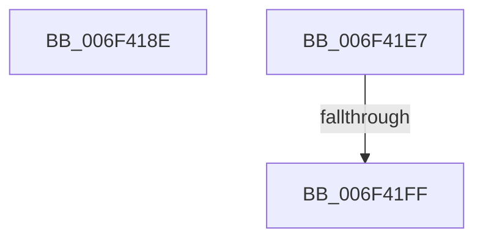

# sub_006F418E

- RVA: `0x006F418E`–`0x006F4219` (길이 `139` bytes)
- VA: `0x00000001406F418E`
- 실행 섹션: `.text`
- PDB 이름 있음: `아니요`; PDB Function 태그: `아니요`
- unwind 정보 RVA: `0x000AC7B4`
- 디코드: `34`개 명령, `139/139` bytes 표시
- 미해석 바이트: `0` (있으면 어셈블리에 `.byte`로 보존)

> 이 문서는 커널 이미지의 기계어와 PDB 기호를 분석해 생성했습니다. 4번과 5번은 함수 원형과 자료형을 바이너리 사용 방식에서 추정한 C 해석이며 원본 소스 복구 결과는 아닙니다.

## 1. Dependencies

- 직접 호출 지점: **3**; 고유 호출 대상: **3**
- 직접 호출자로 확인된 함수: **0**
- RIP 상대 이미지 참조: **2**

### Outgoing calls
- `0x006F41DC` → [tlgWriteTransfer_EtwWriteTransfer](../42/tlgWriteTransfer_EtwWriteTransfer_function_004260E0.md) (function, `0x004260E0`)
- `0x006F41F2` → [KiShouldRearmClockTimer](../39/KiShouldRearmClockTimer_function_0039E134.md) (function, `0x0039E134`)
- `0x006F420E` → [KiSetNextClockTickDueTime](../23/KiSetNextClockTickDueTime_function_002363F0.md) (function, `0x002363F0`)

### Direct callers
- 이 함수 시작 RVA로 연결되는 직접 call은 확인되지 않았습니다. 간접 호출은 완전히 역산할 수 없습니다.

### Static image references
- `0x006F41B1` → RVA `0x0004861A` (`.rdata`; read)
- `0x006F41CB` → RVA `0x00E070D8` (`.data`; read)

## 2. Other-region calls and transfers

- 다른 실행 섹션으로 향하는 call: **0**
- call이 아닌 외부 분기/꼬리 이동: **3**
  - `0x006F41E2` → [KiCancelClockTimer + 0x46](../47/KiCancelClockTimer_function_004743CC.md) (`tail-transfer`)
  - `0x006F41F9` → [KiCancelClockTimer + 0x4A](../47/KiCancelClockTimer_function_004743CC.md) (`tail-transfer`)
  - `0x006F4214` → [KiCancelClockTimer + 0x4A](../47/KiCancelClockTimer_function_004743CC.md) (`tail-transfer`)

## 3. Assembly (complete function range)

```asm
006F418E  83 65 33 00                     and dword ptr [rbp + 0x33], 0
006F4192  48 8D 45 FF                     lea rax, [rbp - 1]
006F4196  83 65 43 00                     and dword ptr [rbp + 0x43], 0
006F419A  B9 04 00 00 00                  mov ecx, 4
006F419F  48 89 45 27                     mov qword ptr [rbp + 0x27], rax
006F41A3  45 33 C9                        xor r9d, r9d
006F41A6  48 8D 45 F7                     lea rax, [rbp - 9]
006F41AA  89 55 FF                        mov dword ptr [rbp - 1], edx
006F41AD  48 89 45 37                     mov qword ptr [rbp + 0x37], rax
006F41B1  48 8D 15 62 44 95 FF            lea rdx, [rip - 0x6abb9e]
006F41B8  48 8D 45 07                     lea rax, [rbp + 7]
006F41BC  89 4D 2F                        mov dword ptr [rbp + 0x2f], ecx
006F41BF  48 89 44 24 28                  mov qword ptr [rsp + 0x28], rax
006F41C4  45 33 C0                        xor r8d, r8d
006F41C7  89 4C 24 20                     mov dword ptr [rsp + 0x20], ecx
006F41CB  48 8D 0D 06 2F 71 00            lea rcx, [rip + 0x712f06]
006F41D2  88 5D F7                        mov byte ptr [rbp - 9], bl
006F41D5  C7 45 3F 01 00 00 00            mov dword ptr [rbp + 0x3f], 1
006F41DC  E8 FF 1E D3 FF                  call 0x1404260e0
006F41E1  90                              nop
006F41E2  E9 2B 02 D8 FF                  jmp 0x140474412
006F41E7  33 DB                           xor ebx, ebx
006F41E9  41 B0 01                        mov r8b, 1
006F41EC  48 8B D3                        mov rdx, rbx
006F41EF  48 8B CF                        mov rcx, rdi
006F41F2  E8 3D 9F CA FF                  call 0x14039e134
006F41F7  84 C0                           test al, al
006F41F9  0F 84 17 02 D8 FF               je 0x140474416
006F41FF  B2 01                           mov dl, 1
006F4201  C7 87 90 95 00 00 02 00 00 00   mov dword ptr [rdi + 0x9590], 2
006F420B  48 8B CB                        mov rcx, rbx
006F420E  E8 DD 21 B4 FF                  call 0x1402363f0
006F4213  90                              nop
006F4214  E9 FD 01 D8 FF                  jmp 0x140474416
```

## 4. C-style interpretation (structured pseudocode)

```c
__int64 __fastcall sub_006F418E(__int64 a1, int a2, int a3, int a4)
{
    __int64 result;
    unsigned int v_stack_p20;
    unsigned __int64 v_stack_p28;

    *(unsigned __int64 *)(v_rbp + 39) = v_rbp - 1;
    a4 = 0;
    *(unsigned int *)(v_rbp - 1) = a2;
    *(unsigned __int64 *)(v_rbp + 55) = v_rbp - 9;
    *(unsigned int *)(v_rbp + 47) = 4;
    v_stack_p28 = v_rbp + 7;
    a3 = 0;
    v_stack_p20 = 4;
    *(unsigned __int8 *)(v_rbp - 9) = (unsigned __int8)(v_rbx);
    *(unsigned int *)(v_rbp + 63) = 1;
    result = tlgWriteTransfer_EtwWriteTransfer(v_rip + 7417606, v_rip - 6994846, a3, a4);
}
```

## 5. (Beta) C Style

```c
int64_t sub_006F418E(int64_t Arg1, int32_t Arg2, int32_t Arg3, int32_t Arg4)
{
    int64_t result;
    uint32_t v_stack_p20;
    uint64_t v_stack_p28;

    *(uint64_t *)(local_rbp + 0x27) = local_rbp - 1;
    Arg4 = 0;
    *(uint32_t *)(local_rbp - 0x1) = Arg2;
    *(uint64_t *)(local_rbp + 0x37) = local_rbp - 9;
    *(uint32_t *)(local_rbp + 0x2F) = 4;
    v_stack_p28 = local_rbp + 7;
    Arg3 = 0;
    v_stack_p20 = 4;
    *(uint8_t *)(local_rbp - 0x9) = (uint8_t)(local_rbx);
    *(uint32_t *)(local_rbp + 0x3F) = 1;
    result = tlgWriteTransfer_EtwWriteTransfer(v_rip + 7417606, v_rip - 6994846, Arg3, Arg4);
}
```

## 6. Execution-region graph

[열기: 2D/3D 그래프와 함수 탐색 컨트롤 패널](../../../control-panel.html?section=text&rva=0x006F418E&view=graph)

- 2D 그래프는 위에서 아래로 흐르고, 3D 그래프는 빈 공간을 드래그해 회전합니다. Shift+드래그는 이동, 휠은 확대·축소, 함수 노드 선택은 대상 보고서 이동입니다.

### Static fallback


