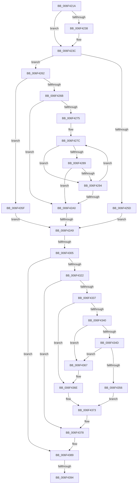

# sub_006F421A

- RVA: `0x006F421A`–`0x006F439C` (길이 `386` bytes)
- VA: `0x00000001406F421A`
- 실행 섹션: `.text`
- PDB 이름 있음: `아니요`; PDB Function 태그: `아니요`
- unwind 정보 RVA: `0x000ACB2C`
- 디코드: `105`개 명령, `386/386` bytes 표시
- 미해석 바이트: `0` (있으면 어셈블리에 `.byte`로 보존)

> 이 문서는 커널 이미지의 기계어와 PDB 기호를 분석해 생성했습니다. 4번과 5번은 함수 원형과 자료형을 바이너리 사용 방식에서 추정한 C 해석이며 원본 소스 복구 결과는 아닙니다.

## 1. Dependencies

- 직접 호출 지점: **4**; 고유 호출 대상: **4**
- 직접 호출자로 확인된 함수: **0**
- RIP 상대 이미지 참조: **0**

### Outgoing calls
- `0x006F42F6` → [MiQueuePageFileExtension](../48/MiQueuePageFileExtension_function_0048187C.md) (function, `0x0048187C`)
- `0x006F4316` → [KeWaitForSingleObject](../20/KeWaitForSingleObject_function_0020E6B0.md) (function, `0x0020E6B0`)
- `0x006F4329` → [ExAcquireSpinLockExclusive](../24/ExAcquireSpinLockExclusive_function_00248690.md) (function, `0x00248690`)
- `0x006F4384` → [MiReleaseSpinLockExclusive](../24/MiReleaseSpinLockExclusive_function_002482C0.md) (function, `0x002482C0`)

### Direct callers
- 이 함수 시작 RVA로 연결되는 직접 call은 확인되지 않았습니다. 간접 호출은 완전히 역산할 수 없습니다.

### Static image references
- 디코드된 RIP-relative 메모리 참조가 없습니다.

## 2. Other-region calls and transfers

- 다른 실행 섹션으로 향하는 call: **0**
- call이 아닌 외부 분기/꼬리 이동: **4**
  - `0x006F42A3` → [MiIssuePageExtendRequest + 0x72](../47/MiIssuePageExtendRequest_function_004752F4.md) (`tail-transfer`)
  - `0x006F42FF` → [MiIssuePageExtendRequest + 0x72](../47/MiIssuePageExtendRequest_function_004752F4.md) (`tail-transfer`)
  - `0x006F438E` → [MiIssuePageExtendRequest + 0x72](../47/MiIssuePageExtendRequest_function_004752F4.md) (`tail-transfer`)
  - `0x006F4397` → [MiIssuePageExtendRequest + 0x74](../47/MiIssuePageExtendRequest_function_004752F4.md) (`tail-transfer`)

## 3. Assembly (complete function range)

```asm
006F421A  44 8B 87 58 48 00 00            mov r8d, dword ptr [rdi + 0x4858]
006F4221  48 8D 5D D7                     lea rbx, [rbp - 0x29]
006F4225  41 BE 01 00 00 00               mov r14d, 1
006F422B  44 88 7D 23                     mov byte ptr [rbp + 0x23], r15b
006F422F  44 89 75 1F                     mov dword ptr [rbp + 0x1f], r14d
006F4233  45 84 E6                        test r14b, r12b
006F4236  74 04                           je 0x1406f423c
006F4238  44 08 4D 26                     or byte ptr [rbp + 0x26], r9b
006F423C  66 83 65 07 00                  and word ptr [rbp + 7], 0
006F4241  48 8D 45 0F                     lea rax, [rbp + 0xf]
006F4245  83 65 0B 00                     and dword ptr [rbp + 0xb], 0
006F4249  48 89 45 17                     mov qword ptr [rbp + 0x17], rax
006F424D  48 8D 45 0F                     lea rax, [rbp + 0xf]
006F4251  48 89 45 0F                     mov qword ptr [rbp + 0xf], rax
006F4255  C6 45 09 06                     mov byte ptr [rbp + 9], 6
006F4259  85 C9                           test ecx, ecx
006F425B  74 05                           je 0x1406f4262
006F425D  4D 8B FB                        mov r15, r11
006F4260  EB 47                           jmp 0x1406f42a9
006F4262  45 3B F8                        cmp r15d, r8d
006F4265  0F 82 F4 00 00 00               jb 0x1406f435f
006F426B  33 D2                           xor edx, edx
006F426D  4D 8B FB                        mov r15, r11
006F4270  45 85 C0                        test r8d, r8d
006F4273  74 2B                           je 0x1406f42a0
006F4275  4C 8D 8F 60 48 00 00            lea r9, [rdi + 0x4860]
006F427C  4D 8B 11                        mov r10, qword ptr [r9]
006F427F  41 F6 82 AC 00 00 00 50         test byte ptr [r10 + 0xac], 0x50
006F4287  75 0B                           jne 0x1406f4294
006F4289  41 8B 0A                        mov ecx, dword ptr [r10]
006F428C  41 8B 42 04                     mov eax, dword ptr [r10 + 4]
006F4290  3B C8                           cmp ecx, eax
006F4292  72 0C                           jb 0x1406f42a0
006F4294  41 03 D6                        add edx, r14d
006F4297  49 83 C1 08                     add r9, 8
006F429B  41 3B D0                        cmp edx, r8d
006F429E  72 DC                           jb 0x1406f427c
006F42A0  41 3B D0                        cmp edx, r8d
006F42A3  0F 84 BD 10 D8 FF               je 0x140475366
006F42A9  8A 4B 4F                        mov cl, byte ptr [rbx + 0x4f]
006F42AC  B2 11                           mov dl, 0x11
006F42AE  8A C1                           mov al, cl
006F42B0  80 C9 08                        or cl, 8
006F42B3  24 F7                           and al, 0xf7
006F42B5  44 0F B6 C1                     movzx r8d, cl
006F42B9  0F B6 C0                        movzx eax, al
006F42BC  41 0F BA E4 03                  bt r12d, 3
006F42C1  44 0F 43 C0                     cmovae r8d, eax
006F42C5  49 8B C7                        mov rax, r15
006F42C8  44 88 43 4F                     mov byte ptr [rbx + 0x4f], r8b
006F42CC  49 2B C3                        sub rax, r11
006F42CF  48 83 63 28 00                  and qword ptr [rbx + 0x28], 0
006F42D4  48 F7 D8                        neg rax
006F42D7  48 89 73 20                     mov qword ptr [rbx + 0x20], rsi
006F42DB  48 89 7B 18                     mov qword ptr [rbx + 0x18], rdi
006F42DF  1A C9                           sbb cl, cl
006F42E1  48 83 63 50 00                  and qword ptr [rbx + 0x50], 0
006F42E6  80 E1 20                        and cl, 0x20
006F42E9  41 80 E0 9F                     and r8b, 0x9f
006F42ED  41 0A C8                        or cl, r8b
006F42F0  88 4B 4F                        mov byte ptr [rbx + 0x4f], cl
006F42F3  48 8B CB                        mov rcx, rbx
006F42F6  E8 81 D5 D8 FF                  call 0x14048187c
006F42FB  41 F6 C4 02                     test r12b, 2
006F42FF  0F 85 61 10 D8 FF               jne 0x140475366
006F4305  48 8D 4B 30                     lea rcx, [rbx + 0x30]
006F4309  4C 89 7C 24 20                  mov qword ptr [rsp + 0x20], r15
006F430E  45 33 C9                        xor r9d, r9d
006F4311  45 33 C0                        xor r8d, r8d
006F4314  33 D2                           xor edx, edx
006F4316  E8 95 A3 B1 FF                  call 0x14020e6b0
006F431B  3D 02 01 00 00                  cmp eax, 0x102
006F4320  75 67                           jne 0x1406f4389
006F4322  48 8D 8F C0 06 00 00            lea rcx, [rdi + 0x6c0]
006F4329  E8 62 43 B5 FF                  call 0x140248690
006F432E  83 7B 34 00                     cmp dword ptr [rbx + 0x34], 0
006F4332  44 8A C0                        mov r8b, al
006F4335  75 41                           jne 0x1406f4378
006F4337  48 8B 4B 50                     mov rcx, qword ptr [rbx + 0x50]
006F433B  48 85 C9                        test rcx, rcx
006F433E  75 2E                           jne 0x1406f436e
006F4340  48 8D 4B 08                     lea rcx, [rbx + 8]
006F4344  48 8B 11                        mov rdx, qword ptr [rcx]
006F4347  48 39 4A 08                     cmp qword ptr [rdx + 8], rcx
006F434B  75 1A                           jne 0x1406f4367
006F434D  48 8B 41 08                     mov rax, qword ptr [rcx + 8]
006F4351  48 39 08                        cmp qword ptr [rax], rcx
006F4354  75 11                           jne 0x1406f4367
006F4356  48 89 10                        mov qword ptr [rax], rdx
006F4359  48 89 42 08                     mov qword ptr [rdx + 8], rax
006F435D  EB 14                           jmp 0x1406f4373
006F435F  45 33 FF                        xor r15d, r15d
006F4362  E9 42 FF FF FF                  jmp 0x1406f42a9
006F4367  B9 03 00 00 00                  mov ecx, 3
006F436C  CD 29                           int 0x29
006F436E  48 83 61 50 00                  and qword ptr [rcx + 0x50], 0
006F4373  48 83 63 28 00                  and qword ptr [rbx + 0x28], 0
006F4378  B8 C0 06 00 00                  mov eax, 0x6c0
006F437D  41 8A D0                        mov dl, r8b
006F4380  48 8D 0C 38                     lea rcx, [rax + rdi]
006F4384  E8 37 3F B5 FF                  call 0x1402482c0
006F4389  48 83 7B 28 00                  cmp qword ptr [rbx + 0x28], 0
006F438E  0F 84 D2 0F D8 FF               je 0x140475366
006F4394  41 8B C6                        mov eax, r14d
006F4397  E9 CC 0F D8 FF                  jmp 0x140475368
```

## 4. C-style interpretation (structured pseudocode)

```c
__int64 __fastcall sub_006F421A(int a1, int a2, __int64 a3, unsigned __int8 a4)
{
    __int64 result;
    __int64 v_r15;
    unsigned __int64 v_stack_p20;

    *(unsigned __int8 *)(v_rbp + 35) = (unsigned __int8)(v_r15);
    *(unsigned int *)(v_rbp + 31) = 1;
    if (((1) & ((unsigned __int8)(v_r12))) != 0) {
    }
    *(unsigned __int64 *)(v_rbp + 23) = v_rbp + 15;
    *(unsigned __int64 *)(v_rbp + 15) = v_rbp + 15;
    *(unsigned __int8 *)(v_rbp + 9) = 6;
    if (a1 == 0) goto loc_006F4262;
    goto loc_006F42A9;
loc_006F4262:
    if (((unsigned int)(v_r11)) < ((unsigned int)((unsigned int)(*(unsigned int *)(v_rdi + 18520))))) goto loc_006F435F;
    a2 = 0;
    if ((unsigned int)((unsigned int)(*(unsigned int *)(v_rdi + 18520))) == 0) goto loc_006F42A0;
loc_006F427C:
    if (((*(unsigned __int8 *)(*(unsigned __int64 *)(v_rdi + 18528) + 172)) & (80)) != 0) goto loc_006F4294;
    if (((unsigned int)((unsigned int)(*(unsigned int *)(*(unsigned __int64 *)(v_rdi + 18528))))) < ((unsigned int)((unsigned int)(*(unsigned int *)(*(unsigned __int64 *)(v_rdi + 18528) + 4))))) goto loc_006F42A0;
loc_006F4294:
    a2 = (unsigned int)((a2) + (1));
    a4 = (v_rdi + 18528) + (8);
    if (a2 < ((unsigned int)((unsigned int)(*(unsigned int *)(v_rdi + 18520))))) goto loc_006F427C;
loc_006F42A0:
loc_006F42A9:
    a1 = (unsigned __int8)((*(unsigned __int8 *)(v_rbp - 41 + 79)) | (8));
    result = (unsigned __int8)(((unsigned __int8)(*(unsigned __int8 *)(v_rbp - 41 + 79))) & (247));
    a3 = (unsigned __int8)(a1);
    if (condition_is_above_or_equal) { a3 = (unsigned int)((unsigned __int8)(result)); }
    *(unsigned __int8 *)(v_rbp - 41 + 79) = (unsigned __int8)(a3);
    result = (v_r11) - (v_r11);
    result = -(result);
    *(unsigned __int64 *)(v_rbp - 41 + 32) = v_rsi;
    *(unsigned __int64 *)(v_rbp - 41 + 24) = v_rdi;
    a1 = (unsigned __int8)((a1) & (32));
    a3 = (unsigned __int8)((a3) & (159));
    a1 = (unsigned __int8)((a1) | ((unsigned __int8)(a3)));
    *(unsigned __int8 *)(v_rbp - 41 + 79) = (unsigned __int8)(a1);
    result = MiQueuePageFileExtension(v_rbp - 41, 17, a3, a4);
    v_stack_p20 = v_r11;
    a4 = 0;
    a3 = 0;
    a2 = 0;
    result = KeWaitForSingleObject(v_rbp - 41 + 48, a2, a3, a4);
    if (((unsigned int)(result)) != 258) goto loc_006F4389;
    result = ExAcquireSpinLockExclusive(v_rdi + 1728, a2, a3, a4);
    if ((*(unsigned int *)(v_rbp - 41 + 52)) != 0) goto loc_006F4378;
    if (*(unsigned __int64 *)(v_rbp - 41 + 80) != 0) goto loc_006F436E;
    if ((*(unsigned __int64 *)(*(unsigned __int64 *)(v_rbp - 41 + 8) + 8)) != (v_rbp - 41 + 8)) goto loc_006F4367;
    if ((*(unsigned __int64 *)(*(unsigned __int64 *)(v_rbp - 41 + 8 + 8))) != (v_rbp - 41 + 8)) goto loc_006F4367;
    *(unsigned __int64 *)(*(unsigned __int64 *)(v_rbp - 41 + 8 + 8)) = *(unsigned __int64 *)(v_rbp - 41 + 8);
    *(unsigned __int64 *)(*(unsigned __int64 *)(v_rbp - 41 + 8) + 8) = *(unsigned __int64 *)(v_rbp - 41 + 8 + 8);
    goto loc_006F4373;
loc_006F435F:
    v_r15 = 0;
    goto loc_006F42A9;
loc_006F4367:
loc_006F436E:
loc_006F4373:
loc_006F4378:
    result = MiReleaseSpinLockExclusive((unsigned int)(0x6C0ULL) + v_rdi * 1, (unsigned __int8)((unsigned __int8)(result)), (unsigned __int8)(result), a4);
loc_006F4389:
}
```

## 5. (Beta) C Style

```c
int64_t sub_006F421A(int32_t Arg1, int32_t Arg2, int64_t Arg3, uint8_t Arg4)
{
    int64_t result;
    int64_t local_r15;
    uint64_t v_stack_p20;

    *(uint8_t *)(local_rbp + 0x23) = (uint8_t)(local_r15);
    *(uint32_t *)(local_rbp + 0x1F) = 1;
    if (((1) & ((uint8_t)(local_r12))) != 0) {
    }
    *(uint64_t *)(local_rbp + 0x17) = local_rbp + 15;
    *(uint64_t *)(local_rbp + 0xF) = local_rbp + 15;
    *(uint8_t *)(local_rbp + 0x9) = 6;
    if (Arg1 == 0) goto loc_006F4262;
    goto loc_006F42A9;
loc_006F4262:
    if (((uint32_t)(local_r11)) < ((uint32_t)((uint32_t)(*(uint32_t *)(local_rdi + 0x4858))))) goto loc_006F435F;
    Arg2 = 0;
    if ((uint32_t)((uint32_t)(*(uint32_t *)(local_rdi + 0x4858))) == 0) goto loc_006F42A0;
loc_006F427C:
    if (((*(uint8_t *)(*(uint64_t *)(local_rdi + 0x4860) + 0xAC)) & (80)) != 0) goto loc_006F4294;
    if (((uint32_t)((uint32_t)(*(uint32_t *)(*(uint64_t *)(local_rdi + 0x4860))))) < ((uint32_t)((uint32_t)(*(uint32_t *)(*(uint64_t *)(local_rdi + 0x4860) + 0x4))))) goto loc_006F42A0;
loc_006F4294:
    Arg2 = (uint32_t)((Arg2) + (1));
    Arg4 = (local_rdi + 18528) + (8);
    if (Arg2 < ((uint32_t)((uint32_t)(*(uint32_t *)(local_rdi + 0x4858))))) goto loc_006F427C;
loc_006F42A0:
loc_006F42A9:
    Arg1 = (uint8_t)((*(uint8_t *)(local_rbp - 0x29 + 0x4F)) | (8));
    result = (uint8_t)(((uint8_t)(*(uint8_t *)(local_rbp - 0x29 + 0x4F))) & (247));
    Arg3 = (uint8_t)(Arg1);
    if (condition_is_above_or_equal) { Arg3 = (uint32_t)((uint8_t)(result)); }
    *(uint8_t *)(local_rbp - 0x29 + 0x4F) = (uint8_t)(Arg3);
    result = (local_r11) - (local_r11);
    result = -(result);
    *(uint64_t *)(local_rbp - 0x29 + 0x20) = local_rsi;
    *(uint64_t *)(local_rbp - 0x29 + 0x18) = local_rdi;
    Arg1 = (uint8_t)((Arg1) & (32));
    Arg3 = (uint8_t)((Arg3) & (159));
    Arg1 = (uint8_t)((Arg1) | ((uint8_t)(Arg3)));
    *(uint8_t *)(local_rbp - 0x29 + 0x4F) = (uint8_t)(Arg1);
    result = MiQueuePageFileExtension(local_rbp - 41, 17, Arg3, Arg4);
    v_stack_p20 = local_r11;
    Arg4 = 0;
    Arg3 = 0;
    Arg2 = 0;
    result = KeWaitForSingleObject(local_rbp - 41 + 48, Arg2, Arg3, Arg4);
    if (((uint32_t)(result)) != 258) goto loc_006F4389;
    result = ExAcquireSpinLockExclusive(local_rdi + 1728, Arg2, Arg3, Arg4);
    if ((*(uint32_t *)(local_rbp - 0x29 + 0x34)) != 0) goto loc_006F4378;
    if (*(uint64_t *)(local_rbp - 0x29 + 0x50) != 0) goto loc_006F436E;
    if ((*(uint64_t *)(*(uint64_t *)(local_rbp - 0x29 + 0x8) + 0x8)) != (local_rbp - 41 + 8)) goto loc_006F4367;
    if ((*(uint64_t *)(*(uint64_t *)(local_rbp - 0x29 + 0x8 + 0x8))) != (local_rbp - 41 + 8)) goto loc_006F4367;
    *(uint64_t *)(*(uint64_t *)(local_rbp - 0x29 + 0x8 + 0x8)) = *(uint64_t *)(local_rbp - 0x29 + 0x8);
    *(uint64_t *)(*(uint64_t *)(local_rbp - 0x29 + 0x8) + 0x8) = *(uint64_t *)(local_rbp - 0x29 + 0x8 + 0x8);
    goto loc_006F4373;
loc_006F435F:
    local_r15 = 0;
    goto loc_006F42A9;
loc_006F4367:
loc_006F436E:
loc_006F4373:
loc_006F4378:
    result = MiReleaseSpinLockExclusive((uint32_t)(0x6C0ULL) + local_rdi * 1, (uint8_t)((uint8_t)(result)), (uint8_t)(result), Arg4);
loc_006F4389:
}
```

## 6. Execution-region graph

[열기: 2D/3D 그래프와 함수 탐색 컨트롤 패널](../../../control-panel.html?section=text&rva=0x006F421A&view=graph)

- 2D 그래프는 위에서 아래로 흐르고, 3D 그래프는 빈 공간을 드래그해 회전합니다. Shift+드래그는 이동, 휠은 확대·축소, 함수 노드 선택은 대상 보고서 이동입니다.

### Static fallback


