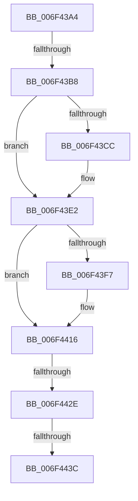

# sub_006F43A4

- RVA: `0x006F43A4`–`0x006F4465` (길이 `193` bytes)
- VA: `0x00000001406F43A4`
- 실행 섹션: `.text`
- PDB 이름 있음: `아니요`; PDB Function 태그: `아니요`
- unwind 정보 RVA: `0x000ACC2C`
- 디코드: `45`개 명령, `193/193` bytes 표시
- 미해석 바이트: `0` (있으면 어셈블리에 `.byte`로 보존)

> 이 문서는 커널 이미지의 기계어와 PDB 기호를 분석해 생성했습니다. 4번과 5번은 함수 원형과 자료형을 바이너리 사용 방식에서 추정한 C 해석이며 원본 소스 복구 결과는 아닙니다.

## 1. Dependencies

- 직접 호출 지점: **7**; 고유 호출 대상: **1**
- 직접 호출자로 확인된 함수: **0**
- RIP 상대 이미지 참조: **0**

### Outgoing calls
- `0x006F43C1` → [IoAddTriageDumpDataBlock](../42/IoAddTriageDumpDataBlock_function_00428374.md) (function, `0x00428374`)
- `0x006F43D1` → [IoAddTriageDumpDataBlock](../42/IoAddTriageDumpDataBlock_function_00428374.md) (function, `0x00428374`)
- `0x006F43DD` → [IoAddTriageDumpDataBlock](../42/IoAddTriageDumpDataBlock_function_00428374.md) (function, `0x00428374`)
- `0x006F43F9` → [IoAddTriageDumpDataBlock](../42/IoAddTriageDumpDataBlock_function_00428374.md) (function, `0x00428374`)
- `0x006F4411` → [IoAddTriageDumpDataBlock](../42/IoAddTriageDumpDataBlock_function_00428374.md) (function, `0x00428374`)
- `0x006F443E` → [IoAddTriageDumpDataBlock](../42/IoAddTriageDumpDataBlock_function_00428374.md) (function, `0x00428374`)
- `0x006F445A` → [IoAddTriageDumpDataBlock](../42/IoAddTriageDumpDataBlock_function_00428374.md) (function, `0x00428374`)

### Direct callers
- 이 함수 시작 RVA로 연결되는 직접 call은 확인되지 않았습니다. 간접 호출은 완전히 역산할 수 없습니다.

### Static image references
- 디코드된 RIP-relative 메모리 참조가 없습니다.

## 2. Other-region calls and transfers

- 다른 실행 섹션으로 향하는 call: **0**
- call이 아닌 외부 분기/꼬리 이동: **4**
  - `0x006F43B2` → [IoReportTargetDeviceChangeAsynchronous + 0x127](../47/IoReportTargetDeviceChangeAsynchronous_function_00475DA0.md) (`tail-transfer`)
  - `0x006F4428` → [IoReportTargetDeviceChangeAsynchronous + 0x127](../47/IoReportTargetDeviceChangeAsynchronous_function_00475DA0.md) (`tail-transfer`)
  - `0x006F4436` → [IoReportTargetDeviceChangeAsynchronous + 0x127](../47/IoReportTargetDeviceChangeAsynchronous_function_00475DA0.md) (`tail-transfer`)
  - `0x006F4460` → [IoReportTargetDeviceChangeAsynchronous + 0x127](../47/IoReportTargetDeviceChangeAsynchronous_function_00475DA0.md) (`tail-transfer`)

## 3. Assembly (complete function range)

```asm
006F43A4  48 8B 83 38 01 00 00            mov rax, qword ptr [rbx + 0x138]
006F43AB  48 8B 48 28                     mov rcx, qword ptr [rax + 0x28]
006F43AF  48 85 C9                        test rcx, rcx
006F43B2  0F 84 0F 1B D8 FF               je 0x140475ec7
006F43B8  BA 88 03 00 00                  mov edx, 0x388
006F43BD  48 8D 71 28                     lea rsi, [rcx + 0x28]
006F43C1  E8 AE 3F D3 FF                  call 0x140428374
006F43C6  66 44 39 3E                     cmp word ptr [rsi], r15w
006F43CA  74 16                           je 0x1406f43e2
006F43CC  8B D7                           mov edx, edi
006F43CE  48 8B CE                        mov rcx, rsi
006F43D1  E8 9E 3F D3 FF                  call 0x140428374
006F43D6  0F B7 16                        movzx edx, word ptr [rsi]
006F43D9  48 8B 4E 08                     mov rcx, qword ptr [rsi + 8]
006F43DD  E8 92 3F D3 FF                  call 0x140428374
006F43E2  48 8B 83 38 01 00 00            mov rax, qword ptr [rbx + 0x138]
006F43E9  48 8B 48 28                     mov rcx, qword ptr [rax + 0x28]
006F43ED  48 83 C1 38                     add rcx, 0x38
006F43F1  66 44 39 39                     cmp word ptr [rcx], r15w
006F43F5  74 1F                           je 0x1406f4416
006F43F7  8B D7                           mov edx, edi
006F43F9  E8 76 3F D3 FF                  call 0x140428374
006F43FE  48 8B 83 38 01 00 00            mov rax, qword ptr [rbx + 0x138]
006F4405  48 8B 48 28                     mov rcx, qword ptr [rax + 0x28]
006F4409  0F B7 51 38                     movzx edx, word ptr [rcx + 0x38]
006F440D  48 8B 49 40                     mov rcx, qword ptr [rcx + 0x40]
006F4411  E8 5E 3F D3 FF                  call 0x140428374
006F4416  48 8B 83 38 01 00 00            mov rax, qword ptr [rbx + 0x138]
006F441D  48 8B 48 28                     mov rcx, qword ptr [rax + 0x28]
006F4421  48 8B 41 10                     mov rax, qword ptr [rcx + 0x10]
006F4425  48 85 C0                        test rax, rax
006F4428  0F 84 99 1A D8 FF               je 0x140475ec7
006F442E  48 8D 48 38                     lea rcx, [rax + 0x38]
006F4432  66 44 39 39                     cmp word ptr [rcx], r15w
006F4436  0F 84 8B 1A D8 FF               je 0x140475ec7
006F443C  8B D7                           mov edx, edi
006F443E  E8 31 3F D3 FF                  call 0x140428374
006F4443  48 8B 83 38 01 00 00            mov rax, qword ptr [rbx + 0x138]
006F444A  48 8B 48 28                     mov rcx, qword ptr [rax + 0x28]
006F444E  48 8B 49 10                     mov rcx, qword ptr [rcx + 0x10]
006F4452  0F B7 51 38                     movzx edx, word ptr [rcx + 0x38]
006F4456  48 8B 49 40                     mov rcx, qword ptr [rcx + 0x40]
006F445A  E8 15 3F D3 FF                  call 0x140428374
006F445F  90                              nop
006F4460  E9 62 1A D8 FF                  jmp 0x140475ec7
```

## 4. C-style interpretation (structured pseudocode)

```c
__int64 __fastcall sub_006F43A4(void)
{
    __int64 result;

    result = IoAddTriageDumpDataBlock(*(unsigned __int64 *)(*(unsigned __int64 *)(v_rbx + 312) + 40), 904, a3, a4);
    if ((*(unsigned __int16 *)(*(unsigned __int64 *)(*(unsigned __int64 *)(v_rbx + 312) + 40) + 40)) != ((unsigned __int16)(v_r15))) {
        a2 = (unsigned int)(v_rdi);
        a1 = *(unsigned __int64 *)(*(unsigned __int64 *)(v_rbx + 312) + 40) + 40;
        result = IoAddTriageDumpDataBlock(a1, a2, a3, a4);
        a2 = *(unsigned __int16 *)(*(unsigned __int64 *)(*(unsigned __int64 *)(v_rbx + 312) + 40) + 40);
        a1 = *(unsigned __int64 *)(*(unsigned __int64 *)(*(unsigned __int64 *)(v_rbx + 312) + 40) + 40 + 8);
        result = IoAddTriageDumpDataBlock(a1, a2, a3, a4);
    }
    a1 = (*(unsigned __int64 *)(*(unsigned __int64 *)(v_rbx + 312) + 40)) + (56);
    result = *(unsigned __int64 *)(v_rbx + 312);
    if ((*(unsigned __int16 *)(a1)) != ((unsigned __int16)(v_r15))) {
        a2 = (unsigned int)(v_rdi);
        result = IoAddTriageDumpDataBlock(a1, a2, a3, a4);
        result = *(unsigned __int64 *)(v_rbx + 312);
        a1 = *(unsigned __int64 *)(result + 40);
        a2 = *(unsigned __int16 *)(a1 + 56);
        a1 = *(unsigned __int64 *)(a1 + 64);
        result = IoAddTriageDumpDataBlock(a1, a2, a3, a4);
    }
    result = IoAddTriageDumpDataBlock(*(unsigned __int64 *)(*(unsigned __int64 *)(*(unsigned __int64 *)(v_rbx + 312) + 40) + 16) + 56, (unsigned int)((unsigned int)(v_rdi)), a3, a4);
    result = IoAddTriageDumpDataBlock(*(unsigned __int64 *)(*(unsigned __int64 *)(*(unsigned __int64 *)(*(unsigned __int64 *)(v_rbx + 312) + 40) + 16) + 64), *(unsigned __int16 *)(*(unsigned __int64 *)(*(unsigned __int64 *)(*(unsigned __int64 *)(v_rbx + 312) + 40) + 16) + 56), a3, a4);
}
```

## 5. (Beta) C Style

```c
void sub_006F43A4(void)
{
    int64_t result;

    result = IoAddTriageDumpDataBlock(*(uint64_t *)(*(uint64_t *)(local_rbx + 0x138) + 0x28), 904, a3, a4);
    if ((*(uint16_t *)(*(uint64_t *)(*(uint64_t *)(local_rbx + 0x138) + 0x28) + 0x28)) != ((uint16_t)(local_r15))) {
        a2 = (uint32_t)(local_rdi);
        a1 = *(uint64_t *)(*(uint64_t *)(local_rbx + 0x138) + 0x28) + 40;
        result = IoAddTriageDumpDataBlock(a1, a2, a3, a4);
        a2 = *(uint16_t *)(*(uint64_t *)(*(uint64_t *)(local_rbx + 0x138) + 0x28) + 0x28);
        a1 = *(uint64_t *)(*(uint64_t *)(*(uint64_t *)(local_rbx + 0x138) + 0x28) + 0x28 + 0x8);
        result = IoAddTriageDumpDataBlock(a1, a2, a3, a4);
    }
    a1 = (*(uint64_t *)(*(uint64_t *)(local_rbx + 0x138) + 0x28)) + (56);
    result = *(uint64_t *)(local_rbx + 0x138);
    if ((*(uint16_t *)(a1)) != ((uint16_t)(local_r15))) {
        a2 = (uint32_t)(local_rdi);
        result = IoAddTriageDumpDataBlock(a1, a2, a3, a4);
        result = *(uint64_t *)(local_rbx + 0x138);
        a1 = *(uint64_t *)(result + 0x28);
        a2 = *(uint16_t *)(a1 + 0x38);
        a1 = *(uint64_t *)(a1 + 0x40);
        result = IoAddTriageDumpDataBlock(a1, a2, a3, a4);
    }
    result = IoAddTriageDumpDataBlock(*(uint64_t *)(*(uint64_t *)(*(uint64_t *)(local_rbx + 0x138) + 0x28) + 0x10) + 56, (uint32_t)((uint32_t)(local_rdi)), a3, a4);
    result = IoAddTriageDumpDataBlock(*(uint64_t *)(*(uint64_t *)(*(uint64_t *)(*(uint64_t *)(local_rbx + 0x138) + 0x28) + 0x10) + 0x40), *(uint16_t *)(*(uint64_t *)(*(uint64_t *)(*(uint64_t *)(local_rbx + 0x138) + 0x28) + 0x10) + 0x38), a3, a4);
}
```

## 6. Execution-region graph

[열기: 2D/3D 그래프와 함수 탐색 컨트롤 패널](../../../control-panel.html?section=text&rva=0x006F43A4&view=graph)

- 2D 그래프는 위에서 아래로 흐르고, 3D 그래프는 빈 공간을 드래그해 회전합니다. Shift+드래그는 이동, 휠은 확대·축소, 함수 노드 선택은 대상 보고서 이동입니다.

### Static fallback


