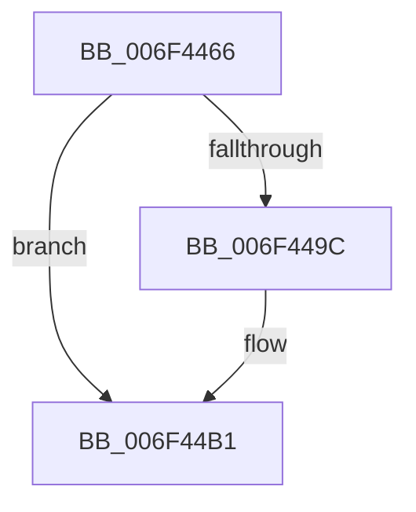

# sub_006F4466

- RVA: `0x006F4466`–`0x006F44D8` (길이 `114` bytes)
- VA: `0x00000001406F4466`
- 실행 섹션: `.text`
- PDB 이름 있음: `아니요`; PDB Function 태그: `아니요`
- unwind 정보 RVA: `0x000ACC80`
- 디코드: `22`개 명령, `114/114` bytes 표시
- 미해석 바이트: `0` (있으면 어셈블리에 `.byte`로 보존)

> 이 문서는 커널 이미지의 기계어와 PDB 기호를 분석해 생성했습니다. 4번과 5번은 함수 원형과 자료형을 바이너리 사용 방식에서 추정한 C 해석이며 원본 소스 복구 결과는 아닙니다.

## 1. Dependencies

- 직접 호출 지점: **1**; 고유 호출 대상: **1**
- 직접 호출자로 확인된 함수: **0**
- RIP 상대 이미지 참조: **5**

### Outgoing calls
- `0x006F44CD` → [KiSetTimerEx](../23/KiSetTimerEx_function_00232CB0.md) (function, `0x00232CB0`)

### Direct callers
- 이 함수 시작 RVA로 연결되는 직접 call은 확인되지 않았습니다. 간접 호출은 완전히 역산할 수 없습니다.

### Static image references
- `0x006F4466` → RVA `0x00F0C8C0` (`.data`; read/write)
- `0x006F448D` → RVA `0x00F0C8B8` (`.data`; read)
- `0x006F44AA` → RVA `0x00F0C8B8` (`.data`; write)
- `0x006F44B4` → RVA `0x00F0CF60` (`.data`; read)
- `0x006F44BB` → RVA `0x00F0CF20` (`.data`; read)

## 2. Other-region calls and transfers

- 다른 실행 섹션으로 향하는 call: **0**
- call이 아닌 외부 분기/꼬리 이동: **1**
  - `0x006F44D3` → [PpmEndHighPerfRequest + 0x3A](../47/PpmEndHighPerfRequest_function_00477490.md) (`tail-transfer`)

## 3. Assembly (complete function range)

```asm
006F4466  FF 05 54 84 81 00               inc dword ptr [rip + 0x818454]
006F446C  48 BA 08 00 00 00 80 F7 FF FF   movabs rdx, 0xfffff78000000008
006F4476  48 8B 12                        mov rdx, qword ptr [rdx]
006F4479  8B 04 98                        mov eax, dword ptr [rax + rbx*4]
006F447C  4C 69 C0 10 27 00 00            imul r8, rax, 0x2710
006F4483  48 A1 08 00 00 00 80 F7 FF FF   movabs rax, qword ptr [0xfffff78000000008]
006F448D  48 8B 0D 24 84 81 00            mov rcx, qword ptr [rip + 0x818424]
006F4494  49 03 C0                        add rax, r8
006F4497  48 3B C8                        cmp rcx, rax
006F449A  77 15                           ja 0x1406f44b1
006F449C  48 A1 08 00 00 00 80 F7 FF FF   movabs rax, qword ptr [0xfffff78000000008]
006F44A6  49 8D 0C 00                     lea rcx, [r8 + rax]
006F44AA  48 89 0D 07 84 81 00            mov qword ptr [rip + 0x818407], rcx
006F44B1  48 2B D1                        sub rdx, rcx
006F44B4  48 8D 05 A5 8A 81 00            lea rax, [rip + 0x818aa5]
006F44BB  48 8D 0D 5E 8A 81 00            lea rcx, [rip + 0x818a5e]
006F44C2  48 89 44 24 20                  mov qword ptr [rsp + 0x20], rax
006F44C7  45 33 C9                        xor r9d, r9d
006F44CA  45 33 C0                        xor r8d, r8d
006F44CD  E8 DE E7 B3 FF                  call 0x140232cb0
006F44D2  90                              nop
006F44D3  E9 F2 2F D8 FF                  jmp 0x1404774ca
```

## 4. C-style interpretation (structured pseudocode)

```c
__int64 __fastcall sub_006F4466(__int64 a1, __int64 a2, __int64 a3, int a4)
{
    __int64 result;
    unsigned __int64 v_stack_p20;

    a3 = (a3) * ((unsigned int)(*(unsigned int *)(result + v_rbx * 4)));
    result = ((unsigned int)(*(unsigned int *)(result + v_rbx * 4))) + (a3);
    if ((*(unsigned __int64 *)(v_rip + 8487972)) <= result) {
        a1 = a3 + result * 1;
        *(unsigned __int64 *)(v_rip + 8487943) = a1;
    }
    a2 = (*(unsigned __int64 *)(a2)) - (a1);
    v_stack_p20 = v_rip + 8489637;
    a4 = 0;
    a3 = 0;
    result = KiSetTimerEx(v_rip + 8489566, a2, a3, a4);
}
```

## 5. (Beta) C Style

```c
int64_t sub_006F4466(int64_t Arg1, int64_t Arg2, void *Arg3, int32_t Arg4)
{
    uint8_t *arg3 = (uint8_t *)Arg3;

    int64_t result;
    uint64_t v_stack_p20;

    Arg3 = (Arg3) * ((uint32_t)(*(uint32_t *)(result + local_rbx * 4)));
    result = ((uint32_t)(*(uint32_t *)(result + local_rbx * 4))) + (Arg3);
    if ((*(uint64_t *)(v_rip + 0x818424)) <= result) {
        Arg1 = Arg3 + result * 1;
        *(uint64_t *)(v_rip + 0x818407) = Arg1;
    }
    Arg2 = (*(uint64_t *)(Arg2)) - (Arg1);
    v_stack_p20 = v_rip + 8489637;
    Arg4 = 0;
    Arg3 = 0;
    result = KiSetTimerEx(v_rip + 8489566, Arg2, Arg3, Arg4);
}
```

### 관측된 메모리 오프셋

구조체 형식이 확인되지 않은 접근은 인자 기준의 오프셋으로만 기록했습니다.

| 기준 인자 | 오프셋 표현 | 폭 (bit) | 접근 |
|---|---:|---:|---|
| `Arg3` | `+ 0x0 + rax*1` | `64` | `R` |

## 6. Execution-region graph

[열기: 2D/3D 그래프와 함수 탐색 컨트롤 패널](../../../control-panel.html?section=text&rva=0x006F4466&view=graph)

- 2D 그래프는 위에서 아래로 흐르고, 3D 그래프는 빈 공간을 드래그해 회전합니다. Shift+드래그는 이동, 휠은 확대·축소, 함수 노드 선택은 대상 보고서 이동입니다.

### Static fallback


