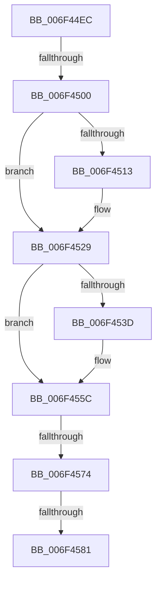

# sub_006F44EC

- RVA: `0x006F44EC`–`0x006F45AA` (길이 `190` bytes)
- VA: `0x00000001406F44EC`
- 실행 섹션: `.text`
- PDB 이름 있음: `아니요`; PDB Function 태그: `아니요`
- unwind 정보 RVA: `0x000ACDE0`
- 디코드: `45`개 명령, `190/190` bytes 표시
- 미해석 바이트: `0` (있으면 어셈블리에 `.byte`로 보존)

> 이 문서는 커널 이미지의 기계어와 PDB 기호를 분석해 생성했습니다. 4번과 5번은 함수 원형과 자료형을 바이너리 사용 방식에서 추정한 C 해석이며 원본 소스 복구 결과는 아닙니다.

## 1. Dependencies

- 직접 호출 지점: **7**; 고유 호출 대상: **1**
- 직접 호출자로 확인된 함수: **0**
- RIP 상대 이미지 참조: **0**

### Outgoing calls
- `0x006F4509` → [IoAddTriageDumpDataBlock](../42/IoAddTriageDumpDataBlock_function_00428374.md) (function, `0x00428374`)
- `0x006F4518` → [IoAddTriageDumpDataBlock](../42/IoAddTriageDumpDataBlock_function_00428374.md) (function, `0x00428374`)
- `0x006F4524` → [IoAddTriageDumpDataBlock](../42/IoAddTriageDumpDataBlock_function_00428374.md) (function, `0x00428374`)
- `0x006F453F` → [IoAddTriageDumpDataBlock](../42/IoAddTriageDumpDataBlock_function_00428374.md) (function, `0x00428374`)
- `0x006F4557` → [IoAddTriageDumpDataBlock](../42/IoAddTriageDumpDataBlock_function_00428374.md) (function, `0x00428374`)
- `0x006F4583` → [IoAddTriageDumpDataBlock](../42/IoAddTriageDumpDataBlock_function_00428374.md) (function, `0x00428374`)
- `0x006F459F` → [IoAddTriageDumpDataBlock](../42/IoAddTriageDumpDataBlock_function_00428374.md) (function, `0x00428374`)

### Direct callers
- 이 함수 시작 RVA로 연결되는 직접 call은 확인되지 않았습니다. 간접 호출은 완전히 역산할 수 없습니다.

### Static image references
- 디코드된 RIP-relative 메모리 참조가 없습니다.

## 2. Other-region calls and transfers

- 다른 실행 섹션으로 향하는 call: **0**
- call이 아닌 외부 분기/꼬리 이동: **4**
  - `0x006F44FA` → [IoInvalidateDeviceState + 0x7A](../47/IoInvalidateDeviceState_function_00477F10.md) (`tail-transfer`)
  - `0x006F456E` → [IoInvalidateDeviceState + 0x7A](../47/IoInvalidateDeviceState_function_00477F10.md) (`tail-transfer`)
  - `0x006F457B` → [IoInvalidateDeviceState + 0x7A](../47/IoInvalidateDeviceState_function_00477F10.md) (`tail-transfer`)
  - `0x006F45A5` → [IoInvalidateDeviceState + 0x7A](../47/IoInvalidateDeviceState_function_00477F10.md) (`tail-transfer`)

## 3. Assembly (complete function range)

```asm
006F44EC  48 8B 83 38 01 00 00            mov rax, qword ptr [rbx + 0x138]
006F44F3  48 8B 48 28                     mov rcx, qword ptr [rax + 0x28]
006F44F7  48 85 C9                        test rcx, rcx
006F44FA  0F 84 8A 3A D8 FF               je 0x140477f8a
006F4500  BA 88 03 00 00                  mov edx, 0x388
006F4505  48 8D 79 28                     lea rdi, [rcx + 0x28]
006F4509  E8 66 3E D3 FF                  call 0x140428374
006F450E  66 39 37                        cmp word ptr [rdi], si
006F4511  74 16                           je 0x1406f4529
006F4513  8B D5                           mov edx, ebp
006F4515  48 8B CF                        mov rcx, rdi
006F4518  E8 57 3E D3 FF                  call 0x140428374
006F451D  0F B7 17                        movzx edx, word ptr [rdi]
006F4520  48 8B 4F 08                     mov rcx, qword ptr [rdi + 8]
006F4524  E8 4B 3E D3 FF                  call 0x140428374
006F4529  48 8B 83 38 01 00 00            mov rax, qword ptr [rbx + 0x138]
006F4530  48 8B 48 28                     mov rcx, qword ptr [rax + 0x28]
006F4534  48 83 C1 38                     add rcx, 0x38
006F4538  66 39 31                        cmp word ptr [rcx], si
006F453B  74 1F                           je 0x1406f455c
006F453D  8B D5                           mov edx, ebp
006F453F  E8 30 3E D3 FF                  call 0x140428374
006F4544  48 8B 83 38 01 00 00            mov rax, qword ptr [rbx + 0x138]
006F454B  48 8B 48 28                     mov rcx, qword ptr [rax + 0x28]
006F454F  0F B7 51 38                     movzx edx, word ptr [rcx + 0x38]
006F4553  48 8B 49 40                     mov rcx, qword ptr [rcx + 0x40]
006F4557  E8 18 3E D3 FF                  call 0x140428374
006F455C  48 8B 83 38 01 00 00            mov rax, qword ptr [rbx + 0x138]
006F4563  48 8B 48 28                     mov rcx, qword ptr [rax + 0x28]
006F4567  48 8B 41 10                     mov rax, qword ptr [rcx + 0x10]
006F456B  48 85 C0                        test rax, rax
006F456E  0F 84 16 3A D8 FF               je 0x140477f8a
006F4574  48 8D 48 38                     lea rcx, [rax + 0x38]
006F4578  66 39 31                        cmp word ptr [rcx], si
006F457B  0F 84 09 3A D8 FF               je 0x140477f8a
006F4581  8B D5                           mov edx, ebp
006F4583  E8 EC 3D D3 FF                  call 0x140428374
006F4588  48 8B 83 38 01 00 00            mov rax, qword ptr [rbx + 0x138]
006F458F  48 8B 48 28                     mov rcx, qword ptr [rax + 0x28]
006F4593  48 8B 49 10                     mov rcx, qword ptr [rcx + 0x10]
006F4597  0F B7 51 38                     movzx edx, word ptr [rcx + 0x38]
006F459B  48 8B 49 40                     mov rcx, qword ptr [rcx + 0x40]
006F459F  E8 D0 3D D3 FF                  call 0x140428374
006F45A4  90                              nop
006F45A5  E9 E0 39 D8 FF                  jmp 0x140477f8a
```

## 4. C-style interpretation (structured pseudocode)

```c
__int64 __fastcall sub_006F44EC(void)
{
    __int64 result;

    result = IoAddTriageDumpDataBlock(*(unsigned __int64 *)(*(unsigned __int64 *)(v_rbx + 312) + 40), 904, a3, a4);
    if ((*(unsigned __int16 *)(*(unsigned __int64 *)(*(unsigned __int64 *)(v_rbx + 312) + 40) + 40)) != ((unsigned __int16)(v_rsi))) {
        a2 = (unsigned int)(v_rbp);
        a1 = *(unsigned __int64 *)(*(unsigned __int64 *)(v_rbx + 312) + 40) + 40;
        result = IoAddTriageDumpDataBlock(a1, a2, a3, a4);
        a2 = *(unsigned __int16 *)(*(unsigned __int64 *)(*(unsigned __int64 *)(v_rbx + 312) + 40) + 40);
        a1 = *(unsigned __int64 *)(*(unsigned __int64 *)(*(unsigned __int64 *)(v_rbx + 312) + 40) + 40 + 8);
        result = IoAddTriageDumpDataBlock(a1, a2, a3, a4);
    }
    a1 = (*(unsigned __int64 *)(*(unsigned __int64 *)(v_rbx + 312) + 40)) + (56);
    result = *(unsigned __int64 *)(v_rbx + 312);
    if ((*(unsigned __int16 *)(a1)) != ((unsigned __int16)(v_rsi))) {
        a2 = (unsigned int)(v_rbp);
        result = IoAddTriageDumpDataBlock(a1, a2, a3, a4);
        result = *(unsigned __int64 *)(v_rbx + 312);
        a1 = *(unsigned __int64 *)(result + 40);
        a2 = *(unsigned __int16 *)(a1 + 56);
        a1 = *(unsigned __int64 *)(a1 + 64);
        result = IoAddTriageDumpDataBlock(a1, a2, a3, a4);
    }
    result = IoAddTriageDumpDataBlock(*(unsigned __int64 *)(*(unsigned __int64 *)(*(unsigned __int64 *)(v_rbx + 312) + 40) + 16) + 56, (unsigned int)((unsigned int)(v_rbp)), a3, a4);
    result = IoAddTriageDumpDataBlock(*(unsigned __int64 *)(*(unsigned __int64 *)(*(unsigned __int64 *)(*(unsigned __int64 *)(v_rbx + 312) + 40) + 16) + 64), *(unsigned __int16 *)(*(unsigned __int64 *)(*(unsigned __int64 *)(*(unsigned __int64 *)(v_rbx + 312) + 40) + 16) + 56), a3, a4);
}
```

## 5. (Beta) C Style

```c
void sub_006F44EC(void)
{
    int64_t result;

    result = IoAddTriageDumpDataBlock(*(uint64_t *)(*(uint64_t *)(local_rbx + 0x138) + 0x28), 904, a3, a4);
    if ((*(uint16_t *)(*(uint64_t *)(*(uint64_t *)(local_rbx + 0x138) + 0x28) + 0x28)) != ((uint16_t)(local_rsi))) {
        a2 = (uint32_t)(local_rbp);
        a1 = *(uint64_t *)(*(uint64_t *)(local_rbx + 0x138) + 0x28) + 40;
        result = IoAddTriageDumpDataBlock(a1, a2, a3, a4);
        a2 = *(uint16_t *)(*(uint64_t *)(*(uint64_t *)(local_rbx + 0x138) + 0x28) + 0x28);
        a1 = *(uint64_t *)(*(uint64_t *)(*(uint64_t *)(local_rbx + 0x138) + 0x28) + 0x28 + 0x8);
        result = IoAddTriageDumpDataBlock(a1, a2, a3, a4);
    }
    a1 = (*(uint64_t *)(*(uint64_t *)(local_rbx + 0x138) + 0x28)) + (56);
    result = *(uint64_t *)(local_rbx + 0x138);
    if ((*(uint16_t *)(a1)) != ((uint16_t)(local_rsi))) {
        a2 = (uint32_t)(local_rbp);
        result = IoAddTriageDumpDataBlock(a1, a2, a3, a4);
        result = *(uint64_t *)(local_rbx + 0x138);
        a1 = *(uint64_t *)(result + 0x28);
        a2 = *(uint16_t *)(a1 + 0x38);
        a1 = *(uint64_t *)(a1 + 0x40);
        result = IoAddTriageDumpDataBlock(a1, a2, a3, a4);
    }
    result = IoAddTriageDumpDataBlock(*(uint64_t *)(*(uint64_t *)(*(uint64_t *)(local_rbx + 0x138) + 0x28) + 0x10) + 56, (uint32_t)((uint32_t)(local_rbp)), a3, a4);
    result = IoAddTriageDumpDataBlock(*(uint64_t *)(*(uint64_t *)(*(uint64_t *)(*(uint64_t *)(local_rbx + 0x138) + 0x28) + 0x10) + 0x40), *(uint16_t *)(*(uint64_t *)(*(uint64_t *)(*(uint64_t *)(local_rbx + 0x138) + 0x28) + 0x10) + 0x38), a3, a4);
}
```

## 6. Execution-region graph

[열기: 2D/3D 그래프와 함수 탐색 컨트롤 패널](../../../control-panel.html?section=text&rva=0x006F44EC&view=graph)

- 2D 그래프는 위에서 아래로 흐르고, 3D 그래프는 빈 공간을 드래그해 회전합니다. Shift+드래그는 이동, 휠은 확대·축소, 함수 노드 선택은 대상 보고서 이동입니다.

### Static fallback


