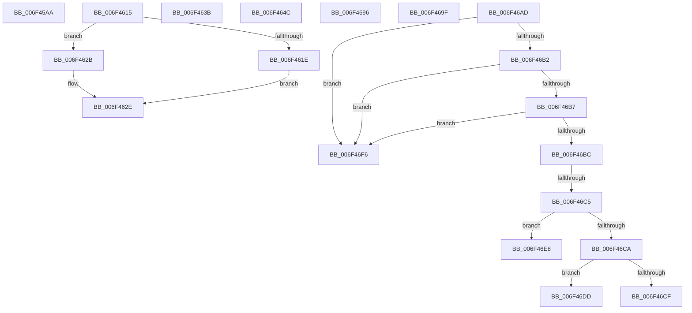

# sub_006F45AA

- RVA: `0x006F45AA`–`0x006F4704` (길이 `346` bytes)
- VA: `0x00000001406F45AA`
- 실행 섹션: `.text`
- PDB 이름 있음: `아니요`; PDB Function 태그: `아니요`
- unwind 정보 RVA: `0x000ACE4C`
- 디코드: `89`개 명령, `346/346` bytes 표시
- 미해석 바이트: `0` (있으면 어셈블리에 `.byte`로 보존)

> 이 문서는 커널 이미지의 기계어와 PDB 기호를 분석해 생성했습니다. 4번과 5번은 함수 원형과 자료형을 바이너리 사용 방식에서 추정한 C 해석이며 원본 소스 복구 결과는 아닙니다.

## 1. Dependencies

- 직접 호출 지점: **10**; 고유 호출 대상: **10**
- 직접 호출자로 확인된 함수: **0**
- RIP 상대 이미지 참조: **3**

### Outgoing calls
- `0x006F45CA` → [ObfReferenceObjectWithTag](../21/ObfReferenceObjectWithTag_function_00210710.md) (function, `0x00210710`)
- `0x006F45F8` → [PipProcessDevNodeTree](../../page/8F/PipProcessDevNodeTree_function_008F9068.md) (function, `0x008F9068`)
- `0x006F4630` → [PiQueryPowerRelations](../../page/AA/PiQueryPowerRelations_function_00AA3F9C.md) (function, `0x00AA3F9C`)
- `0x006F463E` → [PiProcessStartSystemDevices](../../page/72/PiProcessStartSystemDevices_function_0072D7D4.md) (function, `0x0072D7D4`)
- `0x006F467D` → [IoReportTargetDeviceChangeAsynchronous](../47/IoReportTargetDeviceChangeAsynchronous_function_00475DA0.md) (function, `0x00475DA0`)
- `0x006F468B` → [PiPnpRtlPdoRaiseNtPlugPlayPropertyChangeEvent](../../page/AB/PiPnpRtlPdoRaiseNtPlugPlayPropertyChangeEvent_function_00AB447C.md) (function, `0x00AB447C`)
- `0x006F46A2` → [PiProcessSetDeviceProblem](../../page/72/PiProcessSetDeviceProblem_function_0072D668.md) (function, `0x0072D668`)
- `0x006F46D2` → [PiDmaGuardProcessUpdateConsoleLockStateAction](../../page/73/PiDmaGuardProcessUpdateConsoleLockStateAction_function_0073BACC.md) (function, `0x0073BACC`)
- `0x006F46EB` → [PiProcessDeviceResetAction](../5A/PiProcessDeviceResetAction_function_005A5CD8.md) (function, `0x005A5CD8`)
- `0x006F46F9` → [PiConfigureDevice](../../page/72/PiConfigureDevice_function_0072D38C.md) (function, `0x0072D38C`)

### Direct callers
- 이 함수 시작 RVA로 연결되는 직접 call은 확인되지 않았습니다. 간접 호출은 완전히 역산할 수 없습니다.

### Static image references
- `0x006F45AA` → RVA `0x00F8C438` (`.data`; read)
- `0x006F45B6` → RVA `0x00F8C5FA` (`.data`; read)
- `0x006F464C` → RVA `0x00012330` (`.rdata`; read)

## 2. Other-region calls and transfers

- 다른 실행 섹션으로 향하는 call: **7**
  - `0x006F45F8` → [PipProcessDevNodeTree](../../page/8F/PipProcessDevNodeTree_function_008F9068.md) (`.text` → `PAGE`)
  - `0x006F4630` → [PiQueryPowerRelations](../../page/AA/PiQueryPowerRelations_function_00AA3F9C.md) (`.text` → `PAGE`)
  - `0x006F463E` → [PiProcessStartSystemDevices](../../page/72/PiProcessStartSystemDevices_function_0072D7D4.md) (`.text` → `PAGE`)
  - `0x006F468B` → [PiPnpRtlPdoRaiseNtPlugPlayPropertyChangeEvent](../../page/AB/PiPnpRtlPdoRaiseNtPlugPlayPropertyChangeEvent_function_00AB447C.md) (`.text` → `PAGE`)
  - `0x006F46A2` → [PiProcessSetDeviceProblem](../../page/72/PiProcessSetDeviceProblem_function_0072D668.md) (`.text` → `PAGE`)
  - `0x006F46D2` → [PiDmaGuardProcessUpdateConsoleLockStateAction](../../page/73/PiDmaGuardProcessUpdateConsoleLockStateAction_function_0073BACC.md) (`.text` → `PAGE`)
  - `0x006F46F9` → [PiConfigureDevice](../../page/72/PiConfigureDevice_function_0072D38C.md) (`.text` → `PAGE`)
- call이 아닌 외부 분기/꼬리 이동: **11**
  - `0x006F4610` → [PnpDeviceActionWorker + 0x7E](../47/PnpDeviceActionWorker_function_00478400.md) (`tail-transfer`)
  - `0x006F4636` → [PnpDeviceActionWorker + 0x2B6](../47/PnpDeviceActionWorker_function_00478400.md) (`tail-transfer`)
  - `0x006F4647` → [PnpDeviceActionWorker + 0x2B6](../47/PnpDeviceActionWorker_function_00478400.md) (`tail-transfer`)
  - `0x006F4691` → [PnpDeviceActionWorker + 0x2B9](../47/PnpDeviceActionWorker_function_00478400.md) (`tail-transfer`)
  - `0x006F469A` → [PnpDeviceActionWorker + 0x2B9](../47/PnpDeviceActionWorker_function_00478400.md) (`tail-transfer`)
  - `0x006F46A8` → [PnpDeviceActionWorker + 0x2B6](../47/PnpDeviceActionWorker_function_00478400.md) (`tail-transfer`)
  - `0x006F46BF` → [PnpDeviceActionWorker + 0x69F](../47/PnpDeviceActionWorker_function_00478400.md) (`tail-transfer`)
  - `0x006F46D8` → [PnpDeviceActionWorker + 0x2B6](../47/PnpDeviceActionWorker_function_00478400.md) (`tail-transfer`)
  - `0x006F46E3` → [PnpDeviceActionWorker + 0x2B9](../47/PnpDeviceActionWorker_function_00478400.md) (`tail-transfer`)
  - `0x006F46F1` → [PnpDeviceActionWorker + 0x2B6](../47/PnpDeviceActionWorker_function_00478400.md) (`tail-transfer`)
  - `0x006F46FF` → [PnpDeviceActionWorker + 0x2B6](../47/PnpDeviceActionWorker_function_00478400.md) (`tail-transfer`)

## 3. Assembly (complete function range)

```asm
006F45AA  48 8B 0D 87 7E 89 00            mov rcx, qword ptr [rip + 0x897e87]
006F45B1  BA 44 66 6C 74                  mov edx, 0x746c6644
006F45B6  8A 05 3E 80 89 00               mov al, byte ptr [rip + 0x89803e]
006F45BC  C7 45 EF 03 00 00 00            mov dword ptr [rbp - 0x11], 3
006F45C3  88 45 F3                        mov byte ptr [rbp - 0xd], al
006F45C6  48 8B 49 20                     mov rcx, qword ptr [rcx + 0x20]
006F45CA  E8 41 C1 B1 FF                  call 0x140210710
006F45CF  48 8B 0D 62 7E 89 00            mov rcx, qword ptr [rip + 0x897e62]
006F45D6  4C 8D 45 EF                     lea r8, [rbp - 0x11]
006F45DA  41 F6 DD                        neg r13b
006F45DD  40 88 7C 24 30                  mov byte ptr [rsp + 0x30], dil
006F45E2  40 88 7C 24 28                  mov byte ptr [rsp + 0x28], dil
006F45E7  45 1B C9                        sbb r9d, r9d
006F45EA  44 88 64 24 20                  mov byte ptr [rsp + 0x20], r12b
006F45EF  41 F7 D1                        not r9d
006F45F2  33 D2                           xor edx, edx
006F45F4  41 83 E1 03                     and r9d, 3
006F45F8  E8 6B 4A 20 00                  call 0x1408f9068
006F45FD  44 8A E7                        mov r12b, dil
006F4600  40 88 7D E7                     mov byte ptr [rbp - 0x19], dil
006F4604  44 89 65 EB                     mov dword ptr [rbp - 0x15], r12d
006F4608  44 8A EF                        mov r13b, dil
006F460B  BB 01 00 00 00                  mov ebx, 1
006F4610  E9 69 3E D8 FF                  jmp 0x14047847e
006F4615  48 8B 46 10                     mov rax, qword ptr [rsi + 0x10]
006F4619  48 85 C0                        test rax, rax
006F461C  74 0D                           je 0x1406f462b
006F461E  48 8B 80 38 01 00 00            mov rax, qword ptr [rax + 0x138]
006F4625  48 8B 48 28                     mov rcx, qword ptr [rax + 0x28]
006F4629  EB 03                           jmp 0x1406f462e
006F462B  48 8B CF                        mov rcx, rdi
006F462E  33 D2                           xor edx, edx
006F4630  E8 67 F9 3A 00                  call 0x140aa3f9c
006F4635  90                              nop
006F4636  E9 7B 40 D8 FF                  jmp 0x1404786b6
006F463B  48 8B CE                        mov rcx, rsi
006F463E  E8 91 91 03 00                  call 0x14072d7d4
006F4643  40 88 7D E9                     mov byte ptr [rbp - 0x17], dil
006F4647  E9 6A 40 D8 FF                  jmp 0x1404786b6
006F464C  0F 10 05 DD DC 91 FF            movups xmm0, xmmword ptr [rip - 0x6e2323]
006F4653  83 C8 FF                        or eax, 0xffffffff
006F4656  89 7D 0B                        mov dword ptr [rbp + 0xb], edi
006F4659  89 7D 1B                        mov dword ptr [rbp + 0x1b], edi
006F465C  48 8D 55 F7                     lea rdx, [rbp - 9]
006F4660  F3 0F 7F 45 FB                  movdqu xmmword ptr [rbp - 5], xmm0
006F4665  C7 45 F7 01 00 24 00            mov dword ptr [rbp - 9], 0x240001
006F466C  45 33 C9                        xor r9d, r9d
006F466F  48 89 7D 0F                     mov qword ptr [rbp + 0xf], rdi
006F4673  45 33 C0                        xor r8d, r8d
006F4676  89 45 17                        mov dword ptr [rbp + 0x17], eax
006F4679  48 8B 4E 10                     mov rcx, qword ptr [rsi + 0x10]
006F467D  E8 1E 17 D8 FF                  call 0x140475da0
006F4682  BA 15 00 00 00                  mov edx, 0x15
006F4687  48 8B 4E 10                     mov rcx, qword ptr [rsi + 0x10]
006F468B  E8 EC FD 3B 00                  call 0x140ab447c
006F4690  90                              nop
006F4691  E9 23 40 D8 FF                  jmp 0x1404786b9
006F4696  44 88 6D E8                     mov byte ptr [rbp - 0x18], r13b
006F469A  E9 1A 40 D8 FF                  jmp 0x1404786b9
006F469F  48 8B CE                        mov rcx, rsi
006F46A2  E8 C1 8F 03 00                  call 0x14072d668
006F46A7  90                              nop
006F46A8  E9 09 40 D8 FF                  jmp 0x1404786b6
006F46AD  83 E9 16                        sub ecx, 0x16
006F46B0  74 44                           je 0x1406f46f6
006F46B2  83 E9 01                        sub ecx, 1
006F46B5  74 3F                           je 0x1406f46f6
006F46B7  83 E9 01                        sub ecx, 1
006F46BA  74 3A                           je 0x1406f46f6
006F46BC  83 E9 01                        sub ecx, 1
006F46BF  0F 84 DA 43 D8 FF               je 0x140478a9f
006F46C5  83 E9 01                        sub ecx, 1
006F46C8  74 1E                           je 0x1406f46e8
006F46CA  83 F9 01                        cmp ecx, 1
006F46CD  75 0E                           jne 0x1406f46dd
006F46CF  48 8B CE                        mov rcx, rsi
006F46D2  E8 F5 73 04 00                  call 0x14073bacc
006F46D7  90                              nop
006F46D8  E9 D9 3F D8 FF                  jmp 0x1404786b6
006F46DD  41 BE 01 00 00 C0               mov r14d, 0xc0000001
006F46E3  E9 D1 3F D8 FF                  jmp 0x1404786b9
006F46E8  48 8B CE                        mov rcx, rsi
006F46EB  E8 E8 15 EB FF                  call 0x1405a5cd8
006F46F0  90                              nop
006F46F1  E9 C0 3F D8 FF                  jmp 0x1404786b6
006F46F6  48 8B CE                        mov rcx, rsi
006F46F9  E8 8E 8C 03 00                  call 0x14072d38c
006F46FE  90                              nop
006F46FF  E9 B2 3F D8 FF                  jmp 0x1404786b6
```

## 4. C-style interpretation (structured pseudocode)

```c
__int64 __fastcall sub_006F45AA(__int64 a1, __int64 a2, __int64 a3, int a4)
{
    __int64 result;
    __int64 v_r13;
    unsigned __int8 v_stack_p20;
    unsigned __int8 v_stack_p28;
    unsigned __int8 v_stack_p30;

    *(unsigned int *)(v_rbp - 17) = 3;
    *(unsigned __int8 *)(v_rbp - 13) = (unsigned __int8)(*(unsigned __int8 *)(v_rip + 9011262));
    result = ObfReferenceObjectWithTag(*(unsigned __int64 *)(*(unsigned __int64 *)(v_rip + 9010823) + 32), (unsigned int)(0x746C6644ULL), a3, a4);
    v_r13 = (unsigned __int8)(-(v_r13));
    v_stack_p30 = (unsigned __int8)(v_rdi);
    v_stack_p28 = (unsigned __int8)(v_rdi);
    v_stack_p20 = (unsigned __int8)(v_r12);
    a4 = (unsigned int)(~(a4));
    a2 = 0;
    a4 = (unsigned int)((a4) & (3));
    result = PipProcessDevNodeTree(*(unsigned __int64 *)(v_rip + 9010786), a2, v_rbp - 17, a4);
    *(unsigned __int8 *)(v_rbp - 25) = (unsigned __int8)(v_rdi);
    *(unsigned int *)(v_rbp - 21) = (unsigned int)((unsigned __int8)(v_rdi));
}
```

## 5. (Beta) C Style

```c
int64_t sub_006F45AA(int64_t Arg1, int64_t Arg2, int64_t Arg3, int32_t Arg4)
{
    int64_t result;
    int64_t local_r13;
    uint8_t v_stack_p20;
    uint8_t v_stack_p28;
    uint8_t v_stack_p30;

    *(uint32_t *)(local_rbp - 0x11) = 3;
    *(uint8_t *)(local_rbp - 0xD) = (uint8_t)(*(uint8_t *)(v_rip + 0x89803E));
    result = ObfReferenceObjectWithTag(*(uint64_t *)(*(uint64_t *)(v_rip + 0x897E87) + 0x20), (uint32_t)(0x746C6644ULL), Arg3, Arg4);
    local_r13 = (uint8_t)(-(local_r13));
    v_stack_p30 = (uint8_t)(local_rdi);
    v_stack_p28 = (uint8_t)(local_rdi);
    v_stack_p20 = (uint8_t)(local_r12);
    Arg4 = (uint32_t)(~(Arg4));
    Arg2 = 0;
    Arg4 = (uint32_t)((Arg4) & (3));
    result = PipProcessDevNodeTree(*(uint64_t *)(v_rip + 0x897E62), Arg2, local_rbp - 17, Arg4);
    *(uint8_t *)(local_rbp - 0x19) = (uint8_t)(local_rdi);
    *(uint32_t *)(local_rbp - 0x15) = (uint32_t)((uint8_t)(local_rdi));
}
```

## 6. Execution-region graph

[열기: 2D/3D 그래프와 함수 탐색 컨트롤 패널](../../../control-panel.html?section=text&rva=0x006F45AA&view=graph)

- 2D 그래프는 위에서 아래로 흐르고, 3D 그래프는 빈 공간을 드래그해 회전합니다. Shift+드래그는 이동, 휠은 확대·축소, 함수 노드 선택은 대상 보고서 이동입니다.

### Static fallback


