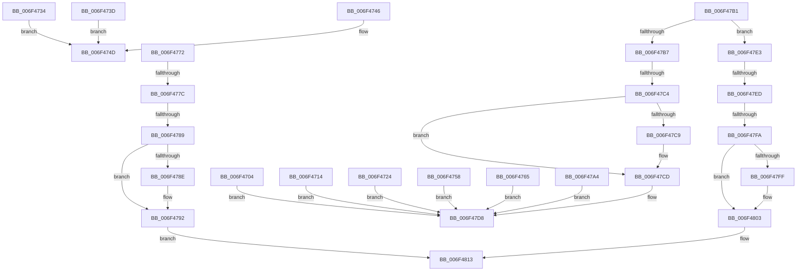

# sub_006F4704

- RVA: `0x006F4704`–`0x006F481E` (길이 `282` bytes)
- VA: `0x00000001406F4704`
- 실행 섹션: `.text`
- PDB 이름 있음: `아니요`; PDB Function 태그: `아니요`
- unwind 정보 RVA: `0x000ACE68`
- 디코드: `62`개 명령, `282/282` bytes 표시
- 미해석 바이트: `0` (있으면 어셈블리에 `.byte`로 보존)

> 이 문서는 커널 이미지의 기계어와 PDB 기호를 분석해 생성했습니다. 4번과 5번은 함수 원형과 자료형을 바이너리 사용 방식에서 추정한 C 해석이며 원본 소스 복구 결과는 아닙니다.

## 1. Dependencies

- 직접 호출 지점: **3**; 고유 호출 대상: **3**
- 직접 호출자로 확인된 함수: **0**
- RIP 상대 이미지 참조: **14**

### Outgoing calls
- `0x006F474D` → [McTemplateK0z_EtwWriteTransfer](../4D/McTemplateK0z_EtwWriteTransfer_function_004DEF6C.md) (function, `0x004DEF6C`)
- `0x006F47D8` → [McTemplateK0zd_EtwWriteTransfer](../42/McTemplateK0zd_EtwWriteTransfer_function_004230CC.md) (function, `0x004230CC`)
- `0x006F4813` → [McTemplateK0zdq_EtwWriteTransfer](../5A/McTemplateK0zdq_EtwWriteTransfer_function_005A8288.md) (function, `0x005A8288`)

### Direct callers
- 이 함수 시작 RVA로 연결되는 직접 call은 확인되지 않았습니다. 간접 호출은 완전히 역산할 수 없습니다.

### Static image references
- `0x006F4708` → RVA `0x00026C80` (`.rdata`; read)
- `0x006F4718` → RVA `0x00027778` (`.rdata`; read)
- `0x006F4728` → RVA `0x00027280` (`.rdata`; read)
- `0x006F4734` → RVA `0x00027170` (`.rdata`; read)
- `0x006F473D` → RVA `0x00027360` (`.rdata`; read)
- `0x006F4746` → RVA `0x00027430` (`.rdata`; read)
- `0x006F475C` → RVA `0x00026E40` (`.rdata`; read)
- `0x006F4769` → RVA `0x000273A0` (`.rdata`; read)
- `0x006F477C` → RVA `0x00EF012B` (`.data`; read)
- `0x006F479B` → RVA `0x00027798` (`.rdata`; read)
- `0x006F47A8` → RVA `0x00026E20` (`.rdata`; read)
- `0x006F47B7` → RVA `0x00EF0129` (`.data`; read)
- `0x006F47D1` → RVA `0x00027748` (`.rdata`; read)
- `0x006F480C` → RVA `0x00026F70` (`.rdata`; read)

## 2. Other-region calls and transfers

- 다른 실행 섹션으로 향하는 call: **0**
- call이 아닌 외부 분기/꼬리 이동: **8**
  - `0x006F4753` → [PnpLogActionQueueEvent + 0x85](../47/PnpLogActionQueueEvent_function_00478ACC.md) (`tail-transfer`)
  - `0x006F4776` → [PnpLogActionQueueEvent + 0x85](../47/PnpLogActionQueueEvent_function_00478ACC.md) (`tail-transfer`)
  - `0x006F4783` → [PnpLogActionQueueEvent + 0x85](../47/PnpLogActionQueueEvent_function_00478ACC.md) (`tail-transfer`)
  - `0x006F47BE` → [PnpLogActionQueueEvent + 0x85](../47/PnpLogActionQueueEvent_function_00478ACC.md) (`tail-transfer`)
  - `0x006F47DE` → [PnpLogActionQueueEvent + 0x85](../47/PnpLogActionQueueEvent_function_00478ACC.md) (`tail-transfer`)
  - `0x006F47E7` → [PnpLogActionQueueEvent + 0x85](../47/PnpLogActionQueueEvent_function_00478ACC.md) (`tail-transfer`)
  - `0x006F47F4` → [PnpLogActionQueueEvent + 0x85](../47/PnpLogActionQueueEvent_function_00478ACC.md) (`tail-transfer`)
  - `0x006F4819` → [PnpLogActionQueueEvent + 0x85](../47/PnpLogActionQueueEvent_function_00478ACC.md) (`tail-transfer`)

## 3. Assembly (complete function range)

```asm
006F4704  89 54 24 20                     mov dword ptr [rsp + 0x20], edx
006F4708  48 8D 15 71 25 93 FF            lea rdx, [rip - 0x6cda8f]
006F470F  E9 C4 00 00 00                  jmp 0x1406f47d8
006F4714  89 54 24 20                     mov dword ptr [rsp + 0x20], edx
006F4718  48 8D 15 59 30 93 FF            lea rdx, [rip - 0x6ccfa7]
006F471F  E9 B4 00 00 00                  jmp 0x1406f47d8
006F4724  89 54 24 20                     mov dword ptr [rsp + 0x20], edx
006F4728  48 8D 15 51 2B 93 FF            lea rdx, [rip - 0x6cd4af]
006F472F  E9 A4 00 00 00                  jmp 0x1406f47d8
006F4734  48 8D 15 35 2A 93 FF            lea rdx, [rip - 0x6cd5cb]
006F473B  EB 10                           jmp 0x1406f474d
006F473D  48 8D 15 1C 2C 93 FF            lea rdx, [rip - 0x6cd3e4]
006F4744  EB 07                           jmp 0x1406f474d
006F4746  48 8D 15 E3 2C 93 FF            lea rdx, [rip - 0x6cd31d]
006F474D  E8 1A A8 DE FF                  call 0x1404def6c
006F4752  90                              nop
006F4753  E9 F9 43 D8 FF                  jmp 0x140478b51
006F4758  89 54 24 20                     mov dword ptr [rsp + 0x20], edx
006F475C  48 8D 15 DD 26 93 FF            lea rdx, [rip - 0x6cd923]
006F4763  EB 73                           jmp 0x1406f47d8
006F4765  89 54 24 20                     mov dword ptr [rsp + 0x20], edx
006F4769  48 8D 15 30 2C 93 FF            lea rdx, [rip - 0x6cd3d0]
006F4770  EB 66                           jmp 0x1406f47d8
006F4772  41 83 F8 02                     cmp r8d, 2
006F4776  0F 85 D5 43 D8 FF               jne 0x140478b51
006F477C  F6 05 A8 B9 7F 00 20            test byte ptr [rip + 0x7fb9a8], 0x20
006F4783  0F 84 C8 43 D8 FF               je 0x140478b51
006F4789  48 85 C9                        test rcx, rcx
006F478C  74 04                           je 0x1406f4792
006F478E  4C 8B 49 30                     mov r9, qword ptr [rcx + 0x30]
006F4792  44 89 5C 24 28                  mov dword ptr [rsp + 0x28], r11d
006F4797  89 54 24 20                     mov dword ptr [rsp + 0x20], edx
006F479B  48 8D 15 F6 2F 93 FF            lea rdx, [rip - 0x6cd00a]
006F47A2  EB 6F                           jmp 0x1406f4813
006F47A4  89 54 24 20                     mov dword ptr [rsp + 0x20], edx
006F47A8  48 8D 15 71 26 93 FF            lea rdx, [rip - 0x6cd98f]
006F47AF  EB 27                           jmp 0x1406f47d8
006F47B1  41 83 F8 01                     cmp r8d, 1
006F47B5  75 2C                           jne 0x1406f47e3
006F47B7  F6 05 6B B9 7F 00 40            test byte ptr [rip + 0x7fb96b], 0x40
006F47BE  0F 84 8D 43 D8 FF               je 0x140478b51
006F47C4  48 85 C9                        test rcx, rcx
006F47C7  74 04                           je 0x1406f47cd
006F47C9  4C 8B 49 30                     mov r9, qword ptr [rcx + 0x30]
006F47CD  89 54 24 20                     mov dword ptr [rsp + 0x20], edx
006F47D1  48 8D 15 70 2F 93 FF            lea rdx, [rip - 0x6cd090]
006F47D8  E8 EF E8 D2 FF                  call 0x1404230cc
006F47DD  90                              nop
006F47DE  E9 6E 43 D8 FF                  jmp 0x140478b51
006F47E3  41 83 F8 02                     cmp r8d, 2
006F47E7  0F 85 64 43 D8 FF               jne 0x140478b51
006F47ED  F6 05 35 B9 7F 00 40            test byte ptr [rip + 0x7fb935], 0x40
006F47F4  0F 84 57 43 D8 FF               je 0x140478b51
006F47FA  48 85 C9                        test rcx, rcx
006F47FD  74 04                           je 0x1406f4803
006F47FF  4C 8B 49 30                     mov r9, qword ptr [rcx + 0x30]
006F4803  44 89 5C 24 28                  mov dword ptr [rsp + 0x28], r11d
006F4808  89 54 24 20                     mov dword ptr [rsp + 0x20], edx
006F480C  48 8D 15 5D 27 93 FF            lea rdx, [rip - 0x6cd8a3]
006F4813  E8 70 3A EB FF                  call 0x1405a8288
006F4818  90                              nop
006F4819  E9 33 43 D8 FF                  jmp 0x140478b51
```

## 4. C-style interpretation (structured pseudocode)

```c
__int64 __fastcall sub_006F4704(__int64 a1, int a2, int a3)
{
    __int64 result;
    unsigned int v_stack_p20;
    unsigned int v_stack_p28;

    v_stack_p20 = a2;
    goto loc_006F47D8;
loc_006F47D8:
    result = McTemplateK0zd_EtwWriteTransfer(a1, v_rip - 7133839, a3, a4);
}
```

## 5. (Beta) C Style

```c
int64_t sub_006F4704(int64_t Arg1, int32_t Arg2, int32_t Arg3)
{
    int64_t result;
    uint32_t v_stack_p20;
    uint32_t v_stack_p28;

    v_stack_p20 = Arg2;
    goto loc_006F47D8;
loc_006F47D8:
    result = McTemplateK0zd_EtwWriteTransfer(Arg1, v_rip - 7133839, Arg3, a4);
}
```

## 6. Execution-region graph

[열기: 2D/3D 그래프와 함수 탐색 컨트롤 패널](../../../control-panel.html?section=text&rva=0x006F4704&view=graph)

- 2D 그래프는 위에서 아래로 흐르고, 3D 그래프는 빈 공간을 드래그해 회전합니다. Shift+드래그는 이동, 휠은 확대·축소, 함수 노드 선택은 대상 보고서 이동입니다.

### Static fallback


