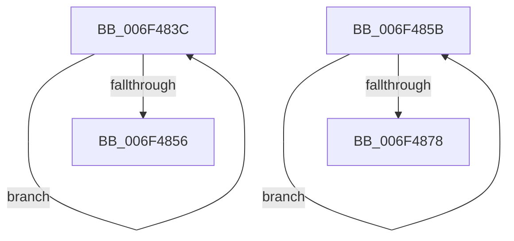

# sub_006F483C

- RVA: `0x006F483C`–`0x006F487D` (길이 `65` bytes)
- VA: `0x00000001406F483C`
- 실행 섹션: `.text`
- PDB 이름 있음: `아니요`; PDB Function 태그: `아니요`
- unwind 정보 RVA: `0x000AD000`
- 디코드: `17`개 명령, `65/65` bytes 표시
- 미해석 바이트: `0` (있으면 어셈블리에 `.byte`로 보존)

> 이 문서는 커널 이미지의 기계어와 PDB 기호를 분석해 생성했습니다. 4번과 5번은 함수 원형과 자료형을 바이너리 사용 방식에서 추정한 C 해석이며 원본 소스 복구 결과는 아닙니다.

## 1. Dependencies

- 직접 호출 지점: **2**; 고유 호출 대상: **1**
- 직접 호출자로 확인된 함수: **0**
- RIP 상대 이미지 참조: **0**

### Outgoing calls
- `0x006F484A` → [IopUnmaskInterrupt](../47/IopUnmaskInterrupt_function_00479BDC.md) (function, `0x00479BDC`)
- `0x006F4869` → [IopUnmaskInterrupt](../47/IopUnmaskInterrupt_function_00479BDC.md) (function, `0x00479BDC`)

### Direct callers
- 이 함수 시작 RVA로 연결되는 직접 call은 확인되지 않았습니다. 간접 호출은 완전히 역산할 수 없습니다.

### Static image references
- 디코드된 RIP-relative 메모리 참조가 없습니다.

## 2. Other-region calls and transfers

- 다른 실행 섹션으로 향하는 call: **0**
- call이 아닌 외부 분기/꼬리 이동: **2**
  - `0x006F4856` → [IoReportInterruptActive + 0x2B](../47/IoReportInterruptActive_function_00479B60.md) (`tail-transfer`)
  - `0x006F4878` → [IoReportInterruptActive + 0x2B](../47/IoReportInterruptActive_function_00479B60.md) (`tail-transfer`)

## 3. Assembly (complete function range)

```asm
006F483C  8B C3                           mov eax, ebx
006F483E  48 8D 0C 40                     lea rcx, [rax + rax*2]
006F4842  48 03 C9                        add rcx, rcx
006F4845  48 8B 4C CF 18                  mov rcx, qword ptr [rdi + rcx*8 + 0x18]
006F484A  E8 8D 53 D8 FF                  call 0x140479bdc
006F484F  FF C3                           inc ebx
006F4851  3B 5F 04                        cmp ebx, dword ptr [rdi + 4]
006F4854  72 E6                           jb 0x1406f483c
006F4856  E9 30 53 D8 FF                  jmp 0x140479b8b
006F485B  8B C3                           mov eax, ebx
006F485D  48 8B 8C C7 28 01 00 00         mov rcx, qword ptr [rdi + rax*8 + 0x128]
006F4865  48 83 C1 70                     add rcx, 0x70
006F4869  E8 6E 53 D8 FF                  call 0x140479bdc
006F486E  FF C3                           inc ebx
006F4870  3B 9F 24 01 00 00               cmp ebx, dword ptr [rdi + 0x124]
006F4876  72 E3                           jb 0x1406f485b
006F4878  E9 0E 53 D8 FF                  jmp 0x140479b8b
```

## 4. C-style interpretation (structured pseudocode)

```c
__int64 __fastcall sub_006F483C(void)
{
    __int64 result;
    __int64 v_rbx;

    a1 = ((unsigned int)((unsigned int)(v_rbx)) + (unsigned int)((unsigned int)(v_rbx)) * 2) + ((unsigned int)((unsigned int)(v_rbx)) + (unsigned int)((unsigned int)(v_rbx)) * 2);
    result = IopUnmaskInterrupt(*(unsigned __int64 *)(v_rdi + a1 * 8 + 24), a2, a3, a4);
    v_rbx = (unsigned int)((v_rbx) + 1);
    if (((unsigned int)(v_rbx)) < (*(unsigned int *)(v_rdi + 4))) goto loc_006F483C;
}
```

## 5. (Beta) C Style

```c
void sub_006F483C(void)
{
    int64_t result;
    int64_t local_rbx;

    a1 = ((uint32_t)((uint32_t)(local_rbx)) + (uint32_t)((uint32_t)(local_rbx)) * 2) + ((uint32_t)((uint32_t)(local_rbx)) + (uint32_t)((uint32_t)(local_rbx)) * 2);
    result = IopUnmaskInterrupt(*(uint64_t *)(local_rdi + a1 * 8 + 0x18), a2, a3, a4);
    local_rbx = (uint32_t)((local_rbx) + 1);
    if (((uint32_t)(local_rbx)) < (*(uint32_t *)(local_rdi + 0x4))) goto loc_006F483C;
}
```

## 6. Execution-region graph

[열기: 2D/3D 그래프와 함수 탐색 컨트롤 패널](../../../control-panel.html?section=text&rva=0x006F483C&view=graph)

- 2D 그래프는 위에서 아래로 흐르고, 3D 그래프는 빈 공간을 드래그해 회전합니다. Shift+드래그는 이동, 휠은 확대·축소, 함수 노드 선택은 대상 보고서 이동입니다.

### Static fallback


