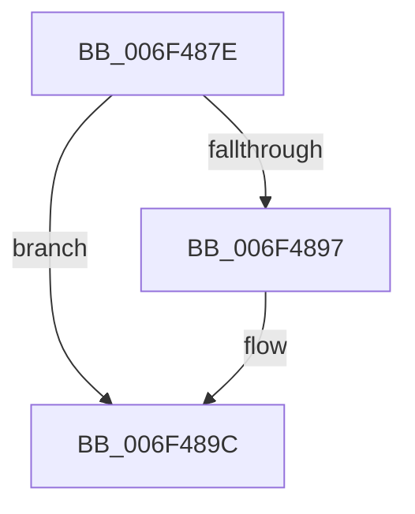

# sub_006F487E

- RVA: `0x006F487E`–`0x006F48A3` (길이 `37` bytes)
- VA: `0x00000001406F487E`
- 실행 섹션: `.text`
- PDB 이름 있음: `아니요`; PDB Function 태그: `아니요`
- unwind 정보 RVA: `0x000AD164`
- 디코드: `11`개 명령, `37/37` bytes 표시
- 미해석 바이트: `0` (있으면 어셈블리에 `.byte`로 보존)

> 이 문서는 커널 이미지의 기계어와 PDB 기호를 분석해 생성했습니다. 4번과 5번은 함수 원형과 자료형을 바이너리 사용 방식에서 추정한 C 해석이며 원본 소스 복구 결과는 아닙니다.

## 1. Dependencies

- 직접 호출 지점: **1**; 고유 호출 대상: **1**
- 직접 호출자로 확인된 함수: **0**
- RIP 상대 이미지 참조: **0**

### Outgoing calls
- `0x006F4897` → [KeWakeAddressAll](../21/KeWakeAddressAll_function_00217C20.md) (function, `0x00217C20`)

### Direct callers
- 이 함수 시작 RVA로 연결되는 직접 call은 확인되지 않았습니다. 간접 호출은 완전히 역산할 수 없습니다.

### Static image references
- 디코드된 RIP-relative 메모리 참조가 없습니다.

## 2. Other-region calls and transfers

- 다른 실행 섹션으로 향하는 call: **0**
- call이 아닌 외부 분기/꼬리 이동: **1**
  - `0x006F489E` → [KiLeaveCooperativeIdleSearch + 0x184](../47/KiLeaveCooperativeIdleSearch_function_0047A010.md) (`tail-transfer`)

## 3. Assembly (complete function range)

```asm
006F487E  4C 89 5D F0                     mov qword ptr [rbp - 0x10], r11
006F4882  48 83 C1 08                     add rcx, 8
006F4886  48 8B 45 F8                     mov rax, qword ptr [rbp - 8]
006F488A  48 8B D0                        mov rdx, rax
006F488D  48 87 11                        xchg qword ptr [rcx], rdx
006F4890  32 D0                           xor dl, al
006F4892  F6 C2 04                        test dl, 4
006F4895  74 05                           je 0x1406f489c
006F4897  E8 84 33 B2 FF                  call 0x140217c20
006F489C  32 C0                           xor al, al
006F489E  E9 F1 58 D8 FF                  jmp 0x14047a194
```

## 4. C-style interpretation (structured pseudocode)

```c
__int64 __fastcall sub_006F487E(__int64 a1)
{
    __int64 result;

    *(unsigned __int64 *)(v_rbp - 16) = v_r11;
    a1 = (a1) + (8);
    a2 = (unsigned __int8)((*(unsigned __int64 *)(v_rbp - 8)) ^ ((unsigned __int8)(*(unsigned __int64 *)(v_rbp - 8))));
    result = *(unsigned __int64 *)(v_rbp - 8);
    if ((((unsigned __int8)(a2)) & (4)) != 0) {
        result = KeWakeAddressAll(a1, a2, a3, a4);
    }
    result = 0;
}
```

## 5. (Beta) C Style

```c
int64_t sub_006F487E(void *Arg1)
{
    uint8_t *arg1 = (uint8_t *)Arg1;

    int64_t result;

    *(uint64_t *)(local_rbp - 0x10) = local_r11;
    Arg1 = (Arg1) + (8);
    a2 = (uint8_t)((*(uint64_t *)(local_rbp - 0x8)) ^ ((uint8_t)(*(uint64_t *)(local_rbp - 0x8))));
    result = *(uint64_t *)(local_rbp - 0x8);
    if ((((uint8_t)(a2)) & (4)) != 0) {
        result = KeWakeAddressAll(Arg1, a2, a3, a4);
    }
    result = 0;
}
```

### 관측된 메모리 오프셋

구조체 형식이 확인되지 않은 접근은 인자 기준의 오프셋으로만 기록했습니다.

| 기준 인자 | 오프셋 표현 | 폭 (bit) | 접근 |
|---|---:|---:|---|
| `Arg1` | `+ 0x0` | `64` | `R/W` |

## 6. Execution-region graph

[열기: 2D/3D 그래프와 함수 탐색 컨트롤 패널](../../../control-panel.html?section=text&rva=0x006F487E&view=graph)

- 2D 그래프는 위에서 아래로 흐르고, 3D 그래프는 빈 공간을 드래그해 회전합니다. Shift+드래그는 이동, 휠은 확대·축소, 함수 노드 선택은 대상 보고서 이동입니다.

### Static fallback


