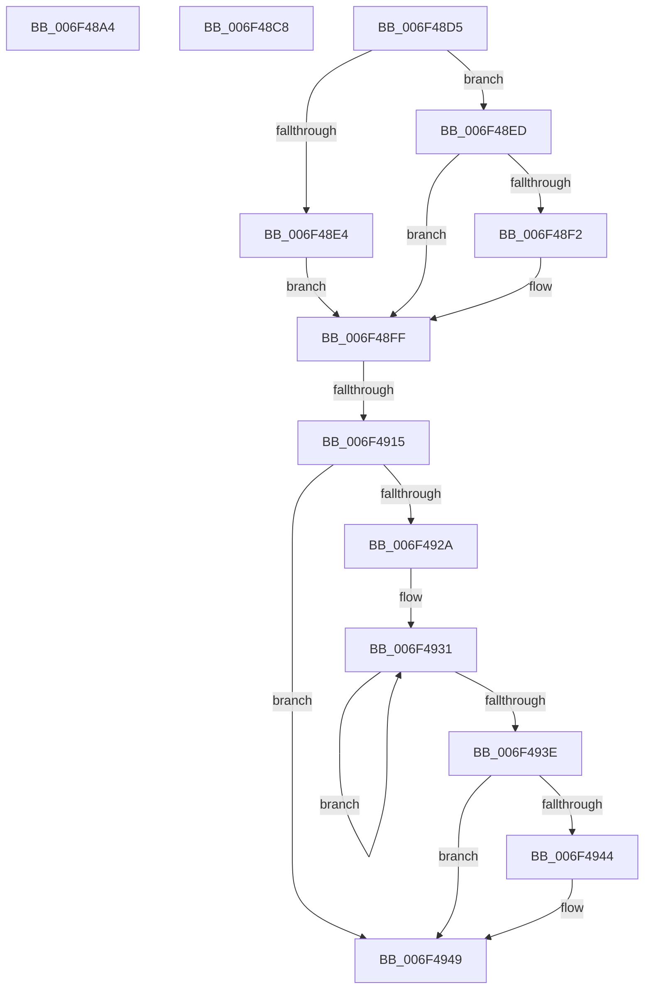

# sub_006F48A4

- RVA: `0x006F48A4`–`0x006F4958` (길이 `180` bytes)
- VA: `0x00000001406F48A4`
- 실행 섹션: `.text`
- PDB 이름 있음: `아니요`; PDB Function 태그: `아니요`
- unwind 정보 RVA: `0x000AD1A0`
- 디코드: `40`개 명령, `180/180` bytes 표시
- 미해석 바이트: `0` (있으면 어셈블리에 `.byte`로 보존)

> 이 문서는 커널 이미지의 기계어와 PDB 기호를 분석해 생성했습니다. 4번과 5번은 함수 원형과 자료형을 바이너리 사용 방식에서 추정한 C 해석이며 원본 소스 복구 결과는 아닙니다.

## 1. Dependencies

- 직접 호출 지점: **1**; 고유 호출 대상: **1**
- 직접 호출자로 확인된 함수: **0**
- RIP 상대 이미지 참조: **0**

### Outgoing calls
- `0x006F4944` → [KiRemoveSystemWorkPriorityKick](../26/KiRemoveSystemWorkPriorityKick_function_002631D0.md) (function, `0x002631D0`)

### Direct callers
- 이 함수 시작 RVA로 연결되는 직접 call은 확인되지 않았습니다. 간접 호출은 완전히 역산할 수 없습니다.

### Static image references
- 디코드된 RIP-relative 메모리 참조가 없습니다.

## 2. Other-region calls and transfers

- 다른 실행 섹션으로 향하는 call: **0**
- call이 아닌 외부 분기/꼬리 이동: **4**
  - `0x006F48C3` → [HvlDmaMapDeviceSparsePages + 0x242](../47/HvlDmaMapDeviceSparsePages_function_0047A390.md) (`tail-transfer`)
  - `0x006F48D0` → [HvlDmaMapDeviceSparsePages + 0x150](../47/HvlDmaMapDeviceSparsePages_function_0047A390.md) (`tail-transfer`)
  - `0x006F490F` → [HvlDmaMapDeviceSparsePages + 0x150](../47/HvlDmaMapDeviceSparsePages_function_0047A390.md) (`tail-transfer`)
  - `0x006F4953` → [HvlDmaMapDeviceSparsePages + 0x150](../47/HvlDmaMapDeviceSparsePages_function_0047A390.md) (`tail-transfer`)

## 3. Assembly (complete function range)

```asm
006F48A4  88 44 24 48                     mov byte ptr [rsp + 0x48], al
006F48A8  65 48 8B 04 25 20 00 00 00      mov rax, qword ptr gs:[0x20]
006F48B1  C7 45 83 01 00 00 00            mov dword ptr [rbp - 0x7d], 1
006F48B8  48 8B 88 00 8C 00 00            mov rcx, qword ptr [rax + 0x8c00]
006F48BF  48 8B 79 10                     mov rdi, qword ptr [rcx + 0x10]
006F48C3  E9 0A 5D D8 FF                  jmp 0x14047a5d2
006F48C8  40 0F B6 C6                     movzx eax, sil
006F48CC  44 0F 22 C0                     mov cr8, rax
006F48D0  E9 0B 5C D8 FF                  jmp 0x14047a4e0
006F48D5  65 48 8B 0C 25 20 00 00 00      mov rcx, qword ptr gs:[0x20]
006F48DE  F6 45 83 01                     test byte ptr [rbp - 0x7d], 1
006F48E2  74 09                           je 0x1406f48ed
006F48E4  48 8B 81 00 8C 00 00            mov rax, qword ptr [rcx + 0x8c00]
006F48EB  EB 12                           jmp 0x1406f48ff
006F48ED  84 55 83                        test byte ptr [rbp - 0x7d], dl
006F48F0  74 0D                           je 0x1406f48ff
006F48F2  48 8B 81 00 8C 00 00            mov rax, qword ptr [rcx + 0x8c00]
006F48F9  48 05 00 10 00 00               add rax, 0x1000
006F48FF  40 8A 74 24 48                  mov sil, byte ptr [rsp + 0x48]
006F4904  48 8B 7D 8F                     mov rdi, qword ptr [rbp - 0x71]
006F4908  48 89 78 10                     mov qword ptr [rax + 0x10], rdi
006F490C  40 84 F6                        test sil, sil
006F490F  0F 84 CB 5B D8 FF               je 0x14047a4e0
006F4915  65 48 8B 0C 25 20 00 00 00      mov rcx, qword ptr gs:[0x20]
006F491E  4C 8B 81 B8 8E 00 00            mov r8, qword ptr [rcx + 0x8eb8]
006F4925  4D 85 C0                        test r8, r8
006F4928  74 1F                           je 0x1406f4949
006F492A  41 0F 0D 08                     prefetchw byte ptr [r8]
006F492E  41 8B 00                        mov eax, dword ptr [r8]
006F4931  8B D0                           mov edx, eax
006F4933  0F BA F2 15                     btr edx, 0x15
006F4937  F0 41 0F B1 10                  lock cmpxchg dword ptr [r8], edx
006F493C  75 F3                           jne 0x1406f4931
006F493E  0F BA E0 15                     bt eax, 0x15
006F4942  73 05                           jae 0x1406f4949
006F4944  E8 87 E8 B6 FF                  call 0x1402631d0
006F4949  FB                              sti
006F494A  48 8B 7D 8F                     mov rdi, qword ptr [rbp - 0x71]
006F494E  40 8A 74 24 48                  mov sil, byte ptr [rsp + 0x48]
006F4953  E9 88 5B D8 FF                  jmp 0x14047a4e0
```

## 4. C-style interpretation (structured pseudocode)

```c
__int64 __fastcall sub_006F48A4(void)
{
    unsigned __int8 v_stack_p48;

    v_stack_p48 = (unsigned __int8)(result);
    *(unsigned int *)(v_rbp - 125) = 1;
}
```

## 5. (Beta) C Style

```c
void sub_006F48A4(void)
{
    uint8_t v_stack_p48;

    v_stack_p48 = (uint8_t)(result);
    *(uint32_t *)(local_rbp - 0x7D) = 1;
}
```

## 6. Execution-region graph

[열기: 2D/3D 그래프와 함수 탐색 컨트롤 패널](../../../control-panel.html?section=text&rva=0x006F48A4&view=graph)

- 2D 그래프는 위에서 아래로 흐르고, 3D 그래프는 빈 공간을 드래그해 회전합니다. Shift+드래그는 이동, 휠은 확대·축소, 함수 노드 선택은 대상 보고서 이동입니다.

### Static fallback


