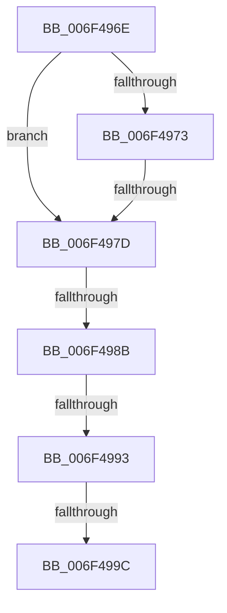

# sub_006F496E

- RVA: `0x006F496E`–`0x006F49A1` (길이 `51` bytes)
- VA: `0x00000001406F496E`
- 실행 섹션: `.text`
- PDB 이름 있음: `아니요`; PDB Function 태그: `아니요`
- unwind 정보 RVA: `0x000AD394`
- 디코드: `12`개 명령, `51/51` bytes 표시
- 미해석 바이트: `0` (있으면 어셈블리에 `.byte`로 보존)

> 이 문서는 커널 이미지의 기계어와 PDB 기호를 분석해 생성했습니다. 4번과 5번은 함수 원형과 자료형을 바이너리 사용 방식에서 추정한 C 해석이며 원본 소스 복구 결과는 아닙니다.

## 1. Dependencies

- 직접 호출 지점: **0**; 고유 호출 대상: **0**
- 직접 호출자로 확인된 함수: **0**
- RIP 상대 이미지 참조: **0**

### Outgoing calls
- 직접 디코드된 call 명령이 없습니다.

### Direct callers
- 이 함수 시작 RVA로 연결되는 직접 call은 확인되지 않았습니다. 간접 호출은 완전히 역산할 수 없습니다.

### Static image references
- 디코드된 RIP-relative 메모리 참조가 없습니다.

## 2. Other-region calls and transfers

- 다른 실행 섹션으로 향하는 call: **0**
- call이 아닌 외부 분기/꼬리 이동: **5**
  - `0x006F4977` → [IopCancelIrpsInCurrentThreadList + 0x82](../47/IopCancelIrpsInCurrentThreadList_function_0047AB14.md) (`tail-transfer`)
  - `0x006F4985` → [IopCancelIrpsInCurrentThreadList + 0x82](../47/IopCancelIrpsInCurrentThreadList_function_0047AB14.md) (`tail-transfer`)
  - `0x006F498D` → [IopCancelIrpsInCurrentThreadList + 0xC8](../47/IopCancelIrpsInCurrentThreadList_function_0047AB14.md) (`tail-transfer`)
  - `0x006F4996` → [IopCancelIrpsInCurrentThreadList + 0x82](../47/IopCancelIrpsInCurrentThreadList_function_0047AB14.md) (`tail-transfer`)
  - `0x006F499C` → [IopCancelIrpsInCurrentThreadList + 0xC8](../47/IopCancelIrpsInCurrentThreadList_function_0047AB14.md) (`tail-transfer`)

## 3. Assembly (complete function range)

```asm
006F496E  48 85 ED                        test rbp, rbp
006F4971  74 0A                           je 0x1406f497d
006F4973  48 39 6E 28                     cmp qword ptr [rsi + 0x28], rbp
006F4977  0F 85 19 62 D8 FF               jne 0x14047ab96
006F497D  8B 46 F0                        mov eax, dword ptr [rsi - 0x10]
006F4980  A9 02 04 00 00                  test eax, 0x402
006F4985  0F 85 0B 62 D8 FF               jne 0x14047ab96
006F498B  A8 84                           test al, 0x84
006F498D  0F 85 49 62 D8 FF               jne 0x14047abdc
006F4993  84 56 27                        test byte ptr [rsi + 0x27], dl
006F4996  0F 84 FA 61 D8 FF               je 0x14047ab96
006F499C  E9 3B 62 D8 FF                  jmp 0x14047abdc
```

## 4. C-style interpretation (structured pseudocode)

```c
__int64 __fastcall sub_006F496E(void)
{
    if (v_rbp == 0) goto loc_006F497D;
loc_006F497D:
}
```

## 5. (Beta) C Style

```c
void sub_006F496E(void)
{
    if (local_rbp == 0) goto loc_006F497D;
loc_006F497D:
}
```

## 6. Execution-region graph

[열기: 2D/3D 그래프와 함수 탐색 컨트롤 패널](../../../control-panel.html?section=text&rva=0x006F496E&view=graph)

- 2D 그래프는 위에서 아래로 흐르고, 3D 그래프는 빈 공간을 드래그해 회전합니다. Shift+드래그는 이동, 휠은 확대·축소, 함수 노드 선택은 대상 보고서 이동입니다.

### Static fallback


