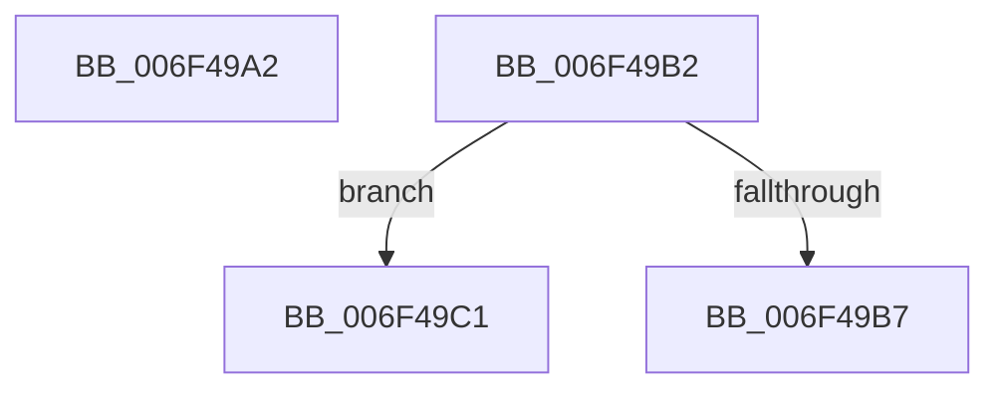

# sub_006F49A2

- RVA: `0x006F49A2`–`0x006F49D3` (길이 `49` bytes)
- VA: `0x00000001406F49A2`
- 실행 섹션: `.text`
- PDB 이름 있음: `아니요`; PDB Function 태그: `아니요`
- unwind 정보 RVA: `0x000AD76C`
- 디코드: `14`개 명령, `49/49` bytes 표시
- 미해석 바이트: `0` (있으면 어셈블리에 `.byte`로 보존)

> 이 문서는 커널 이미지의 기계어와 PDB 기호를 분석해 생성했습니다. 4번과 5번은 함수 원형과 자료형을 바이너리 사용 방식에서 추정한 C 해석이며 원본 소스 복구 결과는 아닙니다.

## 1. Dependencies

- 직접 호출 지점: **0**; 고유 호출 대상: **0**
- 직접 호출자로 확인된 함수: **0**
- RIP 상대 이미지 참조: **0**

### Outgoing calls
- 직접 디코드된 call 명령이 없습니다.

### Direct callers
- 이 함수 시작 RVA로 연결되는 직접 call은 확인되지 않았습니다. 간접 호출은 완전히 역산할 수 없습니다.

### Static image references
- 디코드된 RIP-relative 메모리 참조가 없습니다.

## 2. Other-region calls and transfers

- 다른 실행 섹션으로 향하는 call: **0**
- call이 아닌 외부 분기/꼬리 이동: **3**
  - `0x006F49AD` → [RtlFindLongestRunClearCapped + 0x12D](../47/RtlFindLongestRunClearCapped_function_0047BC5C.md) (`tail-transfer`)
  - `0x006F49BC` → [RtlFindLongestRunClearCapped + 0x198](../47/RtlFindLongestRunClearCapped_function_0047BC5C.md) (`tail-transfer`)
  - `0x006F49CE` → [RtlFindLongestRunClearCapped + 0x198](../47/RtlFindLongestRunClearCapped_function_0047BC5C.md) (`tail-transfer`)

## 3. Assembly (complete function range)

```asm
006F49A2  48 8B 44 24 50                  mov rax, qword ptr [rsp + 0x50]
006F49A7  33 ED                           xor ebp, ebp
006F49A9  4C 8B 78 08                     mov r15, qword ptr [rax + 8]
006F49AD  E9 D7 73 D8 FF                  jmp 0x14047bd89
006F49B2  45 85 C0                        test r8d, r8d
006F49B5  75 0A                           jne 0x1406f49c1
006F49B7  44 21 06                        and dword ptr [rsi], r8d
006F49BA  33 C0                           xor eax, eax
006F49BC  E9 33 74 D8 FF                  jmp 0x14047bdf4
006F49C1  44 3B C3                        cmp r8d, ebx
006F49C4  44 0F 47 C3                     cmova r8d, ebx
006F49C8  41 8B C0                        mov eax, r8d
006F49CB  44 89 1E                        mov dword ptr [rsi], r11d
006F49CE  E9 21 74 D8 FF                  jmp 0x14047bdf4
```

## 4. C-style interpretation (structured pseudocode)

```c
__int64 __fastcall sub_006F49A2(__int64 a1, __int64 a2, int a3, __int64 a4, __int64 a5, __int64 a6, __int64 a7, __int64 a8, __int64 a9, __int64 a10)
{
    __int64 v_rbp;

    v_rbp = 0;
}
```

## 5. (Beta) C Style

```c
int64_t sub_006F49A2(int64_t Arg1, int64_t Arg2, int32_t Arg3, int64_t Arg4, uint64_t Arg5, uint64_t Arg6, uint64_t Arg7, uint64_t Arg8, uint64_t Arg9, void *Arg10)
{
    uint8_t *arg10 = (uint8_t *)Arg10;

    int64_t local_rbp;

    local_rbp = 0;
}
```

### 관측된 메모리 오프셋

구조체 형식이 확인되지 않은 접근은 인자 기준의 오프셋으로만 기록했습니다.

| 기준 인자 | 오프셋 표현 | 폭 (bit) | 접근 |
|---|---:|---:|---|
| `Arg10` | `+ 0x8` | `64` | `R` |

## 6. Execution-region graph

[열기: 2D/3D 그래프와 함수 탐색 컨트롤 패널](../../../control-panel.html?section=text&rva=0x006F49A2&view=graph)

- 2D 그래프는 위에서 아래로 흐르고, 3D 그래프는 빈 공간을 드래그해 회전합니다. Shift+드래그는 이동, 휠은 확대·축소, 함수 노드 선택은 대상 보고서 이동입니다.

### Static fallback


