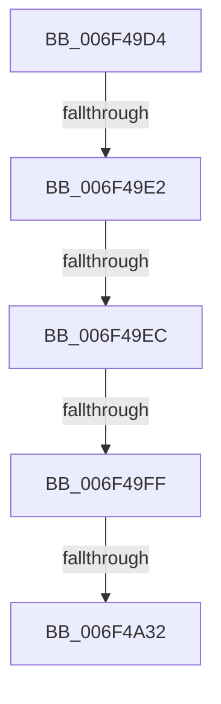

# sub_006F49D4

- RVA: `0x006F49D4`–`0x006F4A5C` (길이 `136` bytes)
- VA: `0x00000001406F49D4`
- 실행 섹션: `.text`
- PDB 이름 있음: `아니요`; PDB Function 태그: `아니요`
- unwind 정보 RVA: `0x000AD79C`
- 디코드: `36`개 명령, `136/136` bytes 표시
- 미해석 바이트: `0` (있으면 어셈블리에 `.byte`로 보존)

> 이 문서는 커널 이미지의 기계어와 PDB 기호를 분석해 생성했습니다. 4번과 5번은 함수 원형과 자료형을 바이너리 사용 방식에서 추정한 C 해석이며 원본 소스 복구 결과는 아닙니다.

## 1. Dependencies

- 직접 호출 지점: **3**; 고유 호출 대상: **1**
- 직접 호출자로 확인된 함수: **0**
- RIP 상대 이미지 참조: **0**

### Outgoing calls
- `0x006F49F2` → [iswctype](../50/iswctype_function_00502900.md) (function, `0x00502900`)
- `0x006F4A07` → [iswctype](../50/iswctype_function_00502900.md) (function, `0x00502900`)
- `0x006F4A3E` → [iswctype](../50/iswctype_function_00502900.md) (function, `0x00502900`)

### Direct callers
- 이 함수 시작 RVA로 연결되는 직접 call은 확인되지 않았습니다. 간접 호출은 완전히 역산할 수 없습니다.

### Static image references
- 디코드된 RIP-relative 메모리 참조가 없습니다.

## 2. Other-region calls and transfers

- 다른 실행 섹션으로 향하는 call: **0**
- call이 아닌 외부 분기/꼬리 이동: **5**
  - `0x006F49DC` → [RtlIpv6StringToAddressExW + 0x68](../47/RtlIpv6StringToAddressExW_function_0047BEE0.md) (`tail-transfer`)
  - `0x006F49E6` → [RtlIpv6StringToAddressExW + 0x68](../47/RtlIpv6StringToAddressExW_function_0047BEE0.md) (`tail-transfer`)
  - `0x006F49F9` → [RtlIpv6StringToAddressExW + 0x68](../47/RtlIpv6StringToAddressExW_function_0047BEE0.md) (`tail-transfer`)
  - `0x006F4A2C` → [RtlIpv6StringToAddressExW + 0x68](../47/RtlIpv6StringToAddressExW_function_0047BEE0.md) (`tail-transfer`)
  - `0x006F4A57` → [RtlIpv6StringToAddressExW + 0x1BD](../47/RtlIpv6StringToAddressExW_function_0047BEE0.md) (`tail-transfer`)

## 3. Assembly (complete function range)

```asm
006F49D4  B8 10 00 00 00                  mov eax, 0x10
006F49D9  66 3B E8                        cmp bp, ax
006F49DC  0F 85 66 75 D8 FF               jne 0x14047bf48
006F49E2  66 41 3B D8                     cmp bx, r8w
006F49E6  0F 83 5C 75 D8 FF               jae 0x14047bf48
006F49EC  41 8B D0                        mov edx, r8d
006F49EF  0F B7 CB                        movzx ecx, bx
006F49F2  E8 09 DF E0 FF                  call 0x140502900
006F49F7  85 C0                           test eax, eax
006F49F9  0F 84 49 75 D8 FF               je 0x14047bf48
006F49FF  BA 02 00 00 00                  mov edx, 2
006F4A04  0F B7 CB                        movzx ecx, bx
006F4A07  E8 F4 DE E0 FF                  call 0x140502900
006F4A0C  F7 D8                           neg eax
006F4A0E  0F B7 CE                        movzx ecx, si
006F4A11  0F B7 C3                        movzx eax, bx
006F4A14  1B D2                           sbb edx, edx
006F4A16  C1 E1 04                        shl ecx, 4
006F4A19  83 E2 20                        and edx, 0x20
006F4A1C  83 C2 41                        add edx, 0x41
006F4A1F  2B CA                           sub ecx, edx
006F4A21  83 C1 0A                        add ecx, 0xa
006F4A24  03 C8                           add ecx, eax
006F4A26  81 F9 FF FF 00 00               cmp ecx, 0xffff
006F4A2C  0F 87 16 75 D8 FF               ja 0x14047bf48
006F4A32  BA 02 00 00 00                  mov edx, 2
006F4A37  66 C1 E6 04                     shl si, 4
006F4A3B  0F B7 CB                        movzx ecx, bx
006F4A3E  E8 BD DE E0 FF                  call 0x140502900
006F4A43  F7 D8                           neg eax
006F4A45  66 1B C9                        sbb cx, cx
006F4A48  66 83 E1 20                     and cx, 0x20
006F4A4C  66 83 C1 41                     add cx, 0x41
006F4A50  66 2B D9                        sub bx, cx
006F4A53  66 83 C3 0A                     add bx, 0xa
006F4A57  E9 41 76 D8 FF                  jmp 0x14047c09d
```

## 4. C-style interpretation (structured pseudocode)

```c
__int64 __fastcall sub_006F49D4(__int64 a1, __int64 a2, int a3)
{
    __int64 result;
    __int64 v_rbx;
    __int64 v_rsi;

    result = iswctype((unsigned __int16)(v_rbx), (unsigned int)(a3), a3, a4);
    result = iswctype((unsigned __int16)(v_rbx), 2, a3, a4);
    result = (unsigned int)(-(result));
    a1 = (unsigned int)(((unsigned __int16)(v_rsi)) << (4));
    a2 = (unsigned int)((2) & (32));
    a2 = (unsigned int)((a2) + (65));
    a1 = (unsigned int)((a1) - ((unsigned int)(a2)));
    a1 = (unsigned int)((a1) + (10));
    a1 = (unsigned int)((a1) + ((unsigned int)((unsigned __int16)(v_rbx))));
    v_rsi = (unsigned __int16)((v_rsi) << (4));
    result = iswctype((unsigned __int16)(v_rbx), 2, a3, a4);
    result = (unsigned int)(-(result));
    a1 = (unsigned __int16)(((unsigned __int16)(v_rbx)) & (32));
    a1 = (unsigned __int16)((a1) + (65));
    v_rbx = (unsigned __int16)((v_rbx) - ((unsigned __int16)(a1)));
    v_rbx = (unsigned __int16)((v_rbx) + (10));
}
```

## 5. (Beta) C Style

```c
int64_t sub_006F49D4(int64_t Arg1, int64_t Arg2, int32_t Arg3)
{
    int64_t result;
    int64_t local_rbx;
    int64_t local_rsi;

    result = iswctype((uint16_t)(local_rbx), (uint32_t)(Arg3), Arg3, a4);
    result = iswctype((uint16_t)(local_rbx), 2, Arg3, a4);
    result = (uint32_t)(-(result));
    Arg1 = (uint32_t)(((uint16_t)(local_rsi)) << (4));
    Arg2 = (uint32_t)((2) & (32));
    Arg2 = (uint32_t)((Arg2) + (65));
    Arg1 = (uint32_t)((Arg1) - ((uint32_t)(Arg2)));
    Arg1 = (uint32_t)((Arg1) + (10));
    Arg1 = (uint32_t)((Arg1) + ((uint32_t)((uint16_t)(local_rbx))));
    local_rsi = (uint16_t)((local_rsi) << (4));
    result = iswctype((uint16_t)(local_rbx), 2, Arg3, a4);
    result = (uint32_t)(-(result));
    Arg1 = (uint16_t)(((uint16_t)(local_rbx)) & (32));
    Arg1 = (uint16_t)((Arg1) + (65));
    local_rbx = (uint16_t)((local_rbx) - ((uint16_t)(Arg1)));
    local_rbx = (uint16_t)((local_rbx) + (10));
}
```

## 6. Execution-region graph

[열기: 2D/3D 그래프와 함수 탐색 컨트롤 패널](../../../control-panel.html?section=text&rva=0x006F49D4&view=graph)

- 2D 그래프는 위에서 아래로 흐르고, 3D 그래프는 빈 공간을 드래그해 회전합니다. Shift+드래그는 이동, 휠은 확대·축소, 함수 노드 선택은 대상 보고서 이동입니다.

### Static fallback


