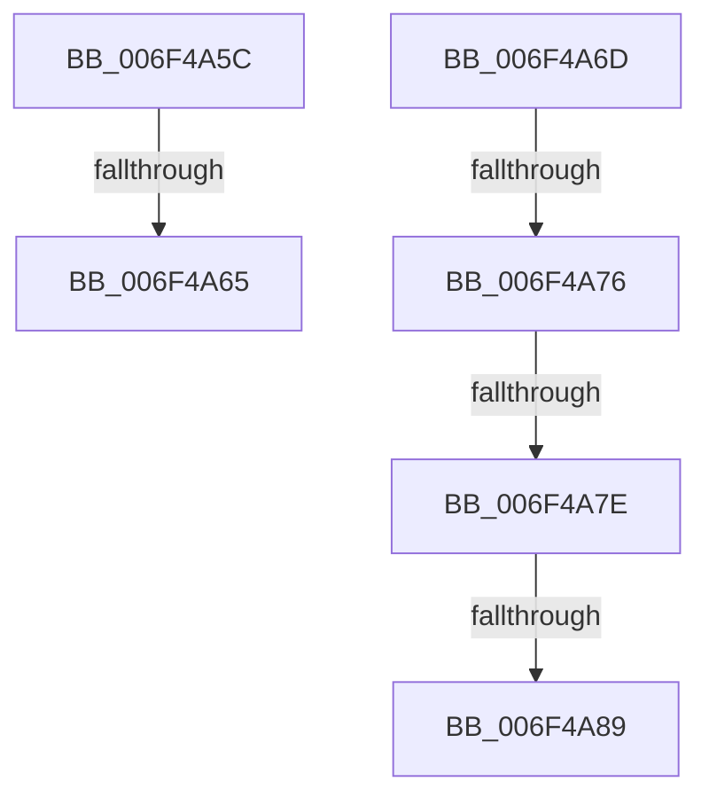

# sub_006F4A5C

- RVA: `0x006F4A5C`–`0x006F4AC2` (길이 `102` bytes)
- VA: `0x00000001406F4A5C`
- 실행 섹션: `.text`
- PDB 이름 있음: `아니요`; PDB Function 태그: `아니요`
- unwind 정보 RVA: `0x000AD7C8`
- 디코드: `25`개 명령, `102/102` bytes 표시
- 미해석 바이트: `0` (있으면 어셈블리에 `.byte`로 보존)

> 이 문서는 커널 이미지의 기계어와 PDB 기호를 분석해 생성했습니다. 4번과 5번은 함수 원형과 자료형을 바이너리 사용 방식에서 추정한 C 해석이며 원본 소스 복구 결과는 아닙니다.

## 1. Dependencies

- 직접 호출 지점: **0**; 고유 호출 대상: **0**
- 직접 호출자로 확인된 함수: **0**
- RIP 상대 이미지 참조: **0**

### Outgoing calls
- 직접 디코드된 call 명령이 없습니다.

### Direct callers
- 이 함수 시작 RVA로 연결되는 직접 call은 확인되지 않았습니다. 간접 호출은 완전히 역산할 수 없습니다.

### Static image references
- 디코드된 RIP-relative 메모리 참조가 없습니다.

## 2. Other-region calls and transfers

- 다른 실행 섹션으로 향하는 call: **0**
- call이 아닌 외부 분기/꼬리 이동: **6**
  - `0x006F4A5F` → [RtlIpv6StringToAddressW + 0xAD](../47/RtlIpv6StringToAddressW_function_0047C110.md) (`tail-transfer`)
  - `0x006F4A68` → [RtlIpv6StringToAddressW + 0x24F](../47/RtlIpv6StringToAddressW_function_0047C110.md) (`tail-transfer`)
  - `0x006F4A70` → [RtlIpv6StringToAddressW + 0x15B](../47/RtlIpv6StringToAddressW_function_0047C110.md) (`tail-transfer`)
  - `0x006F4A78` → [RtlIpv6StringToAddressW + 0xAD](../47/RtlIpv6StringToAddressW_function_0047C110.md) (`tail-transfer`)
  - `0x006F4A83` → [RtlIpv6StringToAddressW + 0xAD](../47/RtlIpv6StringToAddressW_function_0047C110.md) (`tail-transfer`)
  - `0x006F4ABD` → [RtlIpv6StringToAddressW + 0x252](../47/RtlIpv6StringToAddressW_function_0047C110.md) (`tail-transfer`)

## 3. Assembly (complete function range)

```asm
006F4A5C  83 FF 07                        cmp edi, 7
006F4A5F  0F 87 58 77 D8 FF               ja 0x14047c1bd
006F4A65  41 FF C6                        inc r14d
006F4A68  E9 F2 78 D8 FF                  jmp 0x14047c35f
006F4A6D  45 85 F6                        test r14d, r14d
006F4A70  0F 85 F5 77 D8 FF               jne 0x14047c26b
006F4A76  85 FF                           test edi, edi
006F4A78  0F 85 3F 77 D8 FF               jne 0x14047c1bd
006F4A7E  66 83 7E 02 3A                  cmp word ptr [rsi + 2], 0x3a
006F4A83  0F 85 34 77 D8 FF               jne 0x14047c1bd
006F4A89  8D 5F 01                        lea ebx, [rdi + 1]
006F4A8C  41 8B C2                        mov eax, r10d
006F4A8F  45 85 D2                        test r10d, r10d
006F4A92  45 0F B6 DB                     movzx r11d, r11b
006F4A96  8D 7B 01                        lea edi, [rbx + 1]
006F4A99  8B EB                           mov ebp, ebx
006F4A9B  44 0F 44 DB                     cmove r11d, ebx
006F4A9F  44 8B E7                        mov r12d, edi
006F4AA2  33 D2                           xor edx, edx
006F4AA4  44 89 5C 24 20                  mov dword ptr [rsp + 0x20], r11d
006F4AA9  44 03 D3                        add r10d, ebx
006F4AAC  66 41 89 54 45 00               mov word ptr [r13 + rax*2], dx
006F4AB2  44 89 94 24 88 00 00 00         mov dword ptr [rsp + 0x88], r10d
006F4ABA  48 03 F7                        add rsi, rdi
006F4ABD  E9 A0 78 D8 FF                  jmp 0x14047c362
```

## 4. C-style interpretation (structured pseudocode)

```c
__int64 __fastcall sub_006F4A5C(__int64 a1, int a2)
{
    __int64 v_r14;
    unsigned int v_stack_p20;
    unsigned int v_stack_p88;

    v_r14 = (unsigned int)((v_r14) + 1);
}
```

## 5. (Beta) C Style

```c
int64_t sub_006F4A5C(int64_t Arg1, int32_t Arg2)
{
    int64_t local_r14;
    uint32_t v_stack_p20;
    uint32_t v_stack_p88;

    local_r14 = (uint32_t)((local_r14) + 1);
}
```

## 6. Execution-region graph

[열기: 2D/3D 그래프와 함수 탐색 컨트롤 패널](../../../control-panel.html?section=text&rva=0x006F4A5C&view=graph)

- 2D 그래프는 위에서 아래로 흐르고, 3D 그래프는 빈 공간을 드래그해 회전합니다. Shift+드래그는 이동, 휠은 확대·축소, 함수 노드 선택은 대상 보고서 이동입니다.

### Static fallback


