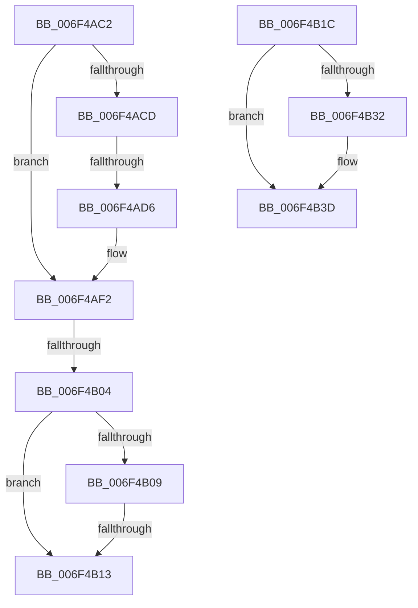

# sub_006F4AC2

- RVA: `0x006F4AC2`–`0x006F4B47` (길이 `133` bytes)
- VA: `0x00000001406F4AC2`
- 실행 섹션: `.text`
- PDB 이름 있음: `아니요`; PDB Function 태그: `아니요`
- unwind 정보 RVA: `0x000AD7F4`
- 디코드: `34`개 명령, `133/133` bytes 표시
- 미해석 바이트: `0` (있으면 어셈블리에 `.byte`로 보존)

> 이 문서는 커널 이미지의 기계어와 PDB 기호를 분석해 생성했습니다. 4번과 5번은 함수 원형과 자료형을 바이너리 사용 방식에서 추정한 C 해석이며 원본 소스 복구 결과는 아닙니다.

## 1. Dependencies

- 직접 호출 지점: **3**; 고유 호출 대상: **3**
- 직접 호출자로 확인된 함수: **0**
- RIP 상대 이미지 참조: **0**

### Outgoing calls
- `0x006F4AEC` → [KeBugCheckEx](../4F/KeBugCheckEx_function_004FD660.md) (function, `0x004FD660`)
- `0x006F4B29` → [MmGetSectionRange](../../page/7F/MmGetSectionRange_function_007F9408.md) (function, `0x007F9408`)
- `0x006F4B37` → [PopInternalError](../5C/PopInternalError_function_005CEBD0.md) (function, `0x005CEBD0`)

### Direct callers
- 이 함수 시작 RVA로 연결되는 직접 call은 확인되지 않았습니다. 간접 호출은 완전히 역산할 수 없습니다.

### Static image references
- 디코드된 RIP-relative 메모리 참조가 없습니다.

## 2. Other-region calls and transfers

- 다른 실행 섹션으로 향하는 call: **1**
  - `0x006F4B29` → [MmGetSectionRange](../../page/7F/MmGetSectionRange_function_007F9408.md) (`.text` → `PAGE`)
- call이 아닌 외부 분기/꼬리 이동: **5**
  - `0x006F4AD0` → [PoSetHiberRange + 0x184](../47/PoSetHiberRange_function_0047C580.md) (`tail-transfer`)
  - `0x006F4AFE` → [PoSetHiberRange + 0x153](../47/PoSetHiberRange_function_0047C580.md) (`tail-transfer`)
  - `0x006F4B0D` → [PoSetHiberRange + 0x153](../47/PoSetHiberRange_function_0047C580.md) (`tail-transfer`)
  - `0x006F4B17` → [PoSetHiberRange + 0x54](../47/PoSetHiberRange_function_0047C580.md) (`tail-transfer`)
  - `0x006F4B42` → [PoSetHiberRange + 0x5D](../47/PoSetHiberRange_function_0047C580.md) (`tail-transfer`)

## 3. Assembly (complete function range)

```asm
006F4AC2  8B 85 C8 00 00 00               mov eax, dword ptr [rbp + 0xc8]
006F4AC8  83 F8 08                        cmp eax, 8
006F4ACB  74 25                           je 0x1406f4af2
006F4ACD  83 F8 09                        cmp eax, 9
006F4AD0  0F 84 2E 7C D8 FF               je 0x14047c704
006F4AD6  BA 0B 01 00 00                  mov edx, 0x10b
006F4ADB  48 89 7C 24 20                  mov qword ptr [rsp + 0x20], rdi
006F4AE0  44 8B C8                        mov r9d, eax
006F4AE3  41 B8 0A 00 00 00               mov r8d, 0xa
006F4AE9  8D 4A 95                        lea ecx, [rdx - 0x6b]
006F4AEC  E8 6F 8B E0 FF                  call 0x1404fd660
006F4AF1  CC                              int3
006F4AF2  8B C3                           mov eax, ebx
006F4AF4  B9 00 00 01 00                  mov ecx, 0x10000
006F4AF9  41 23 C6                        and eax, r14d
006F4AFC  3B C1                           cmp eax, ecx
006F4AFE  0F 85 CF 7B D8 FF               jne 0x14047c6d3
006F4B04  4D 85 C9                        test r9, r9
006F4B07  75 0A                           jne 0x1406f4b13
006F4B09  0F BA E3 0E                     bt ebx, 0xe
006F4B0D  0F 82 C0 7B D8 FF               jb 0x14047c6d3
006F4B13  8B C3                           mov eax, ebx
006F4B15  23 C1                           and eax, ecx
006F4B17  E9 B8 7A D8 FF                  jmp 0x14047c5d4
006F4B1C  4C 8D 44 24 30                  lea r8, [rsp + 0x30]
006F4B21  48 8D 94 24 90 00 00 00         lea rdx, [rsp + 0x90]
006F4B29  E8 DA 48 10 00                  call 0x1407f9408
006F4B2E  85 C0                           test eax, eax
006F4B30  79 0B                           jns 0x1406f4b3d
006F4B32  B9 6E 16 0A 00                  mov ecx, 0xa166e
006F4B37  E8 94 A0 ED FF                  call 0x1405cebd0
006F4B3C  CC                              int3
006F4B3D  44 8B 4C 24 30                  mov r9d, dword ptr [rsp + 0x30]
006F4B42  E9 96 7A D8 FF                  jmp 0x14047c5dd
```

## 4. C-style interpretation (structured pseudocode)

```c
__int64 __fastcall sub_006F4AC2(void)
{
    __int64 result;
    unsigned __int64 v_stack_p20;
    unsigned __int64 v_stack_p30;
    unsigned __int64 v_stack_p90;

    if (((unsigned int)((unsigned int)(*(unsigned int *)(v_rbp + 200)))) == 8) goto loc_006F4AF2;
    v_stack_p20 = v_rdi;
    result = KeBugCheckEx(267 - 107, 267, 10, (unsigned int)((unsigned int)((unsigned int)(*(unsigned int *)(v_rbp + 200)))));
loc_006F4AF2:
    result = (unsigned int)(((unsigned int)((unsigned int)(v_rbx))) & ((unsigned int)(v_r14)));
    if ((unsigned int)((unsigned int)((unsigned int)(*(unsigned int *)(v_rbp + 200)))) != 0) goto loc_006F4B13;
loc_006F4B13:
    result = (unsigned int)(((unsigned int)((unsigned int)(v_rbx))) & ((unsigned int)((unsigned int)(0x10000ULL))));
}
```

## 5. (Beta) C Style

```c
void sub_006F4AC2(void)
{
    int64_t result;
    uint64_t v_stack_p20;
    uint64_t v_stack_p30;
    uint64_t v_stack_p90;

    if (((uint32_t)((uint32_t)(*(uint32_t *)(local_rbp + 0xC8)))) == 8) goto loc_006F4AF2;
    v_stack_p20 = local_rdi;
    result = KeBugCheckEx(267 - 107, 267, 10, (uint32_t)((uint32_t)((uint32_t)(*(uint32_t *)(local_rbp + 0xC8)))));
loc_006F4AF2:
    result = (uint32_t)(((uint32_t)((uint32_t)(local_rbx))) & ((uint32_t)(local_r14)));
    if ((uint32_t)((uint32_t)((uint32_t)(*(uint32_t *)(local_rbp + 0xC8)))) != 0) goto loc_006F4B13;
loc_006F4B13:
    result = (uint32_t)(((uint32_t)((uint32_t)(local_rbx))) & ((uint32_t)((uint32_t)(0x10000ULL))));
}
```

## 6. Execution-region graph

[열기: 2D/3D 그래프와 함수 탐색 컨트롤 패널](../../../control-panel.html?section=text&rva=0x006F4AC2&view=graph)

- 2D 그래프는 위에서 아래로 흐르고, 3D 그래프는 빈 공간을 드래그해 회전합니다. Shift+드래그는 이동, 휠은 확대·축소, 함수 노드 선택은 대상 보고서 이동입니다.

### Static fallback


