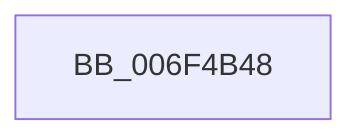

# sub_006F4B48

- RVA: `0x006F4B48`–`0x006F4B72` (길이 `42` bytes)
- VA: `0x00000001406F4B48`
- 실행 섹션: `.text`
- PDB 이름 있음: `아니요`; PDB Function 태그: `아니요`
- unwind 정보 RVA: `0x000AD810`
- 디코드: `10`개 명령, `42/42` bytes 표시
- 미해석 바이트: `0` (있으면 어셈블리에 `.byte`로 보존)

> 이 문서는 커널 이미지의 기계어와 PDB 기호를 분석해 생성했습니다. 4번과 5번은 함수 원형과 자료형을 바이너리 사용 방식에서 추정한 C 해석이며 원본 소스 복구 결과는 아닙니다.

## 1. Dependencies

- 직접 호출 지점: **2**; 고유 호출 대상: **2**
- 직접 호출자로 확인된 함수: **0**
- RIP 상대 이미지 참조: **0**

### Outgoing calls
- `0x006F4B50` → [PopInternalAddToDumpFile](../5C/PopInternalAddToDumpFile_function_005CE634.md) (function, `0x005CE634`)
- `0x006F4B6C` → [KeBugCheckEx](../4F/KeBugCheckEx_function_004FD660.md) (function, `0x004FD660`)

### Direct callers
- 이 함수 시작 RVA로 연결되는 직접 call은 확인되지 않았습니다. 간접 호출은 완전히 역산할 수 없습니다.

### Static image references
- 디코드된 RIP-relative 메모리 참조가 없습니다.

## 2. Other-region calls and transfers

- 다른 실행 섹션으로 향하는 call: **0**
- 별도 외부 분기/꼬리 이동을 확인하지 못했습니다.

## 3. Assembly (complete function range)

```asm
006F4B48  45 33 C0                        xor r8d, r8d
006F4B4B  BA F0 01 00 00                  mov edx, 0x1f0
006F4B50  E8 DF 9A ED FF                  call 0x1405ce634
006F4B55  48 83 64 24 20 00               and qword ptr [rsp + 0x20], 0
006F4B5B  BA 05 01 00 00                  mov edx, 0x105
006F4B60  4C 8B CB                        mov r9, rbx
006F4B63  41 B8 0A 00 00 00               mov r8d, 0xa
006F4B69  8D 4A 9B                        lea ecx, [rdx - 0x65]
006F4B6C  E8 EF 8A E0 FF                  call 0x1404fd660
006F4B71  CC                              int3
```

## 4. C-style interpretation (structured pseudocode)

```c
__int64 __fastcall sub_006F4B48(__int64 a1, __int64 a2, int a3)
{
    __int64 result;
    unsigned __int64 v_stack_p20;

    a3 = 0;
    result = PopInternalAddToDumpFile(a1, 496, a3, a4);
    result = KeBugCheckEx(261 - 101, 261, 10, v_rbx);
    return result;
}
```

## 5. (Beta) C Style

```c
int64_t sub_006F4B48(int64_t Arg1, int64_t Arg2, int32_t Arg3)
{
    int64_t result;
    uint64_t v_stack_p20;

    Arg3 = 0;
    result = PopInternalAddToDumpFile(Arg1, 496, Arg3, a4);
    result = KeBugCheckEx(261 - 101, 261, 10, local_rbx);
    return result;
}
```

## 6. Execution-region graph

[열기: 2D/3D 그래프와 함수 탐색 컨트롤 패널](../../../control-panel.html?section=text&rva=0x006F4B48&view=graph)

- 2D 그래프는 위에서 아래로 흐르고, 3D 그래프는 빈 공간을 드래그해 회전합니다. Shift+드래그는 이동, 휠은 확대·축소, 함수 노드 선택은 대상 보고서 이동입니다.

### Static fallback


