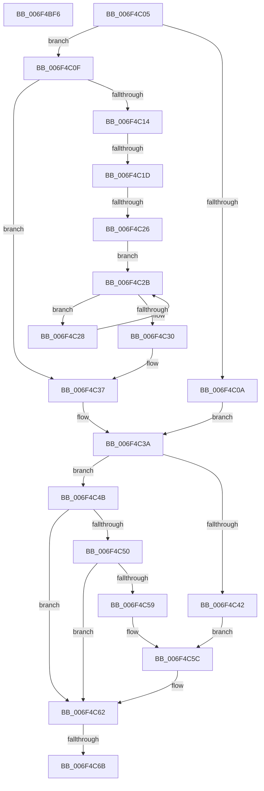

# sub_006F4BF6

- RVA: `0x006F4BF6`–`0x006F4C70` (길이 `122` bytes)
- VA: `0x00000001406F4BF6`
- 실행 섹션: `.text`
- PDB 이름 있음: `아니요`; PDB Function 태그: `아니요`
- unwind 정보 RVA: `0x000ADC58`
- 디코드: `37`개 명령, `122/122` bytes 표시
- 미해석 바이트: `0` (있으면 어셈블리에 `.byte`로 보존)

> 이 문서는 커널 이미지의 기계어와 PDB 기호를 분석해 생성했습니다. 4번과 5번은 함수 원형과 자료형을 바이너리 사용 방식에서 추정한 C 해석이며 원본 소스 복구 결과는 아닙니다.

## 1. Dependencies

- 직접 호출 지점: **1**; 고유 호출 대상: **1**
- 직접 호출자로 확인된 함수: **0**
- RIP 상대 이미지 참조: **0**

### Outgoing calls
- `0x006F4BF6` → [MiReleaseNonPagedResources](../32/MiReleaseNonPagedResources_function_0032299C.md) (function, `0x0032299C`)

### Direct callers
- 이 함수 시작 RVA로 연결되는 직접 call은 확인되지 않았습니다. 간접 호출은 완전히 역산할 수 없습니다.

### Static image references
- 디코드된 RIP-relative 메모리 참조가 없습니다.

## 2. Other-region calls and transfers

- 다른 실행 섹션으로 향하는 call: **0**
- call이 아닌 외부 분기/꼬리 이동: **5**
  - `0x006F4C00` → [MiObtainMdlCharges + 0x145](../47/MiObtainMdlCharges_function_0047E014.md) (`tail-transfer`)
  - `0x006F4C17` → [MiObtainMdlCharges + 0x14C](../47/MiObtainMdlCharges_function_0047E014.md) (`tail-transfer`)
  - `0x006F4C20` → [MiObtainMdlCharges + 0x14C](../47/MiObtainMdlCharges_function_0047E014.md) (`tail-transfer`)
  - `0x006F4C65` → [MiObtainMdlCharges + 0x5D](../47/MiObtainMdlCharges_function_0047E014.md) (`tail-transfer`)
  - `0x006F4C6B` → [MiObtainMdlCharges + 0x14C](../47/MiObtainMdlCharges_function_0047E014.md) (`tail-transfer`)

## 3. Assembly (complete function range)

```asm
006F4BF6  E8 A1 DD C2 FF                  call 0x14032299c
006F4BFB  BD 01 00 00 00                  mov ebp, 1
006F4C00  E9 54 95 D8 FF                  jmp 0x14047e159
006F4C05  48 3B F9                        cmp rdi, rcx
006F4C08  76 05                           jbe 0x1406f4c0f
006F4C0A  48 8B F9                        mov rdi, rcx
006F4C0D  EB 2B                           jmp 0x1406f4c3a
006F4C0F  48 3B FE                        cmp rdi, rsi
006F4C12  77 23                           ja 0x1406f4c37
006F4C14  45 85 E4                        test r12d, r12d
006F4C17  0F 85 43 95 D8 FF               jne 0x14047e160
006F4C1D  48 3B F5                        cmp rsi, rbp
006F4C20  0F 84 3A 95 D8 FF               je 0x14047e160
006F4C26  EB 03                           jmp 0x1406f4c2b
006F4C28  48 D1 EE                        shr rsi, 1
006F4C2B  48 3B FE                        cmp rdi, rsi
006F4C2E  72 F8                           jb 0x1406f4c28
006F4C30  48 85 F6                        test rsi, rsi
006F4C33  48 0F 44 F5                     cmove rsi, rbp
006F4C37  48 2B FE                        sub rdi, rsi
006F4C3A  8B 4B 38                        mov ecx, dword ptr [rbx + 0x38]
006F4C3D  F6 C1 40                        test cl, 0x40
006F4C40  74 09                           je 0x1406f4c4b
006F4C42  48 8B 43 18                     mov rax, qword ptr [rbx + 0x18]
006F4C46  48 2B C5                        sub rax, rbp
006F4C49  EB 11                           jmp 0x1406f4c5c
006F4C4B  F6 C1 20                        test cl, 0x20
006F4C4E  74 12                           je 0x1406f4c62
006F4C50  48 8B 43 18                     mov rax, qword ptr [rbx + 0x18]
006F4C54  48 85 C0                        test rax, rax
006F4C57  74 09                           je 0x1406f4c62
006F4C59  48 FF C8                        dec rax
006F4C5C  48 F7 D0                        not rax
006F4C5F  48 23 F8                        and rdi, rax
006F4C62  48 85 FF                        test rdi, rdi
006F4C65  0F 85 06 94 D8 FF               jne 0x14047e071
006F4C6B  E9 F0 94 D8 FF                  jmp 0x14047e160
```

## 4. C-style interpretation (structured pseudocode)

```c
__int64 __fastcall sub_006F4BF6(__int64 a1)
{
    __int64 result;

    result = MiReleaseNonPagedResources(a1, a2, a3, a4);
}
```

## 5. (Beta) C Style

```c
int64_t sub_006F4BF6(int64_t Arg1)
{
    int64_t result;

    result = MiReleaseNonPagedResources(Arg1, a2, a3, a4);
}
```

## 6. Execution-region graph

[열기: 2D/3D 그래프와 함수 탐색 컨트롤 패널](../../../control-panel.html?section=text&rva=0x006F4BF6&view=graph)

- 2D 그래프는 위에서 아래로 흐르고, 3D 그래프는 빈 공간을 드래그해 회전합니다. Shift+드래그는 이동, 휠은 확대·축소, 함수 노드 선택은 대상 보고서 이동입니다.

### Static fallback


