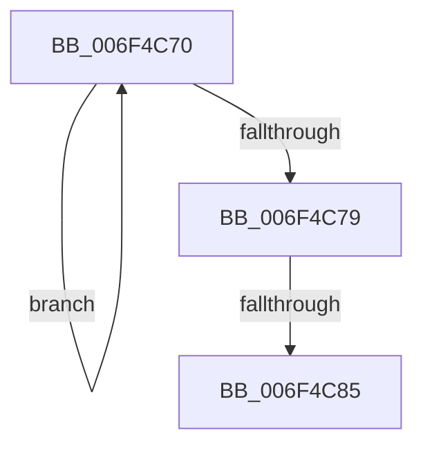

# sub_006F4C70

- RVA: `0x006F4C70`–`0x006F4C8C` (길이 `28` bytes)
- VA: `0x00000001406F4C70`
- 실행 섹션: `.text`
- PDB 이름 있음: `아니요`; PDB Function 태그: `아니요`
- unwind 정보 RVA: `0x000ADFA8`
- 디코드: `8`개 명령, `28/28` bytes 표시
- 미해석 바이트: `0` (있으면 어셈블리에 `.byte`로 보존)

> 이 문서는 커널 이미지의 기계어와 PDB 기호를 분석해 생성했습니다. 4번과 5번은 함수 원형과 자료형을 바이너리 사용 방식에서 추정한 C 해석이며 원본 소스 복구 결과는 아닙니다.

## 1. Dependencies

- 직접 호출 지점: **0**; 고유 호출 대상: **0**
- 직접 호출자로 확인된 함수: **0**
- RIP 상대 이미지 참조: **0**

### Outgoing calls
- 직접 디코드된 call 명령이 없습니다.

### Direct callers
- 이 함수 시작 RVA로 연결되는 직접 call은 확인되지 않았습니다. 간접 호출은 완전히 역산할 수 없습니다.

### Static image references
- 디코드된 RIP-relative 메모리 참조가 없습니다.

## 2. Other-region calls and transfers

- 다른 실행 섹션으로 향하는 call: **0**
- call이 아닌 외부 분기/꼬리 이동: **2**
  - `0x006F4C7F` → [LdrpCompareResourceNamesWithValidation + 0x79](../47/LdrpCompareResourceNamesWithValidation_function_0047E3D4.md) (`tail-transfer`)
  - `0x006F4C87` → [LdrpCompareResourceNamesWithValidation + 0x32](../47/LdrpCompareResourceNamesWithValidation_function_0047E3D4.md) (`tail-transfer`)

## 3. Assembly (complete function range)

```asm
006F4C70  48 FF C1                        inc rcx
006F4C73  66 39 34 4F                     cmp word ptr [rdi + rcx*2], si
006F4C77  75 F7                           jne 0x1406f4c70
006F4C79  0F B7 03                        movzx eax, word ptr [rbx]
006F4C7C  48 3B C8                        cmp rcx, rax
006F4C7F  0F 85 C8 97 D8 FF               jne 0x14047e44d
006F4C85  8B C2                           mov eax, edx
006F4C87  E9 7A 97 D8 FF                  jmp 0x14047e406
```

## 4. C-style interpretation (structured pseudocode)

```c
__int64 __fastcall sub_006F4C70(__int64 a1, int a2)
{
    a1 = (a1) + 1;
    if ((*(unsigned __int16 *)(v_rdi + a1 * 2)) != ((unsigned __int16)(v_rsi))) goto loc_006F4C70;
}
```

## 5. (Beta) C Style

```c
int64_t sub_006F4C70(int64_t Arg1, int32_t Arg2)
{
    Arg1 = (Arg1) + 1;
    if ((*(uint16_t *)(local_rdi + Arg1 * 2)) != ((uint16_t)(local_rsi))) goto loc_006F4C70;
}
```

## 6. Execution-region graph

[열기: 2D/3D 그래프와 함수 탐색 컨트롤 패널](../../../control-panel.html?section=text&rva=0x006F4C70&view=graph)

- 2D 그래프는 위에서 아래로 흐르고, 3D 그래프는 빈 공간을 드래그해 회전합니다. Shift+드래그는 이동, 휠은 확대·축소, 함수 노드 선택은 대상 보고서 이동입니다.

### Static fallback


