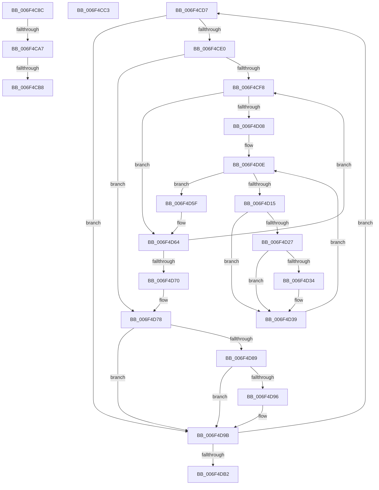

# sub_006F4C8C

- RVA: `0x006F4C8C`–`0x006F4DB7` (길이 `299` bytes)
- VA: `0x00000001406F4C8C`
- 실행 섹션: `.text`
- PDB 이름 있음: `아니요`; PDB Function 태그: `아니요`
- unwind 정보 RVA: `0x000AE01C`
- 디코드: `73`개 명령, `299/299` bytes 표시
- 미해석 바이트: `0` (있으면 어셈블리에 `.byte`로 보존)

> 이 문서는 커널 이미지의 기계어와 PDB 기호를 분석해 생성했습니다. 4번과 5번은 함수 원형과 자료형을 바이너리 사용 방식에서 추정한 C 해석이며 원본 소스 복구 결과는 아닙니다.

## 1. Dependencies

- 직접 호출 지점: **6**; 고유 호출 대상: **4**
- 직접 호출자로 확인된 함수: **0**
- RIP 상대 이미지 참조: **0**

### Outgoing calls
- `0x006F4C8F` → [KeAbPostRelease](../2E/KeAbPostRelease_function_002E1600.md) (function, `0x002E1600`)
- `0x006F4CB8` → [KiCheckForKernelApcDelivery](../2E/KiCheckForKernelApcDelivery_function_002E2C80.md) (function, `0x002E2C80`)
- `0x006F4CCA` → [KeResetEvent](../24/KeResetEvent_function_00248350.md) (function, `0x00248350`)
- `0x006F4D34` → [KiCheckForKernelApcDelivery](../2E/KiCheckForKernelApcDelivery_function_002E2C80.md) (function, `0x002E2C80`)
- `0x006F4D50` → [KeWaitForSingleObject](../20/KeWaitForSingleObject_function_0020E6B0.md) (function, `0x0020E6B0`)
- `0x006F4D96` → [KiCheckForKernelApcDelivery](../2E/KiCheckForKernelApcDelivery_function_002E2C80.md) (function, `0x002E2C80`)

### Direct callers
- 이 함수 시작 RVA로 연결되는 직접 call은 확인되지 않았습니다. 간접 호출은 완전히 역산할 수 없습니다.

### Static image references
- 디코드된 RIP-relative 메모리 참조가 없습니다.

## 2. Other-region calls and transfers

- 다른 실행 섹션으로 향하는 call: **0**
- call이 아닌 외부 분기/꼬리 이동: **5**
  - `0x006F4CA1` → [MiModifiedPageWriter + 0x4F9](../47/MiModifiedPageWriter_function_0047E5F0.md) (`tail-transfer`)
  - `0x006F4CB2` → [MiModifiedPageWriter + 0x4F9](../47/MiModifiedPageWriter_function_0047E5F0.md) (`tail-transfer`)
  - `0x006F4CBE` → [MiModifiedPageWriter + 0x4F9](../47/MiModifiedPageWriter_function_0047E5F0.md) (`tail-transfer`)
  - `0x006F4CD2` → [MiModifiedPageWriter + 0x15C](../47/MiModifiedPageWriter_function_0047E5F0.md) (`tail-transfer`)
  - `0x006F4DB2` → [MiModifiedPageWriter + 0x4DC](../47/MiModifiedPageWriter_function_0047E5F0.md) (`tail-transfer`)

## 3. Assembly (complete function range)

```asm
006F4C8C  49 8B CE                        mov rcx, r14
006F4C8F  E8 6C C9 BE FF                  call 0x1402e1600
006F4C94  B9 01 00 00 00                  mov ecx, 1
006F4C99  90                              nop
006F4C9A  66 01 8F E6 01 00 00            add word ptr [rdi + 0x1e6], cx
006F4CA1  0F 85 42 9E D8 FF               jne 0x14047eae9
006F4CA7  48 8D 87 98 00 00 00            lea rax, [rdi + 0x98]
006F4CAE  90                              nop
006F4CAF  48 39 00                        cmp qword ptr [rax], rax
006F4CB2  0F 84 31 9E D8 FF               je 0x14047eae9
006F4CB8  E8 C3 DF BE FF                  call 0x1402e2c80
006F4CBD  90                              nop
006F4CBE  E9 26 9E D8 FF                  jmp 0x14047eae9
006F4CC3  48 8D 8E 10 03 00 00            lea rcx, [rsi + 0x310]
006F4CCA  E8 81 36 B5 FF                  call 0x140248350
006F4CCF  45 33 E4                        xor r12d, r12d
006F4CD2  E9 75 9A D8 FF                  jmp 0x14047e74c
006F4CD7  4D 39 26                        cmp qword ptr [r14], r12
006F4CDA  0F 84 BB 00 00 00               je 0x1406f4d9b
006F4CE0  66 01 9F E6 01 00 00            add word ptr [rdi + 0x1e6], bx
006F4CE7  45 8B FC                        mov r15d, r12d
006F4CEA  90                              nop
006F4CEB  49 8B 06                        mov rax, qword ptr [r14]
006F4CEE  44 39 60 28                     cmp dword ptr [rax + 0x28], r12d
006F4CF2  0F 86 80 00 00 00               jbe 0x1406f4d78
006F4CF8  48 8B 40 20                     mov rax, qword ptr [rax + 0x20]
006F4CFC  41 8B CF                        mov ecx, r15d
006F4CFF  4C 8B 24 C8                     mov r12, qword ptr [rax + rcx*8]
006F4D03  4D 85 E4                        test r12, r12
006F4D06  74 5C                           je 0x1406f4d64
006F4D08  41 BE 01 00 00 00               mov r14d, 1
006F4D0E  49 83 3C 24 61                  cmp qword ptr [r12], 0x61
006F4D13  75 4A                           jne 0x1406f4d5f
006F4D15  44 88 B6 D1 02 00 00            mov byte ptr [rsi + 0x2d1], r14b
006F4D1C  90                              nop
006F4D1D  66 44 01 B7 E6 01 00 00         add word ptr [rdi + 0x1e6], r14w
006F4D25  75 12                           jne 0x1406f4d39
006F4D27  48 8D 87 98 00 00 00            lea rax, [rdi + 0x98]
006F4D2E  90                              nop
006F4D2F  48 39 00                        cmp qword ptr [rax], rax
006F4D32  74 05                           je 0x1406f4d39
006F4D34  E8 47 DF BE FF                  call 0x1402e2c80
006F4D39  48 83 64 24 20 00               and qword ptr [rsp + 0x20], 0
006F4D3F  48 8D 8E C8 03 00 00            lea rcx, [rsi + 0x3c8]
006F4D46  45 33 C9                        xor r9d, r9d
006F4D49  45 33 C0                        xor r8d, r8d
006F4D4C  41 8D 51 13                     lea edx, [r9 + 0x13]
006F4D50  E8 5B 99 B1 FF                  call 0x14020e6b0
006F4D55  66 01 9F E6 01 00 00            add word ptr [rdi + 0x1e6], bx
006F4D5C  90                              nop
006F4D5D  EB AF                           jmp 0x1406f4d0e
006F4D5F  4C 8B 74 24 48                  mov r14, qword ptr [rsp + 0x48]
006F4D64  49 8B 06                        mov rax, qword ptr [r14]
006F4D67  41 FF C7                        inc r15d
006F4D6A  44 3B 78 28                     cmp r15d, dword ptr [rax + 0x28]
006F4D6E  72 88                           jb 0x1406f4cf8
006F4D70  4C 8B 6C 24 50                  mov r13, qword ptr [rsp + 0x50]
006F4D75  45 33 E4                        xor r12d, r12d
006F4D78  41 BF 01 00 00 00               mov r15d, 1
006F4D7E  90                              nop
006F4D7F  66 44 01 BF E6 01 00 00         add word ptr [rdi + 0x1e6], r15w
006F4D87  75 12                           jne 0x1406f4d9b
006F4D89  48 8D 87 98 00 00 00            lea rax, [rdi + 0x98]
006F4D90  90                              nop
006F4D91  48 39 00                        cmp qword ptr [rax], rax
006F4D94  74 05                           je 0x1406f4d9b
006F4D96  E8 E5 DE BE FF                  call 0x1402e2c80
006F4D9B  49 83 C6 08                     add r14, 8
006F4D9F  4D 2B EF                        sub r13, r15
006F4DA2  4C 89 74 24 48                  mov qword ptr [rsp + 0x48], r14
006F4DA7  4C 89 6C 24 50                  mov qword ptr [rsp + 0x50], r13
006F4DAC  0F 85 25 FF FF FF               jne 0x1406f4cd7
006F4DB2  E9 15 9D D8 FF                  jmp 0x14047eacc
```

## 4. C-style interpretation (structured pseudocode)

```c
__int64 __fastcall sub_006F4C8C(__int64 a1, __int64 a2, int a3, int a4)
{
    __int64 result;
    unsigned __int64 v_stack_p20;
    unsigned __int64 v_stack_p48;
    unsigned __int64 v_stack_p50;

    result = KeAbPostRelease(v_r14, a2, a3, a4);
    result = KiCheckForKernelApcDelivery(1, a2, a3, a4);
}
```

## 5. (Beta) C Style

```c
int64_t sub_006F4C8C(int64_t Arg1, int64_t Arg2, int32_t Arg3, int32_t Arg4)
{
    int64_t result;
    uint64_t v_stack_p20;
    uint64_t v_stack_p48;
    uint64_t v_stack_p50;

    result = KeAbPostRelease(local_r14, Arg2, Arg3, Arg4);
    result = KiCheckForKernelApcDelivery(1, Arg2, Arg3, Arg4);
}
```

## 6. Execution-region graph

[열기: 2D/3D 그래프와 함수 탐색 컨트롤 패널](../../../control-panel.html?section=text&rva=0x006F4C8C&view=graph)

- 2D 그래프는 위에서 아래로 흐르고, 3D 그래프는 빈 공간을 드래그해 회전합니다. Shift+드래그는 이동, 휠은 확대·축소, 함수 노드 선택은 대상 보고서 이동입니다.

### Static fallback


