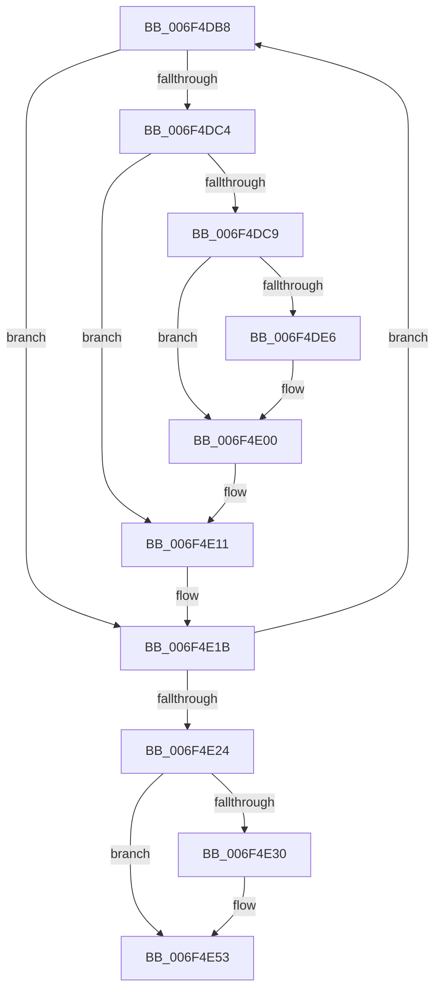

# sub_006F4DB8

- RVA: `0x006F4DB8`–`0x006F4E67` (길이 `175` bytes)
- VA: `0x00000001406F4DB8`
- 실행 섹션: `.text`
- PDB 이름 있음: `아니요`; PDB Function 태그: `아니요`
- unwind 정보 RVA: `0x000AE06C`
- 디코드: `40`개 명령, `175/175` bytes 표시
- 미해석 바이트: `0` (있으면 어셈블리에 `.byte`로 보존)

> 이 문서는 커널 이미지의 기계어와 PDB 기호를 분석해 생성했습니다. 4번과 5번은 함수 원형과 자료형을 바이너리 사용 방식에서 추정한 C 해석이며 원본 소스 복구 결과는 아닙니다.

## 1. Dependencies

- 직접 호출 지점: **5**; 고유 호출 대상: **5**
- 직접 호출자로 확인된 함수: **0**
- RIP 상대 이미지 참조: **1**

### Outgoing calls
- `0x006F4DD3` → [ExAcquireSpinLockExclusive](../24/ExAcquireSpinLockExclusive_function_00248690.md) (function, `0x00248690`)
- `0x006F4DF2` → [MiInitializePagefileBitmapsCache](../3E/MiInitializePagefileBitmapsCache_function_003E5348.md) (function, `0x003E5348`)
- `0x006F4E06` → [MiReleaseSpinLockExclusive](../24/MiReleaseSpinLockExclusive_function_002482C0.md) (function, `0x002482C0`)
- `0x006F4E16` → [MiFreeModifiedReservations](../4F/MiFreeModifiedReservations_function_004FA318.md) (function, `0x004FA318`)
- `0x006F4E33` → [KiQueryUnbiasedInterruptTime](../42/KiQueryUnbiasedInterruptTime_function_0042D180.md) (function, `0x0042D180`)

### Direct callers
- 이 함수 시작 RVA로 연결되는 직접 call은 확인되지 않았습니다. 간접 호출은 완전히 역산할 수 없습니다.

### Static image references
- `0x006F4DF7` → RVA `0x00FC520C` (`ALMOSTRO`; read)

## 2. Other-region calls and transfers

- 다른 실행 섹션으로 향하는 call: **0**
- call이 아닌 외부 분기/꼬리 이동: **1**
  - `0x006F4E62` → [MiCheckFreeModifiedReservations + 0x43](../47/MiCheckFreeModifiedReservations_function_0047ED60.md) (`tail-transfer`)

## 3. Assembly (complete function range)

```asm
006F4DB8  48 8B 3E                        mov rdi, qword ptr [rsi]
006F4DBB  F6 87 AC 00 00 00 60            test byte ptr [rdi + 0xac], 0x60
006F4DC2  75 57                           jne 0x1406f4e1b
006F4DC4  4D 3B FE                        cmp r15, r14
006F4DC7  76 48                           jbe 0x1406f4e11
006F4DC9  4C 8D A7 C8 00 00 00            lea r12, [rdi + 0xc8]
006F4DD0  49 8B CC                        mov rcx, r12
006F4DD3  E8 B8 38 B5 FF                  call 0x140248690
006F4DD8  8A 97 AF 00 00 00               mov dl, byte ptr [rdi + 0xaf]
006F4DDE  44 8A E8                        mov r13b, al
006F4DE1  F6 C2 01                        test dl, 1
006F4DE4  75 1A                           jne 0x1406f4e00
006F4DE6  80 CA 01                        or dl, 1
006F4DE9  48 8B CF                        mov rcx, rdi
006F4DEC  88 97 AF 00 00 00               mov byte ptr [rdi + 0xaf], dl
006F4DF2  E8 51 05 CF FF                  call 0x1403e5348
006F4DF7  8B 15 0F 04 8D 00               mov edx, dword ptr [rip + 0x8d040f]
006F4DFD  89 57 5C                        mov dword ptr [rdi + 0x5c], edx
006F4E00  41 8A D5                        mov dl, r13b
006F4E03  49 8B CC                        mov rcx, r12
006F4E06  E8 B5 34 B5 FF                  call 0x1402482c0
006F4E0B  41 BC 01 00 00 00               mov r12d, 1
006F4E11  33 D2                           xor edx, edx
006F4E13  48 8B CF                        mov rcx, rdi
006F4E16  E8 FD 54 E0 FF                  call 0x1404fa318
006F4E1B  48 83 C6 08                     add rsi, 8
006F4E1F  49 2B EC                        sub rbp, r12
006F4E22  75 94                           jne 0x1406f4db8
006F4E24  44 01 A3 88 03 00 00            add dword ptr [rbx + 0x388], r12d
006F4E2B  4D 3B FE                        cmp r15, r14
006F4E2E  76 23                           jbe 0x1406f4e53
006F4E30  41 8A CC                        mov cl, r12b
006F4E33  E8 48 83 D3 FF                  call 0x14042d180
006F4E38  48 89 83 90 03 00 00            mov qword ptr [rbx + 0x390], rax
006F4E3F  F0 83 0C 24 00                  lock or dword ptr [rsp], 0
006F4E44  66 44 09 A3 9C 03 00 00         or word ptr [rbx + 0x39c], r12w
006F4E4C  44 01 A3 84 03 00 00            add dword ptr [rbx + 0x384], r12d
006F4E53  83 A3 80 03 00 00 00            and dword ptr [rbx + 0x380], 0
006F4E5A  48 83 A3 78 03 00 00 00         and qword ptr [rbx + 0x378], 0
006F4E62  E9 3C 9F D8 FF                  jmp 0x14047eda3
```

## 4. C-style interpretation (structured pseudocode)

```c
__int64 __fastcall sub_006F4DB8(void)
{
    __int64 result;
    __int64 v_rbp;
    __int64 v_rsi;
    unsigned int v_stack_p0;

    if (((*(unsigned __int8 *)(*(unsigned __int64 *)(v_rsi) + 172)) & (96)) != 0) goto loc_006F4E1B;
    if (v_r15 <= v_r14) goto loc_006F4E11;
    result = ExAcquireSpinLockExclusive(*(unsigned __int64 *)(v_rsi) + 200, a2, a3, a4);
    if ((((unsigned __int8)(*(unsigned __int8 *)(*(unsigned __int64 *)(v_rsi) + 175))) & (1)) == 0) {
        a2 = (unsigned __int8)((*(unsigned __int8 *)(*(unsigned __int64 *)(v_rsi) + 175)) | (1));
        a1 = *(unsigned __int64 *)(v_rsi);
        *(unsigned __int8 *)(*(unsigned __int64 *)(v_rsi) + 175) = (unsigned __int8)(a2);
        result = MiInitializePagefileBitmapsCache(a1, a2, a3, a4);
        a2 = *(unsigned int *)(v_rip + 9241615);
        *(unsigned int *)(*(unsigned __int64 *)(v_rsi) + 92) = (unsigned int)(a2);
    }
    result = MiReleaseSpinLockExclusive(*(unsigned __int64 *)(v_rsi) + 200, (unsigned __int8)((unsigned __int8)(result)), a3, a4);
loc_006F4E11:
    a2 = 0;
    result = MiFreeModifiedReservations(*(unsigned __int64 *)(v_rsi), a2, a3, a4);
loc_006F4E1B:
    v_rsi = (v_rsi) + (8);
    v_rbp = (v_rbp) - (1);
    if (condition_is_not_equal) goto loc_006F4DB8;
    if (v_r15 >= = v_r14) {
        a1 = 1;
        result = KiQueryUnbiasedInterruptTime(a1, a2, a3, a4);
        *(unsigned __int64 *)(v_rbx + 912) = result;
    }
}
```

## 5. (Beta) C Style

```c
void sub_006F4DB8(void)
{
    int64_t result;
    int64_t local_rbp;
    int64_t local_rsi;
    uint32_t v_stack_p0;

    if (((*(uint8_t *)(*(uint64_t *)(local_rsi) + 0xAC)) & (96)) != 0) goto loc_006F4E1B;
    if (local_r15 <= local_r14) goto loc_006F4E11;
    result = ExAcquireSpinLockExclusive(*(uint64_t *)(local_rsi) + 200, a2, a3, a4);
    if ((((uint8_t)(*(uint8_t *)(*(uint64_t *)(local_rsi) + 0xAF))) & (1)) == 0) {
        a2 = (uint8_t)((*(uint8_t *)(*(uint64_t *)(local_rsi) + 0xAF)) | (1));
        a1 = *(uint64_t *)(local_rsi);
        *(uint8_t *)(*(uint64_t *)(local_rsi) + 0xAF) = (uint8_t)(a2);
        result = MiInitializePagefileBitmapsCache(a1, a2, a3, a4);
        a2 = *(uint32_t *)(v_rip + 0x8D040F);
        *(uint32_t *)(*(uint64_t *)(local_rsi) + 0x5C) = (uint32_t)(a2);
    }
    result = MiReleaseSpinLockExclusive(*(uint64_t *)(local_rsi) + 200, (uint8_t)((uint8_t)(result)), a3, a4);
loc_006F4E11:
    a2 = 0;
    result = MiFreeModifiedReservations(*(uint64_t *)(local_rsi), a2, a3, a4);
loc_006F4E1B:
    local_rsi = (local_rsi) + (8);
    local_rbp = (local_rbp) - (1);
    if (condition_is_not_equal) goto loc_006F4DB8;
    if (local_r15 >= = local_r14) {
        a1 = 1;
        result = KiQueryUnbiasedInterruptTime(a1, a2, a3, a4);
        *(uint64_t *)(local_rbx + 0x390) = result;
    }
}
```

## 6. Execution-region graph

[열기: 2D/3D 그래프와 함수 탐색 컨트롤 패널](../../../control-panel.html?section=text&rva=0x006F4DB8&view=graph)

- 2D 그래프는 위에서 아래로 흐르고, 3D 그래프는 빈 공간을 드래그해 회전합니다. Shift+드래그는 이동, 휠은 확대·축소, 함수 노드 선택은 대상 보고서 이동입니다.

### Static fallback


