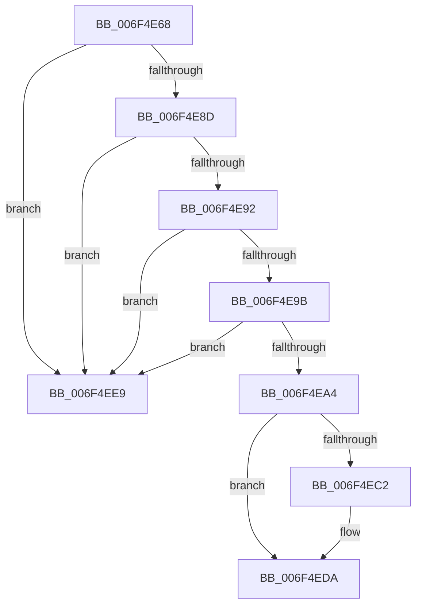

# sub_006F4E68

- RVA: `0x006F4E68`–`0x006F4EF0` (길이 `136` bytes)
- VA: `0x00000001406F4E68`
- 실행 섹션: `.text`
- PDB 이름 있음: `아니요`; PDB Function 태그: `아니요`
- unwind 정보 RVA: `0x000AE1CC`
- 디코드: `33`개 명령, `136/136` bytes 표시
- 미해석 바이트: `0` (있으면 어셈블리에 `.byte`로 보존)

> 이 문서는 커널 이미지의 기계어와 PDB 기호를 분석해 생성했습니다. 4번과 5번은 함수 원형과 자료형을 바이너리 사용 방식에서 추정한 C 해석이며 원본 소스 복구 결과는 아닙니다.

## 1. Dependencies

- 직접 호출 지점: **3**; 고유 호출 대상: **3**
- 직접 호출자로 확인된 함수: **0**
- RIP 상대 이미지 참조: **6**

### Outgoing calls
- `0x006F4E6D` → [KiAcquireSecondarySignalListLock](../5B/KiAcquireSecondarySignalListLock_function_005BD9B8.md) (function, `0x005BD9B8`)
- `0x006F4ED5` → [KeInsertQueueDpc](../20/KeInsertQueueDpc_function_00207C50.md) (function, `0x00207C50`)
- `0x006F4EDE` → [KiReleaseSecondarySignalListLock](../5B/KiReleaseSecondarySignalListLock_function_005BDAE8.md) (function, `0x005BDAE8`)

### Direct callers
- 이 함수 시작 RVA로 연결되는 직접 call은 확인되지 않았습니다. 간접 호출은 완전히 역산할 수 없습니다.

### Static image references
- `0x006F4E72` → RVA `0x00F110A0` (`.data`; read)
- `0x006F4E80` → RVA `0x00F110A8` (`.data`; read)
- `0x006F4EA4` → RVA `0x00F11040` (`.data`; read)
- `0x006F4EB2` → RVA `0x00F110A8` (`.data`; write)
- `0x006F4EC5` → RVA `0x00F11040` (`.data`; write)
- `0x006F4ECE` → RVA `0x00F11060` (`.data`; read)

## 2. Other-region calls and transfers

- 다른 실행 섹션으로 향하는 call: **0**
- call이 아닌 외부 분기/꼬리 이동: **1**
  - `0x006F4EE4` → [KeDispatchSecondaryInterrupt + 0x63](../47/KeDispatchSecondaryInterrupt_function_0047F920.md) (`tail-transfer`)

## 3. Assembly (complete function range)

```asm
006F4E68  48 8D 4C 24 58                  lea rcx, [rsp + 0x58]
006F4E6D  E8 46 8B EC FF                  call 0x1405bd9b8
006F4E72  48 8B 0D 27 C2 81 00            mov rcx, qword ptr [rip + 0x81c227]
006F4E79  4C 8D 05 20 C2 81 00            lea r8, [rip + 0x81c220]
006F4E80  48 8B 15 21 C2 81 00            mov rdx, qword ptr [rip + 0x81c221]
006F4E87  4C 39 41 08                     cmp qword ptr [rcx + 8], r8
006F4E8B  75 5C                           jne 0x1406f4ee9
006F4E8D  4C 39 02                        cmp qword ptr [rdx], r8
006F4E90  75 57                           jne 0x1406f4ee9
006F4E92  48 8B 07                        mov rax, qword ptr [rdi]
006F4E95  48 39 78 08                     cmp qword ptr [rax + 8], rdi
006F4E99  75 4E                           jne 0x1406f4ee9
006F4E9B  48 8B 47 08                     mov rax, qword ptr [rdi + 8]
006F4E9F  48 39 38                        cmp qword ptr [rax], rdi
006F4EA2  75 45                           jne 0x1406f4ee9
006F4EA4  40 38 2D 95 C1 81 00            cmp byte ptr [rip + 0x81c195], bpl
006F4EAB  48 89 3A                        mov qword ptr [rdx], rdi
006F4EAE  48 8B 47 08                     mov rax, qword ptr [rdi + 8]
006F4EB2  48 89 05 EF C1 81 00            mov qword ptr [rip + 0x81c1ef], rax
006F4EB9  4C 89 00                        mov qword ptr [rax], r8
006F4EBC  48 89 57 08                     mov qword ptr [rdi + 8], rdx
006F4EC0  75 18                           jne 0x1406f4eda
006F4EC2  45 33 C0                        xor r8d, r8d
006F4EC5  C6 05 74 C1 81 00 01            mov byte ptr [rip + 0x81c174], 1
006F4ECC  33 D2                           xor edx, edx
006F4ECE  48 8D 0D 8B C1 81 00            lea rcx, [rip + 0x81c18b]
006F4ED5  E8 76 2D B1 FF                  call 0x140207c50
006F4EDA  8A 4C 24 58                     mov cl, byte ptr [rsp + 0x58]
006F4EDE  E8 05 8C EC FF                  call 0x1405bdae8
006F4EE3  90                              nop
006F4EE4  E9 9A AA D8 FF                  jmp 0x14047f983
006F4EE9  B9 03 00 00 00                  mov ecx, 3
006F4EEE  CD 29                           int 0x29
```

## 4. C-style interpretation (structured pseudocode)

```c
__int64 __fastcall sub_006F4E68(__int64 a1, __int64 a2, __int64 a3, __int64 a4, __int64 a5, __int64 a6, __int64 a7, __int64 a8, __int64 a9, __int64 a10, unsigned __int8 a11)
{
    __int64 result;

    result = KiAcquireSecondarySignalListLock(a11, a2, a3, a4);
    if ((*(unsigned __int64 *)(*(unsigned __int64 *)(v_rip + 8503847) + 8)) != (v_rip + 8503840)) goto loc_006F4EE9;
    if ((*(unsigned __int64 *)(*(unsigned __int64 *)(v_rip + 8503841))) != (v_rip + 8503840)) goto loc_006F4EE9;
    if ((*(unsigned __int64 *)(*(unsigned __int64 *)(v_rdi) + 8)) != v_rdi) goto loc_006F4EE9;
    if ((*(unsigned __int64 *)(*(unsigned __int64 *)(v_rdi + 8))) != v_rdi) goto loc_006F4EE9;
    *(unsigned __int64 *)(*(unsigned __int64 *)(v_rip + 8503841)) = v_rdi;
    *(unsigned __int64 *)(v_rip + 8503791) = *(unsigned __int64 *)(v_rdi + 8);
    *(unsigned __int64 *)(*(unsigned __int64 *)(v_rdi + 8)) = v_rip + 8503840;
    *(unsigned __int64 *)(v_rdi + 8) = *(unsigned __int64 *)(v_rip + 8503841);
    result = *(unsigned __int64 *)(v_rdi + 8);
    if ((*(unsigned __int8 *)(v_rip + 8503701)) == ((unsigned __int8)(v_rbp))) {
        a3 = 0;
        *(unsigned __int8 *)(v_rip + 8503668) = 1;
        a2 = 0;
        a1 = v_rip + 8503691;
        result = KeInsertQueueDpc(a1, a2, a3, a4);
    }
    result = KiReleaseSecondarySignalListLock(a11, a2, a3, a4);
loc_006F4EE9:
    return result;
}
```

## 5. (Beta) C Style

```c
int64_t sub_006F4E68(int64_t Arg1, int64_t Arg2, int64_t Arg3, int64_t Arg4, uint64_t Arg5, uint64_t Arg6, uint64_t Arg7, uint64_t Arg8, uint64_t Arg9, uint64_t Arg10, uint8_t Arg11)
{
    int64_t result;

    result = KiAcquireSecondarySignalListLock(Arg11, Arg2, Arg3, Arg4);
    if ((*(uint64_t *)(*(uint64_t *)(v_rip + 0x81C227) + 0x8)) != (v_rip + 8503840)) goto loc_006F4EE9;
    if ((*(uint64_t *)(*(uint64_t *)(v_rip + 0x81C221))) != (v_rip + 8503840)) goto loc_006F4EE9;
    if ((*(uint64_t *)(*(uint64_t *)(local_rdi) + 0x8)) != local_rdi) goto loc_006F4EE9;
    if ((*(uint64_t *)(*(uint64_t *)(local_rdi + 0x8))) != local_rdi) goto loc_006F4EE9;
    *(uint64_t *)(*(uint64_t *)(v_rip + 0x81C221)) = local_rdi;
    *(uint64_t *)(v_rip + 0x81C1EF) = *(uint64_t *)(local_rdi + 0x8);
    *(uint64_t *)(*(uint64_t *)(local_rdi + 0x8)) = v_rip + 8503840;
    *(uint64_t *)(local_rdi + 0x8) = *(uint64_t *)(v_rip + 0x81C221);
    result = *(uint64_t *)(local_rdi + 0x8);
    if ((*(uint8_t *)(v_rip + 0x81C195)) == ((uint8_t)(local_rbp))) {
        Arg3 = 0;
        *(uint8_t *)(v_rip + 0x81C174) = 1;
        Arg2 = 0;
        Arg1 = v_rip + 8503691;
        result = KeInsertQueueDpc(Arg1, Arg2, Arg3, Arg4);
    }
    result = KiReleaseSecondarySignalListLock(Arg11, Arg2, Arg3, Arg4);
loc_006F4EE9:
    return result;
}
```

## 6. Execution-region graph

[열기: 2D/3D 그래프와 함수 탐색 컨트롤 패널](../../../control-panel.html?section=text&rva=0x006F4E68&view=graph)

- 2D 그래프는 위에서 아래로 흐르고, 3D 그래프는 빈 공간을 드래그해 회전합니다. Shift+드래그는 이동, 휠은 확대·축소, 함수 노드 선택은 대상 보고서 이동입니다.

### Static fallback


