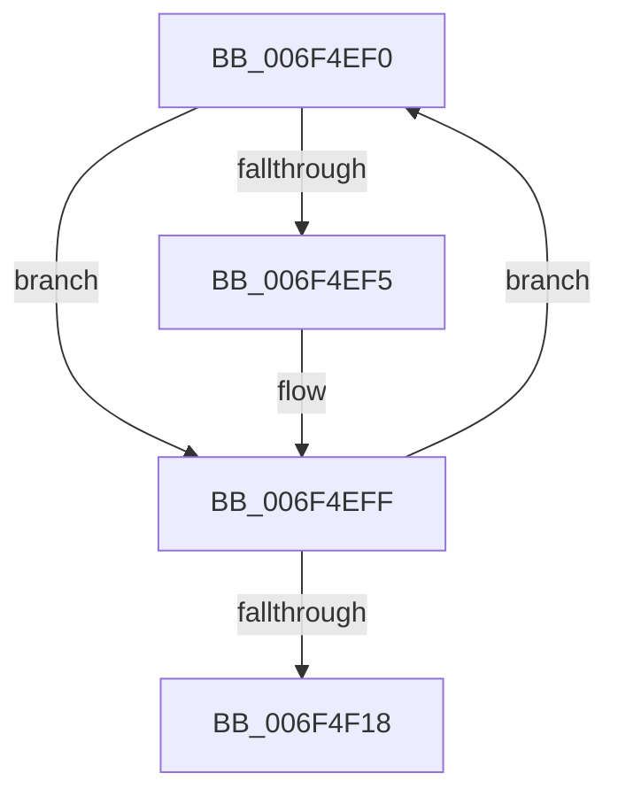

# sub_006F4EF0

- RVA: `0x006F4EF0`–`0x006F4F1D` (길이 `45` bytes)
- VA: `0x00000001406F4EF0`
- 실행 섹션: `.text`
- PDB 이름 있음: `아니요`; PDB Function 태그: `아니요`
- unwind 정보 RVA: `0x000AE47C`
- 디코드: `13`개 명령, `45/45` bytes 표시
- 미해석 바이트: `0` (있으면 어셈블리에 `.byte`로 보존)

> 이 문서는 커널 이미지의 기계어와 PDB 기호를 분석해 생성했습니다. 4번과 5번은 함수 원형과 자료형을 바이너리 사용 방식에서 추정한 C 해석이며 원본 소스 복구 결과는 아닙니다.

## 1. Dependencies

- 직접 호출 지점: **2**; 고유 호출 대상: **2**
- 직접 호출자로 확인된 함수: **0**
- RIP 상대 이미지 참조: **0**

### Outgoing calls
- `0x006F4EFA` → [MiUpdateSubsectionCrossPartitionRefs](../4F/MiUpdateSubsectionCrossPartitionRefs_function_004FB5DC.md) (function, `0x004FB5DC`)
- `0x006F4F07` → [MiInsertUnusedSubsection](../29/MiInsertUnusedSubsection_function_00298D50.md) (function, `0x00298D50`)

### Direct callers
- 이 함수 시작 RVA로 연결되는 직접 call은 확인되지 않았습니다. 간접 호출은 완전히 역산할 수 없습니다.

### Static image references
- 디코드된 RIP-relative 메모리 참조가 없습니다.

## 2. Other-region calls and transfers

- 다른 실행 섹션으로 향하는 call: **0**
- call이 아닌 외부 분기/꼬리 이동: **1**
  - `0x006F4F18` → [MiAppendSubsectionChain + 0x68](../48/MiAppendSubsectionChain_function_00480228.md) (`tail-transfer`)

## 3. Assembly (complete function range)

```asm
006F4EF0  85 73 30                        test dword ptr [rbx + 0x30], esi
006F4EF3  74 0A                           je 0x1406f4eff
006F4EF5  8B D6                           mov edx, esi
006F4EF7  48 8B CB                        mov rcx, rbx
006F4EFA  E8 DD 66 E0 FF                  call 0x1404fb5dc
006F4EFF  48 83 63 50 00                  and qword ptr [rbx + 0x50], 0
006F4F04  48 8B CB                        mov rcx, rbx
006F4F07  E8 44 3E BA FF                  call 0x140298d50
006F4F0C  48 8B 5B 10                     mov rbx, qword ptr [rbx + 0x10]
006F4F10  48 03 E8                        add rbp, rax
006F4F13  48 85 DB                        test rbx, rbx
006F4F16  75 D8                           jne 0x1406f4ef0
006F4F18  E9 73 B3 D8 FF                  jmp 0x140480290
```

## 4. C-style interpretation (structured pseudocode)

```c
__int64 __fastcall sub_006F4EF0(void)
{
    __int64 result;
    __int64 v_rbp;

    if (((*(unsigned int *)(v_rbx + 48)) & ((unsigned int)(v_rsi))) != 0) {
        a2 = (unsigned int)(v_rsi);
        a1 = v_rbx;
        result = MiUpdateSubsectionCrossPartitionRefs(a1, a2, a3, a4);
    }
    result = MiInsertUnusedSubsection(v_rbx, a2, a3, a4);
    v_rbp = (v_rbp) + (result);
    if (*(unsigned __int64 *)(v_rbx + 16) != 0) goto loc_006F4EF0;
}
```

## 5. (Beta) C Style

```c
void sub_006F4EF0(void)
{
    int64_t result;
    int64_t local_rbp;

    if (((*(uint32_t *)(local_rbx + 0x30)) & ((uint32_t)(local_rsi))) != 0) {
        a2 = (uint32_t)(local_rsi);
        a1 = local_rbx;
        result = MiUpdateSubsectionCrossPartitionRefs(a1, a2, a3, a4);
    }
    result = MiInsertUnusedSubsection(local_rbx, a2, a3, a4);
    local_rbp = (local_rbp) + (result);
    if (*(uint64_t *)(local_rbx + 0x10) != 0) goto loc_006F4EF0;
}
```

## 6. Execution-region graph

[열기: 2D/3D 그래프와 함수 탐색 컨트롤 패널](../../../control-panel.html?section=text&rva=0x006F4EF0&view=graph)

- 2D 그래프는 위에서 아래로 흐르고, 3D 그래프는 빈 공간을 드래그해 회전합니다. Shift+드래그는 이동, 휠은 확대·축소, 함수 노드 선택은 대상 보고서 이동입니다.

### Static fallback


