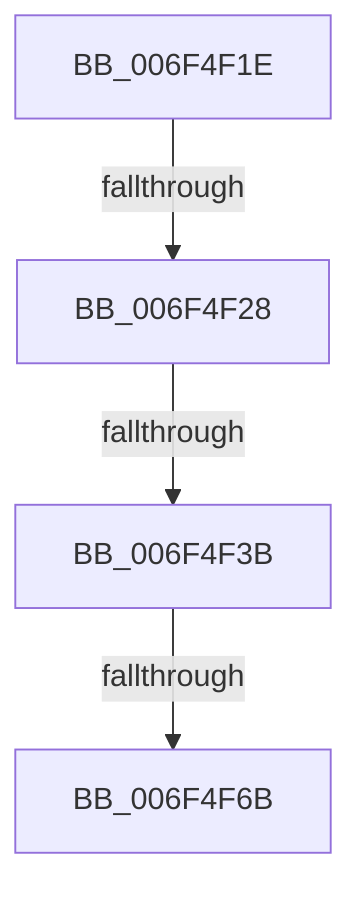

# sub_006F4F1E

- RVA: `0x006F4F1E`–`0x006F4F95` (길이 `119` bytes)
- VA: `0x00000001406F4F1E`
- 실행 섹션: `.text`
- PDB 이름 있음: `아니요`; PDB Function 태그: `아니요`
- unwind 정보 RVA: `0x000AEAEC`
- 디코드: `32`개 명령, `119/119` bytes 표시
- 미해석 바이트: `0` (있으면 어셈블리에 `.byte`로 보존)

> 이 문서는 커널 이미지의 기계어와 PDB 기호를 분석해 생성했습니다. 4번과 5번은 함수 원형과 자료형을 바이너리 사용 방식에서 추정한 C 해석이며 원본 소스 복구 결과는 아닙니다.

## 1. Dependencies

- 직접 호출 지점: **3**; 고유 호출 대상: **1**
- 직접 호출자로 확인된 함수: **0**
- RIP 상대 이미지 참조: **0**

### Outgoing calls
- `0x006F4F2E` → [iswctype](../50/iswctype_function_00502900.md) (function, `0x00502900`)
- `0x006F4F43` → [iswctype](../50/iswctype_function_00502900.md) (function, `0x00502900`)
- `0x006F4F77` → [iswctype](../50/iswctype_function_00502900.md) (function, `0x00502900`)

### Direct callers
- 이 함수 시작 RVA로 연결되는 직접 call은 확인되지 않았습니다. 간접 호출은 완전히 역산할 수 없습니다.

### Static image references
- 디코드된 RIP-relative 메모리 참조가 없습니다.

## 2. Other-region calls and transfers

- 다른 실행 섹션으로 향하는 call: **0**
- call이 아닌 외부 분기/꼬리 이동: **4**
  - `0x006F4F22` → [RtlIpv4StringToAddressExW + 0x45](../48/RtlIpv4StringToAddressExW_function_00480490.md) (`tail-transfer`)
  - `0x006F4F35` → [RtlIpv4StringToAddressExW + 0x45](../48/RtlIpv4StringToAddressExW_function_00480490.md) (`tail-transfer`)
  - `0x006F4F65` → [RtlIpv4StringToAddressExW + 0x45](../48/RtlIpv4StringToAddressExW_function_00480490.md) (`tail-transfer`)
  - `0x006F4F90` → [RtlIpv4StringToAddressExW + 0xF0](../48/RtlIpv4StringToAddressExW_function_00480490.md) (`tail-transfer`)

## 3. Assembly (complete function range)

```asm
006F4F1E  66 41 3B FD                     cmp di, r13w
006F4F22  0F 83 AD B5 D8 FF               jae 0x1404804d5
006F4F28  41 8B D5                        mov edx, r13d
006F4F2B  0F B7 CF                        movzx ecx, di
006F4F2E  E8 CD D9 E0 FF                  call 0x140502900
006F4F33  85 C0                           test eax, eax
006F4F35  0F 84 9A B5 D8 FF               je 0x1404804d5
006F4F3B  BA 02 00 00 00                  mov edx, 2
006F4F40  0F B7 CF                        movzx ecx, di
006F4F43  E8 B8 D9 E0 FF                  call 0x140502900
006F4F48  F7 D8                           neg eax
006F4F4A  0F B7 CB                        movzx ecx, bx
006F4F4D  1B D2                           sbb edx, edx
006F4F4F  C1 E1 04                        shl ecx, 4
006F4F52  83 E2 20                        and edx, 0x20
006F4F55  83 C2 41                        add edx, 0x41
006F4F58  2B CA                           sub ecx, edx
006F4F5A  83 C1 0A                        add ecx, 0xa
006F4F5D  03 CF                           add ecx, edi
006F4F5F  81 F9 FF FF 00 00               cmp ecx, 0xffff
006F4F65  0F 87 6A B5 D8 FF               ja 0x1404804d5
006F4F6B  BA 02 00 00 00                  mov edx, 2
006F4F70  66 C1 E3 04                     shl bx, 4
006F4F74  0F B7 CF                        movzx ecx, di
006F4F77  E8 84 D9 E0 FF                  call 0x140502900
006F4F7C  F7 D8                           neg eax
006F4F7E  66 1B C9                        sbb cx, cx
006F4F81  66 83 E1 20                     and cx, 0x20
006F4F85  66 83 C1 41                     add cx, 0x41
006F4F89  66 2B F9                        sub di, cx
006F4F8C  66 83 C7 0A                     add di, 0xa
006F4F90  E9 EB B5 D8 FF                  jmp 0x140480580
```

## 4. C-style interpretation (structured pseudocode)

```c
__int64 __fastcall sub_006F4F1E(void)
{
    __int64 result;
    __int64 v_rbx;
    __int64 v_rdi;

    result = iswctype((unsigned __int16)(v_rdi), (unsigned int)((unsigned int)(v_r13)), a3, a4);
    result = iswctype((unsigned __int16)(v_rdi), 2, a3, a4);
    result = (unsigned int)(-(result));
    a1 = (unsigned int)(((unsigned __int16)(v_rbx)) << (4));
    a2 = (unsigned int)((2) & (32));
    a2 = (unsigned int)((a2) + (65));
    a1 = (unsigned int)((a1) - ((unsigned int)(a2)));
    a1 = (unsigned int)((a1) + (10));
    a1 = (unsigned int)((a1) + ((unsigned int)(v_rdi)));
    v_rbx = (unsigned __int16)((v_rbx) << (4));
    result = iswctype((unsigned __int16)(v_rdi), 2, a3, a4);
    result = (unsigned int)(-(result));
    a1 = (unsigned __int16)(((unsigned __int16)(v_rdi)) & (32));
    a1 = (unsigned __int16)((a1) + (65));
    v_rdi = (unsigned __int16)((v_rdi) - ((unsigned __int16)(a1)));
    v_rdi = (unsigned __int16)((v_rdi) + (10));
}
```

## 5. (Beta) C Style

```c
void sub_006F4F1E(void)
{
    int64_t result;
    int64_t local_rbx;
    int64_t local_rdi;

    result = iswctype((uint16_t)(local_rdi), (uint32_t)((uint32_t)(local_r13)), a3, a4);
    result = iswctype((uint16_t)(local_rdi), 2, a3, a4);
    result = (uint32_t)(-(result));
    a1 = (uint32_t)(((uint16_t)(local_rbx)) << (4));
    a2 = (uint32_t)((2) & (32));
    a2 = (uint32_t)((a2) + (65));
    a1 = (uint32_t)((a1) - ((uint32_t)(a2)));
    a1 = (uint32_t)((a1) + (10));
    a1 = (uint32_t)((a1) + ((uint32_t)(local_rdi)));
    local_rbx = (uint16_t)((local_rbx) << (4));
    result = iswctype((uint16_t)(local_rdi), 2, a3, a4);
    result = (uint32_t)(-(result));
    a1 = (uint16_t)(((uint16_t)(local_rdi)) & (32));
    a1 = (uint16_t)((a1) + (65));
    local_rdi = (uint16_t)((local_rdi) - ((uint16_t)(a1)));
    local_rdi = (uint16_t)((local_rdi) + (10));
}
```

## 6. Execution-region graph

[열기: 2D/3D 그래프와 함수 탐색 컨트롤 패널](../../../control-panel.html?section=text&rva=0x006F4F1E&view=graph)

- 2D 그래프는 위에서 아래로 흐르고, 3D 그래프는 빈 공간을 드래그해 회전합니다. Shift+드래그는 이동, 휠은 확대·축소, 함수 노드 선택은 대상 보고서 이동입니다.

### Static fallback


