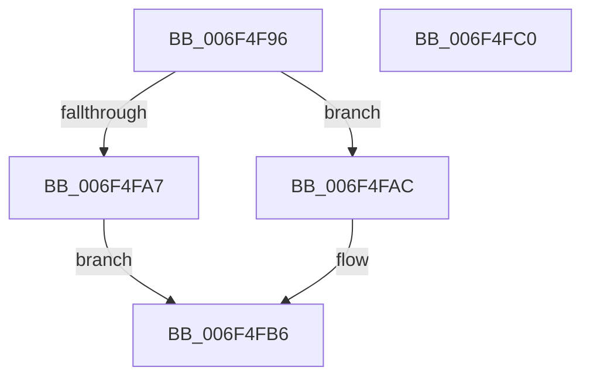

# sub_006F4F96

- RVA: `0x006F4F96`–`0x006F4FD5` (길이 `63` bytes)
- VA: `0x00000001406F4F96`
- 실행 섹션: `.text`
- PDB 이름 있음: `아니요`; PDB Function 태그: `아니요`
- unwind 정보 RVA: `0x000AEB20`
- 디코드: `18`개 명령, `63/63` bytes 표시
- 미해석 바이트: `0` (있으면 어셈블리에 `.byte`로 보존)

> 이 문서는 커널 이미지의 기계어와 PDB 기호를 분석해 생성했습니다. 4번과 5번은 함수 원형과 자료형을 바이너리 사용 방식에서 추정한 C 해석이며 원본 소스 복구 결과는 아닙니다.

## 1. Dependencies

- 직접 호출 지점: **0**; 고유 호출 대상: **0**
- 직접 호출자로 확인된 함수: **0**
- RIP 상대 이미지 참조: **0**

### Outgoing calls
- 직접 디코드된 call 명령이 없습니다.

### Direct callers
- 이 함수 시작 RVA로 연결되는 직접 call은 확인되지 않았습니다. 간접 호출은 완전히 역산할 수 없습니다.

### Static image references
- 디코드된 RIP-relative 메모리 참조가 없습니다.

## 2. Other-region calls and transfers

- 다른 실행 섹션으로 향하는 call: **0**
- call이 아닌 외부 분기/꼬리 이동: **2**
  - `0x006F4FBB` → [RtlIpv4StringToAddressW + 0x52](../48/RtlIpv4StringToAddressW_function_00480600.md) (`tail-transfer`)
  - `0x006F4FD0` → [RtlIpv4StringToAddressW + 0xA0](../48/RtlIpv4StringToAddressW_function_00480600.md) (`tail-transfer`)

## 3. Assembly (complete function range)

```asm
006F4F96  0F B7 07                        movzx eax, word ptr [rdi]
006F4F99  B9 DF FF 00 00                  mov ecx, 0xffdf
006F4F9E  66 83 E8 58                     sub ax, 0x58
006F4FA2  66 85 C1                        test cx, ax
006F4FA5  74 05                           je 0x1406f4fac
006F4FA7  41 B5 01                        mov r13b, 1
006F4FAA  EB 0A                           jmp 0x1406f4fb6
006F4FAC  41 BE 10 00 00 00               mov r14d, 0x10
006F4FB2  48 83 C7 02                     add rdi, 2
006F4FB6  B8 80 00 00 00                  mov eax, 0x80
006F4FBB  E9 92 B6 D8 FF                  jmp 0x140480652
006F4FC0  0B C8                           or ecx, eax
006F4FC2  48 8B 45 D8                     mov rax, qword ptr [rbp - 0x28]
006F4FC6  0F C9                           bswap ecx
006F4FC8  49 89 3C 24                     mov qword ptr [r12], rdi
006F4FCC  89 08                           mov dword ptr [rax], ecx
006F4FCE  33 C0                           xor eax, eax
006F4FD0  E9 CB B6 D8 FF                  jmp 0x1404806a0
```

## 4. C-style interpretation (structured pseudocode)

```c
__int64 __fastcall sub_006F4F96(void)
{
    __int64 result;
    __int64 v_rdi;

    result = (unsigned __int16)((*(unsigned __int16 *)(v_rdi)) - (88));
    if ((((unsigned __int16)((unsigned int)(0xFFDFULL))) & ((unsigned __int16)(result))) == 0) goto loc_006F4FAC;
    goto loc_006F4FB6;
loc_006F4FAC:
    v_rdi = (v_rdi) + (2);
loc_006F4FB6:
}
```

## 5. (Beta) C Style

```c
void sub_006F4F96(void)
{
    int64_t result;
    int64_t local_rdi;

    result = (uint16_t)((*(uint16_t *)(local_rdi)) - (88));
    if ((((uint16_t)((uint32_t)(0xFFDFULL))) & ((uint16_t)(result))) == 0) goto loc_006F4FAC;
    goto loc_006F4FB6;
loc_006F4FAC:
    local_rdi = (local_rdi) + (2);
loc_006F4FB6:
}
```

## 6. Execution-region graph

[열기: 2D/3D 그래프와 함수 탐색 컨트롤 패널](../../../control-panel.html?section=text&rva=0x006F4F96&view=graph)

- 2D 그래프는 위에서 아래로 흐르고, 3D 그래프는 빈 공간을 드래그해 회전합니다. Shift+드래그는 이동, 휠은 확대·축소, 함수 노드 선택은 대상 보고서 이동입니다.

### Static fallback


