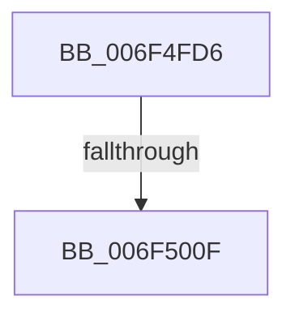

# sub_006F4FD6

- RVA: `0x006F4FD6`–`0x006F5029` (길이 `83` bytes)
- VA: `0x00000001406F4FD6`
- 실행 섹션: `.text`
- PDB 이름 있음: `아니요`; PDB Function 태그: `아니요`
- unwind 정보 RVA: `0x000AEB9C`
- 디코드: `23`개 명령, `83/83` bytes 표시
- 미해석 바이트: `0` (있으면 어셈블리에 `.byte`로 보존)

> 이 문서는 커널 이미지의 기계어와 PDB 기호를 분석해 생성했습니다. 4번과 5번은 함수 원형과 자료형을 바이너리 사용 방식에서 추정한 C 해석이며 원본 소스 복구 결과는 아닙니다.

## 1. Dependencies

- 직접 호출 지점: **0**; 고유 호출 대상: **0**
- 직접 호출자로 확인된 함수: **0**
- RIP 상대 이미지 참조: **0**

### Outgoing calls
- 직접 디코드된 call 명령이 없습니다.

### Direct callers
- 이 함수 시작 RVA로 연결되는 직접 call은 확인되지 않았습니다. 간접 호출은 완전히 역산할 수 없습니다.

### Static image references
- 디코드된 RIP-relative 메모리 참조가 없습니다.

## 2. Other-region calls and transfers

- 다른 실행 섹션으로 향하는 call: **0**
- call이 아닌 외부 분기/꼬리 이동: **2**
  - `0x006F5009` → [KiOpRetrieveRegMemAddress + 0xC5](../48/KiOpRetrieveRegMemAddress_function_00480B64.md) (`tail-transfer`)
  - `0x006F5024` → [KiOpRetrieveRegMemAddress + 0xC5](../48/KiOpRetrieveRegMemAddress_function_00480B64.md) (`tail-transfer`)

## 3. Assembly (complete function range)

```asm
006F4FD6  41 8B C8                        mov ecx, r8d
006F4FD9  83 E1 07                        and ecx, 7
006F4FDC  41 F6 42 40 01                  test byte ptr [r10 + 0x40], 1
006F4FE1  8D 41 08                        lea eax, [rcx + 8]
006F4FE4  0F 44 C1                        cmove eax, ecx
006F4FE7  8B C8                           mov ecx, eax
006F4FE9  49 8B 42 18                     mov rax, qword ptr [r10 + 0x18]
006F4FED  4C 8B 5C C8 78                  mov r11, qword ptr [rax + rcx*8 + 0x78]
006F4FF2  41 8B D0                        mov edx, r8d
006F4FF5  C1 EA 03                        shr edx, 3
006F4FF8  83 E2 07                        and edx, 7
006F4FFB  41 F6 42 40 02                  test byte ptr [r10 + 0x40], 2
006F5000  8D 42 08                        lea eax, [rdx + 8]
006F5003  0F 44 C2                        cmove eax, edx
006F5006  83 F8 04                        cmp eax, 4
006F5009  0F 84 1A BC D8 FF               je 0x140480c29
006F500F  8B D0                           mov edx, eax
006F5011  49 8B C8                        mov rcx, r8
006F5014  49 8B 42 18                     mov rax, qword ptr [r10 + 0x18]
006F5018  48 C1 E9 06                     shr rcx, 6
006F501C  48 8B 7C D0 78                  mov rdi, qword ptr [rax + rdx*8 + 0x78]
006F5021  48 D3 E7                        shl rdi, cl
006F5024  E9 00 BC D8 FF                  jmp 0x140480c29
```

## 4. C-style interpretation (structured pseudocode)

```c
__int64 __fastcall sub_006F4FD6(__int64 a1, __int64 a2, __int64 a3)
{
    __int64 result;
    __int64 v_rdi;

    a1 = (unsigned int)(((unsigned int)((unsigned int)(a3))) & (7));
    result = a1 + 8;
    if (((*(unsigned __int8 *)(v_r10 + 64)) & (1)) == 0) { result = (unsigned int)(a1); }
    a2 = (unsigned int)(((unsigned int)((unsigned int)(a3))) >> (3));
    a2 = (unsigned int)((a2) & (7));
    result = a2 + 8;
    if (((*(unsigned __int8 *)(v_r10 + 64)) & (2)) == 0) { result = (unsigned int)(a2); }
    a1 = (a3) >> (6);
    v_rdi = (*(unsigned __int64 *)(*(unsigned __int64 *)(v_r10 + 24) + (unsigned int)((unsigned int)(result)) * 8 + 120)) << ((unsigned __int8)(a1));
}
```

## 5. (Beta) C Style

```c
int64_t sub_006F4FD6(int64_t Arg1, int64_t Arg2, void *Arg3)
{
    uint8_t *arg3 = (uint8_t *)Arg3;

    int64_t result;
    int64_t local_rdi;

    Arg1 = (uint32_t)(((uint32_t)((uint32_t)(Arg3))) & (7));
    result = Arg1 + 8;
    if (((*(uint8_t *)(local_r10 + 0x40)) & (1)) == 0) { result = (uint32_t)(Arg1); }
    Arg2 = (uint32_t)(((uint32_t)((uint32_t)(Arg3))) >> (3));
    Arg2 = (uint32_t)((Arg2) & (7));
    result = Arg2 + 8;
    if (((*(uint8_t *)(local_r10 + 0x40)) & (2)) == 0) { result = (uint32_t)(Arg2); }
    Arg1 = (Arg3) >> (6);
    local_rdi = (*(uint64_t *)(*(uint64_t *)(local_r10 + 0x18) + (uint32_t)((uint32_t)(result)) * 8 + 0x78)) << ((uint8_t)(Arg1));
}
```

### 관측된 메모리 오프셋

구조체 형식이 확인되지 않은 접근은 인자 기준의 오프셋으로만 기록했습니다.

| 기준 인자 | 오프셋 표현 | 폭 (bit) | 접근 |
|---|---:|---:|---|
| `Arg3` | `+ 0x8` | `32` | `R` |

## 6. Execution-region graph

[열기: 2D/3D 그래프와 함수 탐색 컨트롤 패널](../../../control-panel.html?section=text&rva=0x006F4FD6&view=graph)

- 2D 그래프는 위에서 아래로 흐르고, 3D 그래프는 빈 공간을 드래그해 회전합니다. Shift+드래그는 이동, 휠은 확대·축소, 함수 노드 선택은 대상 보고서 이동입니다.

### Static fallback


