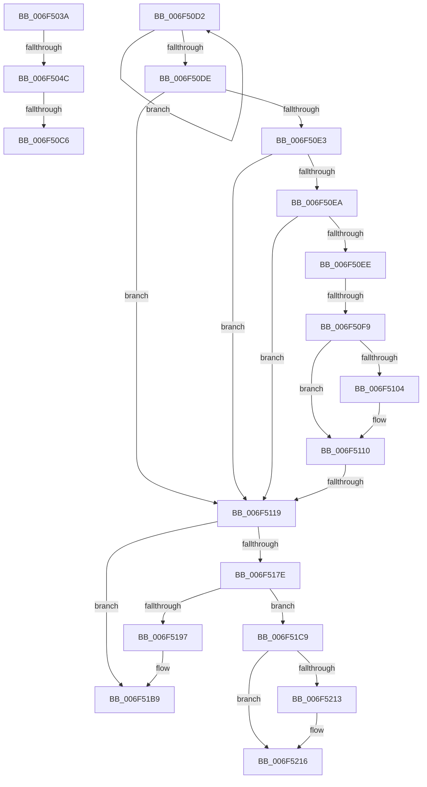

# sub_006F503A

- RVA: `0x006F503A`–`0x006F5238` (길이 `510` bytes)
- VA: `0x00000001406F503A`
- 실행 섹션: `.text`
- PDB 이름 있음: `아니요`; PDB Function 태그: `아니요`
- unwind 정보 RVA: `0x000AECC4`
- 디코드: `150`개 명령, `510/510` bytes 표시
- 미해석 바이트: `0` (있으면 어셈블리에 `.byte`로 보존)

> 이 문서는 커널 이미지의 기계어와 PDB 기호를 분석해 생성했습니다. 4번과 5번은 함수 원형과 자료형을 바이너리 사용 방식에서 추정한 C 해석이며 원본 소스 복구 결과는 아닙니다.

## 1. Dependencies

- 직접 호출 지점: **14**; 고유 호출 대상: **10**
- 직접 호출자로 확인된 함수: **0**
- RIP 상대 이미지 참조: **0**

### Outgoing calls
- `0x006F5092` → [RtlFindLastBackwardRunClear](../3E/RtlFindLastBackwardRunClear_function_003E0AF0.md) (function, `0x003E0AF0`)
- `0x006F50AA` → [RtlFindLastBackwardRunClear](../3E/RtlFindLastBackwardRunClear_function_003E0AF0.md) (function, `0x003E0AF0`)
- `0x006F5136` → [RtlSetBits](../3E/RtlSetBits_function_003E1610.md) (function, `0x003E1610`)
- `0x006F5144` → [RtlSetBits](../3E/RtlSetBits_function_003E1610.md) (function, `0x003E1610`)
- `0x006F5154` → [MiInvalidatePageFileBitmapsCache](../3E/MiInvalidatePageFileBitmapsCache_function_003E3240.md) (function, `0x003E3240`)
- `0x006F5166` → [MiReleaseSpinLockExclusive](../24/MiReleaseSpinLockExclusive_function_002482C0.md) (function, `0x002482C0`)
- `0x006F518E` → [MiChargeCommit](../28/MiChargeCommit_function_00286EB0.md) (function, `0x00286EB0`)
- `0x006F51A1` → [MiReduceCommitLimits](../68/MiReduceCommitLimits_function_0068CDA0.md) (function, `0x0068CDA0`)
- `0x006F51B4` → [MiReturnCommit](../24/MiReturnCommit_function_00248410.md) (function, `0x00248410`)
- `0x006F51CC` → [ExAcquireSpinLockExclusive](../24/ExAcquireSpinLockExclusive_function_00248690.md) (function, `0x00248690`)
- `0x006F51F9` → [RtlClearBits](../3E/RtlClearBits_function_003E1A90.md) (function, `0x003E1A90`)
- `0x006F5207` → [RtlClearBits](../3E/RtlClearBits_function_003E1A90.md) (function, `0x003E1A90`)
- `0x006F521E` → [MiCoalescePageFileBitmapsCache](../3E/MiCoalescePageFileBitmapsCache_function_003E4540.md) (function, `0x003E4540`)
- `0x006F522D` → [MiReleaseSpinLockExclusive](../24/MiReleaseSpinLockExclusive_function_002482C0.md) (function, `0x002482C0`)

### Direct callers
- 이 함수 시작 RVA로 연결되는 직접 call은 확인되지 않았습니다. 간접 호출은 완전히 역산할 수 없습니다.

### Static image references
- 디코드된 RIP-relative 메모리 참조가 없습니다.

## 2. Other-region calls and transfers

- 다른 실행 섹션으로 향하는 call: **0**
- call이 아닌 외부 분기/꼬리 이동: **7**
  - `0x006F5046` → [MiAttemptPageFileReductionApc + 0x14A](../48/MiAttemptPageFileReductionApc_function_004815A0.md) (`tail-transfer`)
  - `0x006F50C0` → [MiAttemptPageFileReductionApc + 0x19A](../48/MiAttemptPageFileReductionApc_function_004815A0.md) (`tail-transfer`)
  - `0x006F50CD` → [MiAttemptPageFileReductionApc + 0x19A](../48/MiAttemptPageFileReductionApc_function_004815A0.md) (`tail-transfer`)
  - `0x006F50F3` → [MiAttemptPageFileReductionApc + 0x14A](../48/MiAttemptPageFileReductionApc_function_004815A0.md) (`tail-transfer`)
  - `0x006F5113` → [MiAttemptPageFileReductionApc + 0x14A](../48/MiAttemptPageFileReductionApc_function_004815A0.md) (`tail-transfer`)
  - `0x006F51C4` → [MiAttemptPageFileReductionApc + 0x156](../48/MiAttemptPageFileReductionApc_function_004815A0.md) (`tail-transfer`)
  - `0x006F5233` → [MiAttemptPageFileReductionApc + 0x167](../48/MiAttemptPageFileReductionApc_function_004815A0.md) (`tail-transfer`)

## 3. Assembly (complete function range)

```asm
006F503A  4D 8B 52 08                     mov r10, qword ptr [r10 + 8]
006F503E  43 8A 04 10                     mov al, byte ptr [r8 + r10]
006F5042  D2 F8                           sar al, cl
006F5044  A8 01                           test al, 1
006F5046  0F 85 9E C6 D8 FF               jne 0x1404816ea
006F504C  41 8B F9                        mov edi, r9d
006F504F  4C 8D 45 D3                     lea r8, [rbp - 0x2d]
006F5053  2B 7E 08                        sub edi, dword ptr [rsi + 8]
006F5056  41 8B C1                        mov eax, r9d
006F5059  4C 3B FF                        cmp r15, rdi
006F505C  41 0F 42 FF                     cmovb edi, r15d
006F5060  2B C7                           sub eax, edi
006F5062  83 E0 E0                        and eax, 0xffffffe0
006F5065  44 2B C8                        sub r9d, eax
006F5068  8B C8                           mov ecx, eax
006F506A  48 C1 E9 05                     shr rcx, 5
006F506E  44 89 4D EF                     mov dword ptr [rbp - 0x11], r9d
006F5072  44 89 4D FF                     mov dword ptr [rbp - 1], r9d
006F5076  41 8D 51 FF                     lea edx, [r9 - 1]
006F507A  49 8D 04 8B                     lea rax, [r11 + rcx*4]
006F507E  48 89 45 F7                     mov qword ptr [rbp - 9], rax
006F5082  41 8D 59 FF                     lea ebx, [r9 - 1]
006F5086  49 8D 04 8A                     lea rax, [r10 + rcx*4]
006F508A  48 8D 4D EF                     lea rcx, [rbp - 0x11]
006F508E  48 89 45 07                     mov qword ptr [rbp + 7], rax
006F5092  E8 59 BA CE FF                  call 0x1403e0af0
006F5097  3B C7                           cmp eax, edi
006F5099  4C 8D 45 D7                     lea r8, [rbp - 0x29]
006F509D  44 8B F0                        mov r14d, eax
006F50A0  48 8D 4D FF                     lea rcx, [rbp - 1]
006F50A4  8B D3                           mov edx, ebx
006F50A6  44 0F 47 F7                     cmova r14d, edi
006F50AA  E8 41 BA CE FF                  call 0x1403e0af0
006F50AF  44 8B 45 CB                     mov r8d, dword ptr [rbp - 0x35]
006F50B3  44 3B F0                        cmp r14d, eax
006F50B6  8B 5D C7                        mov ebx, dword ptr [rbp - 0x39]
006F50B9  44 0F 47 F0                     cmova r14d, eax
006F50BD  45 85 C0                        test r8d, r8d
006F50C0  0F 85 74 C6 D8 FF               jne 0x14048173a
006F50C6  8B C3                           mov eax, ebx
006F50C8  F7 D8                           neg eax
006F50CA  44 23 F0                        and r14d, eax
006F50CD  E9 68 C6 D8 FF                  jmp 0x14048173a
006F50D2  48 8B D0                        mov rdx, rax
006F50D5  48 8B 40 08                     mov rax, qword ptr [rax + 8]
006F50D9  48 85 C0                        test rax, rax
006F50DC  75 F4                           jne 0x1406f50d2
006F50DE  48 85 D2                        test rdx, rdx
006F50E1  74 36                           je 0x1406f5119
006F50E3  8B 42 F8                        mov eax, dword ptr [rdx - 8]
006F50E6  85 C0                           test eax, eax
006F50E8  74 2F                           je 0x1406f5119
006F50EA  3B F8                           cmp edi, eax
006F50EC  77 2B                           ja 0x1406f5119
006F50EE  8D 78 01                        lea edi, [rax + 1]
006F50F1  3B F8                           cmp edi, eax
006F50F3  0F 82 F1 C5 D8 FF               jb 0x1404816ea
006F50F9  44 8B F1                        mov r14d, ecx
006F50FC  44 2B F7                        sub r14d, edi
006F50FF  45 85 C0                        test r8d, r8d
006F5102  75 0C                           jne 0x1406f5110
006F5104  8B C3                           mov eax, ebx
006F5106  8B F9                           mov edi, ecx
006F5108  F7 D8                           neg eax
006F510A  44 23 F0                        and r14d, eax
006F510D  41 2B FE                        sub edi, r14d
006F5110  45 85 F6                        test r14d, r14d
006F5113  0F 84 D1 C5 D8 FF               je 0x1404816ea
006F5119  48 8B 4D 0F                     mov rcx, qword ptr [rbp + 0xf]
006F511D  45 8B C6                        mov r8d, r14d
006F5120  89 3E                           mov dword ptr [rsi], edi
006F5122  8B D7                           mov edx, edi
006F5124  8B 46 0C                        mov eax, dword ptr [rsi + 0xc]
006F5127  41 2B C6                        sub eax, r14d
006F512A  89 46 0C                        mov dword ptr [rsi + 0xc], eax
006F512D  8B 46 14                        mov eax, dword ptr [rsi + 0x14]
006F5130  41 2B C6                        sub eax, r14d
006F5133  89 46 14                        mov dword ptr [rsi + 0x14], eax
006F5136  E8 D5 C4 CE FF                  call 0x1403e1610
006F513B  48 8B 4D 17                     mov rcx, qword ptr [rbp + 0x17]
006F513F  45 8B C6                        mov r8d, r14d
006F5142  8B D7                           mov edx, edi
006F5144  E8 C7 C4 CE FF                  call 0x1403e1610
006F5149  45 33 C9                        xor r9d, r9d
006F514C  45 8B C6                        mov r8d, r14d
006F514F  8B D7                           mov edx, edi
006F5151  48 8B CE                        mov rcx, rsi
006F5154  E8 E7 E0 CE FF                  call 0x1403e3240
006F5159  8A 55 7F                        mov dl, byte ptr [rbp + 0x7f]
006F515C  48 8D 9E C8 00 00 00            lea rbx, [rsi + 0xc8]
006F5163  48 8B CB                        mov rcx, rbx
006F5166  E8 55 31 B5 FF                  call 0x1402482c0
006F516B  41 8B CE                        mov ecx, r14d
006F516E  4C 2B F9                        sub r15, rcx
006F5171  48 89 4D 7F                     mov qword ptr [rbp + 0x7f], rcx
006F5175  F6 86 AC 00 00 00 10            test byte ptr [rsi + 0xac], 0x10
006F517C  75 3B                           jne 0x1406f51b9
006F517E  48 8B 55 DF                     mov rdx, qword ptr [rbp - 0x21]
006F5182  41 B8 02 00 00 00               mov r8d, 2
006F5188  48 03 D1                        add rdx, rcx
006F518B  49 8B CC                        mov rcx, r12
006F518E  E8 1D 1D B9 FF                  call 0x140286eb0
006F5193  85 C0                           test eax, eax
006F5195  74 32                           je 0x1406f51c9
006F5197  48 8B 55 7F                     mov rdx, qword ptr [rbp + 0x7f]
006F519B  45 33 C0                        xor r8d, r8d
006F519E  49 8B CC                        mov rcx, r12
006F51A1  E8 FA 7B F9 FF                  call 0x14068cda0
006F51A6  48 8B 55 DF                     mov rdx, qword ptr [rbp - 0x21]
006F51AA  45 33 C0                        xor r8d, r8d
006F51AD  48 03 55 7F                     add rdx, qword ptr [rbp + 0x7f]
006F51B1  49 8B CC                        mov rcx, r12
006F51B4  E8 57 32 B5 FF                  call 0x140248410
006F51B9  48 8B 45 67                     mov rax, qword ptr [rbp + 0x67]
006F51BD  41 8B CD                        mov ecx, r13d
006F51C0  89 7C 88 28                     mov dword ptr [rax + rcx*4 + 0x28], edi
006F51C4  E9 2D C5 D8 FF                  jmp 0x1404816f6
006F51C9  48 8B CB                        mov rcx, rbx
006F51CC  E8 BF 34 B5 FF                  call 0x140248690
006F51D1  41 8D 0C 3E                     lea ecx, [r14 + rdi]
006F51D5  45 8B C6                        mov r8d, r14d
006F51D8  89 0E                           mov dword ptr [rsi], ecx
006F51DA  44 8A F8                        mov r15b, al
006F51DD  8B 56 0C                        mov edx, dword ptr [rsi + 0xc]
006F51E0  41 03 D6                        add edx, r14d
006F51E3  89 56 0C                        mov dword ptr [rsi + 0xc], edx
006F51E6  8B 56 14                        mov edx, dword ptr [rsi + 0x14]
006F51E9  41 03 D6                        add edx, r14d
006F51EC  89 56 14                        mov dword ptr [rsi + 0x14], edx
006F51EF  8B D7                           mov edx, edi
006F51F1  48 8B 5E 50                     mov rbx, qword ptr [rsi + 0x50]
006F51F5  48 8D 4B 08                     lea rcx, [rbx + 8]
006F51F9  E8 92 C8 CE FF                  call 0x1403e1a90
006F51FE  48 8D 4B 18                     lea rcx, [rbx + 0x18]
006F5202  45 8B C6                        mov r8d, r14d
006F5205  8B D7                           mov edx, edi
006F5207  E8 84 C8 CE FF                  call 0x1403e1a90
006F520C  8B 46 58                        mov eax, dword ptr [rsi + 0x58]
006F520F  3B F8                           cmp edi, eax
006F5211  73 03                           jae 0x1406f5216
006F5213  89 7E 58                        mov dword ptr [rsi + 0x58], edi
006F5216  44 8B C7                        mov r8d, edi
006F5219  33 D2                           xor edx, edx
006F521B  48 8B CE                        mov rcx, rsi
006F521E  E8 1D F3 CE FF                  call 0x1403e4540
006F5223  41 8A D7                        mov dl, r15b
006F5226  48 8D 8E C8 00 00 00            lea rcx, [rsi + 0xc8]
006F522D  E8 8E 30 B5 FF                  call 0x1402482c0
006F5232  90                              nop
006F5233  E9 CF C4 D8 FF                  jmp 0x140481707
```

## 4. C-style interpretation (structured pseudocode)

```c
__int64 __fastcall sub_006F503A(unsigned __int8 a1, __int64 a2, __int64 a3, int a4)
{
    __int64 result;
    __int64 v_r14;
    __int64 v_rdi;

    result = (unsigned __int8)((*(unsigned __int8 *)(a3 + *(unsigned __int64 *)(v_r10 + 8) * 1)) >> (a1));
    v_rdi = (unsigned int)(((unsigned int)(a4)) - (*(unsigned int *)(v_rsi + 8)));
    if (v_r15 < v_rdi) { v_rdi = (unsigned int)(v_r15); }
    result = (unsigned int)(((unsigned int)(a4)) - ((unsigned int)(v_rdi)));
    result = (unsigned int)((result) & (0xFFFFFFE0ULL));
    a4 = (unsigned int)((a4) - ((unsigned int)(result)));
    a1 = ((unsigned int)((unsigned int)(result))) >> (5);
    *(unsigned int *)(v_rbp - 17) = a4;
    *(unsigned int *)(v_rbp - 1) = a4;
    *(unsigned __int64 *)(v_rbp - 9) = v_r11 + a1 * 4;
    *(unsigned __int64 *)(v_rbp + 7) = *(unsigned __int64 *)(v_r10 + 8) + a1 * 4;
    result = RtlFindLastBackwardRunClear(v_rbp - 17, a4 - 1, v_rbp - 45, a4);
    v_r14 = (unsigned int)((unsigned int)(result));
    if (((unsigned int)(result)) > ((unsigned int)(v_rdi))) { v_r14 = (unsigned int)(v_rdi); }
    result = RtlFindLastBackwardRunClear(v_rbp - 1, (unsigned int)((unsigned int)(a4 - 1)), v_rbp - 41, a4);
    if (((unsigned int)(v_r14)) > ((unsigned int)(result))) { v_r14 = (unsigned int)(result); }
    result = (unsigned int)(-((unsigned int)((unsigned int)((unsigned int)(*(unsigned int *)(v_rbp - 57))))));
    v_r14 = (unsigned int)((v_r14) & ((unsigned int)(result)));
}
```

## 5. (Beta) C Style

```c
int64_t sub_006F503A(uint8_t Arg1, int64_t Arg2, void *Arg3, void *Arg4)
{
    uint8_t *arg3 = (uint8_t *)Arg3;
    uint8_t *arg4 = (uint8_t *)Arg4;

    int64_t result;
    int64_t local_r14;
    int64_t local_rdi;

    result = (uint8_t)((*(uint8_t *)(arg3 + *(uint64_t *)(local_r10 + 0x8) * 1)) >> (Arg1));
    local_rdi = (uint32_t)(((uint32_t)(Arg4)) - (*(uint32_t *)(local_rsi + 0x8)));
    if (local_r15 < local_rdi) { local_rdi = (uint32_t)(local_r15); }
    result = (uint32_t)(((uint32_t)(Arg4)) - ((uint32_t)(local_rdi)));
    result = (uint32_t)((result) & (0xFFFFFFE0ULL));
    Arg4 = (uint32_t)((Arg4) - ((uint32_t)(result)));
    Arg1 = ((uint32_t)((uint32_t)(result))) >> (5);
    *(uint32_t *)(local_rbp - 0x11) = Arg4;
    *(uint32_t *)(local_rbp - 0x1) = Arg4;
    *(uint64_t *)(local_rbp - 0x9) = local_r11 + Arg1 * 4;
    *(uint64_t *)(local_rbp + 0x7) = *(uint64_t *)(local_r10 + 0x8) + Arg1 * 4;
    result = RtlFindLastBackwardRunClear(local_rbp - 17, Arg4 - 1, local_rbp - 45, Arg4);
    local_r14 = (uint32_t)((uint32_t)(result));
    if (((uint32_t)(result)) > ((uint32_t)(local_rdi))) { local_r14 = (uint32_t)(local_rdi); }
    result = RtlFindLastBackwardRunClear(local_rbp - 1, (uint32_t)((uint32_t)(Arg4 - 1)), local_rbp - 41, Arg4);
    if (((uint32_t)(local_r14)) > ((uint32_t)(result))) { local_r14 = (uint32_t)(result); }
    result = (uint32_t)(-((uint32_t)((uint32_t)((uint32_t)(*(uint32_t *)(local_rbp - 0x39))))));
    local_r14 = (uint32_t)((local_r14) & ((uint32_t)(result)));
}
```

### 관측된 메모리 오프셋

구조체 형식이 확인되지 않은 접근은 인자 기준의 오프셋으로만 기록했습니다.

| 기준 인자 | 오프셋 표현 | 폭 (bit) | 접근 |
|---|---:|---:|---|
| `Arg3` | `+ 0x0 + r10*1` | `8` | `R` |
| `Arg4` | `- 0x1` | `32` | `R` |

## 6. Execution-region graph

[열기: 2D/3D 그래프와 함수 탐색 컨트롤 패널](../../../control-panel.html?section=text&rva=0x006F503A&view=graph)

- 2D 그래프는 위에서 아래로 흐르고, 3D 그래프는 빈 공간을 드래그해 회전합니다. Shift+드래그는 이동, 휠은 확대·축소, 함수 노드 선택은 대상 보고서 이동입니다.

### Static fallback


