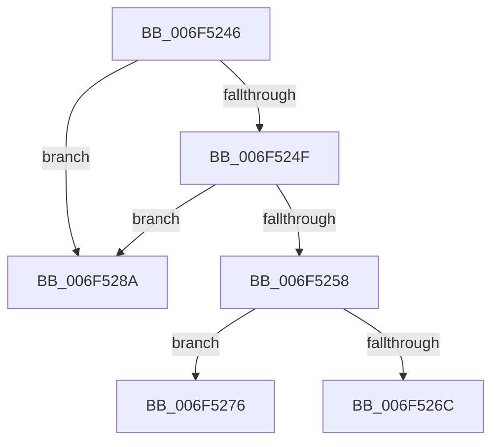

# sub_006F5246

- RVA: `0x006F5246`–`0x006F5291` (길이 `75` bytes)
- VA: `0x00000001406F5246`
- 실행 섹션: `.text`
- PDB 이름 있음: `아니요`; PDB Function 태그: `아니요`
- unwind 정보 RVA: `0x000AED84`
- 디코드: `22`개 명령, `75/75` bytes 표시
- 미해석 바이트: `0` (있으면 어셈블리에 `.byte`로 보존)

> 이 문서는 커널 이미지의 기계어와 PDB 기호를 분석해 생성했습니다. 4번과 5번은 함수 원형과 자료형을 바이너리 사용 방식에서 추정한 C 해석이며 원본 소스 복구 결과는 아닙니다.

## 1. Dependencies

- 직접 호출 지점: **1**; 고유 호출 대상: **1**
- 직접 호출자로 확인된 함수: **0**
- RIP 상대 이미지 참조: **0**

### Outgoing calls
- `0x006F527F` → [KeSetEvent](../33/KeSetEvent_function_0033F310.md) (function, `0x0033F310`)

### Direct callers
- 이 함수 시작 RVA로 연결되는 직접 call은 확인되지 않았습니다. 간접 호출은 완전히 역산할 수 없습니다.

### Static image references
- 디코드된 RIP-relative 메모리 참조가 없습니다.

## 2. Other-region calls and transfers

- 다른 실행 섹션으로 향하는 call: **0**
- call이 아닌 외부 분기/꼬리 이동: **2**
  - `0x006F5271` → [MiWakeCommitRequest + 0x38](../48/MiWakeCommitRequest_function_00481C58.md) (`tail-transfer`)
  - `0x006F5285` → [MiWakeCommitRequest + 0x38](../48/MiWakeCommitRequest_function_00481C58.md) (`tail-transfer`)

## 3. Assembly (complete function range)

```asm
006F5246  4C 8B 01                        mov r8, qword ptr [rcx]
006F5249  49 39 48 08                     cmp qword ptr [r8 + 8], rcx
006F524D  75 3B                           jne 0x1406f528a
006F524F  48 8B 41 08                     mov rax, qword ptr [rcx + 8]
006F5253  48 39 08                        cmp qword ptr [rax], rcx
006F5256  75 32                           jne 0x1406f528a
006F5258  4C 89 00                        mov qword ptr [rax], r8
006F525B  49 89 40 08                     mov qword ptr [r8 + 8], rax
006F525F  F6 02 04                        test byte ptr [rdx], 4
006F5262  48 C7 41 48 01 00 00 00         mov qword ptr [rcx + 0x48], 1
006F526A  74 0A                           je 0x1406f5276
006F526C  33 C0                           xor eax, eax
006F526E  87 41 40                        xchg dword ptr [rcx + 0x40], eax
006F5271  E9 1A CA D8 FF                  jmp 0x140481c90
006F5276  48 83 C1 28                     add rcx, 0x28
006F527A  45 33 C0                        xor r8d, r8d
006F527D  33 D2                           xor edx, edx
006F527F  E8 8C A0 C4 FF                  call 0x14033f310
006F5284  90                              nop
006F5285  E9 06 CA D8 FF                  jmp 0x140481c90
006F528A  B9 03 00 00 00                  mov ecx, 3
006F528F  CD 29                           int 0x29
```

## 4. C-style interpretation (structured pseudocode)

```c
__int64 __fastcall sub_006F5246(__int64 a1, __int64 a2)
{
    __int64 result;

    if ((*(unsigned __int64 *)(*(unsigned __int64 *)(a1) + 8)) != a1) goto loc_006F528A;
    if ((*(unsigned __int64 *)(*(unsigned __int64 *)(a1 + 8))) != a1) goto loc_006F528A;
    *(unsigned __int64 *)(*(unsigned __int64 *)(a1 + 8)) = *(unsigned __int64 *)(a1);
    *(unsigned __int64 *)(*(unsigned __int64 *)(a1) + 8) = *(unsigned __int64 *)(a1 + 8);
    *(unsigned __int64 *)(a1 + 72) = 1;
    if (((*(unsigned __int8 *)(a2)) & (4)) == 0) goto loc_006F5276;
    result = 0;
loc_006F5276:
    a1 = (a1) + (40);
    a3 = 0;
    a2 = 0;
    result = KeSetEvent(a1, a2, a3, a4);
loc_006F528A:
    return result;
}
```

## 5. (Beta) C Style

```c
int64_t sub_006F5246(void *Arg1, void *Arg2)
{
    uint8_t *arg1 = (uint8_t *)Arg1;
    uint8_t *arg2 = (uint8_t *)Arg2;

    int64_t result;

    if ((*(uint64_t *)(*(uint64_t *)(arg1) + 0x8)) != Arg1) goto loc_006F528A;
    if ((*(uint64_t *)(*(uint64_t *)(arg1 + 0x8))) != Arg1) goto loc_006F528A;
    *(uint64_t *)(*(uint64_t *)(arg1 + 0x8)) = *(uint64_t *)(arg1);
    *(uint64_t *)(*(uint64_t *)(arg1) + 0x8) = *(uint64_t *)(arg1 + 0x8);
    *(uint64_t *)(arg1 + 0x48) = 1;
    if (((*(uint8_t *)(arg2)) & (4)) == 0) goto loc_006F5276;
    result = 0;
loc_006F5276:
    Arg1 = (Arg1) + (40);
    a3 = 0;
    Arg2 = 0;
    result = KeSetEvent(Arg1, Arg2, a3, a4);
loc_006F528A:
    return result;
}
```

### 관측된 메모리 오프셋

구조체 형식이 확인되지 않은 접근은 인자 기준의 오프셋으로만 기록했습니다.

| 기준 인자 | 오프셋 표현 | 폭 (bit) | 접근 |
|---|---:|---:|---|
| `Arg1` | `+ 0x0` | `64` | `R` |
| `Arg1` | `+ 0x8` | `64` | `R` |
| `Arg1` | `+ 0x40` | `32` | `R/W` |
| `Arg1` | `+ 0x48` | `64` | `W` |
| `Arg2` | `+ 0x0` | `8` | `R` |

## 6. Execution-region graph

[열기: 2D/3D 그래프와 함수 탐색 컨트롤 패널](../../../control-panel.html?section=text&rva=0x006F5246&view=graph)

- 2D 그래프는 위에서 아래로 흐르고, 3D 그래프는 빈 공간을 드래그해 회전합니다. Shift+드래그는 이동, 휠은 확대·축소, 함수 노드 선택은 대상 보고서 이동입니다.

### Static fallback


