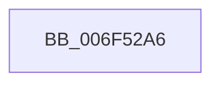

# sub_006F52A6

- RVA: `0x006F52A6`–`0x006F52FF` (길이 `89` bytes)
- VA: `0x00000001406F52A6`
- 실행 섹션: `.text`
- PDB 이름 있음: `아니요`; PDB Function 태그: `아니요`
- unwind 정보 RVA: `0x000AEE58`
- 디코드: `19`개 명령, `89/89` bytes 표시
- 미해석 바이트: `0` (있으면 어셈블리에 `.byte`로 보존)

> 이 문서는 커널 이미지의 기계어와 PDB 기호를 분석해 생성했습니다. 4번과 5번은 함수 원형과 자료형을 바이너리 사용 방식에서 추정한 C 해석이며 원본 소스 복구 결과는 아닙니다.

## 1. Dependencies

- 직접 호출 지점: **3**; 고유 호출 대상: **3**
- 직접 호출자로 확인된 함수: **0**
- RIP 상대 이미지 참조: **3**

### Outgoing calls
- `0x006F52A9` → [KeAcquireSpinLockRaiseToDpc](../20/KeAcquireSpinLockRaiseToDpc_function_00208470.md) (function, `0x00208470`)
- `0x006F52B9` → [KeReleaseSpinLock](../39/KeReleaseSpinLock_function_00392BA0.md) (function, `0x00392BA0`)
- `0x006F52F4` → [DbgkWerCaptureLiveKernelDump](../../page/AC/DbgkWerCaptureLiveKernelDump_function_00AC1E90.md) (function, `0x00AC1E90`)

### Direct callers
- 이 함수 시작 RVA로 연결되는 직접 call은 확인되지 않았습니다. 간접 호출은 완전히 역산할 수 없습니다.

### Static image references
- `0x006F52AE` → RVA `0x00E676E4` (`.data`; read)
- `0x006F52C3` → RVA `0x006CBF50` (` ?? ::FNODOBFM::`string'`; read)
- `0x006F52DE` → RVA `0x00F0CCE8` (`.data`; read)

## 2. Other-region calls and transfers

- 다른 실행 섹션으로 향하는 call: **1**
  - `0x006F52F4` → [DbgkWerCaptureLiveKernelDump](../../page/AC/DbgkWerCaptureLiveKernelDump_function_00AC1E90.md) (`.text` → `PAGE`)
- call이 아닌 외부 분기/꼬리 이동: **1**
  - `0x006F52FA` → [PopUserPresentSet + 0x28](../48/PopUserPresentSet_function_00482B90.md) (`tail-transfer`)

## 3. Assembly (complete function range)

```asm
006F52A6  48 8B CD                        mov rcx, rbp
006F52A9  E8 C2 31 B1 FF                  call 0x140208470
006F52AE  8B 1D 30 24 77 00               mov ebx, dword ptr [rip + 0x772430]
006F52B4  8A D0                           mov dl, al
006F52B6  48 8B CD                        mov rcx, rbp
006F52B9  E8 E2 D8 C9 FF                  call 0x140392ba0
006F52BE  83 64 24 40 00                  and dword ptr [rsp + 0x40], 0
006F52C3  48 8D 0D 86 6C FD FF            lea rcx, [rip - 0x2937a]
006F52CA  48 83 64 24 38 00               and qword ptr [rsp + 0x38], 0
006F52D0  BA A0 00 00 00                  mov edx, 0xa0
006F52D5  48 83 64 24 30 00               and qword ptr [rsp + 0x30], 0
006F52DB  44 8B CB                        mov r9d, ebx
006F52DE  48 63 05 03 7A 81 00            movsxd rax, dword ptr [rip + 0x817a03]
006F52E5  48 83 64 24 28 00               and qword ptr [rsp + 0x28], 0
006F52EB  44 8D 42 71                     lea r8d, [rdx + 0x71]
006F52EF  48 89 44 24 20                  mov qword ptr [rsp + 0x20], rax
006F52F4  E8 97 CB 3C 00                  call 0x140ac1e90
006F52F9  90                              nop
006F52FA  E9 B9 D8 D8 FF                  jmp 0x140482bb8
```

## 4. C-style interpretation (structured pseudocode)

```c
__int64 __fastcall sub_006F52A6(__int64 a1, __int64 a2, __int64 a3, __int64 a4, __int64 a5, __int64 a6, __int64 a7, unsigned int a8)
{
    __int64 result;
    unsigned __int64 v_stack_p20;

    result = KeAcquireSpinLockRaiseToDpc(v_rbp, a2, a3, a4);
    result = KeReleaseSpinLock(v_rbp, (unsigned __int8)(result), a3, a4);
    v_stack_p20 = (int)(*(unsigned int *)(v_rip + 8485379));
    result = DbgkWerCaptureLiveKernelDump(v_rip - 168826, 160, 160 + 113, (unsigned int)((unsigned int)((unsigned int)(*(unsigned int *)(v_rip + 7808048)))));
}
```

## 5. (Beta) C Style

```c
int64_t sub_006F52A6(int64_t Arg1, int64_t Arg2, int64_t Arg3, int64_t Arg4, int64_t Arg5, int64_t Arg6, int64_t Arg7, uint32_t Arg8)
{
    int64_t result;
    uint64_t v_stack_p20;

    result = KeAcquireSpinLockRaiseToDpc(local_rbp, Arg2, Arg3, Arg4);
    result = KeReleaseSpinLock(local_rbp, (uint8_t)(result), Arg3, Arg4);
    v_stack_p20 = (int32_t)(*(uint32_t *)(v_rip + 0x817A03));
    result = DbgkWerCaptureLiveKernelDump(v_rip - 168826, 160, 160 + 113, (uint32_t)((uint32_t)((uint32_t)(*(uint32_t *)(v_rip + 0x772430)))));
}
```

## 6. Execution-region graph

[열기: 2D/3D 그래프와 함수 탐색 컨트롤 패널](../../../control-panel.html?section=text&rva=0x006F52A6&view=graph)

- 2D 그래프는 위에서 아래로 흐르고, 3D 그래프는 빈 공간을 드래그해 회전합니다. Shift+드래그는 이동, 휠은 확대·축소, 함수 노드 선택은 대상 보고서 이동입니다.

### Static fallback


