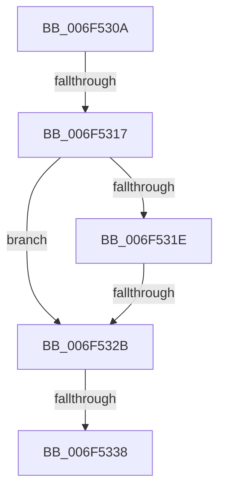

# sub_006F530A

- RVA: `0x006F530A`–`0x006F5356` (길이 `76` bytes)
- VA: `0x00000001406F530A`
- 실행 섹션: `.text`
- PDB 이름 있음: `아니요`; PDB Function 태그: `아니요`
- unwind 정보 RVA: `0x000AEFB0`
- 디코드: `13`개 명령, `76/76` bytes 표시
- 미해석 바이트: `0` (있으면 어셈블리에 `.byte`로 보존)

> 이 문서는 커널 이미지의 기계어와 PDB 기호를 분석해 생성했습니다. 4번과 5번은 함수 원형과 자료형을 바이너리 사용 방식에서 추정한 C 해석이며 원본 소스 복구 결과는 아닙니다.

## 1. Dependencies

- 직접 호출 지점: **0**; 고유 호출 대상: **0**
- 직접 호출자로 확인된 함수: **0**
- RIP 상대 이미지 참조: **0**

### Outgoing calls
- 직접 디코드된 call 명령이 없습니다.

### Direct callers
- 이 함수 시작 RVA로 연결되는 직접 call은 확인되지 않았습니다. 간접 호출은 완전히 역산할 수 없습니다.

### Static image references
- 디코드된 RIP-relative 메모리 참조가 없습니다.

## 2. Other-region calls and transfers

- 다른 실행 섹션으로 향하는 call: **0**
- call이 아닌 외부 분기/꼬리 이동: **4**
  - `0x006F5311` → [PopCompleteNotifyTransitionCommon + 0x1D9](../48/PopCompleteNotifyTransitionCommon_function_00483B4C.md) (`tail-transfer`)
  - `0x006F5325` → [PopCompleteNotifyTransitionCommon + 0x1D9](../48/PopCompleteNotifyTransitionCommon_function_00483B4C.md) (`tail-transfer`)
  - `0x006F5332` → [PopCompleteNotifyTransitionCommon + 0x1D9](../48/PopCompleteNotifyTransitionCommon_function_00483B4C.md) (`tail-transfer`)
  - `0x006F5351` → [PopCompleteNotifyTransitionCommon + 0x1D9](../48/PopCompleteNotifyTransitionCommon_function_00483B4C.md) (`tail-transfer`)

## 3. Assembly (complete function range)

```asm
006F530A  80 BE D2 01 00 00 00            cmp byte ptr [rsi + 0x1d2], 0
006F5311  0F 85 0E EA D8 FF               jne 0x140483d25
006F5317  3D BB 00 00 C0                  cmp eax, 0xc00000bb
006F531C  75 0D                           jne 0x1406f532b
006F531E  80 BE D3 01 00 00 00            cmp byte ptr [rsi + 0x1d3], 0
006F5325  0F 85 FA E9 D8 FF               jne 0x140483d25
006F532B  83 BE C0 01 00 00 00            cmp dword ptr [rsi + 0x1c0], 0
006F5332  0F 8C ED E9 D8 FF               jl 0x140483d25
006F5338  89 86 C0 01 00 00               mov dword ptr [rsi + 0x1c0], eax
006F533E  48 8B 47 40                     mov rax, qword ptr [rdi + 0x40]
006F5342  48 89 86 C8 01 00 00            mov qword ptr [rsi + 0x1c8], rax
006F5349  C6 84 24 80 00 00 00 01         mov byte ptr [rsp + 0x80], 1
006F5351  E9 CF E9 D8 FF                  jmp 0x140483d25
```

## 4. C-style interpretation (structured pseudocode)

```c
__int64 __fastcall sub_006F530A(void)
{
    unsigned __int8 v_stack_p80;

    if (((unsigned int)(result)) != 0xC00000BBULL) goto loc_006F532B;
loc_006F532B:
    *(unsigned int *)(v_rsi + 448) = (unsigned int)(result);
    *(unsigned __int64 *)(v_rsi + 456) = *(unsigned __int64 *)(v_rdi + 64);
    v_stack_p80 = 1;
}
```

## 5. (Beta) C Style

```c
void sub_006F530A(void)
{
    uint8_t v_stack_p80;

    if (((uint32_t)(result)) != 0xC00000BBULL) goto loc_006F532B;
loc_006F532B:
    *(uint32_t *)(local_rsi + 0x1C0) = (uint32_t)(result);
    *(uint64_t *)(local_rsi + 0x1C8) = *(uint64_t *)(local_rdi + 0x40);
    v_stack_p80 = 1;
}
```

## 6. Execution-region graph

[열기: 2D/3D 그래프와 함수 탐색 컨트롤 패널](../../../control-panel.html?section=text&rva=0x006F530A&view=graph)

- 2D 그래프는 위에서 아래로 흐르고, 3D 그래프는 빈 공간을 드래그해 회전합니다. Shift+드래그는 이동, 휠은 확대·축소, 함수 노드 선택은 대상 보고서 이동입니다.

### Static fallback


