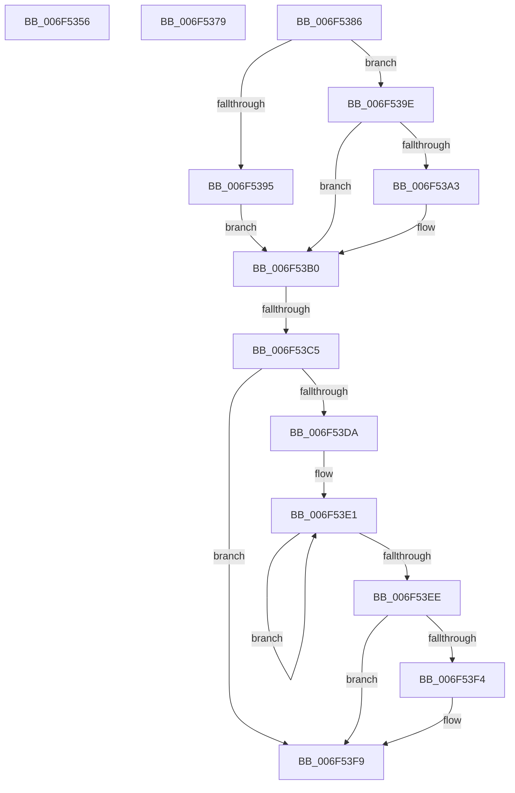

# sub_006F5356

- RVA: `0x006F5356`–`0x006F5407` (길이 `177` bytes)
- VA: `0x00000001406F5356`
- 실행 섹션: `.text`
- PDB 이름 있음: `아니요`; PDB Function 태그: `아니요`
- unwind 정보 RVA: `0x000AF210`
- 디코드: `40`개 명령, `177/177` bytes 표시
- 미해석 바이트: `0` (있으면 어셈블리에 `.byte`로 보존)

> 이 문서는 커널 이미지의 기계어와 PDB 기호를 분석해 생성했습니다. 4번과 5번은 함수 원형과 자료형을 바이너리 사용 방식에서 추정한 C 해석이며 원본 소스 복구 결과는 아닙니다.

## 1. Dependencies

- 직접 호출 지점: **1**; 고유 호출 대상: **1**
- 직접 호출자로 확인된 함수: **0**
- RIP 상대 이미지 참조: **0**

### Outgoing calls
- `0x006F53F4` → [KiRemoveSystemWorkPriorityKick](../26/KiRemoveSystemWorkPriorityKick_function_002631D0.md) (function, `0x002631D0`)

### Direct callers
- 이 함수 시작 RVA로 연결되는 직접 call은 확인되지 않았습니다. 간접 호출은 완전히 역산할 수 없습니다.

### Static image references
- 디코드된 RIP-relative 메모리 참조가 없습니다.

## 2. Other-region calls and transfers

- 다른 실행 섹션으로 향하는 call: **0**
- call이 아닌 외부 분기/꼬리 이동: **4**
  - `0x006F5374` → [HvlDmaUnmapDeviceSparsePages + 0x207](../48/HvlDmaUnmapDeviceSparsePages_function_004844C0.md) (`tail-transfer`)
  - `0x006F5381` → [HvlDmaUnmapDeviceSparsePages + 0x14B](../48/HvlDmaUnmapDeviceSparsePages_function_004844C0.md) (`tail-transfer`)
  - `0x006F53BF` → [HvlDmaUnmapDeviceSparsePages + 0x14B](../48/HvlDmaUnmapDeviceSparsePages_function_004844C0.md) (`tail-transfer`)
  - `0x006F5402` → [HvlDmaUnmapDeviceSparsePages + 0x14B](../48/HvlDmaUnmapDeviceSparsePages_function_004844C0.md) (`tail-transfer`)

## 3. Assembly (complete function range)

```asm
006F5356  88 45 87                        mov byte ptr [rbp - 0x79], al
006F5359  65 48 8B 04 25 20 00 00 00      mov rax, qword ptr gs:[0x20]
006F5362  C7 45 8B 01 00 00 00            mov dword ptr [rbp - 0x75], 1
006F5369  48 8B 88 00 8C 00 00            mov rcx, qword ptr [rax + 0x8c00]
006F5370  48 8B 79 10                     mov rdi, qword ptr [rcx + 0x10]
006F5374  E9 4E F3 D8 FF                  jmp 0x1404846c7
006F5379  40 0F B6 C6                     movzx eax, sil
006F537D  44 0F 22 C0                     mov cr8, rax
006F5381  E9 85 F2 D8 FF                  jmp 0x14048460b
006F5386  65 48 8B 0C 25 20 00 00 00      mov rcx, qword ptr gs:[0x20]
006F538F  F6 45 8B 01                     test byte ptr [rbp - 0x75], 1
006F5393  74 09                           je 0x1406f539e
006F5395  48 8B 81 00 8C 00 00            mov rax, qword ptr [rcx + 0x8c00]
006F539C  EB 12                           jmp 0x1406f53b0
006F539E  84 55 8B                        test byte ptr [rbp - 0x75], dl
006F53A1  74 0D                           je 0x1406f53b0
006F53A3  48 8B 81 00 8C 00 00            mov rax, qword ptr [rcx + 0x8c00]
006F53AA  48 05 00 10 00 00               add rax, 0x1000
006F53B0  40 8A 75 87                     mov sil, byte ptr [rbp - 0x79]
006F53B4  48 8B 7D 97                     mov rdi, qword ptr [rbp - 0x69]
006F53B8  48 89 78 10                     mov qword ptr [rax + 0x10], rdi
006F53BC  40 84 F6                        test sil, sil
006F53BF  0F 84 46 F2 D8 FF               je 0x14048460b
006F53C5  65 48 8B 0C 25 20 00 00 00      mov rcx, qword ptr gs:[0x20]
006F53CE  4C 8B 81 B8 8E 00 00            mov r8, qword ptr [rcx + 0x8eb8]
006F53D5  4D 85 C0                        test r8, r8
006F53D8  74 1F                           je 0x1406f53f9
006F53DA  41 0F 0D 08                     prefetchw byte ptr [r8]
006F53DE  41 8B 00                        mov eax, dword ptr [r8]
006F53E1  8B D0                           mov edx, eax
006F53E3  0F BA F2 15                     btr edx, 0x15
006F53E7  F0 41 0F B1 10                  lock cmpxchg dword ptr [r8], edx
006F53EC  75 F3                           jne 0x1406f53e1
006F53EE  0F BA E0 15                     bt eax, 0x15
006F53F2  73 05                           jae 0x1406f53f9
006F53F4  E8 D7 DD B6 FF                  call 0x1402631d0
006F53F9  FB                              sti
006F53FA  48 8B 7D 97                     mov rdi, qword ptr [rbp - 0x69]
006F53FE  40 8A 75 87                     mov sil, byte ptr [rbp - 0x79]
006F5402  E9 04 F2 D8 FF                  jmp 0x14048460b
```

## 4. C-style interpretation (structured pseudocode)

```c
__int64 __fastcall sub_006F5356(void)
{
    *(unsigned __int8 *)(v_rbp - 121) = (unsigned __int8)(result);
    *(unsigned int *)(v_rbp - 117) = 1;
}
```

## 5. (Beta) C Style

```c
void sub_006F5356(void)
{
    *(uint8_t *)(local_rbp - 0x79) = (uint8_t)(result);
    *(uint32_t *)(local_rbp - 0x75) = 1;
}
```

## 6. Execution-region graph

[열기: 2D/3D 그래프와 함수 탐색 컨트롤 패널](../../../control-panel.html?section=text&rva=0x006F5356&view=graph)

- 2D 그래프는 위에서 아래로 흐르고, 3D 그래프는 빈 공간을 드래그해 회전합니다. Shift+드래그는 이동, 휠은 확대·축소, 함수 노드 선택은 대상 보고서 이동입니다.

### Static fallback


