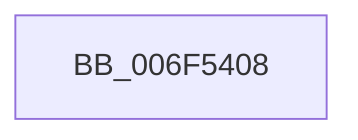

# sub_006F5408

- RVA: `0x006F5408`–`0x006F541A` (길이 `18` bytes)
- VA: `0x00000001406F5408`
- 실행 섹션: `.text`
- PDB 이름 있음: `아니요`; PDB Function 태그: `아니요`
- unwind 정보 RVA: `0x000AF340`
- 디코드: `5`개 명령, `18/18` bytes 표시
- 미해석 바이트: `0` (있으면 어셈블리에 `.byte`로 보존)

> 이 문서는 커널 이미지의 기계어와 PDB 기호를 분석해 생성했습니다. 4번과 5번은 함수 원형과 자료형을 바이너리 사용 방식에서 추정한 C 해석이며 원본 소스 복구 결과는 아닙니다.

## 1. Dependencies

- 직접 호출 지점: **1**; 고유 호출 대상: **1**
- 직접 호출자로 확인된 함수: **0**
- RIP 상대 이미지 참조: **0**

### Outgoing calls
- `0x006F540F` → [ExFreePoolWithTag](../../poolcode/B8/ExFreePoolWithTag_function_00B82870.md) (function, `0x00B82870`)

### Direct callers
- 이 함수 시작 RVA로 연결되는 직접 call은 확인되지 않았습니다. 간접 호출은 완전히 역산할 수 없습니다.

### Static image references
- 디코드된 RIP-relative 메모리 참조가 없습니다.

## 2. Other-region calls and transfers

- 다른 실행 섹션으로 향하는 call: **1**
  - `0x006F540F` → [ExFreePoolWithTag](../../poolcode/B8/ExFreePoolWithTag_function_00B82870.md) (`.text` → `POOLCODE`)
- call이 아닌 외부 분기/꼬리 이동: **1**
  - `0x006F5415` → [WheapFreeErrorRecord + 0x10](../48/WheapFreeErrorRecord_function_0048491C.md) (`tail-transfer`)

## 3. Assembly (complete function range)

```asm
006F5408  48 8B 51 20                     mov rdx, qword ptr [rcx + 0x20]
006F540C  8B 52 24                        mov edx, dword ptr [rdx + 0x24]
006F540F  E8 5C D4 48 00                  call 0x140b82870
006F5414  90                              nop
006F5415  E9 12 F5 D8 FF                  jmp 0x14048492c
```

## 4. C-style interpretation (structured pseudocode)

```c
__int64 __fastcall sub_006F5408(__int64 a1)
{
    __int64 result;

    result = ExFreePoolWithTag(a1, (unsigned int)(*(unsigned int *)(*(unsigned __int64 *)(a1 + 32) + 36)), a3, a4);
}
```

## 5. (Beta) C Style

```c
int64_t sub_006F5408(void *Arg1)
{
    uint8_t *arg1 = (uint8_t *)Arg1;

    int64_t result;

    result = ExFreePoolWithTag(Arg1, (uint32_t)(*(uint32_t *)(*(uint64_t *)(arg1 + 0x20) + 0x24)), a3, a4);
}
```

### 관측된 메모리 오프셋

구조체 형식이 확인되지 않은 접근은 인자 기준의 오프셋으로만 기록했습니다.

| 기준 인자 | 오프셋 표현 | 폭 (bit) | 접근 |
|---|---:|---:|---|
| `Arg1` | `+ 0x20` | `64` | `R` |

## 6. Execution-region graph

[열기: 2D/3D 그래프와 함수 탐색 컨트롤 패널](../../../control-panel.html?section=text&rva=0x006F5408&view=graph)

- 2D 그래프는 위에서 아래로 흐르고, 3D 그래프는 빈 공간을 드래그해 회전합니다. Shift+드래그는 이동, 휠은 확대·축소, 함수 노드 선택은 대상 보고서 이동입니다.

### Static fallback


