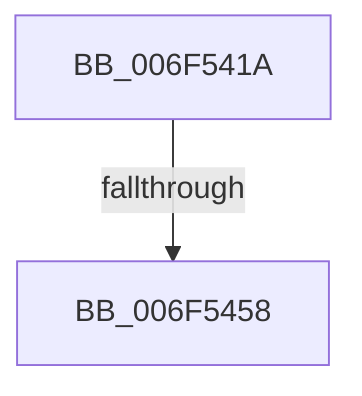

# sub_006F541A

- RVA: `0x006F541A`–`0x006F5476` (길이 `92` bytes)
- VA: `0x00000001406F541A`
- 실행 섹션: `.text`
- PDB 이름 있음: `아니요`; PDB Function 태그: `아니요`
- unwind 정보 RVA: `0x000AF3C8`
- 디코드: `26`개 명령, `92/92` bytes 표시
- 미해석 바이트: `0` (있으면 어셈블리에 `.byte`로 보존)

> 이 문서는 커널 이미지의 기계어와 PDB 기호를 분석해 생성했습니다. 4번과 5번은 함수 원형과 자료형을 바이너리 사용 방식에서 추정한 C 해석이며 원본 소스 복구 결과는 아닙니다.

## 1. Dependencies

- 직접 호출 지점: **4**; 고유 호출 대상: **4**
- 직접 호출자로 확인된 함수: **0**
- RIP 상대 이미지 참조: **0**

### Outgoing calls
- `0x006F543E` → [MiCopyOnWrite](../36/MiCopyOnWrite_function_00362A0C.md) (function, `0x00362A0C`)
- `0x006F544B` → [MiUnlockPageTable](../21/MiUnlockPageTable_function_00216EC0.md) (function, `0x00216EC0`)
- `0x006F545E` → [MiUnlockWorkingSetShared](../27/MiUnlockWorkingSetShared_function_0027D690.md) (function, `0x0027D690`)
- `0x006F546B` → [MiCopyOnWriteCheckConditions](../2A/MiCopyOnWriteCheckConditions_function_002A750C.md) (function, `0x002A750C`)

### Direct callers
- 이 함수 시작 RVA로 연결되는 직접 call은 확인되지 않았습니다. 간접 호출은 완전히 역산할 수 없습니다.

### Static image references
- 디코드된 RIP-relative 메모리 참조가 없습니다.

## 2. Other-region calls and transfers

- 다른 실행 섹션으로 향하는 call: **0**
- call이 아닌 외부 분기/꼬리 이동: **2**
  - `0x006F5452` → [MiLockPagedAddress + 0x67](../48/MiLockPagedAddress_function_00484CDC.md) (`tail-transfer`)
  - `0x006F5471` → [MiLockPagedAddress + 0x1A7](../48/MiLockPagedAddress_function_00484CDC.md) (`tail-transfer`)

## 3. Assembly (complete function range)

```asm
006F541A  49 8B CE                        mov rcx, r14
006F541D  48 C1 E1 19                     shl rcx, 0x19
006F5421  48 8B C6                        mov rax, rsi
006F5424  48 21 5C 24 20                  and qword ptr [rsp + 0x20], rbx
006F5429  45 33 C9                        xor r9d, r9d
006F542C  48 C1 E0 19                     shl rax, 0x19
006F5430  49 83 C8 FF                     or r8, 0xffffffffffffffff
006F5434  48 2B C8                        sub rcx, rax
006F5437  49 8B D6                        mov rdx, r14
006F543A  48 C1 F9 10                     sar rcx, 0x10
006F543E  E8 C9 D5 C6 FF                  call 0x140362a0c
006F5443  48 8B D5                        mov rdx, rbp
006F5446  49 8B CD                        mov rcx, r13
006F5449  8B F8                           mov edi, eax
006F544B  E8 70 1A B2 FF                  call 0x140216ec0
006F5450  85 FF                           test edi, edi
006F5452  0F 89 EB F8 D8 FF               jns 0x140484d43
006F5458  41 8A D7                        mov dl, r15b
006F545B  49 8B CD                        mov rcx, r13
006F545E  E8 2D 82 B8 FF                  call 0x14027d690
006F5463  45 33 C0                        xor r8d, r8d
006F5466  8B D7                           mov edx, edi
006F5468  49 8B CD                        mov rcx, r13
006F546B  E8 9C 20 BB FF                  call 0x1402a750c
006F5470  90                              nop
006F5471  E9 0D FA D8 FF                  jmp 0x140484e83
```

## 4. C-style interpretation (structured pseudocode)

```c
__int64 __fastcall sub_006F541A(__int64 a1, __int64 a2, __int64 a3, int a4)
{
    __int64 result;
    unsigned __int64 v_stack_p20;

    a1 = (v_r14) << (25);
    a4 = 0;
    result = (v_rsi) << (25);
    a3 = (a3) | (-1);
    a1 = (a1) - (result);
    a1 = (a1) >> (16);
    result = MiCopyOnWrite(a1, v_r14, a3, a4);
    result = MiUnlockPageTable(v_r13, v_rbp, a3, a4);
    result = MiUnlockWorkingSetShared(v_r13, (unsigned __int8)(v_r15), a3, a4);
    a3 = 0;
    result = MiCopyOnWriteCheckConditions(v_r13, (unsigned int)((unsigned int)((unsigned int)((unsigned int)(result)))), a3, a4);
}
```

## 5. (Beta) C Style

```c
int64_t sub_006F541A(int64_t Arg1, int64_t Arg2, int64_t Arg3, int32_t Arg4)
{
    int64_t result;
    uint64_t v_stack_p20;

    Arg1 = (local_r14) << (25);
    Arg4 = 0;
    result = (local_rsi) << (25);
    Arg3 = (Arg3) | (-1);
    Arg1 = (Arg1) - (result);
    Arg1 = (Arg1) >> (16);
    result = MiCopyOnWrite(Arg1, local_r14, Arg3, Arg4);
    result = MiUnlockPageTable(local_r13, local_rbp, Arg3, Arg4);
    result = MiUnlockWorkingSetShared(local_r13, (uint8_t)(local_r15), Arg3, Arg4);
    Arg3 = 0;
    result = MiCopyOnWriteCheckConditions(local_r13, (uint32_t)((uint32_t)((uint32_t)((uint32_t)(result)))), Arg3, Arg4);
}
```

## 6. Execution-region graph

[열기: 2D/3D 그래프와 함수 탐색 컨트롤 패널](../../../control-panel.html?section=text&rva=0x006F541A&view=graph)

- 2D 그래프는 위에서 아래로 흐르고, 3D 그래프는 빈 공간을 드래그해 회전합니다. Shift+드래그는 이동, 휠은 확대·축소, 함수 노드 선택은 대상 보고서 이동입니다.

### Static fallback


