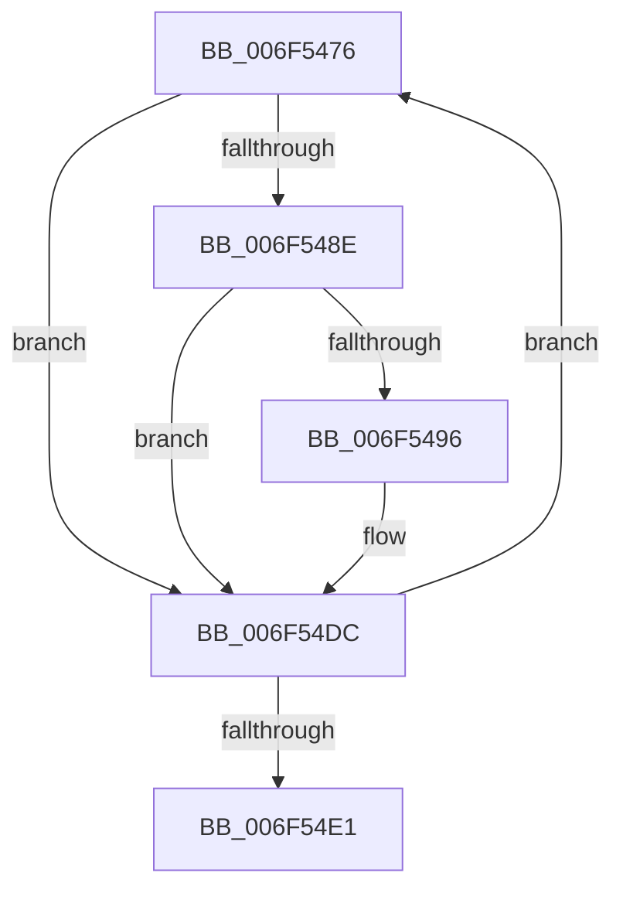

# sub_006F5476

- RVA: `0x006F5476`–`0x006F54E6` (길이 `112` bytes)
- VA: `0x00000001406F5476`
- 실행 섹션: `.text`
- PDB 이름 있음: `아니요`; PDB Function 태그: `아니요`
- unwind 정보 RVA: `0x000AF44C`
- 디코드: `26`개 명령, `112/112` bytes 표시
- 미해석 바이트: `0` (있으면 어셈블리에 `.byte`로 보존)

> 이 문서는 커널 이미지의 기계어와 PDB 기호를 분석해 생성했습니다. 4번과 5번은 함수 원형과 자료형을 바이너리 사용 방식에서 추정한 C 해석이며 원본 소스 복구 결과는 아닙니다.

## 1. Dependencies

- 직접 호출 지점: **1**; 고유 호출 대상: **1**
- 직접 호출자로 확인된 함수: **0**
- RIP 상대 이미지 참조: **0**

### Outgoing calls
- `0x006F54D7` → [EtwpLogKernelEvent](../25/EtwpLogKernelEvent_function_0025CC00.md) (function, `0x0025CC00`)

### Direct callers
- 이 함수 시작 RVA로 연결되는 직접 call은 확인되지 않았습니다. 간접 호출은 완전히 역산할 수 없습니다.

### Static image references
- 디코드된 RIP-relative 메모리 참조가 없습니다.

## 2. Other-region calls and transfers

- 다른 실행 섹션으로 향하는 call: **0**
- call이 아닌 외부 분기/꼬리 이동: **1**
  - `0x006F54E1` → [EtwTraceSiloTimedEvent + 0xC0](../48/EtwTraceSiloTimedEvent_function_00485260.md) (`tail-transfer`)

## 3. Assembly (complete function range)

```asm
006F5476  8D 47 FF                        lea eax, [rdi - 1]
006F5479  8B D1                           mov edx, ecx
006F547B  23 F8                           and edi, eax
006F547D  8B C1                           mov eax, ecx
006F547F  48 C1 E0 05                     shl rax, 5
006F5483  48 05 CC 11 00 00               add rax, 0x11cc
006F5489  48 03 C3                        add rax, rbx
006F548C  74 4E                           je 0x1406f54dc
006F548E  F7 00 00 20 00 00               test dword ptr [rax], 0x2000
006F5494  74 46                           je 0x1406f54dc
006F5496  0F B6 84 4B 99 11 00 00         movzx eax, byte ptr [rbx + rcx*2 + 0x1199]
006F549E  41 B9 02 00 00 00               mov r9d, 2
006F54A4  83 65 E4 00                     and dword ptr [rbp - 0x1c], 0
006F54A8  48 FF C8                        dec rax
006F54AB  C7 45 E0 08 00 00 00            mov dword ptr [rbp - 0x20], 8
006F54B2  C7 44 24 28 02 18 50 00         mov dword ptr [rsp + 0x28], 0x501802
006F54BA  66 89 74 24 20                  mov word ptr [rsp + 0x20], si
006F54BF  49 8D 0C C6                     lea rcx, [r14 + rax*8]
006F54C3  48 89 4D D8                     mov qword ptr [rbp - 0x28], rcx
006F54C7  48 8D 4D D8                     lea rcx, [rbp - 0x28]
006F54CB  44 0F B6 84 53 98 11 00 00      movzx r8d, byte ptr [rbx + rdx*2 + 0x1198]
006F54D4  48 8B D3                        mov rdx, rbx
006F54D7  E8 24 77 B6 FF                  call 0x14025cc00
006F54DC  0F BC CF                        bsf ecx, edi
006F54DF  75 95                           jne 0x1406f5476
006F54E1  E9 3A FE D8 FF                  jmp 0x140485320
```

## 4. C-style interpretation (structured pseudocode)

```c
__int64 __fastcall sub_006F5476(__int64 a1)
{
    __int64 result;
    __int64 v_rdi;
    unsigned __int16 v_stack_p20;
    unsigned int v_stack_p28;

    v_rdi = (unsigned int)((v_rdi) & ((unsigned int)(v_rdi - 1)));
    result = ((unsigned int)((unsigned int)(a1))) << (5);
    result = (result) + (0x11CCULL);
    result = (result) + (v_rbx);
    if (condition_is_equal) goto loc_006F54DC;
    if (((*(unsigned int *)(result)) & (0x2000ULL)) != 0) {
        result = *(unsigned __int8 *)(v_rbx + a1 * 2 + 4505);
        a4 = 2;
        result = (result) - 1;
        *(unsigned int *)(v_rbp - 32) = 8;
        v_stack_p28 = 0x501802ULL;
        v_stack_p20 = (unsigned __int16)(v_rsi);
        a1 = v_r14 + result * 8;
        *(unsigned __int64 *)(v_rbp - 40) = a1;
        a1 = v_rbp - 40;
        a3 = *(unsigned __int8 *)(v_rbx + (unsigned int)((unsigned int)(a1)) * 2 + 4504);
        a2 = v_rbx;
        result = EtwpLogKernelEvent(a1, a2, a3, a4);
    }
    if (((*(unsigned int *)(result)) & (0x2000ULL)) != 0) goto loc_006F5476;
}
```

## 5. (Beta) C Style

```c
int64_t sub_006F5476(int64_t Arg1)
{
    int64_t result;
    int64_t local_rdi;
    uint16_t v_stack_p20;
    uint32_t v_stack_p28;

    local_rdi = (uint32_t)((local_rdi) & ((uint32_t)(local_rdi - 1)));
    result = ((uint32_t)((uint32_t)(Arg1))) << (5);
    result = (result) + (0x11CCULL);
    result = (result) + (local_rbx);
    if (condition_is_equal) goto loc_006F54DC;
    if (((*(uint32_t *)(result)) & (0x2000ULL)) != 0) {
        result = *(uint8_t *)(local_rbx + Arg1 * 2 + 0x1199);
        a4 = 2;
        result = (result) - 1;
        *(uint32_t *)(local_rbp - 0x20) = 8;
        v_stack_p28 = 0x501802ULL;
        v_stack_p20 = (uint16_t)(local_rsi);
        Arg1 = local_r14 + result * 8;
        *(uint64_t *)(local_rbp - 0x28) = Arg1;
        Arg1 = local_rbp - 40;
        a3 = *(uint8_t *)(local_rbx + (uint32_t)((uint32_t)(Arg1)) * 2 + 0x1198);
        a2 = local_rbx;
        result = EtwpLogKernelEvent(Arg1, a2, a3, a4);
    }
    if (((*(uint32_t *)(result)) & (0x2000ULL)) != 0) goto loc_006F5476;
}
```

## 6. Execution-region graph

[열기: 2D/3D 그래프와 함수 탐색 컨트롤 패널](../../../control-panel.html?section=text&rva=0x006F5476&view=graph)

- 2D 그래프는 위에서 아래로 흐르고, 3D 그래프는 빈 공간을 드래그해 회전합니다. Shift+드래그는 이동, 휠은 확대·축소, 함수 노드 선택은 대상 보고서 이동입니다.

### Static fallback


