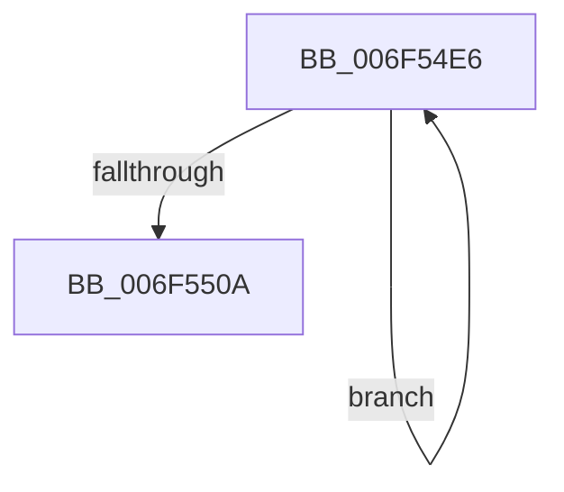

# sub_006F54E6

- RVA: `0x006F54E6`–`0x006F551C` (길이 `54` bytes)
- VA: `0x00000001406F54E6`
- 실행 섹션: `.text`
- PDB 이름 있음: `아니요`; PDB Function 태그: `아니요`
- unwind 정보 RVA: `0x000AF46C`
- 디코드: `15`개 명령, `54/54` bytes 표시
- 미해석 바이트: `0` (있으면 어셈블리에 `.byte`로 보존)

> 이 문서는 커널 이미지의 기계어와 PDB 기호를 분석해 생성했습니다. 4번과 5번은 함수 원형과 자료형을 바이너리 사용 방식에서 추정한 C 해석이며 원본 소스 복구 결과는 아닙니다.

## 1. Dependencies

- 직접 호출 지점: **2**; 고유 호출 대상: **2**
- 직접 호출자로 확인된 함수: **0**
- RIP 상대 이미지 참조: **0**

### Outgoing calls
- `0x006F54FE` → [SmHwAcceleratorWaitForRequest](../61/SmHwAcceleratorWaitForRequest_function_00611A7C.md) (function, `0x00611A7C`)
- `0x006F5511` → [SmHwAcceleratorPartitionMgrFreeDescriptor](../4D/SmHwAcceleratorPartitionMgrFreeDescriptor_function_004D7918.md) (function, `0x004D7918`)

### Direct callers
- 이 함수 시작 RVA로 연결되는 직접 call은 확인되지 않았습니다. 간접 호출은 완전히 역산할 수 없습니다.

### Static image references
- 디코드된 RIP-relative 메모리 참조가 없습니다.

## 2. Other-region calls and transfers

- 다른 실행 섹션으로 향하는 call: **0**
- call이 아닌 외부 분기/꼬리 이동: **1**
  - `0x006F5517` → [SmStoreDecompressBufferContextCleanup + 0x15](../48/SmStoreDecompressBufferContextCleanup_function_00485368.md) (`tail-transfer`)

## 3. Assembly (complete function range)

```asm
006F54E6  48 8B 4B 08                     mov rcx, qword ptr [rbx + 8]
006F54EA  48 8D 44 24 40                  lea rax, [rsp + 0x40]
006F54EF  4C 8D 4C 24 48                  lea r9, [rsp + 0x48]
006F54F4  48 89 44 24 20                  mov qword ptr [rsp + 0x20], rax
006F54F9  45 33 C0                        xor r8d, r8d
006F54FC  8B D7                           mov edx, edi
006F54FE  E8 79 C5 F1 FF                  call 0x140611a7c
006F5503  FF C7                           inc edi
006F5505  3B 7B 24                        cmp edi, dword ptr [rbx + 0x24]
006F5508  72 DC                           jb 0x1406f54e6
006F550A  48 8B 53 08                     mov rdx, qword ptr [rbx + 8]
006F550E  48 8B 0B                        mov rcx, qword ptr [rbx]
006F5511  E8 02 24 DE FF                  call 0x1404d7918
006F5516  90                              nop
006F5517  E9 61 FE D8 FF                  jmp 0x14048537d
```

## 4. C-style interpretation (structured pseudocode)

```c
__int64 __fastcall sub_006F54E6(__int64 a1, __int64 a2, int a3, __int64 a4, __int64 a5, __int64 a6, __int64 a7, __int64 a8, __int64 a9)
{
    __int64 result;
    __int64 v_rdi;
    unsigned __int64 v_stack_p20;

    v_stack_p20 = a8;
    a3 = 0;
    result = SmHwAcceleratorWaitForRequest(*(unsigned __int64 *)(v_rbx + 8), (unsigned int)((unsigned int)(v_rdi)), a3, a9);
    v_rdi = (unsigned int)((v_rdi) + 1);
    if (((unsigned int)(v_rdi)) < (*(unsigned int *)(v_rbx + 36))) goto loc_006F54E6;
    result = SmHwAcceleratorPartitionMgrFreeDescriptor(*(unsigned __int64 *)(v_rbx), *(unsigned __int64 *)(v_rbx + 8), a3, a9);
}
```

## 5. (Beta) C Style

```c
int64_t sub_006F54E6(int64_t Arg1, int64_t Arg2, int32_t Arg3, int64_t Arg4, uint64_t Arg5, uint64_t Arg6, uint64_t Arg7, int64_t Arg8, int64_t Arg9)
{
    int64_t result;
    int64_t local_rdi;
    uint64_t v_stack_p20;

    v_stack_p20 = Arg8;
    Arg3 = 0;
    result = SmHwAcceleratorWaitForRequest(*(uint64_t *)(local_rbx + 0x8), (uint32_t)((uint32_t)(local_rdi)), Arg3, Arg9);
    local_rdi = (uint32_t)((local_rdi) + 1);
    if (((uint32_t)(local_rdi)) < (*(uint32_t *)(local_rbx + 0x24))) goto loc_006F54E6;
    result = SmHwAcceleratorPartitionMgrFreeDescriptor(*(uint64_t *)(local_rbx), *(uint64_t *)(local_rbx + 0x8), Arg3, Arg9);
}
```

## 6. Execution-region graph

[열기: 2D/3D 그래프와 함수 탐색 컨트롤 패널](../../../control-panel.html?section=text&rva=0x006F54E6&view=graph)

- 2D 그래프는 위에서 아래로 흐르고, 3D 그래프는 빈 공간을 드래그해 회전합니다. Shift+드래그는 이동, 휠은 확대·축소, 함수 노드 선택은 대상 보고서 이동입니다.

### Static fallback


