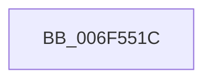

# sub_006F551C

- RVA: `0x006F551C`–`0x006F553F` (길이 `35` bytes)
- VA: `0x00000001406F551C`
- 실행 섹션: `.text`
- PDB 이름 있음: `아니요`; PDB Function 태그: `아니요`
- unwind 정보 RVA: `0x000AF544`
- 디코드: `6`개 명령, `35/35` bytes 표시
- 미해석 바이트: `0` (있으면 어셈블리에 `.byte`로 보존)

> 이 문서는 커널 이미지의 기계어와 PDB 기호를 분석해 생성했습니다. 4번과 5번은 함수 원형과 자료형을 바이너리 사용 방식에서 추정한 C 해석이며 원본 소스 복구 결과는 아닙니다.

## 1. Dependencies

- 직접 호출 지점: **0**; 고유 호출 대상: **0**
- 직접 호출자로 확인된 함수: **0**
- RIP 상대 이미지 참조: **3**

### Outgoing calls
- 직접 디코드된 call 명령이 없습니다.

### Direct callers
- 이 함수 시작 RVA로 연결되는 직접 call은 확인되지 않았습니다. 간접 호출은 완전히 역산할 수 없습니다.

### Static image references
- `0x006F551E` → RVA `0x00FD9EE0` (`PAGEDATA`; write)
- `0x006F5528` → RVA `0x00FD9EF0` (`PAGEDATA`; write)
- `0x006F5533` → RVA `0x00FD9EE8` (`PAGEDATA`; write)

## 2. Other-region calls and transfers

- 다른 실행 섹션으로 향하는 call: **0**
- call이 아닌 외부 분기/꼬리 이동: **1**
  - `0x006F553A` → [CmpDoFileRead + 0x188](../48/CmpDoFileRead_function_00485658.md) (`tail-transfer`)

## 3. Assembly (complete function range)

```asm
006F551C  2B CF                           sub ecx, edi
006F551E  C7 05 B8 49 8E 00 01 00 00 00   mov dword ptr [rip + 0x8e49b8], 1
006F5528  89 0D C2 49 8E 00               mov dword ptr [rip + 0x8e49c2], ecx
006F552E  B8 11 00 00 C0                  mov eax, 0xc0000011
006F5533  48 89 35 AE 49 8E 00            mov qword ptr [rip + 0x8e49ae], rsi
006F553A  E9 A1 02 D9 FF                  jmp 0x1404857e0
```

## 4. C-style interpretation (structured pseudocode)

```c
__int64 __fastcall sub_006F551C(int a1)
{
    a1 = (unsigned int)((a1) - ((unsigned int)(v_rdi)));
    *(unsigned int *)(v_rip + 9324984) = 1;
    *(unsigned int *)(v_rip + 9324994) = a1;
    *(unsigned __int64 *)(v_rip + 9324974) = v_rsi;
}
```

## 5. (Beta) C Style

```c
int64_t sub_006F551C(int32_t Arg1)
{
    Arg1 = (uint32_t)((Arg1) - ((uint32_t)(local_rdi)));
    *(uint32_t *)(v_rip + 0x8E49B8) = 1;
    *(uint32_t *)(v_rip + 0x8E49C2) = Arg1;
    *(uint64_t *)(v_rip + 0x8E49AE) = local_rsi;
}
```

## 6. Execution-region graph

[열기: 2D/3D 그래프와 함수 탐색 컨트롤 패널](../../../control-panel.html?section=text&rva=0x006F551C&view=graph)

- 2D 그래프는 위에서 아래로 흐르고, 3D 그래프는 빈 공간을 드래그해 회전합니다. Shift+드래그는 이동, 휠은 확대·축소, 함수 노드 선택은 대상 보고서 이동입니다.

### Static fallback


